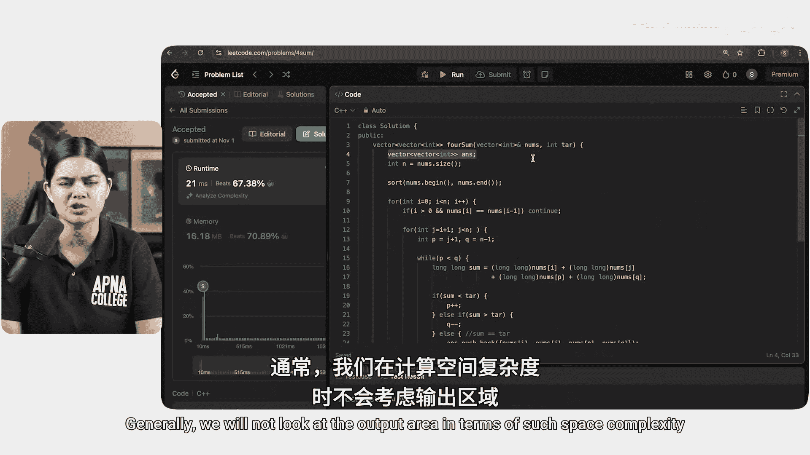

# C++ DSA课程：39：四数之和问题 - 最优方法


在本节课中，我们将学习如何解决“四数之和”问题。这是一个经典的算法问题，要求我们在一个数组中找到所有和为特定目标值的四元组。我们将使用一种基于排序和双指针技术的高效方法来解决它。

---

## 问题概述

给定一个整数数组 `nums` 和一个目标值 `target`，我们需要找出数组中所有满足 `nums[i] + nums[j] + nums[k] + nums[l] == target` 的四元组 `(i, j, k, l)`。其中，四个索引 `i`、`j`、`k`、`l` 必须互不相同，并且返回的四元组组合必须是唯一的。

例如，对于数组 `[-1, -1, 1, 1]` 和目标值 `0`，四元组 `(-1, -1, 1, 1)` 的和为 `0`，是一个有效的答案。

---

## 核心思路

上一节我们介绍了三数之和问题，本节中我们来看看它的扩展——四数之和。基本思路是将其转化为类似三数之和的问题，然后使用双指针法进行优化。

核心策略如下：
1.  首先对数组进行排序。
2.  使用两层外层循环固定前两个数 `nums[i]` 和 `nums[j]`。
3.  对于剩下的部分，使用双指针法寻找后两个数 `nums[p]` 和 `nums[q]`，使得四数之和等于目标值。

---

## 算法步骤详解

以下是解决四数之和问题的详细步骤：

### 1. 排序数组
首先，我们将输入数组 `nums` 按升序排序。排序是使用双指针法的基础，它允许我们根据和的大小来移动指针。

```cpp
sort(nums.begin(), nums.end());
```

### 2. 外层循环与去重
我们使用两个外层循环来遍历前两个数的所有可能组合。
*   第一个循环变量 `i` 从 `0` 遍历到 `n-4`。
*   第二个循环变量 `j` 从 `i+1` 遍历到 `n-3`。

为了避免重复的四元组，我们需要跳过重复的值：
*   如果 `nums[i]` 与前一个值相同，则跳过本次循环。
*   如果 `nums[j]` 与前一个值相同，则跳过本次循环。

### 3. 双指针查找
在固定了 `i` 和 `j` 之后，问题就转化为在 `j+1` 到数组末尾的区间内，寻找两个数 `nums[p]` 和 `nums[q]`，使得它们的和等于 `target - nums[i] - nums[j]`。

我们初始化两个指针：
*   `p = j + 1` （指向剩余区间的最小值）
*   `q = n - 1` （指向剩余区间的最大值）

然后在一个 `while(p < q)` 循环中执行以下逻辑：
*   计算当前四数之和 `sum = nums[i] + nums[j] + nums[p] + nums[q]`。
*   如果 `sum < target`，说明总和太小，需要增大，因此将 `p` 指针向右移动 (`p++`)。
*   如果 `sum > target`，说明总和太大，需要减小，因此将 `q` 指针向左移动 (`q--`)。
*   如果 `sum == target`，则找到了一个有效四元组，将其加入答案列表。然后，同样为了去重，我们需要将 `p` 指针移动到下一个不同的值，将 `q` 指针移动到前一个不同的值。

### 4. 返回结果
遍历完所有可能的 `i` 和 `j` 的组合后，返回收集到的所有唯一四元组。

---

## 代码实现

以下是整合了所有优化步骤的C++代码实现：

```cpp
vector<vector<int>> fourSum(vector<int>& nums, int target) {
    vector<vector<int>> result;
    int n = nums.size();
    if (n < 4) return result;

    // 1. 排序
    sort(nums.begin(), nums.end());

    for (int i = 0; i < n - 3; ++i) {
        // 跳过重复的 nums[i]
        if (i > 0 && nums[i] == nums[i - 1]) continue;

        for (int j = i + 1; j < n - 2; ++j) {
            // 跳过重复的 nums[j]
            if (j > i + 1 && nums[j] == nums[j - 1]) continue;

            long long twoSumTarget = (long long)target - nums[i] - nums[j];
            int p = j + 1;
            int q = n - 1;

            while (p < q) {
                long long currentSum = (long long)nums[p] + nums[q];

                if (currentSum < twoSumTarget) {
                    p++;
                } else if (currentSum > twoSumTarget) {
                    q--;
                } else {
                    // 找到一组解
                    result.push_back({nums[i], nums[j], nums[p], nums[q]});

                    // 跳过重复的 nums[p]
                    while (p < q && nums[p] == nums[p + 1]) p++;
                    // 跳过重复的 nums[q]
                    while (p < q && nums[q] == nums[q - 1]) q--;

                    p++;
                    q--;
                }
            }
        }
    }
    return result;
}
```

---

## 复杂度分析

*   **时间复杂度：O(n³)**。排序需要 O(n log n) 时间。主体部分有两层嵌套循环和一层双指针遍历，最坏情况下复杂度为 O(n³)。因此总体复杂度为 O(n³)。
*   **空间复杂度：O(1)** 或 O(n)，取决于排序算法的实现。我们只使用了常数额外空间来存储指针和结果（结果空间不计入复杂度分析）。

---



## 总结


本节课中我们一起学习了如何解决“四数之和”问题。我们首先理解了问题定义，然后通过将其分解为“固定两个数，再用双指针法找另外两个数”的策略，设计出了一个高效的算法。关键点在于**先排序**，然后使用**两层循环加双指针**，并注意在每一步**跳过重复值**以避免输出重复的组合。这是解决此类“K数之和”问题的通用且高效的模式。