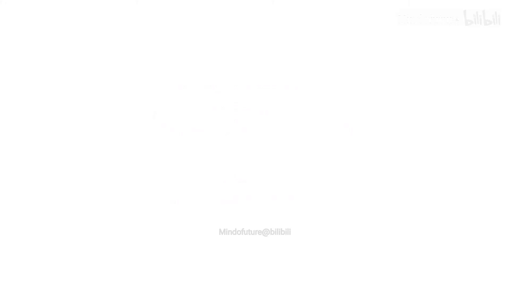
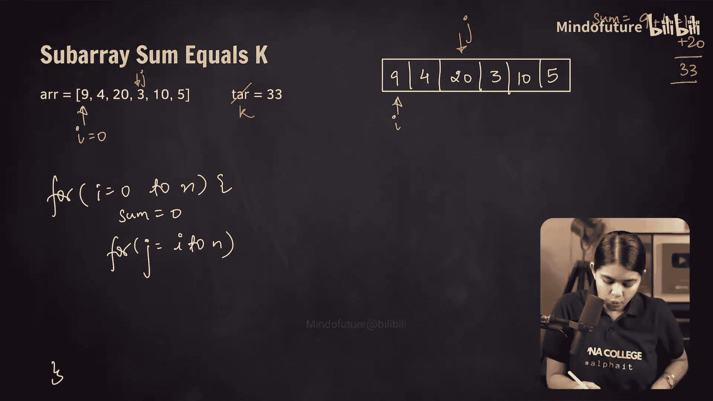
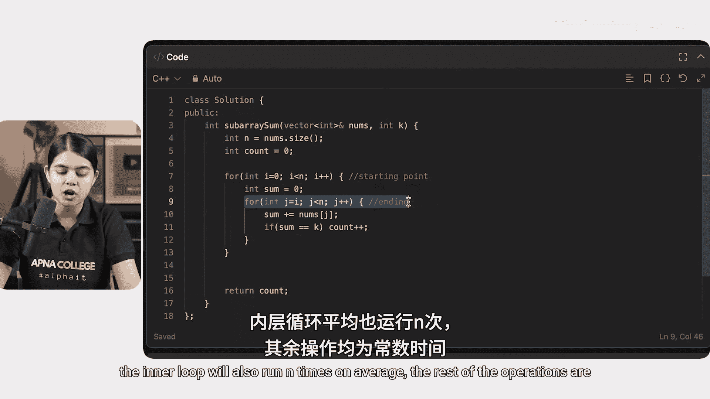
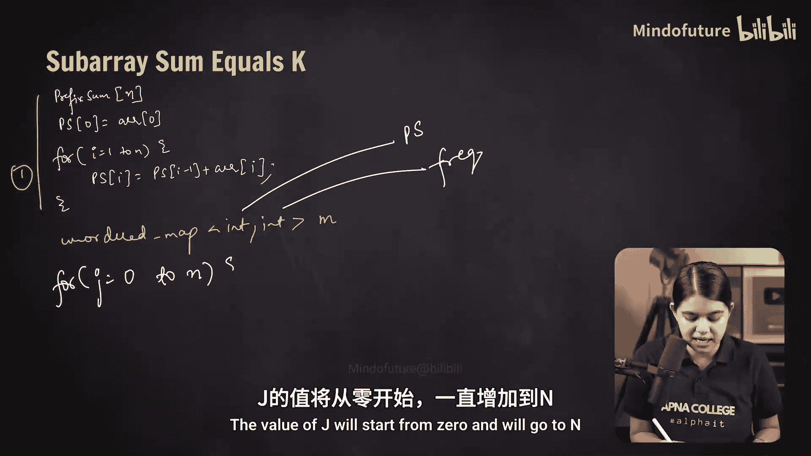
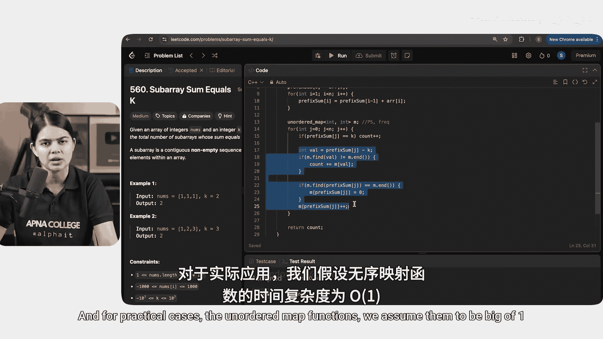
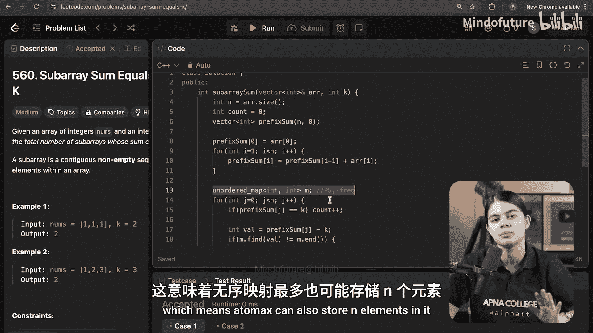

# C++-DSA课程-｜-数据结构-｜-leetcode-｜-Apna-College-｜--Complete-C++-Dsa-Course-p40-P41_子数组和等于K-暴力-更好-最优方法--BV18oUGBkEmV_p40-

Id one welcome to the complete DA series。 and today we're going to solve an important DSA question。

 which is called Sa sum equals K。 Now， this is an important problem because it's going to teach us a specific concept。

 Jo is Saal canander to use cur a plus we are also going to apply that concept in multiple different DA questions。

 Abikvay concept9 E C channel Cooperer is playless canner available Miljaga。 Also。

 there is a link for a company by DA sheet in the description box。 So you can also check that out。

 The Saval K Saal is called Sa sum equals K， and this is problem number 560 on lead code。

 A Saval canander。 we are given this E and a specific target。 Ane is E Cvo count to Baana。😊。

Yo number of subberis Batannihe Ginka sum is target K equal。 For example。

 a Bgaraic erianders suberriki Bacony， though it is basically a continuous part。😊。

Of end E is eandersous partco consider。 that will be called a subri。 For example， this is a subri。

 this particular part is a sub， or this is a sub of two elements inside the And this entire array is also considered as a valid sub isri eander。

 there are multiple subberries that exist， but specifically there are only two subries ginka sum is equal to this target。

 or conseuries sub sub is this subander， we have three elements，9，4 and 20 gino sum 33。

 The second sub with the required sum is this subander。

 we have three elements 23 and 10 Genininopa 33 Sori countjagi2 andmes count2ku return functionhaal straightforwardander。

 what total number of sub return g。😊，Targe equal approaches discuss the first approach will basically be the brute force approach。

 in fact， this is an optimized version of the brute force approach and the second approach that we are going to discuss is the most optimal approach interviews we are expected to come up with this optimal solution generally in one on1 interviews interviewers us to come up with this brute force approach first and then come up with the optimal solution So if you are somebody who is already aware about the brute approach you can directly jump to the optimal solution let's talk about the brute force out sum for all the brute force approach。

Of all Saris find out Carnegie， k Kringgi or in Sariari Saaigbar Sam。 The second step Ho meham。

 he conse Sari。😊，Just some hip。That is equal to my target。 In fact。

 consider this target to be an arbitrary value called and is a very easy solution and in。😊。

and ending position marks boundaries fix my with value。third and similar out is equal position and。😊。

Let's suppose Amipas E Eri given here Gque under Shiwa me。 This is my starting position。 I。

 and this is my ending position。 G， Ab let's suppose Hamari Saerica Hamni， some calculate career。

 just maam Gri。😊，element equal time be a which is9 and equal3。

To basically starting point fix ending element which basically means we are going to sum variable which will initial with right which is written for variable equal basicallyer loop is marking。

😊。

point of my sub Uskibaam make some variable earlier， and this is the inner loop。

 which is marking my ending boundary。 I my barbar ending Hamari change overria justmam sum calculate current some kche k is it equal to k and Herbani countku plus last maam me countku return Kia we can also run this approach and try to submit it。

😊，Thisju brute force constraints n solution time complexity outer loop n times on inner loop n times on operationsju time complexity for this particular approach will be n complexity constant complexity kind of brutene second approach n square time complexity or optimize nne second approachim。

😊。

last question basically because we wanted to find all concept。😊。

Supposepaander we have multiple elements A's suppose0re index i elements is sumia lets suppose this is1。

2，3，4 and 5 or example i prefi sum of I stored prefix sum of i is0 indexre i index sum to prefix sum of i elements any1 plus 2 which is equal to3 or0re j elements sumia k equal to that might prefix sum of j is equal to 1 plus2 plus3 plus4。

 which is equal to 10 to basically prefi sum index i prefi。😊。

K0 at index indexriari values index pre sum calculate interesting cheese index pre calculate orco problem is subika sum calculateika sum calculate basically inari。

😊，What was this， This was prefix sum of J and Hamariipas insri valueskabi sumta What was this。

 This was prefix sum of I to agarham insri Valkander ye Valju Vale In minus Kdi to Camqueecteariipas is saerica sumnical krajaa to basically Agarhamme ki B suberica sum calculate Knata Joseri I plus1se Shire or J per Kare to saerica subnical kraai my prefix sum of J minus my prefix sum of I。

😊，y entire concept approach based basically and next directly and first minus this was what this was the equation In fact equation。

😊，From my index I to my index j is equal to prefix sum of j prefix sum of i1 So this is the logic that we use to calculate the using the prefix sum part of the problem which is prex second tool is basically an important formula and the formula is for example if this is。

😊，fix sum of j minus my prex sum of i1 this value should equal to this value should equal to which isfi sum of i1 value is equal to pre sum of j equation basically。

which is to calculate let us also write with basically。Haripa indexojagi，0，1，2，3，4， and 5。

m first index which is equal to9ham first index which is equal to 13ham is which is equal to 33 is equal to 36 to basically34 similar4 index definitely of and is equal to1fi sum of is equal to prex sum of plus is the first part of the problem。

😊，part is basically So this basically becomes the boundary right boundary of right pre of is j equal to446 equal or4633。

😊，V 13 equal sum of i1 value 13 equal identify46 equal 13 value 13 index given that my I is less than313333313 index i is equal to value is equal。

this is equal to my eye is20 plus 3 plus 10 and finallys1313230。

equalSo this is what we are trying to do when we are using the pre sum approach prefix sum approach can the right boundary or left boundary by finding this value which is the magical value is magical value and22 is basicallys。

😊，Aari isfi3 equalfi is directly equal to33 value which is equal to casefi of count or ors case suppose。

😊，values instead of two we have 9， we have4。 we have and3ham333 which is equalham3131313 for。

this point and could also be this point or 13 basically use as compared to complexity which is。

 crucial to solving。equation unor which will be in teacher in teacher basically first in second start with of。

sum3 equal minus3。 which is equal to 33。😊，33 equal to 33 next time equal 36363 is 33 frequency and next time3 now comes the most part question6 and value is。

😊，Be equal to 13 a frequency of and second is the right boundary for of3 first second and third for firsts call it。

Frequency goes jham me J boundarying J value0 start Hogi sub prex sum of J he compare kling K。

 if my prefix sum of J。😊。

Is equal to k y， This is my case number 2 second prefi sum of3 or existence andto。

 which is the existence of value in second next time。

fi next time ofke corresponding frequency exists frequencytoi frequency So this is the entire approach basis and then we are going to analyze the。

 which is basically my dot size。 Let me rename this to。😊，Ukeallavahammni count laactam。

 which will store our answer is if we initialize Kleium0 caat and anaic vector of integer lelaium。😊。

Victor of intesure。 let's call it prefix sum。This is my prefix sum。

 Justca I Oga n is initialized s0 kat Hamme pattaya Hamra prefix sum of 0 k value equal to Hogi Hamari area of 0 k equal and bakiari value k a I is equal to once a loop start carrying a I less than n I plus plus Hamra prefix sum of I is equal to prefix sum of I -1。

😊，Plus， Hamra E of。I， so this is what the logic to calculate prefix sum is going to look like。

 Okeri second step oja to calculate the count count calculate can ham outer boundary boundary J K Ki0 k J less than n J plus less subipto King Agarhamri prefix sum of J K value。

 If this becomes equal to my k。 Those case meap a get to countgi plus namei valueaiari value justcomnaian that is prefix sum of J minus k Agarhamari map kander let us also create a map。

😊，The Yapperhamic unordered map create Kaneval of integer integer values。

 which is called M is Makander Hammna prefix sum with the frequency stored Karanana the map k the C Kling Agarhamari Ma kander dot find Hamari Jovaluhe Voggger exist。

 Kthe。 any if this is not equal to M dot end。Those case and frequency or frequency dot my of suppose case frequency of0 and frequency frequency frequency plus which is what we want or frequency and count as answer So this is what the approach is going to look like and let us submit it。

😊，The am time complexity the time complexity hes me if we seeari n times run second Jo is under operations to such constant loop n times or practical cases map unordered map functionsari key time complexity time complexity first step can second step can time complexity will be complexity vector use plus unor map use can prefi space complexity be complexity will be definitely complexity as compared to the brute approach but in the optimized approach time is more important than space always when we are talking about programming always can。

😊。

Extremeja in majority of the cases， time is definitely our priority whenever we are talking about data structures and algorithm problems the upper time complexity subs are the optimized convert and this is how we solve the problem of sumsing different I hope that you are enjoying the hashing problems and youre this concept of maps and sets maps sets basically one of the most important tools especially you're targeting Google Microsoft or Uber generally in companies plain majority cases additional data structure use or majority cases may hashing athsne convert that。

😊，Successfully completed today's lecture you can mark your attendance down in the comments I me you can also share your progress with me on Twitter just cu link upku each description box canther Mill Jaga ask you late night the next lecture cannder till and keep learning and keep exploring。

😊。