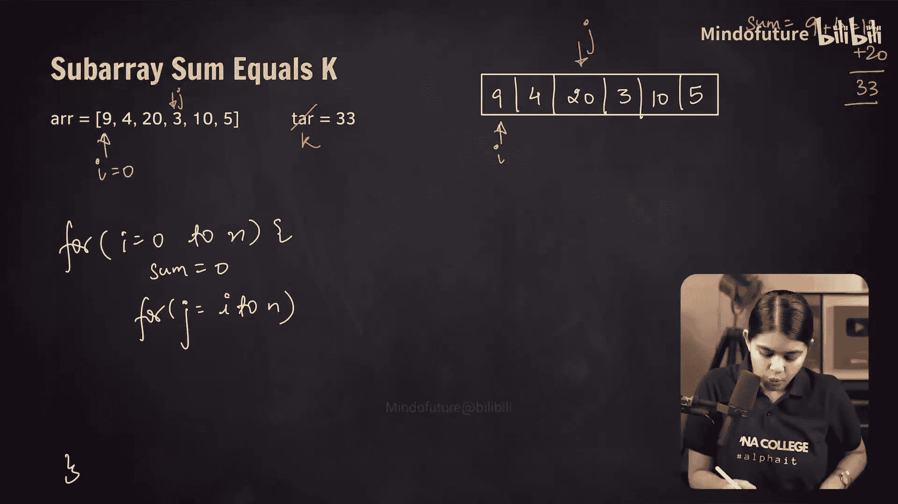
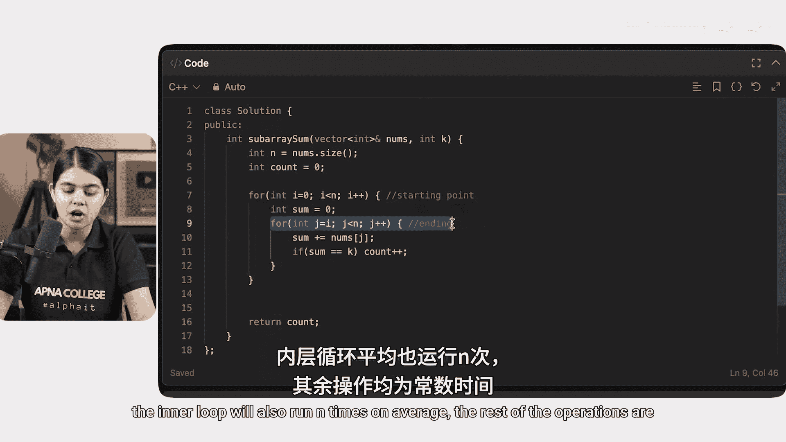
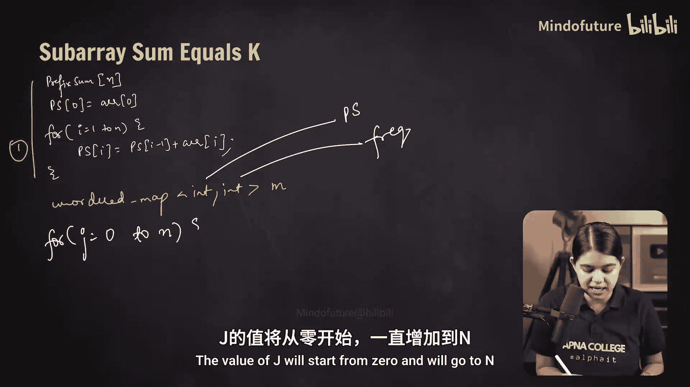
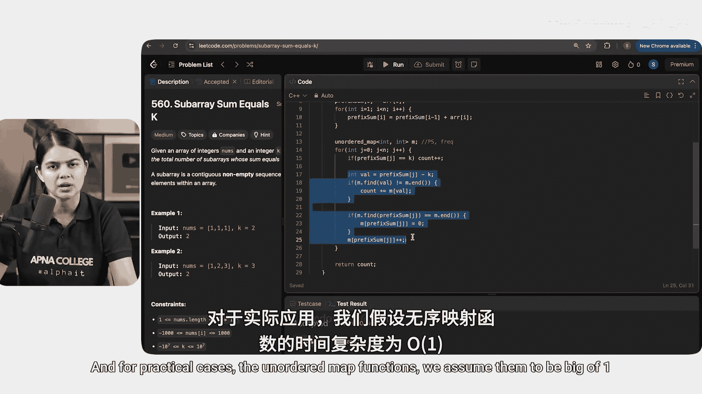
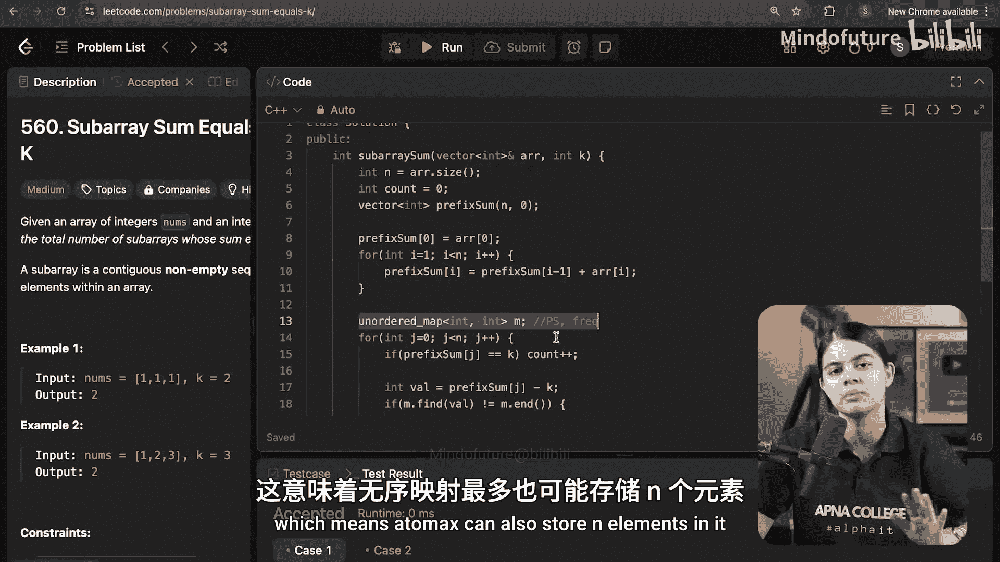

# C++ DSA课程：40：子数组和等于K问题详解 🎯

在本节课中，我们将学习一个重要的数据结构与算法问题：“子数组和等于K”。这个问题将教会我们一个特定的概念——前缀和与哈希映射的结合使用，这个概念可以应用于多种不同的DSA问题中。我们将在LeetCode问题560上实践。


## 问题概述

给定一个整数数组 `nums` 和一个整数 `k`，我们需要找出数组中**连续子数组**的和等于 `k` 的个数。

**核心概念**：
*   **子数组**：数组中的一个**连续**部分。
*   **目标**：计算所有和为 `k` 的连续子数组的数量。

**示例**：
输入：`nums = [9, 4, 20, 3, 10, 5]`, `k = 33`
输出：`2`
解释：和为33的子数组有两个：`[9, 4, 20]` 和 `[20, 3, 10]`。

---

## 方法一：优化版暴力解法

上一节我们明确了问题，本节中我们来看看第一种解法——优化版暴力法。其核心思想是枚举所有可能的子数组，并计算它们的和。

**思路**：
1.  固定子数组的**起始点** `i`。
2.  从 `i` 开始，逐步扩展**结束点** `j`。
3.  在扩展 `j` 的同时累加元素，计算当前子数组 `nums[i...j]` 的和。
4.  检查当前和是否等于 `k`，如果是，则计数器加一。



**以下是该方法的伪代码描述：**

```cpp
int count = 0;
for (int i = 0; i < n; i++) {
    int currentSum = 0;
    for (int j = i; j < n; j++) {
        currentSum += nums[j]; // 扩展子数组并累加
        if (currentSum == k) {
            count++;
        }
    }
}
return count;
```



**复杂度分析**：
*   **时间复杂度**：O(n²)。外层循环 `i` 运行 n 次，内层循环 `j` 平均运行 n/2 次。
*   **空间复杂度**：O(1)。只使用了常数级别的额外空间。

这种方法简单直观，但在数组较大时效率较低。面试中，通常需要先提出此法，再优化。

---

## 方法二：最优解（前缀和 + 哈希映射）

上一节我们介绍了时间复杂度较高的暴力法，本节中我们来看看最优解。这种方法利用**前缀和**的概念和**哈希映射**进行高效查找。

### 核心概念：前缀和

数组 `nums` 在索引 `i` 处的**前缀和** `prefixSum[i]` 定义为从数组开头到 `i` 的所有元素之和。
`prefixSum[i] = nums[0] + nums[1] + ... + nums[i]`

**重要公式**：
子数组 `nums[i...j]` 的和可以通过前缀和快速计算：
`sum(nums[i...j]) = prefixSum[j] - prefixSum[i-1]` （当 `i > 0` 时）
如果 `i == 0`，则 `sum(nums[0...j]) = prefixSum[j]`。

### 问题转化

我们的目标是找到 `sum(nums[i...j]) = k`。
根据上述公式，这等价于寻找满足以下条件的 `i` 和 `j`：
`prefixSum[j] - prefixSum[i-1] = k`
将其变形，得到解决问题的关键：
`prefixSum[i-1] = prefixSum[j] - k`

**这意味着**：对于当前的前缀和 `prefixSum[j]`，如果我们在之前的前缀和中，能找到值为 `(prefixSum[j] - k)` 的前缀和，那么就找到了一个以 `j` 结尾、和为 `k` 的子数组。



### 算法步骤

以下是利用哈希映射实现此思路的步骤：

1.  初始化一个哈希映射 `map`，用于存储**前缀和的值**及其**出现的次数**。初始时，前缀和为 `0` 出现了 `1` 次（表示空数组的情况）。
2.  初始化变量 `currentPrefixSum = 0` 和 `count = 0`。
3.  遍历数组 `nums` 中的每个元素 `num`：
    a. 更新当前前缀和：`currentPrefixSum += num`。
    b. 计算我们需要在历史中寻找的值：`need = currentPrefixSum - k`。
    c. 检查 `need` 是否在 `map` 中。如果在，则 `count` 增加 `map[need]`（因为每个 `need` 都对应一个有效的子数组起点）。
    d. 将当前的 `currentPrefixSum` 加入 `map`，并将其频率加1。
4.  遍历结束后，返回 `count`。

**以下是该方法的代码实现：**

```cpp
int subarraySum(vector<int>& nums, int k) {
    unordered_map<int, int> prefixSumCount;
    prefixSumCount[0] = 1; // 初始化，前缀和为0出现1次
    int currentPrefixSum = 0;
    int count = 0;

    for (int num : nums) {
        currentPrefixSum += num; // 计算当前前缀和
        int need = currentPrefixSum - k; // 需要查找的历史前缀和

        // 如果 need 在映射中存在，则增加计数
        if (prefixSumCount.find(need) != prefixSumCount.end()) {
            count += prefixSumCount[need];
        }

        // 将当前前缀和加入映射
        prefixSumCount[currentPrefixSum]++;
    }
    return count;
}
```

**复杂度分析**：
*   **时间复杂度**：O(n)。我们只遍历数组一次，哈希映射的插入和查找操作平均时间复杂度为 O(1)。
*   **空间复杂度**：O(n)。在最坏情况下，哈希映射可能需要存储 n 个不同的前缀和。

与暴力法相比，此方法用空间换取了时间的大幅提升，是面试中的期望解法。

---





## 总结

本节课中我们一起学习了“子数组和等于K”这一经典问题。

1.  我们首先理解了问题定义：寻找数组中所有和为特定值 `k` 的连续子数组。
2.  接着，我们探讨了**优化版暴力解法**，通过双重循环枚举所有子数组，其时间复杂度为 O(n²)。
3.  最后，我们深入学习了**最优解法**，其核心是利用**前缀和公式**将问题转化为查找历史前缀和 `(currentPrefixSum - k)`，并借助**哈希映射**实现 O(1) 时间的查找，从而将总时间复杂度降至 O(n)。

前缀和与哈希映射的结合是解决一系列子数组求和问题的强大工具，理解和掌握这个方法对面试和解决实际问题都至关重要。