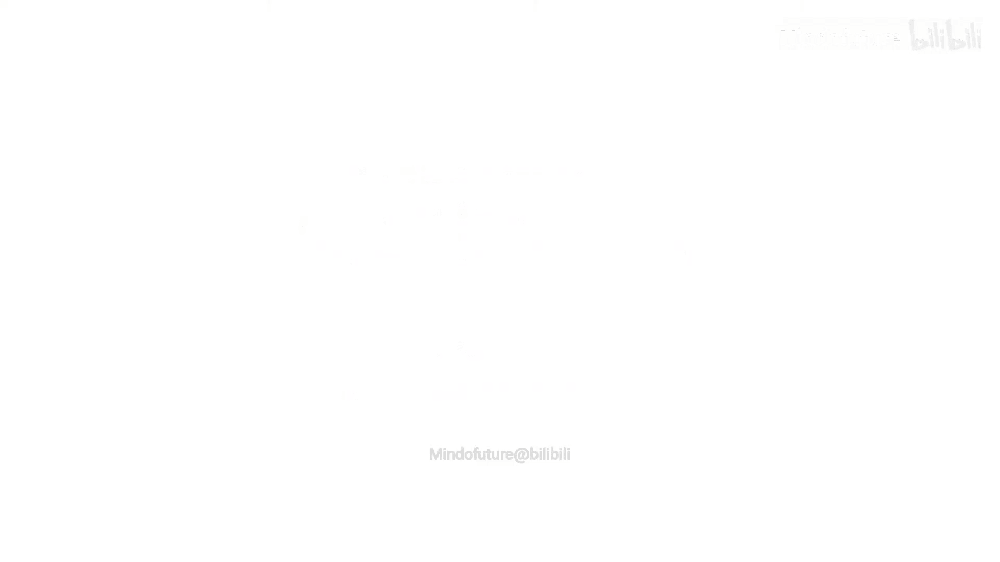
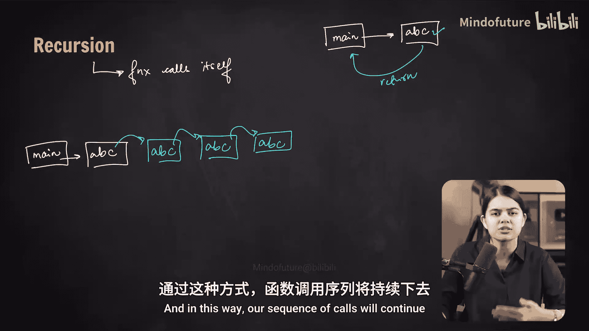
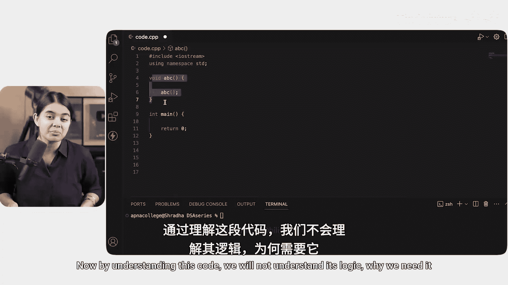
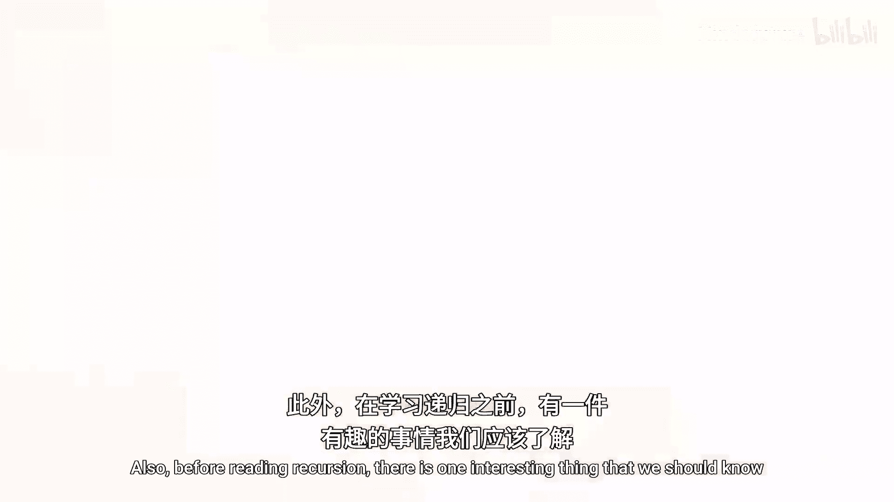
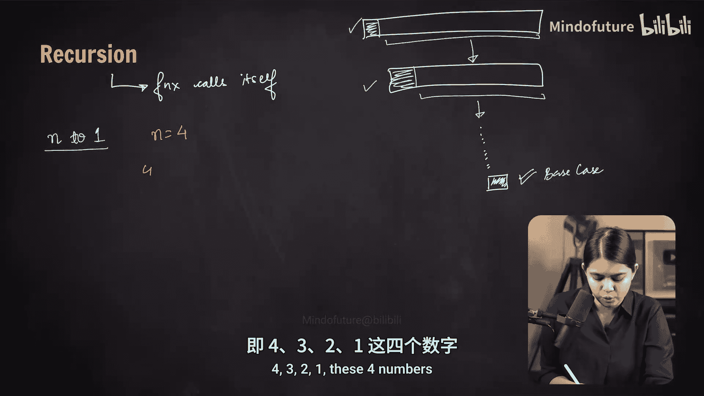
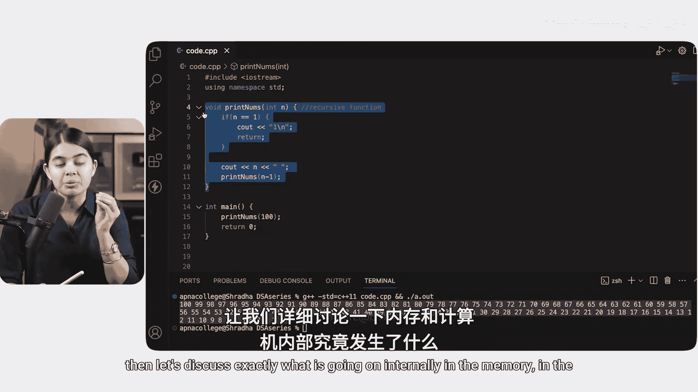
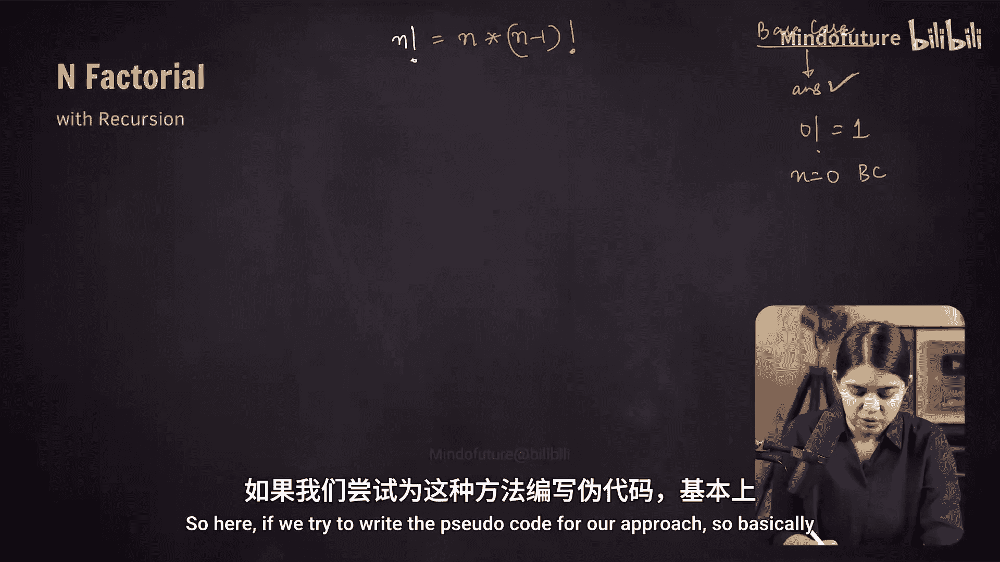
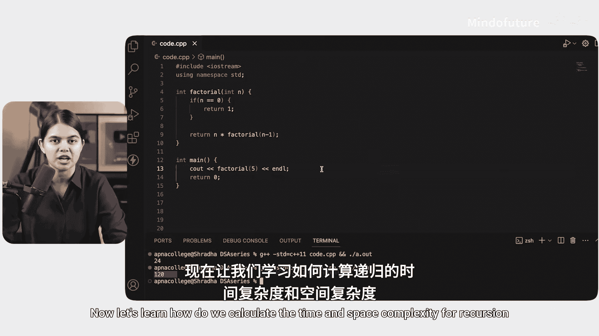
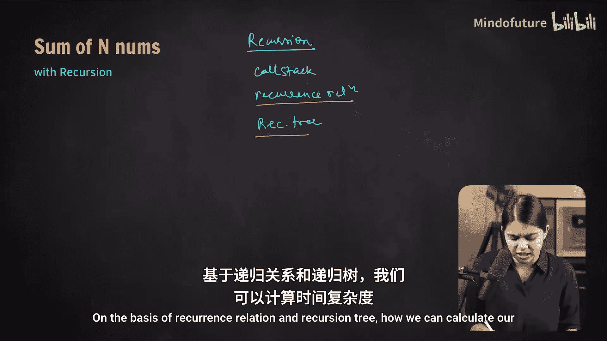

# C++-DSA课程-｜-数据结构-｜-leetcode-｜-Apna-College-｜--Complete-C++-Dsa-Course-p41-P42_递归教程-从基础到高级-第一部分--BV18oUGBkEmV_p41-

H everyone and welcome to the complete DS series。 And today we're going to learn about the important concept of recursion。

 which is extensively used while solving data structures and algorithm problems。 Now。

 if youre somebody who doesn't have any idea about what but we are not sure how exactly it works complete understanding and we are also going to learn how to calculate the time and complexity that is involved withcurs there is a link for a company placement preparation is function that calls itself。

😊。

main function and main function generally suppose we have a function called A main function main function is the function and and of where the function is repeatedly calling itself and and ending。

😊。

detail let's suppose function。 And we are also going to write。

s suppose a function called A function repeatedly Then this is what practical Also There is one interesting thing that we should know about。

😊。

programming but depending upon the statement use equally。manner。

next function called same manner recur repeat we finally end up with the smallest possible problem and this is base cases example using basically321 in logical is equal to。

。equal。Buthu problem re n -1 kilo Ui function go isko perform recur functiona Koic function。

 let us call it print numbers。😊，Print numbers and function because it doesn't need to return anything。

 function or Ises suppose with second function next function print numbers function n and function but there is a。

😊，and this point will be our base case base case generally basis n is equal to function and base case will and So this is what the base case is going to look likes functionname numbers function function。

And Bki problem K， this function is going to call itself n values n Bto N n1 n values next n-2 say1 kilo function already I going to pass n1 and base case is function whose case sub simply out with n of line。

😊，And Yahai hum simply Gjagiton twist the Rikekahama function here。

 And this function is repeatedly calling itself。 And that is why this function is called a recursive function。

 The Yahai Igbal print numbers go call thegathem for n is equal to 4。 Let's save it and run。😊。

To Maripa Samra output Pretoa， a bi logic Yni generic logic high。

 which will work for any end that you give it。 Let's suppose Agarhamni hundred be Pa here。😊。

Those case we are going to get all the numbers from to is something is basically。😊。

functions function main function print for n is equal to function main function print for which is n equal is n n is equal to n is equal n equal n。

Let's suppose this is my output window to4 print This is the output j print nly print n is equal to n is equal to print n is equal function function statement is we are going to print this in our output n equal n equal to print。

for n is equal to2 print numbers n is equal to2 and n equal n is equal to2 statement is going to n is not equal to and is n n is currently n n n equal print n equal n equal function。

with and and and and this is are back back equal。function are at the last line and n equal equal。and。

diagram is diagram this is called simple straight straight lines but a lot of times is so complex of which is also pretty interesting example。

😊，To basically math k f of x y function U x input f of x is equal to x cube is a2 k2 cubeme as answer mathematically I f of x co change f of f of x f of xi function co internally this is going to be equal to f of x cube or f of x cube x function x cube x cube function x cube cubega which is equal to x to the power9 is if we put x S2pa output can value52 equal。

 So this is a practical demonstration of what recurs looks like in mathematical terms function recur mathematical terms although this is not really required for placement point of view。

😊，A mathematical point of Uium recurjagen Coampath Okyippaic strong understanding Aium Ajaium recurjainkibaium。

 There is one specific thing that we talk about， which is called a recurrence relation。

Recur relation basically mathematical functions for example。

 problem basically is is then it is making the same function for are to print n and function equation functions suppose n is equal to。

😊，We we call complexity n complexity for any n is equal to the time complexity of this operation constant this is basically big1 plus complexity n functioncur whenever we are talking example want to calculate。

😊，The4 factorial is 4 into 3 into 2 into1。 Cam Ca then this is also equal to4 into3 factorial。

 O see similar that Ige say， can I say3 factorial is equal to 3 into 2 factorial。

2 factorial is equal to 2 to1 factorialari pattern number nial calculate nial basicallyly nial calculate nply n1ial and logic basically if we take example of n equal toial function n is equal to4 basically multiply f of n is equal to or f of n is equal toialial。

😊，n is equal to equal equal equal is equal to😊，N is equal to 0 base n is equal So this is what the flow ofcur nial this is the logic on which is work。

😊，Try to write the pseudo code for our approach。 Those may basically ham function Man。

 Let us call it factorialial n a factorial function calculate n-1 n-ial functionial of n1 co and Jese n1 factorial multiply multip and directly。

😊。

Return we are going to return this final value factorial calculate in teacherger value return return type in teacher base case function。

😊，To agarhamari N value kbi0 upon， those case may alreadyta answer to directly one return Kgi Azar0 factorial。

 So this is the logic for factorial using recurion we are going to write a function called in teacher factorialas in teacher n value Agi Agarhamari valuebi0 whose case may we already know the answer is equal to1。

 So this is the base case。 and Nehi to finally return n into factorial of n1pauraura and simple other lines of codene internallyura workri and logically work that is the important part。

 let us see out factorial。😊，For4 to answer print hookjaga 24 k equal。 though this is 24。

 Similarlyly how many is equal to 5 k Caranggi。 is bar will get 120。

 and is theial function Now lets learn how do we calculate the time and space complexity for recursion the recurs time complexity calculate we have taken a simple example of factorial calculation using recurs of this factorial ch is a fairly easy example of what recurs looks likeial Laca function can the in teacher Nki value0 Nahine n multiplied by factorial of n recur work recurss scan the time complexity in sub there。

😊。

To calculate time complexity using a recurrence relation。

Yanniham recurnce relation equation at theusa orusco mathematically solve k time complexity go calculate curtheme。

 and second Terika out the time complexity go calculate Knea that we find out the time complexity as total number of recursion calls。

😊，Multipliied by work done in each call。 anyni recurar calls but total calls come multiply callna inhi we get the same value of time complexity generally recurnce relation value thrustsses are the mathematicalai In fact。

 Kabarri recur called recurrence relation possible Ne The generally practical cases may second I prefer This example。

 k， let's talk about thisial function。 I Ahamri find outne any recurnce relations。😊。

To put a code recurrence relation geoga， recurrence relation in upper ota F n is equal to constant plus f of n -1。

K agarju function he is say n to functione constant ye constant multiplyne plus same function a value n1 F N N K is function f of n1 Y iste function plus some k constant function parts recurnce relation is complexity basicallycur factorial f is a measure of complexity equation what do we do。

😊，H is the reka f of n-1hammii Galtoko find out。 This is going to be k plus f of n-2 verham f of n-2 Ne Galto Ehojaga K plus f of n -3。

 and is the re sayari values ch Rgi Last makega value value Last Me Iaaripaski F of1 is1 plus f of0。

😊，And f of0 k value 0 n value simply return constants suppose this is some other constant side value and right side Similarly f n is equal to right right is right constant constant n equations。

😊，equations plus in terms terms and re。😊，Which is finding out the total number of recurs calls or in find out by drawing a recursgen recursgen for this particular code。

 Let's suppose n equal n is equal to4 n is equal to4 sub f of4 f of4 f of3 f of3 f of2 f of f of1 f of1 f of levelgar n is equal to41。

2，3，4，5 is S n value  n total n plus1 in fact is n plus1 n in general approximately n recur n now calculate。

😊，U return multip multi multip24ialial24 total approximately n total equal multiplied by in each。😊。

E call kba thoseka H function call is function canander I if statement a constant calm here。

 you return G and say multiply G you call La y constant ca to overall a function call Gander constant camoa。

😊，The constant co K time complexity O Jov n2 k is co n equal Yaha same answer I to Cha answer time complexity recurrence relations in Cha directs formula throughli K。

 the answer is always going to be same。 So the time complexity of this recursive code is going to be linear J time complexity with recurgen K space complexity Cal recurgent key and normal code key space complexity make Chotas or both interesting difference So and the difference is keybi recursgen。

😊，Haari pass， it called stakota。ial orsese complexity for example， is equal to44。😊。

N is equal to 4 k calledgi n is equal to 4 n is equal to3 k called n is equal to 3 F 2 k called to yander memory Ogi F1 memory f calledgi to memory occupygi。

 even though extra variable like in internal recur call frames memory occupy complexity contribute of space complexity the recurgen space complexity auxiliary space to calculate extra variables plusmus call stackkibi memory And this basically becomes depth of recurgent3。

😊，Multiplied by memory occupied in each call。Yeah in fact。

 EC see cheese code change Kque hummick I think space complexity is equal to height of call stack。😊。

Multipliied by memory。In each call。Togen f421，0 maximum maximum approximately n n visual or or constant memory is also constant equal。

😊，space complexity because of this call easier or most complexity formula use complexity calculate and to calculate the sum of n numbers usingcur for example。

 function。😊，Though example value44 numbers that will be equal to 4 plus 3 plus 2 plus1 sum calculate n is equal to4 for n is equal to next time is equal to33 plus2 plus1 calculate or calculate is equal to2 basically logically what do we want to do。

😊，n1 numbers for example， f is equal to is equal to going to add n value basically n this is the logic。

😊，basically f of f of f f of f of f f n and n equal smallest possible So this is what is like function n and。

😊，and Ya， we are going to return the final answer base case may aki value1。

 Those case may we can simply return one as are sum。

 So this is the logic Aham C outna lets suppose 4 those case may the answer should be equal to 10 10ja A 5 those case may we should get 15pa 15to internallyk internally regenri。

Basically， f of4 f of4 name subse n is equal to 4 k f of4 sum calculate f of similarly f of f of similarly f of f of return f of f of21 value return f of f of return2 plus f f of return n is equal to f of2 return f of36 return。

To y U valley level6 return f of4's suppose n value4 f of3 key n value44 and6 f of4 10 return to y U level10 return and that is y for f of4 we are getting this 10 value recur is the This is the recurrengent you can also try to draw the call stack on your own recur time and space complexity sub time time formula that it is equal to total calls。

😊，Into work done。In each call。To total callas Aham f of4 to a callha second call third call fourth call to n is equal to4 total cha Similarlyly on averageas n that is why total number of calls or this is the function function ye constante kind of constant complexity So this is the time complexity of complexity complexity variable is either the height of the or the depth of the recurs recurs was case for any n n is equal to412。

3。😊，that is also function equal to n this as well as complexity n and complexity complexity comes with bagg of long simpler as compared to the。

Concepts cover exactly is on the basis of recurnce relation and recur and complexity importants about the basics about the fundamental means important or you have successfully completed lecture mark attendance in the you can also let me know what was your favorite learning from today's lecture concept at least half the。

😊。

s supposeis。 So this is an important concept。 fundamental understanding interview of view said this is important and lecture learning and。

😊。