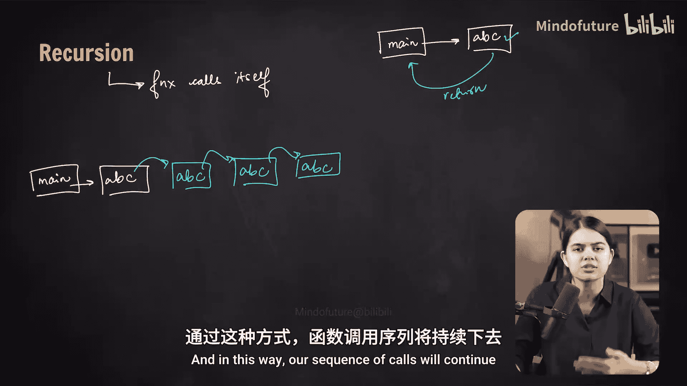
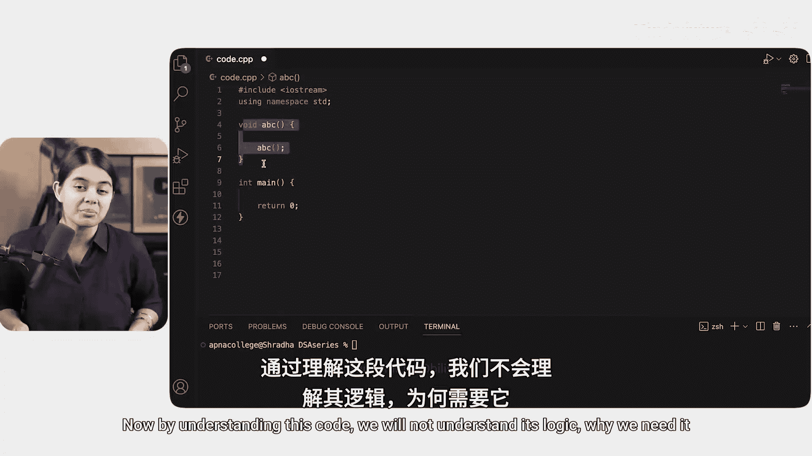
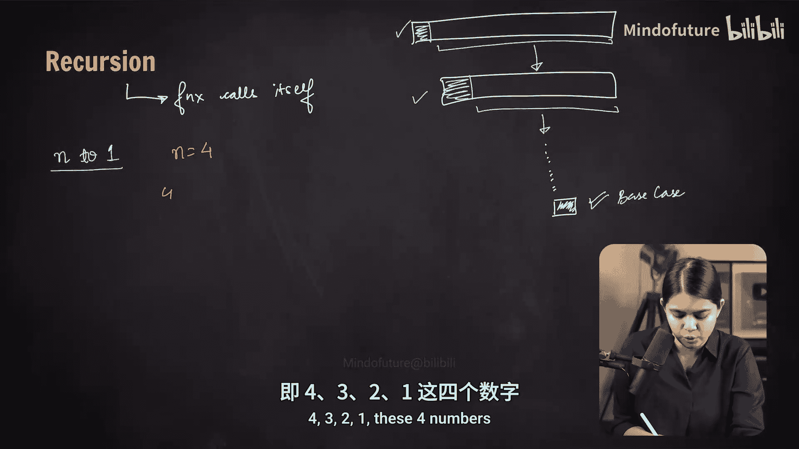
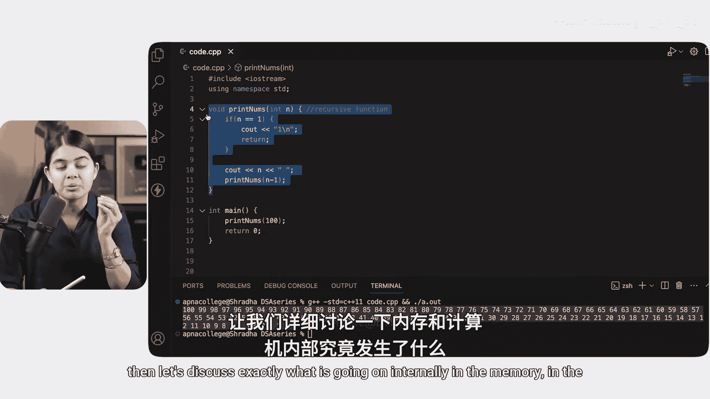
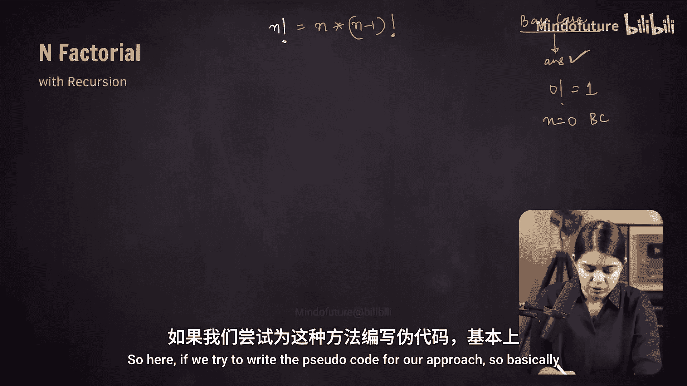
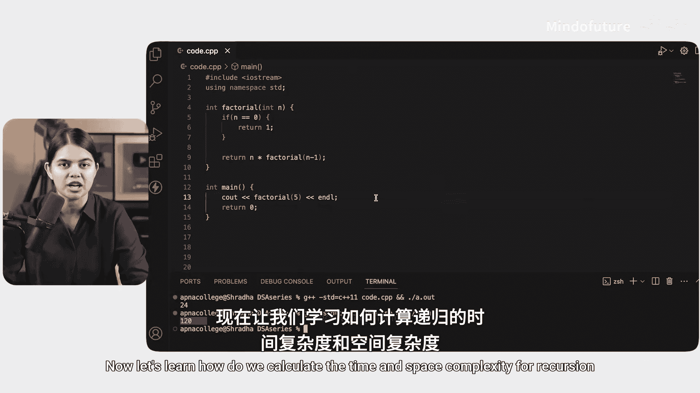
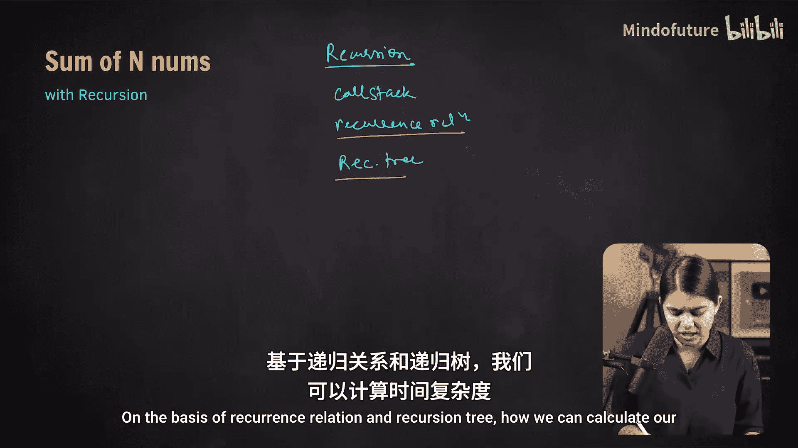

# C++ DSA课程：P41：递归教程：从基础到高级（第一部分） 🌀

在本节课中，我们将要学习数据结构与算法中的一个重要概念——**递归**。递归在解决各类算法问题时被广泛使用。我们将从基础开始，完整地理解递归的工作原理，并学习如何计算递归算法的时间与空间复杂度。


---



## 什么是递归？ 🔄




递归是指一个函数直接或间接地调用自身的过程。



在编程中，`main`函数是程序的入口。假设我们有一个函数`A`，如果`A`在其函数体内调用了自身，那么`A`就是一个递归函数。递归的核心在于，函数通过反复调用自身，将大问题分解为更小的同类问题，直到达到一个可以直接解决的**基本情况**。

**递归的数学类比**：
考虑一个数学函数 `f(x) = x³`。如果我们计算 `f(f(2))`，其过程是：
`f(f(2)) = f(2³) = f(8) = 8³ = 512`
这展示了函数“嵌套”自身的思想，类似于递归中函数调用自身。

---

## 递归的基本组成部分



一个完整的递归定义包含两个关键部分：

1.  **基本情况**：这是递归的终止条件。它定义了最简单、可以直接求解的问题实例，防止函数无限调用下去。
2.  **递归情况**：这是函数调用自身的部分。它将原始问题分解为一个或多个更小的、结构相同的子问题。

---

## 第一个递归示例：打印数字

让我们通过一个简单的例子来理解递归。我们将编写一个函数，按顺序打印从1到N的所有数字。

以下是实现思路：
我们定义一个函数 `printNumbers(n)`。它的逻辑是：**要打印1到n，可以先打印1到n-1，然后再打印n**。

**代码实现**：
```cpp
void printNumbers(int n) {
    // 基本情况：当n为0时，不再打印，直接返回
    if (n == 0) {
        return;
    }
    // 递归情况：先打印1到n-1
    printNumbers(n - 1);
    // 然后打印当前的数字n
    cout << n << " ";
}
```

**调用过程分析（以n=4为例）**：
1.  `printNumbers(4)` 调用 `printNumbers(3)`。
2.  `printNumbers(3)` 调用 `printNumbers(2)`。
3.  `printNumbers(2)` 调用 `printNumbers(1)`。
4.  `printNumbers(1)` 调用 `printNumbers(0)`。
5.  `printNumbers(0)` 满足基本情况，直接返回。
6.  控制权返回给 `printNumbers(1)`，它打印 `1`，然后返回。
7.  控制权返回给 `printNumbers(2)`，它打印 `2`，然后返回。
8.  控制权返回给 `printNumbers(3)`，它打印 `3`，然后返回。
9.  控制权返回给 `printNumbers(4)`，它打印 `4`，然后返回。

最终输出为：`1 2 3 4`。

---

## 递归关系



递归关系是用数学方程形式化地描述递归函数的时间复杂度。对于 `printNumbers` 函数，其递归关系可以表示为：
`T(n) = c + T(n-1)`
其中 `T(n)` 表示处理规模为 `n` 的问题所需的时间，`c` 是每次递归调用中的常数时间操作（如判断和打印）。

通过展开这个关系式，我们可以推导出其时间复杂度为 `O(n)`。

---

## 经典示例：计算阶乘



上一节我们介绍了打印数字的递归示例，本节中我们来看看另一个经典问题——计算阶乘。

阶乘的定义是：`n! = n * (n-1) * (n-2) * ... * 1`。例如，`4! = 4*3*2*1 = 24`。
我们可以观察到：`n! = n * (n-1)!`。这正是递归的结构。

**递归思路**：
- **基本情况**：`0!` 定义为 `1`。
- **递归情况**：`n! = n * (n-1)!`

**代码实现**：
```cpp
int factorial(int n) {
    // 基本情况
    if (n == 0) {
        return 1;
    }
    // 递归情况
    return n * factorial(n - 1);
}
```

**调用栈分析（以n=4为例）**：
函数调用顺序为 `factorial(4)` -> `factorial(3)` -> `factorial(2)` -> `factorial(1)` -> `factorial(0)`。
然后逐层返回结果：`factorial(0)` 返回1，`factorial(1)` 返回 `1*1=1`，`factorial(2)` 返回 `2*1=2`，`factorial(3)` 返回 `3*2=6`，最终 `factorial(4)` 返回 `4*6=24`。

---

## 递归的时间与空间复杂度分析

理解递归的复杂度对于评估算法效率至关重要。

### 时间复杂度计算
有两种常用方法：
1.  **使用递归关系**：建立如 `T(n) = k + T(n-1)` 的方程并求解。
2.  **计算总调用次数**：时间复杂度 ≈ **总递归调用次数** × **每次调用中的工作量**。

对于 `factorial` 函数：
- 总调用次数为 `n+1`（从n到0）。
- 每次调用执行常数时间 `O(1)` 的操作（乘法和返回）。
- 因此，总时间复杂度为 `(n+1) * O(1) = O(n)`。

### 空间复杂度计算
递归的空间复杂度主要取决于**调用栈的深度**。
- 每次递归调用都会在调用栈中占用一块内存（称为栈帧），用于存储参数、局部变量和返回地址。
- 空间复杂度 ≈ **递归树的最大深度** × **每个栈帧占用的空间**。

对于 `factorial` 函数：
- 最大深度为 `n+1`（从n到0）。
- 每个栈帧占用常数空间 `O(1)`。
- 因此，总空间复杂度为 `O(n)`。

**注意**：这是递归带来的额外空间开销（辅助空间）。在非递归（迭代）解法中，可能只需要 `O(1)` 的额外空间。

---

## 另一个示例：计算前N个自然数之和

让我们应用所学知识，用递归计算前N个自然数的和。

**递归思路**：
前n个数的和 = `n + (前n-1个数的和)`。
- **基本情况**：当 `n=1` 时，和为 `1`。
- **递归情况**：`sum(n) = n + sum(n-1)`

**代码实现**：
```cpp
int sumOfN(int n) {
    // 基本情况
    if (n == 1) {
        return 1;
    }
    // 递归情况
    return n + sumOfN(n - 1);
}
```
对于 `sumOfN(4)`，计算过程为：`4 + sumOfN(3)` -> `4 + (3 + sumOfN(2))` -> `4 + (3 + (2 + sumOfN(1)))` -> `4 + (3 + (2 + 1)) = 10`。

其时间复杂度和空间复杂度同样为 `O(n)`。

---

## 总结 📝

本节课中我们一起学习了递归的核心概念：
1.  **递归定义**：函数调用自身来解决问题。
2.  **两个必要部分**：**基本情况**用于终止递归，**递归情况**将问题分解为更小的子问题。
3.  **递归示例**：我们实现了打印数字、计算阶乘和求和三个经典递归函数。
4.  **复杂度分析**：我们学习了如何分析递归算法的时间复杂度（通常为 `O(n)`）和空间复杂度（取决于调用栈深度，通常也为 `O(n)`）。



递归是理解许多高级算法（如分治、回溯、动态规划和树/图遍历）的基石。掌握其基本原理和复杂度分析，将为后续学习更复杂的数据结构与算法打下坚实基础。