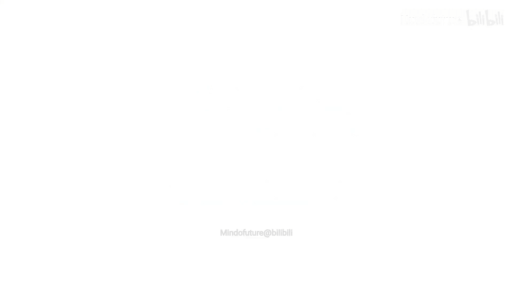
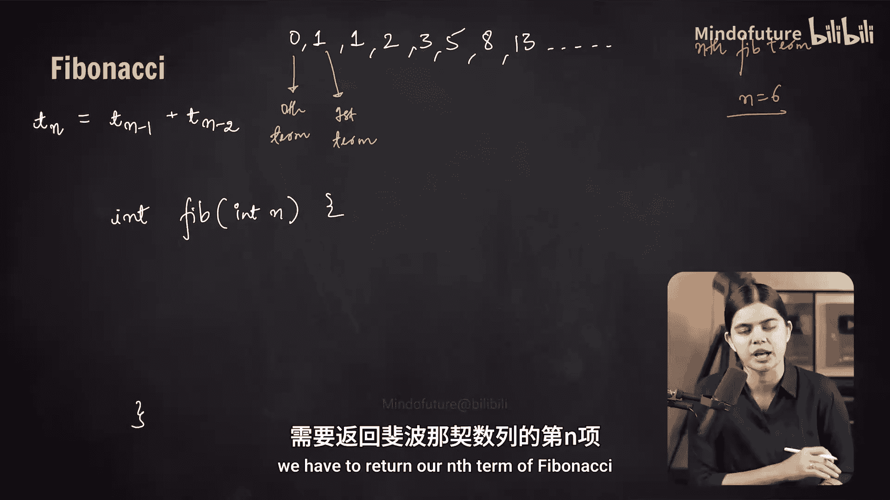
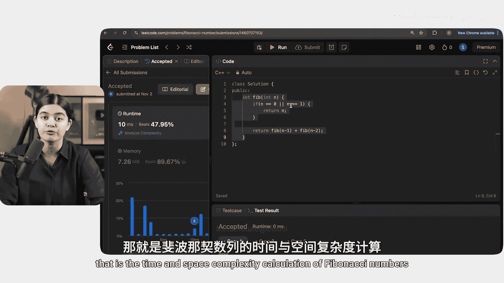
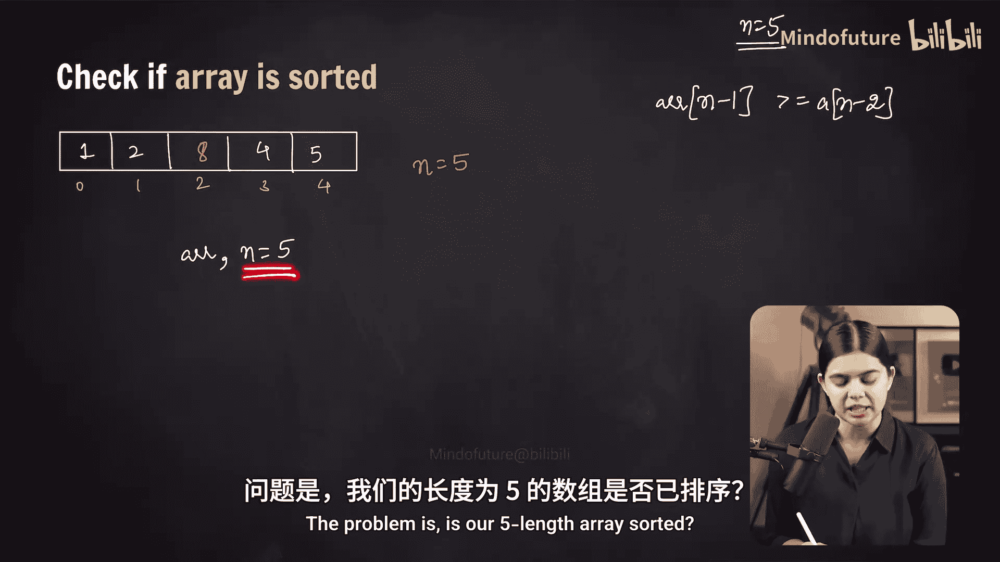
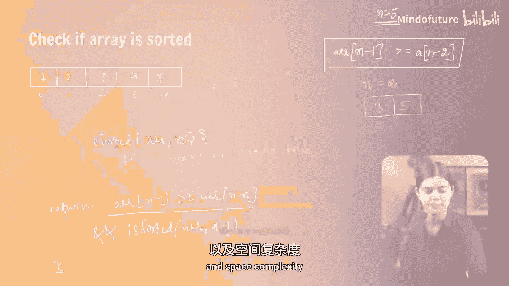
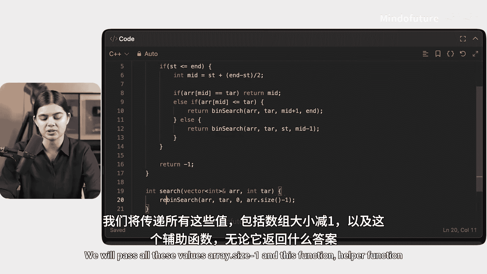
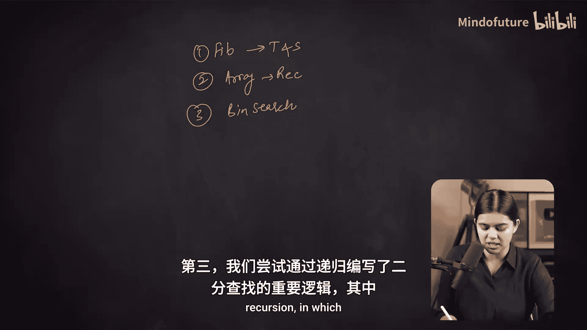

# C++-DSA课程-｜-数据结构-｜-leetcode-｜-Apna-College-｜--Complete-C++-Dsa-Course-p42-P43_递归第二部分-斐波那契数问题_二分查找问题_判断数组是否有序问题--BV18oUGBkEmV_p42-

H everyone welcome to the complete series orju recur can or importing problemboncur are going to solve the problem to if array is sorted or not using recur。

 and then we are going to understand the code for binary using recur available Also is for sheet in the description box for which is a very classical problem of sequence or sequence and Fi term sequence and first term sequence rule term it will be equal to n1 term。

😊。

Plus n minus2ome， for example， Agaham Fibonci is second term that will be equal to the first term plus the0 term first term the next term of Fibonacci will be which is equal to0 plus1 next term2 equal which will be1 plus1 next term Igi1 plus2 k equal2 plus5 equal3 plus k equal and5 plus 13 k equalboncibonac general problem that is to find out the n Fibonacci For example。

s n is equal to6 Fibonacci term sequence for we can tell this is0 first second， third， fourth。

 fifth and66 Fibonacci term is equal to answer should be equal to is problem already loops multiple times solve previous。

An epittome of fibonology。logic function。

Calc possible j calculate or same functions will equal to n1 plus n So this is the logic to calculate usingcur n is equal to n1 and n solution solution。

equal and first1 equal value answer or n value value value。

N is equal to 0 k is0 return return So this is the base case n is equal to third equal fbon function equal that is the answer will be equal to n is equal to and this is definecur to solve this problem number9bon number。

Level problem function is function sub case value or it is equal to1 those equal tobon n1 calculate plusbon n calculate solution So this is the entire。

And let's submit it This the problem solve next is discuss， which is going to be very important。

 That is the time and space complexity calculation of Fibonac numbers to subsequently time complexity time complexity recurrent rock let's suppose for any equal to。

N is equal to 4 kbon sub f4 k F4 base case f3 and f2 to f4 f3 and f2 f f3 k base case2 and1 to f3 f2 and f1 similarly f f1 and f f f1 and f base case base case totalcur incomp branches form balance level completely level completely second time complexity time complexity was total number of calls。

Yet total calls the name cata multiplied by work done in each call。

The total number of callsari first level pay8 callari second level pay though calls aari third level pay4 calls a similarly Q balance out Kari last level pay8 calls only ca1 is equal to 2 to the 02 is equal to root to the 14 is equal to2 to the 28 is equal to2 to the 3ari calls level perari plus n is equal to4 arbitrary n our value of n T total number of calls K total number of calls first level pay O2 d0 plus 2 to the 1 plus 2 to the2 plus2 to the3。

And last level muji n1 calls Q4 n is equal to4 the last level2 to3 calls n say last level2 to n1 total number of calls total number of calls geometric progressionmetric progression the total sum of all of the values is equal to a r to n divided by r a starting value difference n total number of first value which is equal to2 multiplied r n common difference difference equal to total number of n0 n n1 divided by212 n1 divided by1 this value becomes equal。

n1 the final value2 n I completeari total calls total number of callsari total number of calls1 or her call make。

Y constant comm a call y constant， Y constant multiplied by K to overall time complexity K I time complexity O I big of2 to the power N K equal。

boncur is。1 complexity complexity。Of recurs height of the call stack multiplied by space or memory in each call minus total second level or function total complexity will be complexity to check if is sorted or not So basically we are given this function called sorted called and function is sorted or issorted。

This problem calledcursium cases alter it is sub atop negative by aifying is scan。

 Let's suppose how many numbers they 1，2，3，4 and 5。 and is。 we also have the index values。

 geopa available。multiple， depending upon given。sorted assume sorted ascending order can we need to find if the given array sorted in ascending order or not given ascending order can sorted asending order can theed special quality and the quality is forward direction can increase。

Butum algorithmmic Co V index I。To Hammepath sorted array can index I value would be that will always be greater than equal to array of I -1。

Not the forward direction may togi took， if sorted or not， her adjacent element who compared。yes3。

A is index and index are going to make use of the parameter that we are given which is this value value given value given which is equal to5。

Or every k n is equal to5 valuepa given problem backward。

 So I'm gonna start carrying Yaari value5 givenari n value a5 value index existing n1 compare n minus。

m basically check n value n n1 n2 n is4 n n problem n confirm。

Or Qki n1 kiloche is n8 element degrees the next time Jo called n minus1 pa。

logically to n is equal to5 k is element co index4 index n is equal to5 problem n n equal n minus equal logical function my is called。

this particular condition This is the small condition n1 is greater than equal n function are to call the same function is sorted。

est，base case can n value n value those case default because the is already sorted and in base for example。

 n n is equal to2 and n is equal to2 minus and n n n minus index minus n is equal to1 size k condition satisfy will give and then we likely try to and calculate this is the function。

A base case looks a2 B， B inky value 0 is at the1 is This case maybe we already know the answer is going to be 2。

Make sub in fact key area of n minus1。greater than equal to here array of n2 V single condition satisfy area here he falls over Tom to false return coming in directly and and。

and1 size andcur are always index try to run this function is sorted。4 are8。

And Nja we already saw today to answer was one， which is equal to 2。And of line for but j say equal。

s suppose replace cium with those case maybe we are going to get0 false as our solution case likely suppose and this function and n equal to n is equal to k of n1 is it greater than equal to of n。

value4 values yes true true n is equal n is equal yes this is greater than n is equal to n is equal to n is equal greater than greater than in the。

If called jagi F of5， f of4 key called F of3， F of two and F of one。

 the worst case may base case the qua n0 F is equal to1 call I N is equal to5 kilo total number of calls me time complexity total calls。

Multiplied by work done。In each call。The total number of calls n is equal to 5 kilo5 to n K approximatelypa n calls only or a column constant if conditiona and constant a can the constant That is why the time complexity is equal to big Q。

😊，Space complexity space complexity case equal that is why the complexity is n and the time complexity is also n for this particular recursive solution recur important algorithm recur we to solve is called binary binary binary binary basically starting position and we also had an ending pointer。

 which we initialized with n say example is ending pointer equal。😊。

The starting and ending pointers binary binary given equal by n divided this is formula is value equal and。

binary logic value in the secondcur ending。and depending upon situation。

Let's call it binary research binary can area target starting value value binary start or n defined the calculate in。

usually or n divided。the second half of the Shane Valley parameters con changegeham start and。

Second third。equal。5。B next5，9， second my first and。This is the and the this time value is equal to。

basis case。whose case are going to return1。 So this is the entire logic to perform binary search usingcur calculate is the function function as compared to n will basically be equal to。

And Hamjaga n-1 Y A dot size -1 to starter in parameters create orari parameters who usely。

 we can create a separate function。 just go generally programming can the helper function。

Tomic doa function monos them called integer binary search。And you basically youa。

This is the helper function。 This can the a to Maripa A or target to I J Sa Sa the Marias6 starting value Ie and a ending value Ie。

To sub eton check， a start is then equal to n， but the valid conditions children。

This case my teleo the calling mid will be equal to start plus and minus start divided by 2。

of value greater than equal second second second is。

equalSo this is the entire logic or answerta base case last a value the logic binary is helper function call is function basically the binary search value function target。

Starting value， start pass value should me 0 and ending value。

 which will be a dot size Yes values pass A dot size-1 and here function helper function Joham search functions run。

And let's submit it to Hama you code here who successfully submit O again Ab code key but time complexity time complexity analysis kill it。

 Let us try to analyze the kind of recurst tree that we are going to get。Basically binary exactly。

Next time we call change hooker to F3， next time call change hookkuji to F1 and finally is the ri recurs the recursion can already。

divided by will help calculate n equal n equation which n divided is equal n equal。

W to n is equal to basically k and K K total number of levels time complexity total number of calls calls to basically call log n to or call me call This is all constant of。

time complexity that is big log n but this is the time complexity forcur binary similar is time and complexity second and and complexity successfully。

Progress with me on specifically complete fundamental but eventually by the of consistently。

