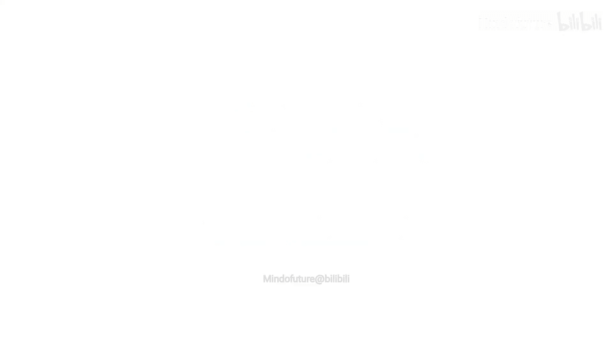
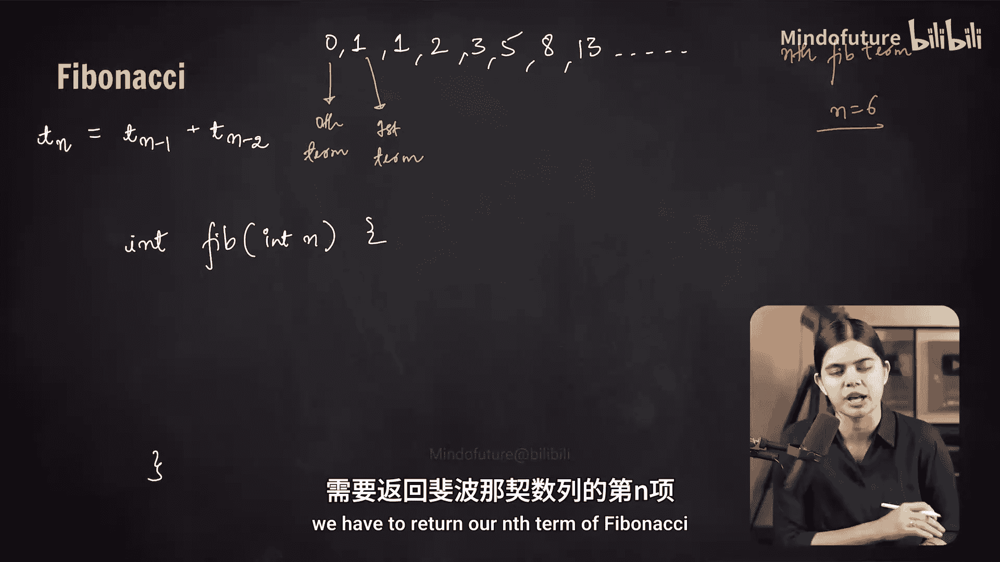
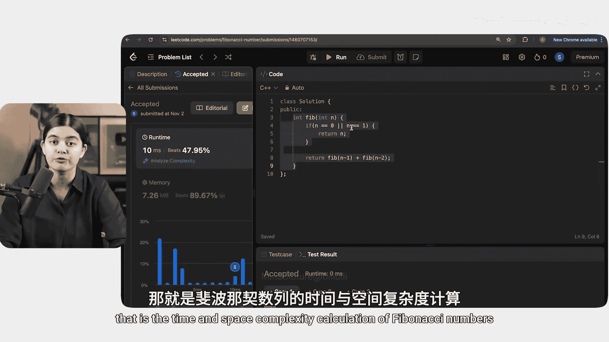
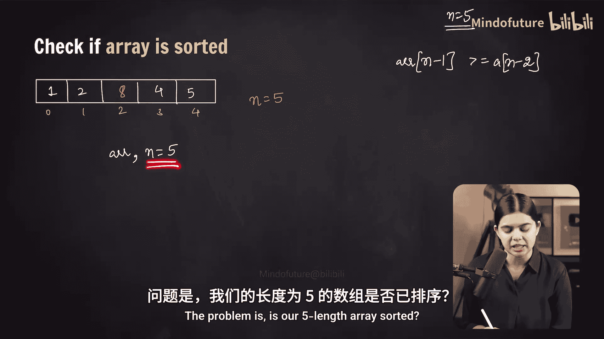
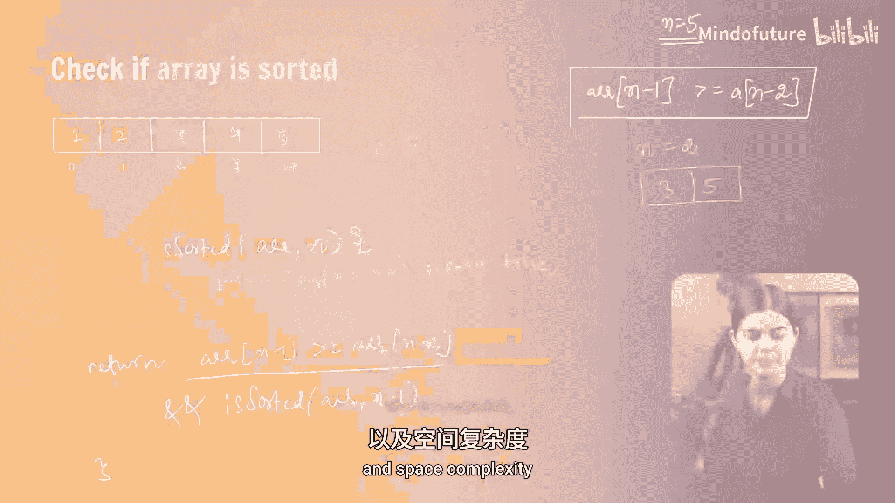
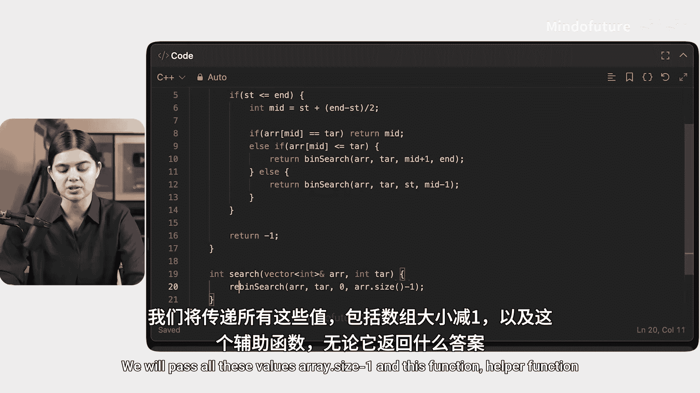
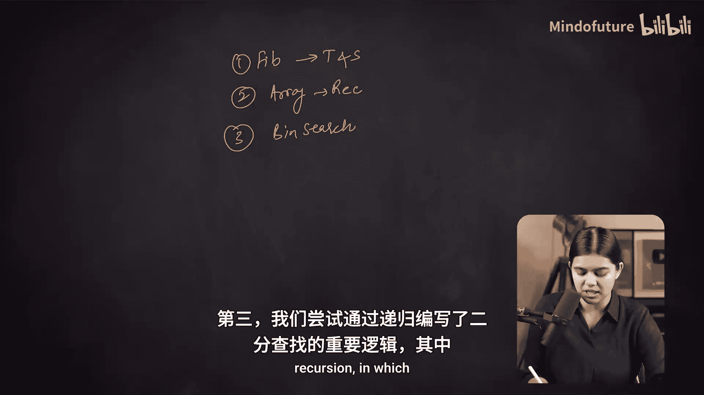

# C++数据结构与算法课程：P42-P43：递归第二部分 - 斐波那契数、二分查找与数组有序性判断 📚

在本节课中，我们将深入学习递归的经典应用。我们将解决三个核心问题：计算斐波那契数列、使用递归实现二分查找，以及判断一个数组是否有序。通过这些问题，我们将进一步理解递归的思维方式和实现细节。



---

## 斐波那契数列问题 🐚

上一节我们介绍了递归的基本概念，本节中我们来看看如何用递归解决经典的斐波那契数列问题。

斐波那契数列是一个数列，其中每一项（从第三项开始）都等于前两项之和。其规则可以用以下公式描述：



**F(n) = F(n-1) + F(n-2)**

例如，数列的前几项是：0, 1, 1, 2, 3, 5, 8, 13...

我们的目标是编写一个递归函数，输入 `n`，返回第 `n` 个斐波那契数（通常认为 F(0)=0, F(1)=1）。

### 递归逻辑与代码实现

以下是解决该问题的递归函数逻辑：



1.  **基准情况（Base Case）**：当 `n` 为 0 或 1 时，直接返回 `n` 本身。
2.  **递归情况（Recursive Case）**：对于其他 `n`，返回 `fibonacci(n-1)` 与 `fibonacci(n-2)` 之和。

对应的C++代码实现如下：

```cpp
int fibonacci(int n) {
    // 基准情况
    if (n == 0 || n == 1) {
        return n;
    }
    // 递归情况
    return fibonacci(n-1) + fibonacci(n-2);
}
```

### 时间与空间复杂度分析

现在我们来分析上述递归解法的时间复杂度。我们可以将递归调用过程可视化为一棵递归树。


以计算 `F(4)` 为例，函数调用会像树一样展开。每一层的调用次数呈指数增长（大约为 2^k）。总调用次数是一个几何级数求和。

总调用次数 ≈ 2^0 + 2^1 + 2^2 + ... + 2^(n-1) = 2^n - 1

因此，**时间复杂度为 O(2^n)**。这是一个非常高的复杂度，意味着对于较大的 `n`，此方法效率极低。

**空间复杂度**主要取决于递归调用栈的最大深度，即树的高度 `n`。因此，**空间复杂度为 O(n)**。

---

## 判断数组是否有序问题 📈

接下来，我们使用递归来判断一个给定的数组是否按升序排列。

判断数组是否有序的核心思想是：如果一个数组是升序的，那么对于任意位置 `i`，都有 `arr[i] >= arr[i-1]`。我们可以通过比较相邻元素来递归地验证这一点。

### 递归思路与代码实现

我们将从数组的末尾开始向前检查。函数 `isSorted` 接收数组和数组大小 `n` 作为参数。



1.  **基准情况**：当 `n` 为 0 或 1 时，单个元素或空数组自然是有序的，返回 `true`。
2.  **递归步骤**：检查最后两个元素 `arr[n-1]` 和 `arr[n-2]`。
    *   如果 `arr[n-1] >= arr[n-2]` 成立，则问题缩小为判断前 `n-1` 个元素是否有序。
    *   否则，数组不是有序的，返回 `false`。

以下是代码实现：



```cpp
bool isSorted(int arr[], int n) {
    // 基准情况：数组为空或只有一个元素
    if (n == 0 || n == 1) {
        return true;
    }
    // 检查最后两个元素
    if (arr[n-1] < arr[n-2]) {
        return false;
    }
    // 递归检查前 n-1 个元素
    return isSorted(arr, n-1);
}
```


### 复杂度分析

*   **时间复杂度**：函数最多被调用 `n` 次（从 `n` 递归到 1），每次调用执行常数时间操作。因此，**时间复杂度为 O(n)**。
*   **空间复杂度**：递归调用栈的最大深度为 `n`。因此，**空间复杂度为 O(n)**。

---

## 递归实现二分查找问题 🔍

最后，我们探讨如何使用递归来实现高效的二分查找算法。

二分查找的前提是数组必须是有序的。其核心思想是不断将搜索范围对半分割，通过与中间元素的比较来决定下一步搜索左半部分还是右半部分。

### 递归逻辑与代码实现

我们将实现一个辅助函数来进行递归搜索，它需要数组、目标值、起始索引 `start` 和结束索引 `end` 作为参数。

1.  **基准情况**：如果 `start > end`，说明搜索范围无效，未找到目标，返回 `-1`。
2.  **计算中间索引**：`mid = start + (end - start) / 2` (防止整数溢出)。
3.  **比较与递归**：
    *   如果 `arr[mid] == target`，找到目标，返回 `mid`。
    *   如果 `arr[mid] > target`，目标在左半部分，递归搜索 `(start, mid-1)` 范围。
    *   如果 `arr[mid] < target`，目标在右半部分，递归搜索 `(mid+1, end)` 范围。

以下是完整的代码实现，包含一个对用户友好的主函数接口：

```cpp
// 递归辅助函数
int binarySearchRecursive(int arr[], int target, int start, int end) {
    // 基准情况：搜索范围无效
    if (start > end) {
        return -1;
    }
    int mid = start + (end - start) / 2;
    if (arr[mid] == target) {
        return mid;
    } else if (arr[mid] > target) {
        // 搜索左半部分
        return binarySearchRecursive(arr, target, start, mid - 1);
    } else {
        // 搜索右半部分
        return binarySearchRecursive(arr, target, mid + 1, end);
    }
}
// 主函数接口
int binarySearch(int arr[], int size, int target) {
    return binarySearchRecursive(arr, target, 0, size - 1);
}
```



### 复杂度分析

*   **时间复杂度**：每次递归调用都将搜索范围减半。因此，最多需要进行 log₂(n) 次递归调用，每次调用执行常数时间操作。**时间复杂度为 O(log n)**。
*   **空间复杂度**：递归调用栈的最大深度同样约为 log₂(n)。因此，**空间复杂度为 O(log n)**。

---


## 总结 🎯

本节课中我们一起学习了递归在三个经典问题中的应用：

1.  **斐波那契数列**：我们实现了直观的递归解法，但其时间复杂度为 **O(2ⁿ)**，效率低下，揭示了递归可能带来的性能问题。
2.  **判断数组有序性**：我们利用递归分解问题，每次比较相邻元素，实现了时间复杂度为 **O(n)** 的解法。
3.  **二分查找**：我们使用递归实现了高效的搜索算法，其时间复杂度为 **O(log n)**，展示了递归在分治算法中的强大能力。

通过对比这三个问题，我们深刻体会到：虽然递归代码通常简洁易懂，但必须仔细分析其时间与空间复杂度。在有些情况下（如斐波那契数列的朴素递归），递归可能并非最优选择，需要考虑迭代或记忆化（Memoization）等优化技术。理解递归树是分析递归复杂度的关键工具。




持续练习这些基础问题，将为你解决更复杂的数据结构与算法挑战打下坚实的基础。