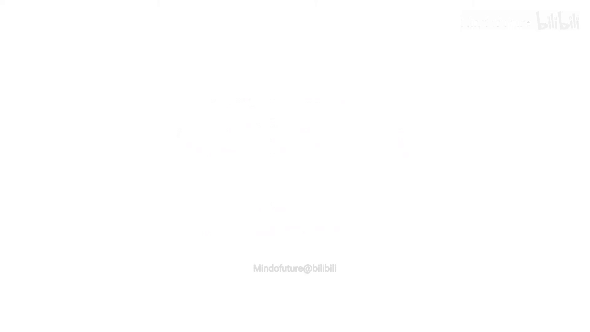
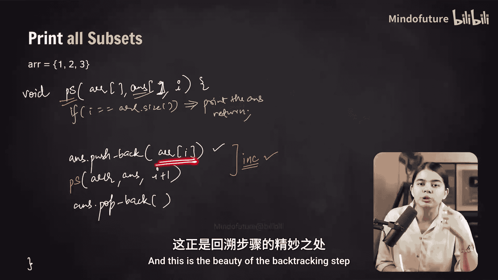
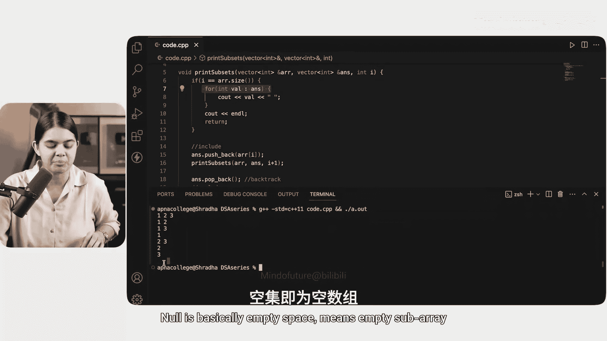
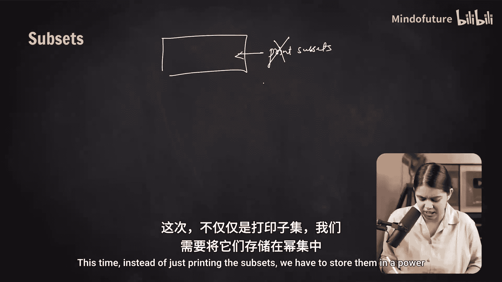
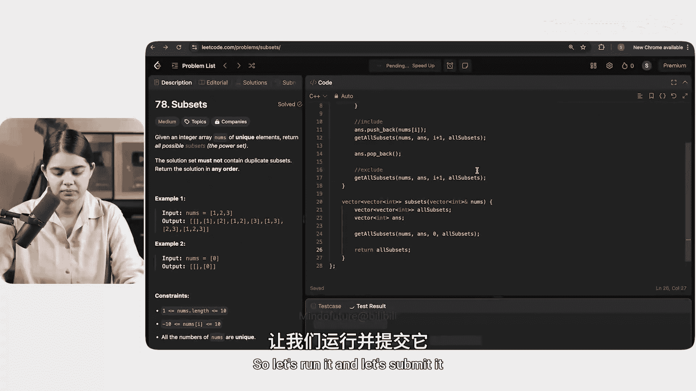
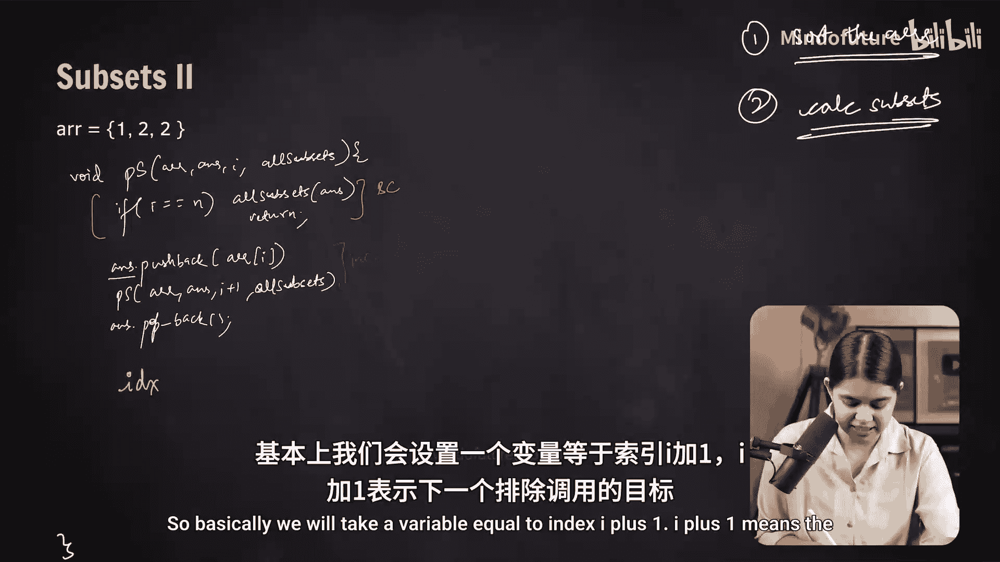
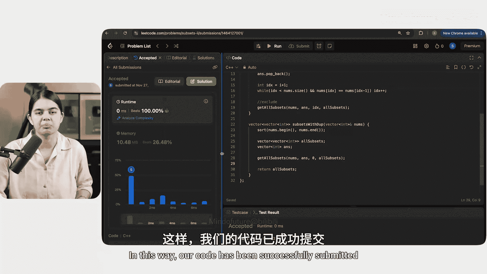
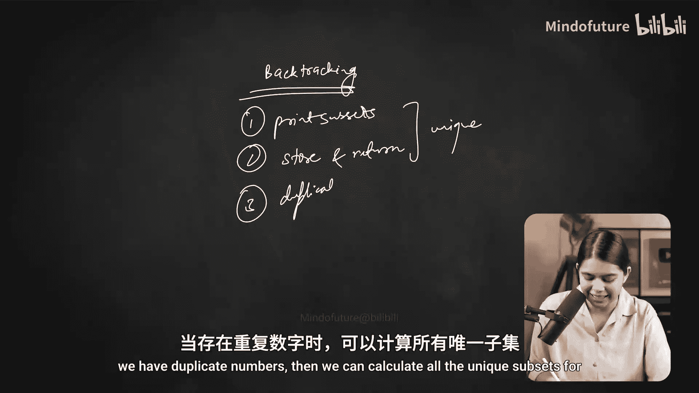

# C++-DSA课程-｜-数据结构-｜-leetcode-｜-Apna-College-｜--Complete-C++-Dsa-Course-p43-P44_递归第三部分-回溯详解-打印所有子集-子集II--BV18oUGBkEmV_p43-

Hi everyone， and welcome to the complete D series。 And today。

 we're going to dive deep into the concept of backt with recursioncur can backtrack or detail subset based problems which are important for placement and internship interviews concept Also there is a link for a company by sheet in the description box basic problem。

 which is to print all subsets for given and strings suppose we have some characters stringri linear structures same logic for subsets subsetri giventa subgroup。

😊。

Of datase， for example， agar， which has two elements。

1 and2 given third and and given possible and and to basically elements combinations for the givenham elements。

1 in32 and three3 elements1，2 and3 and definitely number of are equal to given elements the total number of is equal to equal basically given given using fundamentally concept concept fundamental concept。

Most important in recursion A Sahamsri， basicallyme Al Pattaki Kisbiriki sub。

 her egg element kpa Cho Soki kvo elementari sub k include Ho exclude Ho ki elementari sub include Ho exclude Ho Tu reionander。

what。which is to solve for a single element to basically values1 equal and depending upon but equal or case case。

Yatohami include Yaem Agar K to subar Al W Tubi sub Jaarga，ga。

 but I Baari subseander will have1 and 2。😊，Agar exclude include。

 will not change toari same choice exclude include to or isari excludely second level2 in the next level we are going to take choice for the next element。

 which is going to be3 exclude include1 exclude and same include exclude。😊。

Depending upon that include ktoki3 is the element Ex let us minimize this a bit。

 include exclude exclude exclude exclude at the end exclude is 1，2，3，4，5，6。

7 and 8 to2 to3 exactly If we try to follow this path and we had an empty to start with her level ofcur。

exclude and depending upon that plus into and finally into the answer answer is basically equal to next。

H a variable liam。 Let's call it I， which is going to track the index of that particular element to first level k。

 first level of recurs kander Iq value 0 Hoie second level kander I value1 Ho third level kander I value2 Ho or jari I value 3 Hogi Meja is equal to3 v index exists inta to jaririho cover Kari passari subs ajaga bus in value print we can start with a variable I equals0 and her bar next call to I plus1。

😊，Plus1 and plus1 this problem， what does a function signature look like， I'm basically function。

 Let's call it print sub I and in teacherja return because we are not really going to return anythingcur level pay exclude include we are trying to include it in this answer。

 which is storing the value we can try to push back that value。

ki eventually answer or or next for the next element next function。😊。

3 once we hit this base case what is going to happen。

 We need to print this subset or base case when I value is equal to the size of base。😊。

Those case just print the answer and simply the answer to which is called did1。

previous state vja to backting Magi elementko last Meath。

 which was3 Yaha is to include vas le toari123 exclude exclude Ha to Ha what we are going to do element。

Hk kringi element Co。Pop and is this step is particular element eventually and this is the beauty of the backting step next。

😊。

Pham is3。 It is making sense in this last call。 And formi co to inclusion he calledgi A sub function co with Eri with answer and is bar inclusion Maham answer element exclusion he calls basically original answer he pass on original answer I Man to yeari exclusion he callmco exclude。

 And this is the important step。 Ju basically。😊，back step I process or right or is called。

include back from step answer original is the logic for print are to are trying to let us write the for it。

😊，This is our main function。 Janawe is function could called Laganniham Ecor Victor Benani。

 which is called Anser answerser Kander basically st Karani vni subu。

And humprint subsets function go called going for E for answer or result command answer k and for。

Index I one thing which is important to notice key is answer by reference pass is by value s both important by reference pass that is why we are passing by referencet answer create each loop with space。

😊，And let's see out end of line。 And here you see hum return Ka to Yane subko print Kva Yam return kge subseelli inclusion Castaga include Gnemallahe Ane answer Kander push back Kneva current value。

 which is E of I。 And then we are going to call the same function print subsets for E answer and I plus 1。

Uskeba， exclude Kneka Steppaga， exclude vis Stepmi Kni Gna。

 ye include vla Stepta to exclude my Isko Klagaia。 But change ye Jochis include Kiti Usk pop bagby Knaga before exclusion。

Though answer dot pop back。 We are going to pop back the last element。 y backt k perform。

 So this is the significance of backtracking during the recurs process。

 So this is the entire function that we are going to call in this particular basically answer print let us save it and run our1。

2，3，1，2，1，3，1，2，3，2，3 and nu null basically empty And in fact。

mi print If we look at this particular recursion 1，2，3，12，1，3，1，2，3，2。

3 and null same order printing recur exactly internal execute and。

are a success print to a whisk time complexity analyze cula。

 the time complexity of recursion is basically total calls。😊。

Multipied by work done in each call and112，3 Similarlylyham and。😊。

Total calls n into n a work done in each call within this particular function。

ip constant and condition base case time if we assume the work done in each call to be big of1 case time complexity that will be of2 n multiplied by n and this is the time complexity to print all of the subsets using print Next we are going to solve a problem which is based on the previous logic。

 This is problem number 7 a unique elements given in the form of and we have to return all the possible subsets of the all possible subset case set power basically now。

 instead of printing all the subsets subset vector of vector can the and then we have to return。

 So this question is going to be really easy。😊，Basically。

 last question was all hamk function Man function Sari subsetco print Kne is subset print Kneme store Ka in a power set to yta sum change K the code is going to be almost seen to I directly to accept them Ham basically Hamik function Man。

 which lets call it all subsets。😊。

To function calculate I logic print basically I we are going to get we are going to get our answer which will store the and in case this time we to store and first include answer element Then we are going to call the same function all with the numbers answer and and exclude which is to call。

😊，With the same values。 The Yamar function complete O is function。

 Can the sari subscom calculate K Next to Ja G is vector of vector can on sub comm to。

 So let's call it are all subsets。😊，And in fact， is function co rename cur to get。哦。Subsets。

Let's copy this and paste it here。And Ferram， all subko call Lai get all sub who call Lai with our numbers。

 Saki I vector of intija Ktan called answer Iam answerpane Ikijaham0 pass Kane。

 and we are also going to pass this all subkam Saari subkoikiham is vko pass on Kana Im as a parameter include K Yahaur。

😊，And storeran all subst push exactly。 What we can do isriari values automatically answer or all。

Same all sub in these function calls as a parameter is all sub to the function or allari complexitygi that is the same as before。

 which is going to beov n into2 to the powerhi same complexity So before running theham all sub with reference changes is function and we are going to return all sub here。

😊，Do you say ran Thursday。

And let's submit it。successfully submit with a time complexity of big n into。

 This is a direct variation of the previous question。

 I calculate return differenceip elements The last question description unique elements I elements does it make a difference elements elements lets suppose22 previous same approach this is basicallyri elements。

😊，2 and 2 Shiwa ksam Anekaki with I is equal to 0， and I is equal to 0 k Aas answered K Abias。

 those choices Yato I is equal to 0eth element，0eth element Matla Y element I say yaam include ks I exclude ksam X choice include kyogi exclude kyogi jaba include Kringgiari sub elementjaga1 exclude kgisminga。

 or next calljagi I is equal to。😊，1 k A I is equal to1th element Kni 2 king is include Knai exclude Knai to the barm call Ge a inclusionki call a exclusionki call include just call meahamipas element。

 Aja1 and 2， exclude kippa element Ajaga 1 k equal。

 And next you call Jagi That will be for I is equal to 2。

 Sam cheese Agi include kcal Ex K call include k orippa element。

 Ajaga2 k equall exclude kia or subset will be empty。 Next you call Jagi。

 That will be for I equal to2。 Sam cheese hum repeat Kne is barabni last element。 Yni is 2 k。😊。

Let us bring it here。And I sayham Jahito remove k。And Yahoper。Let us resize this a bit。

The next thebarraium include exclude k Cha Rainge for this two element。 Thearm include Kane。

 Yaham exclude Kane。 to include Giat of Mariipas， Eriga 1 to 2 k equall。

Exclude ka tomaippa El Sage 1，2 k。 Similarlyly， Yaham include Gne include gikoe Tuku Agar I karham Tuku include kaatjaga Agarham exclude ka Tu Aga Yaipas Aa same cheese kringi include Kagi exclude Karinggi Agarham is kat I tukobi include Ga those case meipas2 andga and exclude ka to Yahabi choice inclusion kyog exclusion kyogi Agarham empty kand tuo include kaipas Aga。

😊，Agarhamni empty kandar Tuqua exclude Giaipas dubars empty A is the say Agar n elements n to n is equal to 3 K。

2 di par n any2 the par 3 any8 subset saarias C，1，2，3，4，5，6，7， and 8。

 but8 important j Jomini Ckiipas duplicate elements exist K kander。 twin duplicate elements K。

 We are going to get some duplicate subsets as a result。 Agarhamki ye original he， ye original he。

 ye original he， This is original original Maab， unique。😊，But y your upset here， y repeat。

Yee repeat subset calculate k forme repeating subset in Saip given here that the solution set must not contain duplicate subsetdiga in repeating in duplicate subset code deletepine remove kp from the entire recursion process removeme recognize knadijo repeating subset is process basically recurgen callsse step I is equal to 1 k inclusion and exclusion Cho。

😊，Basically， I is equal to1。😊，Is this value include level next level I is equal to。

 which is basically this value the same value which is equal to2 include exclude or exclude repetition branch step exclude or branchse is basically exclude original exclude。

😊，this and same choices。up。element include and exclude exclude repeatedly i equal equal value exclude is that will basically functions call it print。

or all base case will basically be equal those case may all sub or This is going to be the base case normally inclusion or inclusion answer I plus1 and all subsets。

😊，To Cho for inclusion exclude element is what are equal let us minimize this basically equal for example。

😊。

2 and three I we want to directly call for this particular element index next call that will basically be starting from i plus1 index value index plusb。

😊，Ytohama index is less than n。This is crucial。 index valid element on and Jeptaari array of index key value is equal to array of index-1 index plus Next timejo index update 3 k equaljaga equal index update4 equal I3 is not equal to2 values successfully skip directly exclusion kki call I equal to1 next we are going to make the call to print subsets for array answer I directly index and all subsets y this step This is importantki is step we are skipping。

😊，The duplicate values or would duplicate values a a index。

 we need to sort the array in advance already sortedmb which is possible inpath 2，1，2。

3 and2 is elements we wouldn't have been able to skip the duplicate values。

 So this is the entire logicander， this is the function that we have to complete is function subse all sub vector vectorang。

😊，And finally， we will return this all subsets value to yper， return like them。😊。

And I or up now vector of integer Van then， let's call it。

Result or yaffce answer we guess them and Sari Chi Kneze ball obtain numbers Erico sought Kane v to numbers dot begin。

And numbers dot and。Let's create a function void。 Let's call it get all subsets。 get all subsets。

 Bill called Peli v upper kon v。 Just can。 we are going to pass the numbers。

 We are going to pass the answer。 Jomari sub Costo Kega in teacher I and vector vector。😊。

Called all subs。Answer can the subly base case Ajaga Ugarhamari Iq value is equal to my numbers dot size。

 any N K equal。 Those case may all sub can the hum simply dot push back Kanevalm。

Une answerko and Yahai Kajagiri I AbM by a reference pass it to store all the values。

Ssehama include Kaque saigga include Caque kai， giham same function co callai。😊。

After answer Kandarhamme include Kdini vluu， and he push back Kdiia vluku to push back Kdiham nus off。

Ico and Yaber， we are going to call it for nums answer i plus1 and all subsets。

Okeba backt Kwa we have to pop back the same value and is bat a special step to skip the duplicate values Whamminaga to index who initialize Ktgi with i plus1 Jepta kari index key value is less than nus dot size and Jepta kari nus of index key value is equal to the previous value your duplicate remove Carnegisher kptaham index co plus the Kthja this is the special step and Ukeba Hamna exclude knea to step heresko we call the same function。

😊，Ps Kander I plus 1 kjge Hammiba index coasson Gui cuzaruini index key value I plus 10 index K value I plus 1 B Hopa Mariippa Sa elements Uni。

 So this is the entire functional logic。😊，Yea Hamra main function here。

 Yahase we need to call the function， get all subsets this scan numbers pass kringi answer pass kringgi Iq value initialial I ki0 kar and will pass all subsets。

Let us run this code。And try to submit it。Is who successfully submit basically first。

 which was to sort complexity plus calculate calculate So that is why the complexity is equal to this value will complexity able to store and return all of the unique important and similar problems and problems have understood what exactly back is basically and back problems。

😊。

return for all problems unique and all of these problems are What was your part of the lecture in the know about progress if have successfully completed lecture attendance in the lecture and。

😊。

