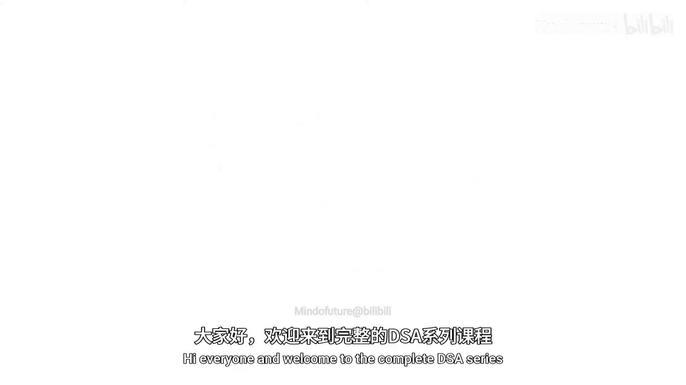
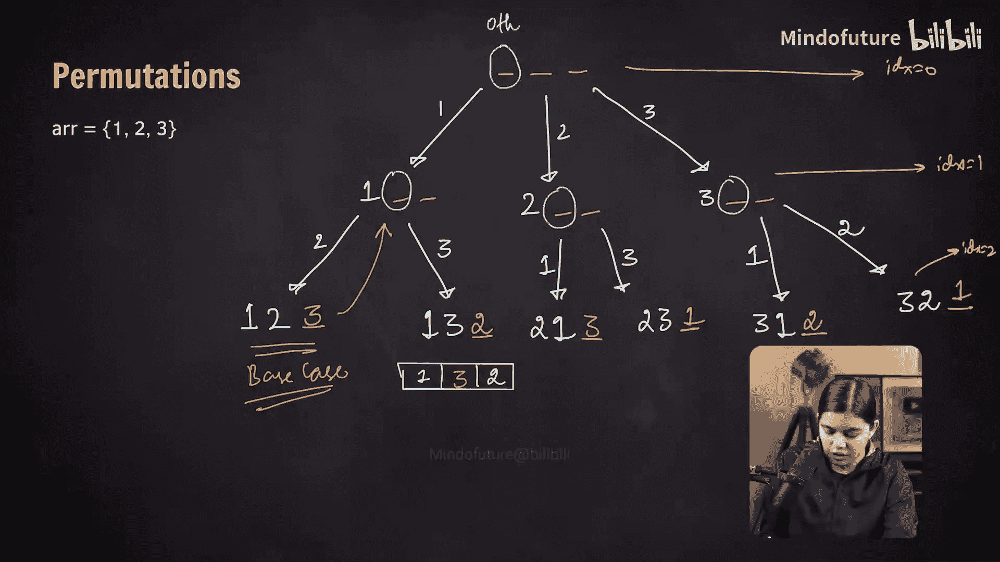
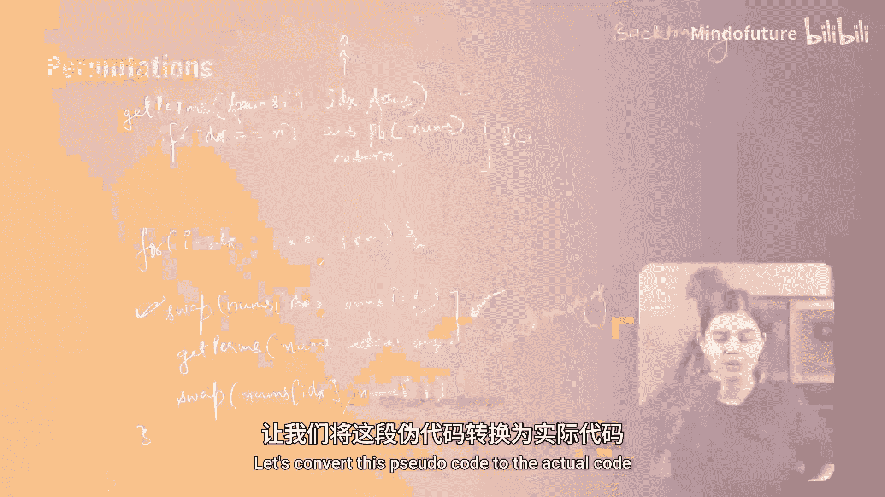
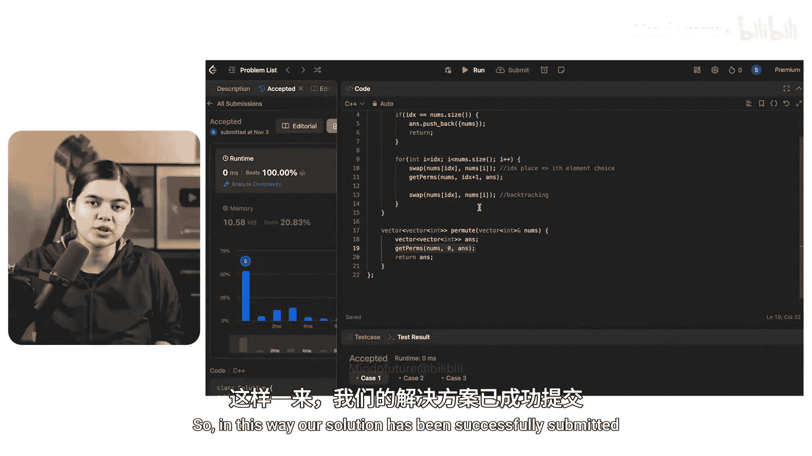
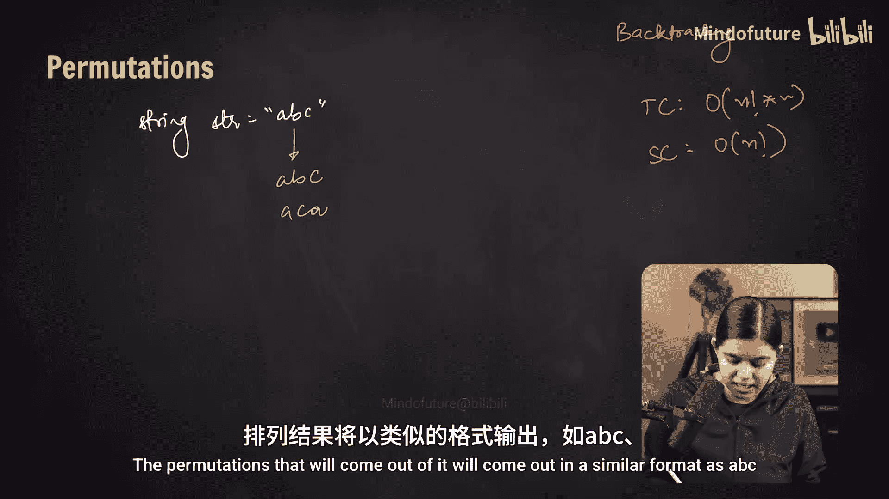

# C++-DSA课程-｜-数据结构-｜-leetcode-｜-Apna-College-｜--Complete-C++-Dsa-Course-p44-P45_数组字符串的排列-递归回溯--BV18oUGBkEmV_p44-

I'd run welcome to the complete DS series。 and today we're going to solve one more important recursion problem called permutations of in Eri all conceptja Also there is a link for company sheet in the description box。

 So let's talk about the question。 The question is calledmutations orhi logic question given or functionmutations calculate what exactly aremutationsmutations basicallyla arrangements given possible arrangement example elements123 first arrangement 123 Second arrangement132123123 to。

😊。

6 possible arrangements in elements in possible arrangements vector vector total number ofutationsial equal the total number ofutations are to be equal toial mathematically basicallyations what exactly are we trying to do basically firstations or depending upon。

Different arrangements first place peripas1，2，3 choices possible arrangement or three and third and second and and basically second and similarly third。

co choiceiummutations mathematicalmaticallymutations co calculate spaces choicesium on subbu multiply this value comes out to I3ial k equal to basicallyari n elementsari first placeas choices then we have n1 choices n2 choices and is the valueutation is equal to nial So this is the math behind calculating themutations elementmutationscur calculate basically idea iss n with the elements we are going to start with three spacesasinos n andpa elements onsas elements1 to3 k equal。

😊，lets supposena So depending upon those choices。 different branch decision I decision basically first and。

 similar。 So this is the combination that we are going to get。 And if we fill it with three。

 then this is the combination that we are to get second basically first say0 position Ina second level firstna is particular again。

 two choices depending upon。😊，Yamco2ku3 co， similarly ya2co3 co， the first case mayipus 1。

2 and empty space Hajagi， second case may hamapus 1。

3 and a empty spacejagi similar choices I Yahaaling Yaucofil3 cofil will get2。

1 and an empty space and Yahaa will get 2，3 and。😊，An empty space same choice third second place per 3。

1 and empty spacegi， Similarlyly32 and and second places level last depending upon third element is to givenip here we are going to add2 and here we are to add1 last level number ofutationsialmutations equalut spaces。

😊，we are going to try to fill one space topino places unique arrangement is also problem number 46mutationste andutations basicallys call itutations。

😊，I function numbers positions suppose this is the index and should be index value one more interesting thing that we are going to and that is。

😊，Une permutations co calculate k and that is the most interesting part of this problem Ca calculate ins co and original eri a level may pass on basically eco imaginering as three empty spaces or agar index value0 equal to basically I want to fill this space with multiple different elements different different choices as to index k value to empty space empty empty space co is position swap different elements's position parameter3 different choices to basically to implementation y a and if we have three elements 123 to E。

😊，K spaces co thin empty spaces Ki imagine Kinggi， we are not going to use a separate vector of integer。

 This is my index 0。 This is my index 1。 This is my index2 Shiru hams index 0 co Knegi kgi Yaha is 0th position for Aham1ham is a1 co1 k swaphampa 8 particular combinationippa same Ega busham index key value update Kingi or Yapa first positionli already fell ojagi with this index value1。

😊，Second choice meb position1 and2 or position to this position to unique arrangements Third case will be something like and next and this is the third case basically。

😊，original position filling，이 갈자 게。By one， Jepak I is less than n or herbarham k kinggi Ane nus of index co swapwab kinggi with the nus of I to s Carnivaa step head。

 This is important cuki extra space complexityi numbers Ericsnegi ahamsne next index co called la to get permutation key。

😊，pass and we are going to pass index plus position which is related to index is equal to for index is equal to and index is equal and second position。

The is original eriat original e index is equal to0 is Jo with this one valuehiri level per pass level perja second with two value1 and second quo2 to the next level third with the remaining element which is equal to3 tohiri1。

23 arrangement。😊，ha are using vector vector function function going pass answer is equal to which is numbers pushation and is going base which is。

😊，2ly first y is positioned per up3 key choice3 key choice ladybe backtrack。

 we are going to re that array back to its original place originally123 case33 key choice。😊。

Isasja and I the second placeja and I pass on to the next level y will be 1，3，2 and 1。

32 or 132bgi132 pass to the same levelriari for the second placeari are to re the starting position in numbers of original numbers of to basically。

😊。

Backt back before we make another choice original backt basically going to to place them at their originals of index and nus of original and。

😊，The important backtracking step Gne for the solution tohamra entire code here my function starts from here and n z here basejaari choices for the0 index value n times1 value n1 times2 n minus2 times nial choices convert to the actual code The function call complete definitely is function parameter pass we are going to create another function let's call it Y getmutations。

😊。

kander8 topara numbers me， we are going to get the index value and we are going to pass this answer value。

 main functions returngi to get permutations call scan the numbers passgi index value 0 passgi andna answer pass answerja both numbers and answer by reference pastrum changesne。

In Teja Iingi， which starts from indexp I is less than nu dot size I plusium or Cho at index I value ats index Cho is the work that we are going tomutations plusja and answer or v I and this is my back tracking step。

😊，Base case kbiari index key value is equal to nus dot size。 Those case may answer k。

 I am going to push back my numbers Eri。 In fact， is numbers and So this is the entireer function or is function help function answer and let's submit our solution。

😊，This solution was successfully sum time complexity to logically suit them logically time complexityander atip nial solution level level nial but her a is nial total complexityja will be of nial So this is the time complexityipas already given。

😊。

Ikallava we are using this vector vector of integer nialmutations calculate k to nialari calculate kme plusari call first case n levels deep ja nial plus Nari complexity hogi which is going to be equal to big nialari complexity nial into n and space complexity nial because of storage of those answersto logic to calculate themutations for n problem can the bi same logic Uga that is to calculatemutations of string string let's suppose A is stringririutations printva isana is but simply print kvana So this is a home problem for you is schedulemutations niang similar for niang A A。

😊。

C andialmutations for particular string。 If you are able to do this question for the string successfully understood the entire logic completed in。

😊，And that is something that you have to do to be able to understand recursion on the fundamental level。

 so I hope k ask lecture saymius Nik Silogi askate9 the next video until them keep learning and keep exploring。

😊。