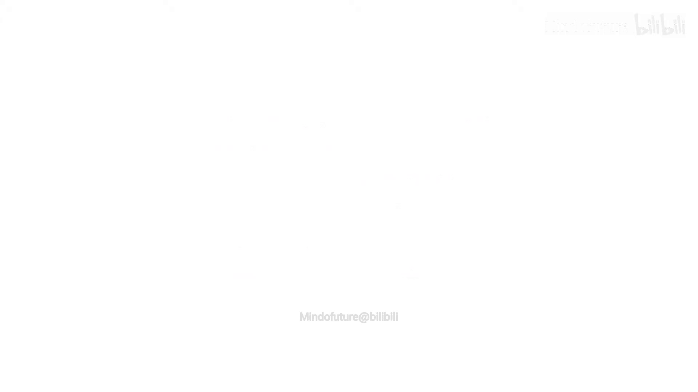
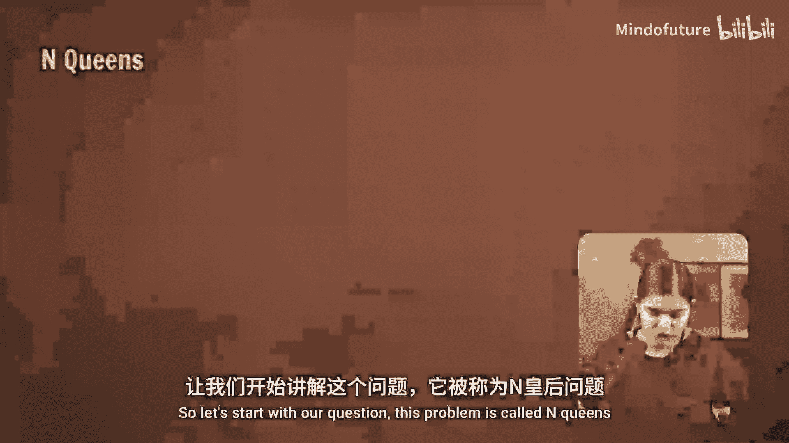
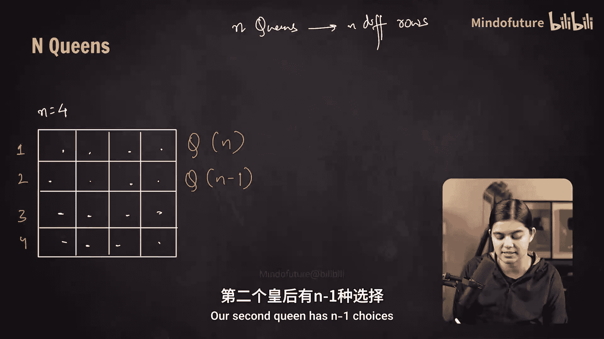

# C++-DSA课程-｜-数据结构-｜-leetcode-｜-Apna-College-｜--Complete-C++-Dsa-Course-p45-P46_N皇后问题-使用回溯-Leetcode困难题--BV18oUGBkEmV_p45-

Hi everyone， and welcome to the complete D series。karne have one more important recursion and backtracking problem called N queens Ben queens is a very classical problem。

 Jome dive deepname and recurion and backtracking could detail Mas conceptga Also there is a link for a company by sheet in the description box。

 question this problem is called N queens and this problem is based on a ches board rule basically N cross N board given him Just our example。

 if n is equal to4 N and N columns。😊。

A problem here is n cross queen place queen is basically a ches particular set of moves and such they do not attack others vertical direction horizontallyagon direction vertical horizontally rightagon。

😊，such that they do not attack one another problem logically what we are going to do is ornes and andagonne is an important point in basically。

problems。😊，and roseki eventually queen and basically we need to find the arrangement。

 queen n separate rose and Jese basically next sayne's This is my row number 0 row number one row number row number3 is queen2。

 is queen3。 This is queen next lets Q Jese。😊，Nextagon this is what we call a safe second position in the second row in the third row then we are going to try to place it in the second vertical And if we try to place it in the cellagon is an important moments is not a correct arrangement Why is it not a correct arrangement third third。

😊，ne and that is why back third and the third second and the second Let me just change the row numbers。

😊，This is myan。 This is mytu Ro row4。 second the second。 This is the wrong position。

 we are going to move the second queen to this is second position4 fourth first position second position third position fourth position basically4。

😊，positions back place Q is apparently also unsa next positionne and positionne position positionne will try to place in second columnne attacking position is attacking position。

😊，is is a unique position and attacking one another and second part of which。This recursive function。

 this recursive function callediclib hamic function monoosac called N queens N queens can a to Hamipas Hama Bo ajaga。

😊，Draaripasvo ro Ajagi Ro this particular rokona I hismeham to me n value copaname。

 And let's make this function ofvo type up n queenskonemetame is Ro and kic particular position Panicoplace tohamaing loop from J equals 0 to n。

And Yahamper， Hamcous Karinggiki Bke under。andne basically is character character particular position will create a separate function called and orgar or particular next next next next function。

 which iss will pass the。😊，R plus1 andcurse is equal to is equal to1 equal to2 is equal to and configuration depending upon the question to the answer and is configurations which is backt step。

s suppose we are trying to represent them using at first time configurations backs。

So this is what the if statement and the for loop is going to look like。

ari statement next or next So this is the first part of the problem basically of string of string and string。

😊，Abi Saal Kar， Hamriassek bohe， or amisari possible board configuration store Knehe Ane answer Kander Jaja make possible solution to I functional。

 Let's call it en queens and queens kander I tohamabna board pass kriongi。

 the vector of string board。😊，Let's pass it using reference a km knee row number pass Ka re U meham9 teacher N pass Karingnge。

 and we are going to pass this answer value justhamsari bold configurations go through sector。

A misfunction Gander。Amed Baai， Kihamme， Sarisari possible columns Meche Kai， J Zusi Leker J Antak。

 if we can place our queen。At the position board。R j queenko place k those case may K or place knegiga。

 which is called is y function queen co is position but place possible He is function pass k and row and J N en Agar will place the queen here and call queens by passing our is row plus1 pass N and answer andt v isko replace K with the dotbiki equal those case may answer pushne。

😊，UpNow， board configuration。Which is the answer。 and Yasseham Kajagiriton。

 So this is the logic to place the queens recursively in n different rows。

 Yassehamni N Queen's vt function co call Lagaak will pass the board。We will pass the row number。

 which is equal to 0 Hama n and Hama answer。And last may iss safety。😊。

Subseelhamari queen horizontally safe pho eachche。😊，Secondly，ari queen vertically say Honi and third。

juhe would diagonly say Ho I。 Let us take an example of an arbitrary queen。

 Lets suppose this queen is going to be horizontally safe basically queenme queen to is and given Ii or to horizontally from j is equal to0 to narii or Agar queen will get to know that this is an unsafe position and return false value horizontally ver。

😊，i same column canham K for all the different rows。

 Kiku or queen to existing to vertically checkniham loop Chiak from I is equal to 0 to n。

 Jahaa ch kgiki， Ui same board par for all the different rows and the same column。 Yaa row， same he。

 Yaa column， same。😊，Ki or queen exist curo or agar exist curea。

 whose case may we are going to return the false value。

to about easy step set to check horizontally and vertically up diagongi diagonne let's take an example of this cell queen queen agarne ormiagon dineagon lets suppose isju diagonalagon diagonal the special thing isgar this value。

😊，Is R comma C if this cell is Ra C to I kjaja diagonally up。

 this is equal to r1-1 I valueja is R2-2 diagon rh and column basically what it means isme diagonal k I value star R star I co jp I is greater than 0 and my j is also greater than0 or k Ia j position per co case return false valueagonal right diagonal k let's suppose right diagonal k If this is my cell Ra。

😊，To y Agerelge is made rh to -1 Uier per column plus 1 Matla y Ajo Cge。 This is R-1， C plus1。😊。

Similarly， diagonal candleander， this is R -2 C plus 2 to write diagonal Co。

 consider curtheue Herba row cota minus minus ktejare and column go hum plus plus kthejare。

 The Oscallejusro called haripahoga。 That will be equal to this is my case for。Right diagonal。

Jaha Iq value co k J value Cari valuem decrease kja top I is greater than equal to 0 and column value co increase kteja top J Y my column is less than n theptham I co to minus minus Kring and up j co plus plus kringgi。

😊，Or herbachch kringgiki Agarhamari board of I comma Japer already coy a queen place here。

Those case mayham a return， Kepne falses value。 He Yahaper I or queen musla R comma sper。

 E or queen coplace Kna possible Nea。 Otherwise the queens are going to attack each other。

 So these are the four configurations jmeche Kna， vertical， horizontal and diagonal left and right。

igbarkyne is safe function co them。Is say functioning Boolean function Hoga。

Joe Truya falses value return Karia I subhaminggi， we are going to pass the rh and column value。

 Joha， R and Jm。Andnne certainly me， will pass the value of。And。Subsealham horizontally chkane。

 horizontally chka， same rouleate different columns skill luanga J is equal to 0 J less than n J plus this Agahamme Pata Hama board of。

Re commma Japer。There is a queen Jew already exists。 Cartha。 Those case Maham a return， Guheny。

放s value。Similarly， hum a loop Chilani vertically checkka， similar Sahia loop， let's paste it。

 I scanander hum up。Ro Yani 아이ve。Thehammara row variable Hoga， but Hammaa column fixed Hoga。

Am loop Cheanggi up knee left diagonal k。Left diagonal key case me up the iq value co start carrying a row casar j co start carrying a column casat Jept I is greater than equal to0 and j is greater than equal to 0。

😊，Tpttaham I co minus minus and J co minus minus kjagi Agahammi Pajai Kihamara board of I comm Japer Al Gui queen placed him。

Those case me， we are going to return false value。Same cheese sum knival have for our right diagonal。

Let's。😔，Paste it right diagonal k case me column go Hammin k kingit tojapt J is less than n。

 J Co Kingi plus plus and herb same cheesesam J knevalem Agar is function Ne Charro condition。

 say B false return nikea。 Those case may queen go place Kna possible here Sa here to Yasm return King yni。

😊，True value is function function basically of string。😊，더 말이뭘겠들？

Starting me dot character single s to indicate Is initial second dot string initial and basically startingize character I dot pass n and are going toize this with n dot initial will pass the and initial So this is the entire logic。

 Let us run it。😊，And let's submit the code。s problem problem calculate in different Similarlyly choices problem。

😊。

If it is safe to place a queen in that position。 if we have successfully completed the chapter。

 we can mark our attendance down in the comments。 I case me， there is a related problem to N queens。

 which is called N nights。 N queens to Ise related Nns keep problemhamja andbi E yoga I hope that we have learned something new from today's lecture。

 You can also share your progress with me on Twitter justuniche description boxja。

 Ask late Mil lecture that them keep learning and keep exploring。😊。

