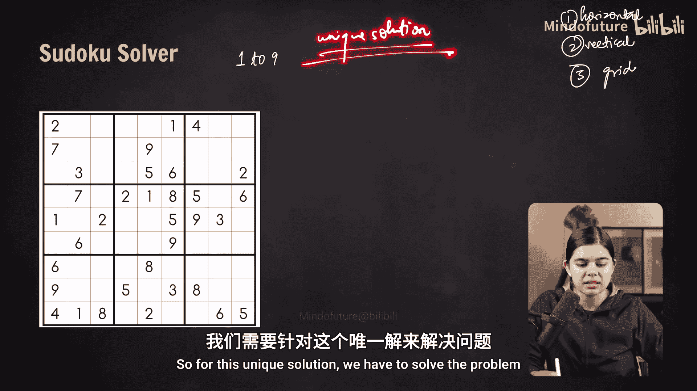
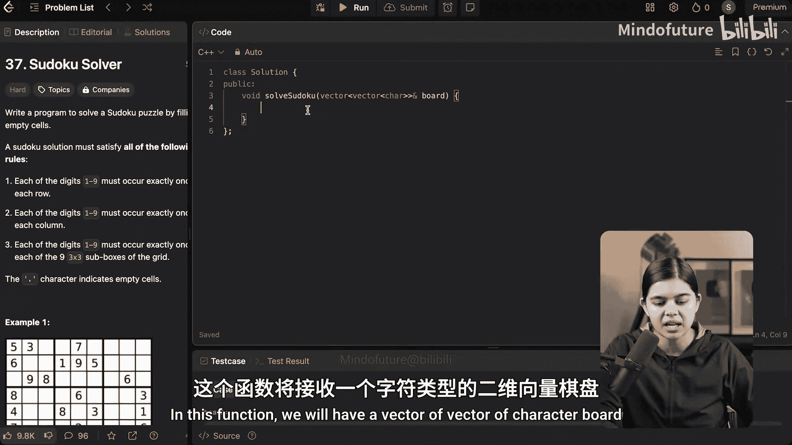
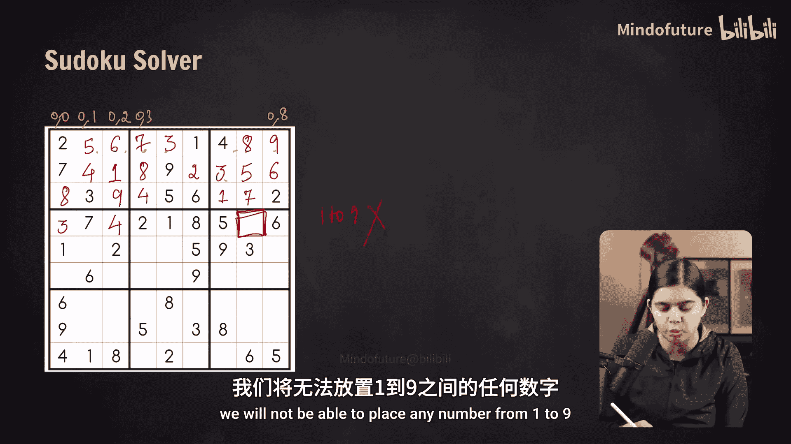
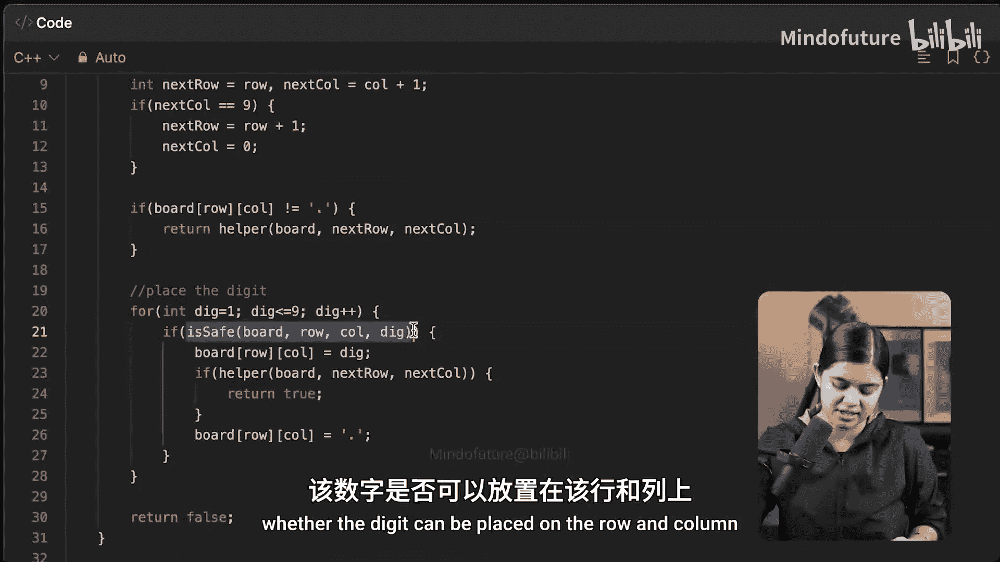
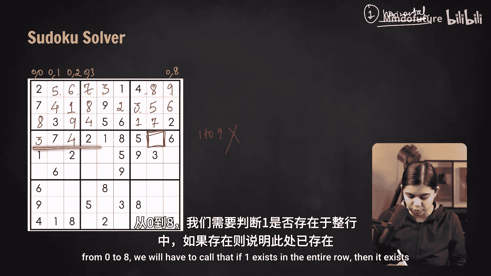
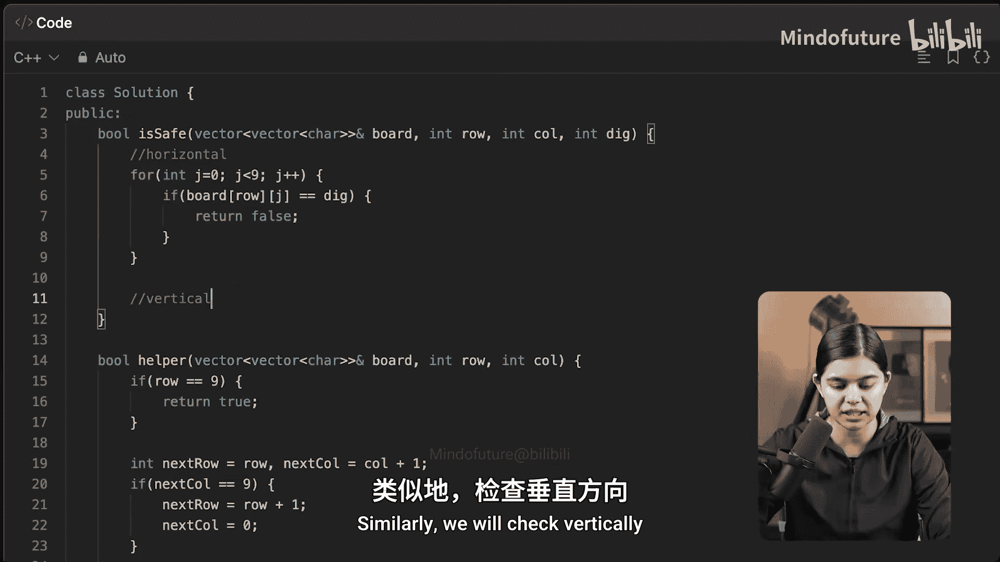
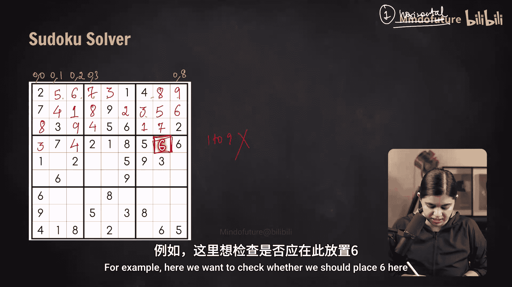
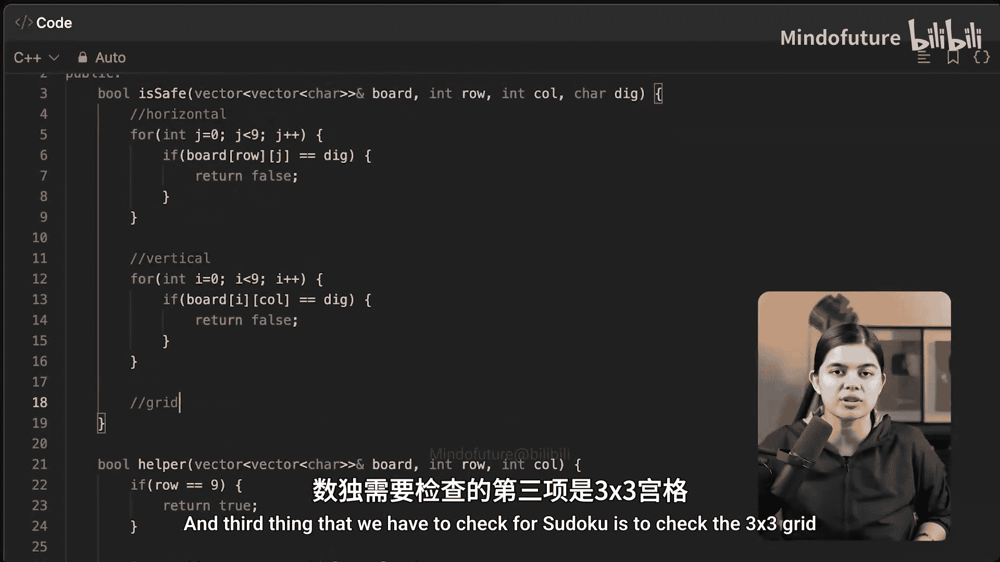
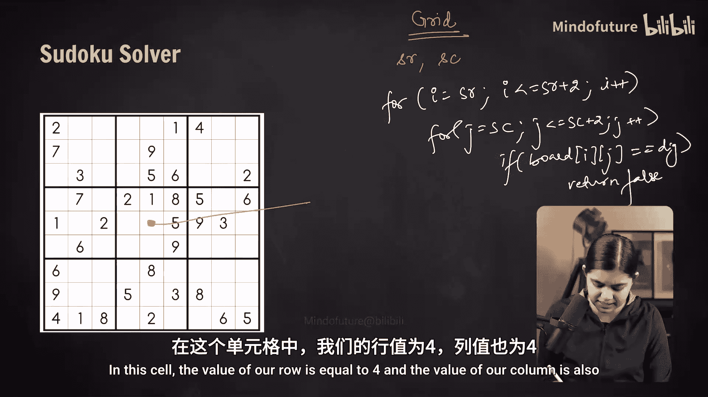
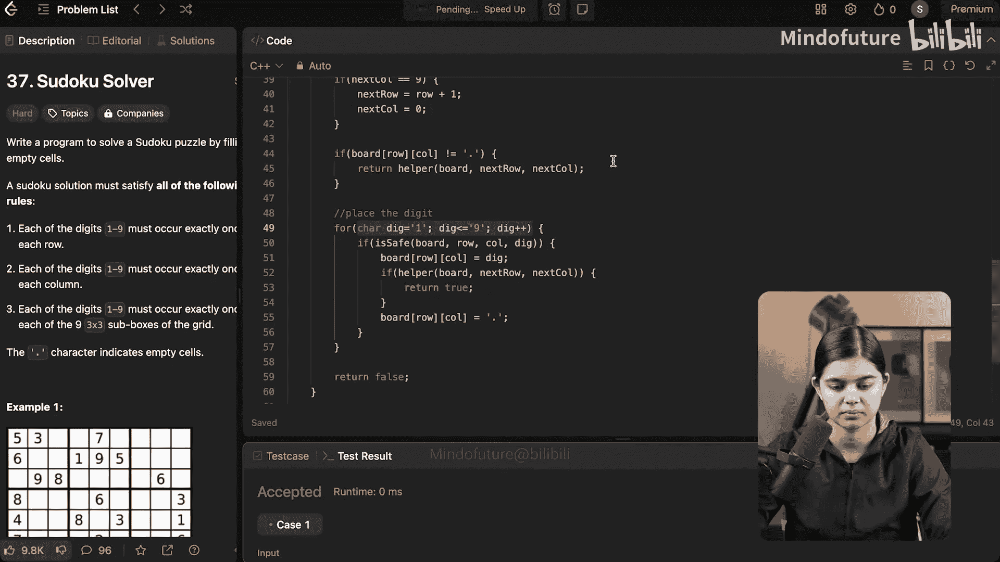

# C++-DSA课程-｜-数据结构-｜-leetcode-｜-Apna-College-｜--Complete-C++-Dsa-Course-p46-P47_数独求解器问题-使用回溯-Leetcode困难题--BV18oUGBkEmV_p46-

H everyone。 and welcome to the complete DSA series。

 and today we' are going to solve my favorite DSA question， which is called Sudoku solvever。 Now。

 this problem is based on recurin and backtracking j in depth study I availableja Also there is for a company DS in the description box。

😊，To given 3 cross39 grids available Su What are the rules basicallys horizontal and condition Secondly。

 vertical condition and thirdly。basically which is incomplete unique solution to solve problem This is also problem number37 on function of basically are in the form of logical basically horizontally。

will try to solve and this problem is very similar to the problem So if you have already done usingcurt advise you to pause and to solve1 and。

Given he just inyaard0a1 he vhaer ham upne kissi a character quo B par Ane row and columnumer kissi a number co Jobihama number he。

 Let's call it。 I y， in fact， I say hamapna digit k。😊。

Jo is position per placenesenene 8 or isri secondne2 isne3 vertical to3ne horizontalne5 is something horizontally vertical5 one of the possible solution。

😊，Next which is basicallyham in same process repeat grid6 is value horizontal this is something that we can place in and basically or digitsit as long as it is safe to place。

😊，check for a condition。 Key Agarhamra， If is it safe to place that digit。

ari U Agarhamne and column k to ki Part digitkona is if condition k throughs or agarbius deitko place dekoa tomehamme next row next column to basically what we can do function ks。

 let's call it Sukuara。😊，Which is a vector of vector of character。

 I says Amiaripa vru and columna Jane numbers K start carrying it Defite Sudoku 0 0。

 say start curme R and column G value 0 k yehama function Ho v。😊。

Ais function Ger subsearam already isku digit exist k Agar digit exists kisruhi whose caseham Cho Picking from1 to 9 to subse step in this entire function will be to check digit already exist k to let us copy this pseudocode once and say paste to basically functionjuse ye bowl off row column。

😊，Agar digit existit exist non digit already dot if this is not equal to dot next for the next row and column if my board of column is not equal to a dot for our and for the next row and next column next row and next column basically generally and by basically next that will be equal toju column that will be equal to exception and that。

😊，Aerham already0 comma 8 per gra those case may Hamari to next row He rh plus1ojagi and Hama column Hamya hass start carrying。

 which will be equal to 0。😊，Mam Ike calculation Gelehamami Chekana Pegaki Kabibi， Agarhamari。

 next column K value 9 nielgaarria Jo columnum exist in Igarta。

 Those case may hum up next Roco Up Kheni to row plus1。😊。

And next column co reset Kingi to0 value to yehama process yogaga for calculating the next row and next column for the next recursive call to agar already equal value exists Knina next Lein value exists inhi those case may have loopri。

 is it safe to place that number in the board U was deitko place King andkeba up next column and next Ro to basically Sudoku solveko board。

😊，Next to do。And next column decision 5 or 6 is it the right decision A right decisionaririari values unique solutionja or at the end last row and last column per po true value return k to show。

😊，To basically function or When are we going to hit base case。

5 co plays cardia yani 6 co plays cardia。Is position to7 is the first safest number。 Next is。

 Similarlyly is and same format finally1，2，3，4，5，6，7，8 and 9。😊。

Backt kjavapagi So just number khamme plays kathi number k Ab position Haanaega because we want to place another number in that position。

😊，To Jebam backt Curquevapasanggi， Mahamjo function call Wihi function call kba Jobum Liium Mohammaa backting steppotan to function call kbad jaam backt Curquevapaanggi to Yahaper j number Ko Ham placeha Yahaur Ui number co。

😊，do So this is the logic for is logic is it safe to placeit in。

and last false value not able to answer with theit is。

To this is the function that we have to complete。 Su function givenhamna function we had three parameters。

 I helper version Boian let's call it helper or helper passringgime we are going to pass the row and column Sudo say helper function call kring with the board and row0 column0 and As helper functionrit the helper functionander subringgi board of row column agar digit exist ktab this is not equal to a dot。

😊，Those case mayam helper coi call Kdige for the next row and the next column a next row and next column could calculate clinicalical logic I already discussedtuque Her barju next row Hogi。

 that will be the same row。😊，To inteia next row and Jo Hamara next column Hogan。

 that will be column plus 1， per kbibiham path Alki column key value。

Your next column key value again 9 k equals R。 Those case may next row is going to be rh plus 1。

And next column is going to be equal to 0。 The Yabraham board Kopakaheni。

With next row and next column。 and Jobi answered Agas a return。 Hokuraga。

 we are going to revert back the same thing。Agar we try to place the correct digit in that particular cell。

 correct digitco plays K loop from digit equals once digit Jeptaine equal to9 head digit K plus hava King is it safe to place the digit on the board。

 The board may row pass Ki column pass Ki digit pass Ki to z Ki function already exist Kthjuruya false return Agarsneru return here those board per and row comma column upne digit co plays K to digitga and fill Heperki he callinge for R board。

😊，로。Roki Jhamme passnani next Roco， next columnco。And a is function true return those case we are also going to return true value with and false。

 So this is thecur logic9 return So base case is the only case is the only true next important part of the probleme and conditionslyit horizontally lets suppose。

is equal to 08 Lets create a function。😊。

Called Boolean is safe jca under Hamakna board row column and digitcopakeringgi。In tea， didit。Subip。

Horizontal checking it。Agggar i equals ya J equals0 silire j less than 9。J plus plus。

Agad Kahibi Hamri bowl off。Ra Japer， Hammehamara digit Miljate， those whose case me。

 we are going to return。False value。Similar cheese vertli， for example。

 ya  k up 6 6 vertli already exists to 6 k to column loop from row I equals 0 I less than 9 I plus less。

😊。

Agahamari bowl off eyea Colur。Haara digit already exists curai。

 Those case mayham return Geringge false value。 a callja change curect thing a digit actually a character。

 He Hamari question K according the Yaber Jm digits create K。 we can create it of type character。

 And third cheese justcommi chkana Suu whoulele。 That is to check the three cross3 grid。😊。

Just say for example， agamea 9 K to 9 horizontally we exist Ne Karta vertically we exist Ni Karta Lein 9 Hamari is 3 cross 3 grid Kandander exist Kta。

 Just come at them here 9happer place a grid Koga， because this is going to be a very interesting logic。

😊，A gridko C Kneke logic， basically， Hamme Patki hapa 9 grid Jo exist Cartheian。

 her gridka Ana exstar Rohogi and exstar columnhoga。😊，Is Gki Bari。

ki y starting Rohe and y starting columnhe。😊，Is starting grid columnari gridari less than equal to row plus for example it starts from1 and1 and。

😊，But similarly。Yeah， but evening， this will be4。And for J equal starting column J less than equal to starting column plus2 J plus plushamari grid k from traverse or herbal per I Jit exist exist k to his case may return King a false value This poor logic can the sub important starting row and starting column value calculate。

😊，Tscallet， let's take an example of an arbitrary cell。

 Let's suppose Hamripa El had just come an example here。

I silkander Hamari row key value H 4 k equal and Hamari column key we value have 4 k equal。😊。

U k yari ye grid0 comm 0， says ye grid 0 comma 3 says。

 ye grid0 comma 6 isy ye grid 3 comm 0ye6 comma 0e， Similarlyly yejo gridari 3a 3 cie，3 6 stare。😊。

Ye gridd6a 3e and y grid6 6 to a common pattern hem observed Hamari grid Jobi starting starting3 k multi Z3 k multiple Z can we say agarari row k value 0 say2 k range me grid k starting row Hamme ho avo value 3 say 5 k range to starting row of the grid Hamme 3 k equal avo value 68 range me starting row of the grid Hammea6 k equalgi to Jobiari value starting row of the grid basically a first set of starting ro is second set of starting ro y third set of starting ro。

😊，Agarham rh co divide K3 k toari particular valuejagi0 say2 k range 3 say 5 k range1 aa and 68 k mega or and for in values multiply Ki k to get the correct starting row of the gridari starting rh grid that will be equal to rh divided by3 multiplied by3 example Kari row 4la is cell kham starting rhia starting column calculate to vja4 divided by3 multiplied by3 k equal4 co3 say divided value1 k equal1 n3ja3 value rowari starting rowgi and similar manner starting column co calculate starting columnja column divided by3 multiplied by3 k equalla c value4。

😊，ra starting columnas 3 k equal is particular cell kari grid Hogi Japer starting row and starting column 3 comma3 is the calculate k is starting row starting column using this formula a core example。

 isum for example， Ham y particular cell h is a p Japer roki value and column key values M column 8 k equal and rowri5 k equal ajo starting roki valuegi that will be equal to this formula。

 which is equal to5 divided by3 multiplied by 3 to y valuejagipa1 into3 k equal。

 which is equal to 3 starting column key， So this is equal to8 divided by3 multiplied by3 y valueja 2 into3 6 k equal to3 comm 6ari gridrika starting pointga3 comm 6 is this particular cell Jahai。

hamme E L conci gridme E L is particular grid kander exist k toham grid value k starting rule and starting column niing and foring using these loopski whose gridandra digit exist k and to E bar grid ni subip to starting rule them。

😊，That will be equal to row divided by3。And multiplied by three。Similarly。

 starting column Hamli Hujaga column divided by3。And multiplied by3 the grid candleanderche canle4 integer I equals starting row I less than equal to starting row plus2 i coardingi herber plus plus similarly J equals starting column J less than equal to starting column plus2 and Herber j cocardgi plus plus Agar kbibi marri B candleander I comma j per。

We find the digit。Those case may we are going to return a false value。 Iveitto Balu lagraganest loop。

 per kki ye Hammea gridd perchoti 3 cross 3 k grid per travel carte。

 to ye bigov 9 tank complexity car lupe， which is constant tank complexityity。

Ugarhamari is a function make ahiap B false return Nwa to last May we are going to return a true value。

😊，So this is the entire function to check if it's safe to place a particular digit in a particular cell and recursive function main function say recursive helper function go call hopefully going to make one more change character digit define character ksat and character9 Sa initialization let us try to run the。

😊，And submit it。

we solve the solve problem complexity though it is really complex to calculate the time complexity of this particular question because logical9 choices9 basically the time complexity is going to be of9 to power choices into choices9 choices empty to and this is the that is going to take to try out all the combinations I hope that we have successfully completed's lecture the last question that we did which wass。

😊，Similar questions important here recurs point of view say if you successfully completed the lecture you can mark your attendance down in the comments Smi you can also let me know your favorite part of today's lecture。

 something new that you got to learn from today Sami can also share your progress with me on Twitter just Ka description box canja ask late next lecture can that then keep learning and keep exploring。

😊。