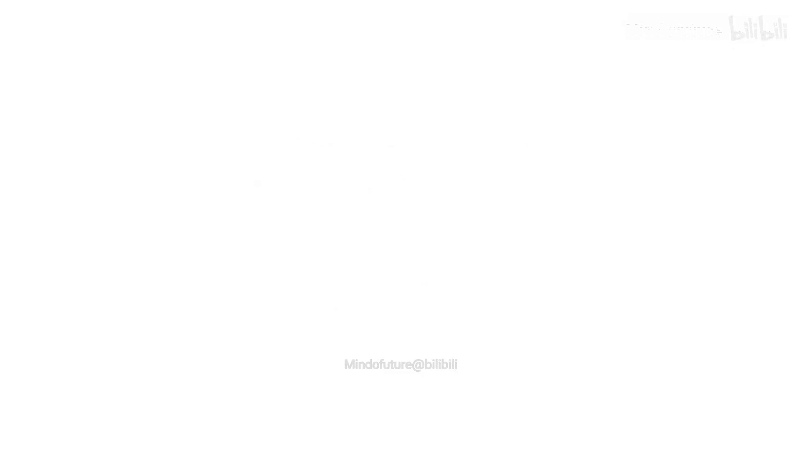
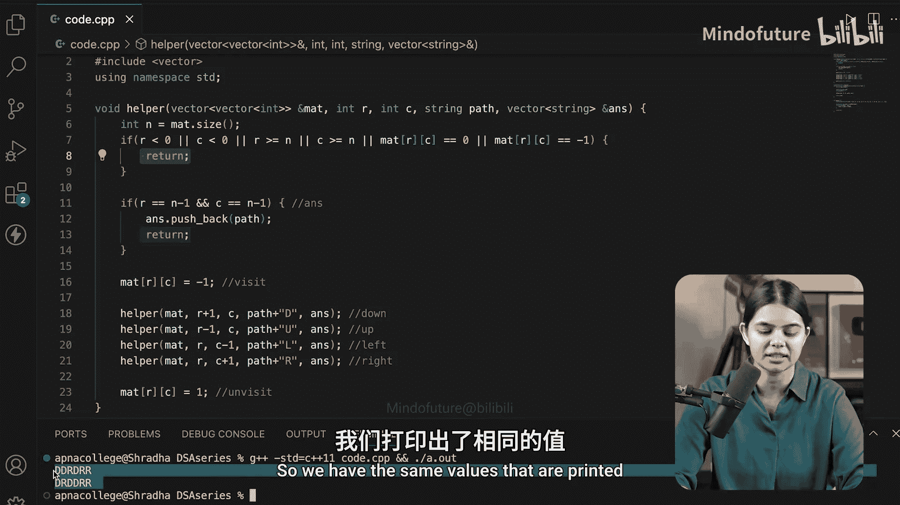

# C++-DSA课程-｜-数据结构-｜-leetcode-｜-Apna-College-｜--Complete-C++-Dsa-Course-p47-P48_迷宫中的老鼠问题-回溯--BV18oUGBkEmV_p47-

Hi everyone welcome to the complete series。 and today we' are going to solve one more important recursion and backtracking problem called rat in Also there is a link for company sheet in the description box problem is called and classical purelycur is basically vector of vector or and equal number of rows and equal number of columns starting cell。

😊。

Yni top left v Sels Agaraham Shiva Km， or Ani Jo Co Jo Kaam Wham bottomom right v Selper Kamm to is starting Selsi is ending Seltajaki Kihene possible path and exist Ktheem Orham moves Kconil I Agaham Kissbi Sper Kdim。

😊，To her cell cha directions， let's suppose this is my cell to a diagonal movements allowed inro directionsari starting say ending in the question there are two additional conditions。

s suppose right movement or in fact， is movement allowed second allowed particular path travel to find the exact path to move from to this ending。

😊，is startinggi down direction， let us keep writing our right hit right hit and one more right second I right Then again one more right and the last right。

 This is the second parts that exists basically I he answers answers or functions return to basicallyejo down right up and leftri answerne approachgi。

😊，Basically approach because we want to explore all the path。

 starting endingel combination possible answer lecture basically when we want to explore all the possible answers to is a very popular solution。

😊，Basically， is thepa matrix given here， we have the starting cell and the ending cell exactly possible possible direction right up and down inro directions travelgiham arbitrary position per。

's suppose is and and C columnjaja rope basically Als column we are trying to move to number R downward down direction plus。

😊，we are trying to move to r plus1 right basically next column what we are trying to we are trying to increase the column number within the same right and similarly direction move out of boundary to reach second rules basically directions。

in charge different directions can move k。 if we imagine a recursive function。

 jaari possibleju isi lir isel boundaryri key conditioningippau is 01 conditioning those case may use recur function basically Ra recur function subse Cameelru and column to the recursive function that will write Let's call it get answer。

😊，Is get answer function， which is a2 and choices Similarlyly are going to have four different for four different choices are going to。

😊，choice me rightjare we are trying to go to R comma C plus1 third choice just me left J R comma c14 choiceham up J that is equal to R1 comma to cha different call from our recursive function Joeari recur can branches coing This is basically a representation of two levels of the recurs to Ya char choice Le up get answer function chai subari down key call value This is my down call This is my up call。

 This is my left call and this is my right call to get answer matrix passgi down k row plus1 and column Similarlyly。

 get answer k passringgi up k R1 and call k get answer co call kgi with R matrix left K same R but C1 and right ja k matrix key callgi right me same row but column plus1 to a cha。

😊，recurs different choices define exactlyp knee conditions focus in recurs calls K according tooga in recurs calls K according。

 we are going to start with row 0 and column 0ra recursion 3 formnaga。😊。

definitelyariis direction direction right and second right direction if we go the right direction。

 then what we are trying to do to question right direction interestingly，😊，basicallys。

S left direction left direction may0m basically we are trying to go to 01 to column value less than0 or similarlyms direction may be value which is less than0b second case base value less than value less than0 whose caseja In fact。

 there is a similar case that exists。 Aham is or caseham is bottom key boundary key condition a core condition row less than0 less than value greater than equal to n。

😊，column greater than equal valid。Fander， Let us bring this here function kham as andham answerriko and。

 we are going to pass a string path string path k stringgiko to basicallybham down direction may move kham k downgi to calls answer2hi function calls k。

😊，Plus Smi Yaha Joho Apahoga。down Similarlyly， are to add and if is equal to n and my is equal to n and we are to return basically this is the majority。

se convert。 And then we are going to talk about an important base case。

 So in our code in the main function we've already created the matrix weve already written the logic to print all of the answers that we are going to function given which is called of string or is function。

 but we need to write a recur function which has a lot of different parameters case function functioner function or functionse let us create answer。

😊，Maippai answer Raa helper candle。 we are going to pass our matrix row and column 0。

0 says start kringgi。 Let's create a string called path and initialize it as an empty string。

na path pass kinggi and up now answer pass kinggi Yaari parameters and gcom pseudo called mechi。

 Let's write the same parameters in our helper function。

 Mariippa matrix Sajagi will get row column Umi will get a string called path and our vector。😊。

Of string called answer because the strings that we are going to store here。

 we need them in the calling function is function coja call right direction and downwards direction and we are going to directions1 and which will be right plus。

And this will be different directions base case case simply return and column valid row and column column valid matrix value valid base are going to define our condition R is less than0 column is less0。

😊，Y let us take n n is basicallyari matrix class matrix that is equal to nari value is greater than equal to n or if c is greater than equal to n in cases and then comes n1 equal and column is equal to n case push and we are going to return。

the upper8 condition missing here and that condition is let's supposem Yahashi start。

 we start from here。😊，ham is direction direction rightward if from this cell we make to upward which will basicallying opposite。

😊，case are not to get any answer which is basically。😊，visited simplicity the entire with false。😊。

He visited Selper Ponja Yaam Cha to Vaapas return Ba Kiwi do not need to make any further calls from here。

 and Yaha At Hamra， important base case， important base case Cassagga taught me fine path function kandri。

 we can create a vector of vector of Booleion， which we call visit。😊，A visited k Yahabi Ana n leleta。

 which is equal to my matrix dot size。 a visited co initialize Knega basically visited Karme N cross Nska2 Boolean type2 to n comma vector of Boolean I B initialize K with n and false values visitor co create Kier I he visited co we are going to pass to this helper function。

 Let us add one more angular bracket to Yamaa visited Aga and I he same visited co。😊。

An by reference visited visited those return in all step which is back step in the same visited or suppose。

😊，Original matrix。 and this is my visited matrix。 is that we are going to start with isel true directions let's suppose downwards directionwardswards's supposewardwardward is which is is true。

😊，right right。Visited already visited or basically answer or answerki visited situation next that we can find out alternate solution I visited after making allki。

😊，So this is is and this is function and in fact match。us remove this original and。

And Kobi Agar free Matlabu unvisited U visit Kiiajaak tovoto already Sarikiri Voel Zage in per already value1 to cam case extent that the cell being equal to one kibi matrix cananderaggar Ra Siki value 1 Hotier。

 it is equivalent2 visited of R comma C being false。😊，visited sake simplicity and and。😊。

or vas unvisitki separate to we are going to use the same matrix to mark our unvisit cellsja is visited completely y opt terms of space complexity visited。

😊，And visited Ko Hamsari callai。Is the kiss remove Caring。And。Even from the parameters。

 Aringi is visited Kija Ham matrix of Rko mark Kinggi as-1 Ielko visit Kthiabar matrix of Rco kringgi with one I unvisit Kthea1 here easily initialize Kki operation some be performed Ki and Yaju visited K is a of R Kiki value1 equalme we are to return let us save the code and run it once again。

 topa same valuesto iski time complexity analysis isri The time complexity。😊。

Haamipatihymaipas total kidney cells， Hamipas total n square cells， Uhamipas N cross Ns s matrix A。😊。

calls choices to power n total choices and that is the of solution。

 So this is in as compared to memorizingnship not necessary question。😊。

Or question change that to logic both important solution question K according change Kap I hope that we have understood the entire logic。

 the entire recursion backtracking approach behind solving this problem。

 If you have successfully completed lecture， you can mark your attendance now in the comments I Scalava you can also share your progress with me on Twitter just Kakuche description box scan Ja Askate 9 multi next video material and Keep learning and keep exploring。

😊。