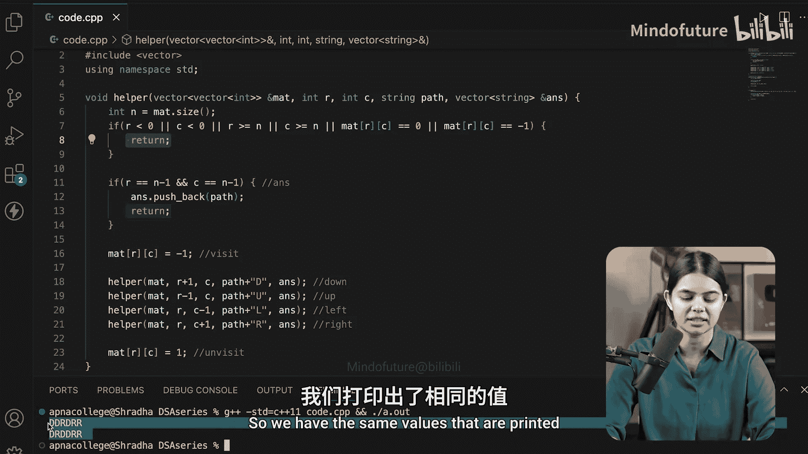

# C++ 数据结构与算法课程：P47-P48：迷宫中的老鼠问题 - 回溯法 🐀


在本节课中，我们将学习一个重要的递归与回溯问题——“迷宫中的老鼠”问题。我们将理解问题定义，学习回溯法的核心思想，并一步步编写代码来找出老鼠从迷宫左上角到右下角的所有可能路径。

---

## 问题概述 🧩

问题“迷宫中的老鼠”描述如下：
*   给定一个 `N x N` 的迷宫（矩阵）。
*   老鼠起始于左上角单元格 `(0, 0)`。
*   目标点是右下角单元格 `(N-1, N-1)`。
*   矩阵中的值 `1` 表示可通行的单元格，`0` 表示障碍物（墙）。
*   老鼠每次只能向**四个方向**移动：**下 (D)**、**右 (R)**、**上 (U)**、**左 (L)**。
*   任务是找出所有从起点到终点的可能路径。


## 核心思路：回溯法 🔄

上一节我们明确了问题，本节中我们来看看解决方案的核心思路——回溯法。

回溯法是一种通过探索所有可能的候选解来找出所有解的算法。如果候选解被确认不是解（或者至少不是最后一个解），回溯算法会丢弃该解，并在上一步进行回退，尝试其他的可能性。

对于迷宫问题，我们的思路是：
1.  从起点 `(0, 0)` 开始。
2.  尝试向所有允许的方向（下、右、上、左）移动。
3.  每移动到一个新单元格，就将其标记为“已访问”。
4.  递归地从新单元格继续探索。
5.  如果到达终点 `(N-1, N-1)`，则记录当前路径。
6.  如果从某个单元格出发的所有方向都探索完毕（或不可行），则**回溯**：取消标记该单元格为“未访问”，并返回到上一个单元格尝试其他方向。

## 算法设计与实现 ⚙️

理解了回溯思想后，我们来设计具体的递归函数。

### 递归函数设计

我们将创建一个递归辅助函数，它需要以下参数：
*   `maze`：原始的迷宫矩阵。
*   `row`, `col`：老鼠当前所在的单元格坐标。
*   `path`：一个字符串，记录从起点到当前单元格的移动序列（由 ‘D‘, ‘R‘, ‘U‘, ‘L‘ 组成）。
*   `answer`：一个字符串向量，用于存储所有找到的完整路径。

此外，为了避免老鼠在路径中绕圈子（重复访问单元格），我们需要一个机制来标记已访问的单元格。有两种常见方法：
1.  创建一个独立的 `N x N` 布尔矩阵 `visited`。
2.  直接修改原始迷宫矩阵，将访问过的单元格值从 `1` 改为另一个值（例如 `0` 或 `-1`），回溯时再改回来。

为了节省空间，我们采用第二种方法。

### 递归的步骤（伪代码）

以下是递归函数 `findPath` 的逻辑步骤：

```
function findPath(maze, row, col, path, answer):
    // 1. 基础情况：检查是否越界或遇到障碍/已访问单元格
    if (row < 0 || col < 0 || row >= N || col >= N || maze[row][col] != 1):
        return

    // 2. 基础情况：检查是否到达终点
    if (row == N-1 && col == N-1):
        answer.push_back(path) // 找到一条路径，存入结果
        return

    // 3. 标记当前单元格为已访问
    maze[row][col] = -1

    // 4. 尝试所有四个可能的移动方向
    // 向下移动
    findPath(maze, row+1, col, path + ‘D‘, answer)
    // 向右移动
    findPath(maze, row, col+1, path + ‘R‘, answer)
    // 向上移动
    findPath(maze, row-1, col, path + ‘U‘, answer)
    // 向左移动
    findPath(maze, row, col-1, path + ‘L‘, answer)

    // 5. 回溯：取消标记当前单元格，以便其他路径可以访问
    maze[row][col] = 1
```

### 代码实现

根据以上设计，以下是完整的C++实现代码：

```cpp
#include <iostream>
#include <vector>
#include <string>
using namespace std;

class Solution {
public:
    vector<string> findPath(vector<vector<int>>& maze) {
        vector<string> answer;
        string path = "";
        // 从起点(0, 0)开始递归搜索
        search(maze, 0, 0, path, answer);
        return answer;
    }

private:
    void search(vector<vector<int>>& grid, int row, int col, string path, vector<string>& ans) {
        int n = grid.size();

        // 1. 边界条件与有效性检查
        if (row < 0 || col < 0 || row >= n || col >= n || grid[row][col] != 1) {
            return;
        }

        // 2. 到达终点，记录路径
        if (row == n - 1 && col == n - 1) {
            ans.push_back(path);
            return;
        }

        // 3. 标记当前单元格为已访问
        grid[row][col] = -1;

        // 4. 探索四个方向
        // 向下
        search(grid, row + 1, col, path + ‘D‘, ans);
        // 向右
        search(grid, row, col + 1, path + ‘R‘, ans);
        // 向上
        search(grid, row - 1, col, path + ‘U‘, ans);
        // 向左
        search(grid, row, col - 1, path + ‘L‘, ans);

        // 5. 回溯：恢复单元格状态
        grid[row][col] = 1;
    }
};

// 主函数用于测试
int main() {
    Solution sol;
    vector<vector<int>> maze = {
        {1, 0, 0, 0},
        {1, 1, 0, 1},
        {1, 1, 0, 0},
        {0, 1, 1, 1}
    };

    vector<string> paths = sol.findPath(maze);
    cout << "所有可能的路径：" << endl;
    for (const string& p : paths) {
        cout << p << endl;
    }
    return 0;
}
```

## 复杂度分析 📊

*   **时间复杂度**：在最坏情况下，每个单元格都有4个方向可以选择。因此，时间复杂度可以近似为 **O(4^(N²))**。这是一个指数级复杂度，但对于N不大的迷宫是可行的。实际由于障碍物和边界限制，复杂度会低很多。
*   **空间复杂度**：主要是递归调用栈的深度。在最坏情况下，路径可能遍历几乎所有单元格，因此递归深度为 O(N²)。我们修改了原矩阵，没有使用额外的 `visited` 矩阵，所以额外空间复杂度为 **O(N²)**（递归栈空间）。



## 总结与要点 🎯


本节课中我们一起学习了“迷宫中的老鼠”问题及其回溯解法。

以下是关键要点回顾：
*   **回溯法**是解决此类需要找出**所有可能解**问题的强大工具。
*   算法的核心是：**尝试 -> 递归 -> 回溯**。
*   使用**修改原矩阵值**的方法来标记访问状态，可以节省一个 `visited` 数组的空间。
*   递归函数必须妥善处理**边界条件**、**终止条件**和**状态恢复（回溯）**。
*   该问题的时间复杂度较高，但对于规模有限的网格是有效的解决方案。

理解这个问题的解法，对于掌握回溯算法模板至关重要。你可以尝试修改问题条件（例如，允许对角线移动，或者要求找出最短路径），来进一步巩固所学知识。