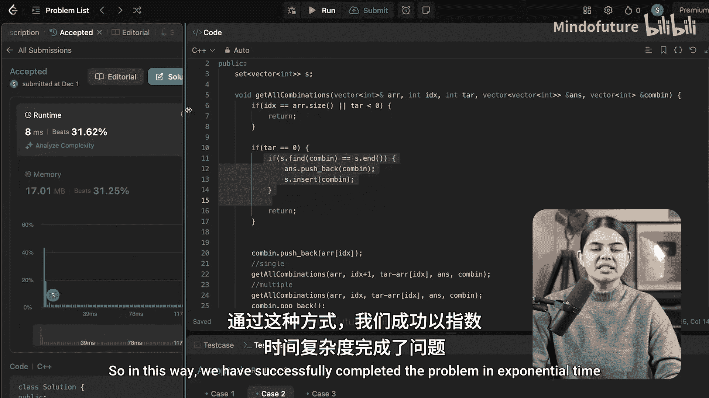

# C++-DSA课程-｜-数据结构-｜-leetcode-｜-Apna-College-｜--Complete-C++-Dsa-Course-p48-P49_组合总和问题-递归回溯--BV18oUGBkEmV_p48-

Id one and welcome to the complete series。 And today we' are going to solve one more important recur and backtracking problem called combination sum result for in the description box Today are going to solve an important problem which is called combination sum important in terms of teaching concepts ofcur backtracking I I multiple combination is also problem 39 function sum I but we can also rename I combinations。

😊。

example， k， let's supposeipasander we have three elements 2，3 and 5 in elements go useque。

 the first combination is of numbers 3 and 5 equal interestingly questionas allowed number multiple timesas combination four times sum of and we have one more combination2 and three two times include to target to possible combinationsipino cases numbers equal vector vector of injaino as our final problemfi brute force approach direction basicallyas multiple numbers。

😊，special combinations Nik say on combinations equalne lets think about the simplest problem。

 which is to create all possible combinations using this I multiple possible combinations only definitely for isriri possible combinations calculate elements say basically a combination elements。

😊，A job hum in elements score is combination canander a Garnaza to we can say her element cappauche Choi said。

😊，Just a for example， agramstuka example， twisttuki pass Cho hekiari combination kar Anajata。

 a combination kar Nejata。😊，Yanni Ari combination karai。

 we can get answers like this or ari combination kjata， we can get an answer like this。

ander2 as an element。 they include to co Agarhamaripa number a， let's call it area of I。

 to Ukypak Choseki Yatovohamari combination kander include Hojata Yairvo exclude Hoja Mala binowus number co combination Gander add Q A Bhammni possible combinations the Kkne and inclusion K under B。

 There are two different types of choices。😊，e2ari combination k aari combination k multiple times in combination multiple times include combination made we get something like this。

 So choiceki termss me， there is one more choice。 a inclusion。

 single time and aki inclusionara multiple time her elementpa every single element of the E has three different choices combination a multiple times completely excludehi the impossible cases exist combinations to let us start making the choices for each E element Let's supposeara 2。

3 and 5。😊，This the Ericrico visualize kname of Ericriki Ek element K。 Let us start making a choice。

 Let's suppose only sub I is equal to 0 element K Joly to Yahaa2 k choice M first choice Hogesque underham Tuo Ebar include Ka Ebar include Kneka Malabeki combination sum k and to include Oga。

😊，multiple times include multiple times include combination and third basically numbers with is equal equals talk the first single。

same index element are not going to include it again is equal i is equal to single choice equal second times times equal times multiple times equal multiple times。

Same I passki next time is branch kki Ibar or Ki2 or two I multiple times include K just maybe to toja Ibar or the of multiple valley branches I index。

 because we are going to take the same choices for the same element again and again。😊。

Third case element exclude exclude。 we are going to exclude this element and increment our index to equal level Let's suppose we reach here single include single is equal to1 is same choice3 k first choicejaander single include combination and second choicejaander multiple times include combination2 and3 third choice exclude combinationander include index single include the next time index to index will be i equal to2 multiple times index same element same k。

😊，i is equal to1 key choicegi exclusion key to scan we are going to increase the index level per3 different choices depending upon the combination that we want to make re logic is in recur logic logicham branch for example I is equal to0 multiple multiple then again we'll get a multiple choices multiple So this is in recur and recur are going to include this target condition。

😊，Target condition Kenhamlabe Shiume Hammipatham first element kilo choice laray I equal to 0 kilocho lare。

 the bamipathgira target konji， Hamra target 8 k equalji。 the Shirume， we already are aware key。

 Hampa K given target value。😊，combinationham2 include element include next time target value we basically decreasejaki elements inclusion multiple inclusion value and value equal element with the help of these elements combinationsham equal equal which is equal toki。

😊，6 values called name A is branch example them A B is branchni I2 co equal include Carnegi Cho or three co multiple times include Carnegi Cho Next timearinggi。

 Next time， a I is equal to1 per。 We are talking about this level。

 Abbi Hamni to n3 co include Kir target Jome or3 K equal Ham is3 K choices la。😊。

Y multiple times include I single time includene 23 and3 k equal next time single index update value i equal to index0 equal combination numbers exist original target basically is a condition of the base case。

 What is the condition of hitting the base case base case basically。😊。

Y numbers condition reach possible answer， which is 2。

3 and3 to second base case second base case probably iss suppose 818 include18 to achieve 2 plus 3 plus5 maximum cases10 equal to second base case though this is another case。

 let us summarize our approach in the form of basically function let us call it combination sum combination。

😊，index value get some vector of in combination and get vector or because we want the changes persist combination combination possible choices time or exclude include basically combination and next time。

😊，Ba combination sum co let us highlight it Yaari first recur combination sum is+1 passki single time include Garnet to next time index update Ho Same will pass our combination and we also pass the answer。

😊，Up answer we are also going to track the target value Jo to target basically next call Ta say minus i value I include this is basically the single inclusion call multiple inclusion inclusion and multiple inclusion calls to simply directly call and this call is for multiple inclusion multiple inclusions index are not going to update the index because we want to make the same choices for the same element multiple times next time update to target minus thirdas third choice is the exclusion choice。

😊，exclusion choicemena combination， if this is recur branch second branch third branch first and second branchb when we are back from these branch or specifically from the second branch to back step because next time combination send to the next call is branch next time empty。

😊，The Yaboard backt Kanika， key Yjom call Karinggi。😊。

Exclusion valley Just scan the Eri Paka Ham I plus1 index update Kingi combination pass Kingi answer pass Kthingi target Hamas rega cukihamniku element include nika。

 though this elementko include giha Ico exclude Kanaga exclude Knekamlaheki combination。

 sake ham pop Bakaringgi to last value Hamnepa insert gihi。 And this is an important step。

 which is my。😊，Backting step。Tmni element Coada combination canander。

 single and multiple inclusion key choicely Vapai toi element kne poppa kia orkiba exclusion key choicely。

 So this is the overall recursion and backting logic。 Abiander Agarham Ani base cases called Ina。

 to let us talk about our base cases。😊，Let's create this function of y type because we don't really want to return any value。

 base caseari value0 combination Jo with the combination and return basically answer n equal n is the of indexes I base return basically let's suppose 102 and3 equal equal first time1 single10hamja。

😊，target value J5。 does it make any sense to make future choices。

 It doesn't make sense A already given aander to positive values value future element include be question constraints are already given that all of the values the candidate values are going to be positive and the target values also going to be positive target value positive target Those case target value less than0 case directly return So this is the entire logic using which we are going to solve a problem of combination The pseudo code let us convert into the code code can sub create answer。

😊，Let us call it answer and Iklava Hamic vector of integer C Kainghi let us call it combination。

Haic helper function， Liney Val and ye helper function Hamaraura kurakaamriam。

 let's call it wide get all。😊，Combinations get all combinations cans， subseelleto ham upna。

 Eri and target Lilithe。Suth may let us take our index value， let is call it index。

Is case Ame Hammana vector of vector answer include Kringgi。And Abna。Combinitioning the old getting。

So these are the different parameters that we have。

 Sa parameters go by reference past Kne Valm vector parameters quo。

 because we want the changes to persist， even in the calling function。

 Aba subse Ana Cho Lenei complete subseham single choice single choice Leni basically Ane combination canander。

😊，Push back Kdhe Ani E off。Index value go and Yahaper we are taking the single choice get all combinations this scan will pass our E index plus 1。

Target value save。Let us make a target targetet value。

 say reduce Kval array of index value Who is case Aam password the yna answer and combination。

me multiple key choice Tobi we are going to do the same thing。

 bus index co plus and agarham exclusion key choice exclusion key choice is same format me value co index plusja target same valuega and exclusion key choice value include value co combination pop base K kgar to kbi vgar index key value is equal to my dot size。

 which is equal to n kbiari target value less than0 those case simply going to return。

 we will not be continuing the recursion kbi vari target value0 answer to answerham push。😊。

Back curat upne combination， Valluku。And Yai Hamkaarjagi Raon。

 So this is the entire logic to solve the combination some problem。

 tobar upne function co call k get all。😊，Combinations this scan and pass K E starting index value 0 k equalojagi and pass K Val upna target。

 upna answer and the。Combination vector， the sari parameters and incom include Gliia and。😊。

function go called。 we are going to return the answer。 are going to fix one thing。

 This condition should actually be an or condition because condition let us which was part of the problem basically for example23 and multiple times repeat multiple times repeat and question we only need the unique combinations combinations we can basically create a set of vectorger to our unique combinations set of vector integer let us call it S and exists to。

To set kander， I'm fine kneky cohers carrying up a combination， and if it doesn't exist。

 though doesn't exist， K case mejo iterator here it will be equal to s dot n those caseme combination co push back everything in the answer and is a set kander B insert canneval top combination co。

😊，Am Chahi to Yahabbi insert Kakam。We can also remove the curly braces。

 So this is the way of tracking all of the unique combinations tobar thebaresangthe。

And let us submit our code。 we have successfully completed the problem in exponential time complexity。

 combinations of Al。 And this is not just a standalone question combinations per based multiple different questions and variations future canja I hope that we have understood the entire concept behind combination Ki kill multiple choices。

 is backtracking step other important to be able to remove the element me the usage of a set to track all of the unique combinations。

 So I hope that you've successfully completed today's problem。

 You can mark your ten now in the comments。 I you can also share your progress with me on Twitterku description box ask the next video until then keep learning and keep exploring。

😊。

