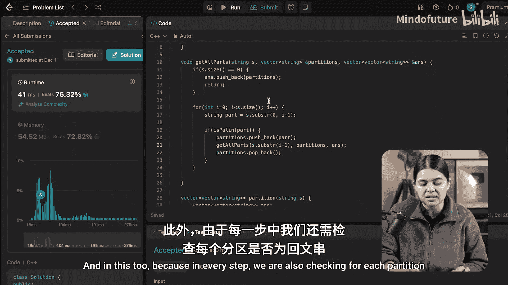

# C++-DSA课程-｜-数据结构-｜-leetcode-｜-Apna-College-｜--Complete-C++-Dsa-Course-p49-P50_回文分割问题-递归回溯--BV18oUGBkEmV_p49-

I everyone with the complete series。 and today we're going to solve one more important recurs problem calledendroomic partitioning backtracking Also there is a link for a compromise in the description box problem is calleddro partitioning string given is string possible partitionsromerome is basically a string and backward for example this is is alsodro string and backwards possibledrome partition string is also problem number 131 on function complete given string or string basically of string。

😊。

One possible partitions of a string which are all peindromic nature and in subcoki form me return the sub basicallye string partitionrome giant to major problem here string possible partitionslo our own partitionsro string possible partitions。

😊，Example K， let us talk about a string A D E。 Agar possible partitions partitionshak E E partition。

 This is the second partition next to partition Yak， second partition next toha。😊。

And is the her egg particular index per ja Aari string casis N equal Jeari N value to possible partition a second third and fourth to basically n size string total n-1 cuts to n string n1 ks possible partition n given string bar let's suppose string A A B K equal A A B。

😊，I possible partitions I partitiont need an empty string first first partition second partition or partition two parts and which is a anditions suppose case aro。

😊，and second and possible partition are let us an example of string partition partition partition。

Left for the sake of simplicity example，😊，Butchi is stringari possible palomic partition Nik。

la is string rei， A， B， C， A B， A。finally。recur string。😊，Let's suppose this is my。Last character， I。

 for this part。 you just drink a first part， him。Drake's substr here up is string con case that case Carhi Agarhamari overall string S he or is may usual last character Herari Partka index I per to cam case a thankkihamraju part he string part。

 This is equal to S dot sub string。😊，Jo index 0 or length plus1 k equal a last character i index total length plus1ja andth index index or part if this part is or not general logic and then we alsoas is function parts is function string vector of string partitions。

😊，And partitions k vector of vector of string answerme functions return to vector of vector of string。

 This is going to be answered Partitions and answer dono by reference passki persist string index perar string partitions string index I basically loop4 in teacher I equals 0 I less than my n which is equal to my string dot size I plus。

😊，Harbar Hammana partition Guthheni。Partition Gqueju left part Ine kindrome I is sub form me calculate k name to my string。

😊，Butt。😔，Is going to be equal to S dot substr， which starts with 0th index。

 and it ends with a length of i plus1 thisippa part If this isinro or not function string function is or y functiondrodro for example。

 orro if my string if my part isin case say。😊，Those case may haveid do on name。Ssein I partitions Fu。

😊，To basically her marriage of partitions in。O hum push back kingpartko so that we are saving it for the future and bahu stringhu stringjagi A index I to marryhu string y particular stringjagi and this stringhuni string I a substr Matab。

 this is equal to S dot sub S of I plus1。 If this is index I stringru I plus1 index is to stringyhu substrra next regard。

😊，The next recursive call callleium is get all parts function co call Kringgi。

 I have written it as gap justque under S dot。😊，Substr of I plus1kohampacaringgi。

 He basically but to Grhamari Strer and I scan the upni partitions go。

And Ane answer khamen Ktgi tser a future calls kander Hamariju string He palindroic partition kander divide Ulijagi Abjam backtkiappame nextja partition Knaga Y example。

 Gil Agar Ani string kander Ani is given string kander Agarhamni first partition kathar Ya。😊。

anditionition so that we can of partitionbition partition。😊，Hump pop backval him。

For this particular part， next timeari statement statement partition So this for loop contains the entire logic for partitions string particular will hit the base case basically。

😊，Lets suppose we started with this string A and is next part or partition。

Poss partitionly partition。to partitionition。string A。

 because the entire string is also a possible partition of Aroro andki terms yea。

 though particular and ye particular answersko string basically， if at any point。

 my S dot size becomes equal to 0。😊，Ivo to Yaha answerham pushback King A partition school Jo calculate K and Yahas K return。

So this part is my base case， and this part is my rest of recursive logic to a purura function here helper functioner recursive functionky helpsari Belindroomic partitions co calculate K let us convert this into a code the yapai function K subseto answer Kne vector of vector of string。

 Lets call it answer Ime let us create a vector of string。 Gise Ka。😊，Partitions。

And let us call this function get all parts Jora reard function top reard function void get all partsander string S passgi me we are going to pass this vector of string partition and vector of vector of string answer answer Kobiham with the reference pass a partitions Kobi with reference pass to is function a S Kobega partitions Koga and answer Koga and last may answer gomvis functionander Jopa string subse。

 we are going to make cuts on the string and try to calculate our partitions So in teacherger I equals0 I than my string dot size I plus plus。

First Johama apart tiga， lets call it string part。 This is going to be equal to S dot sub SR0 ci star hookr i plus 1。

Hmharic Partculi ch kringgi is this palindroic。 Asum ky function already exists kai is palindroomic。

 This scan part quad kringgi， Augusting palindroic hair， part palindroic he。

 Those case may hum upne partitions k under。😊，Push back Kanivalli him。

U and let's make another recursive call for the rest of the string rest of the string S dot substr。

 starting with index i plus1 partitions and backt basically partitions vector string next time are doing the back。

 which is cleanup for the vector stringcur and my S dot becomes equal to0。

Those case me answer kander and pushed back Kanival up now。Partition。

Partitions and Yahaniarham return Abss is Peindrome function could be complete Kleium。

 Peindroomic logicly ni about again。 This will be a boolean function。 trueia false return。

 Kagacan the kbi string stringindromeic Ya the forward and backwardmusku characters go compare kak。

 Ya we can create a second string。 Let's call it S2。

 which is a copy of the original string or S2 Ko Stuham Rivers kakname S2 dot Bein。😊。

And a to dot end。Or it compare Kingi Ki khaari original stringni reverse stringke equal he A original and reverse equal he。

 So this is a peinium。 Neto this is not a peianro。 Y per parts curque is called kigbarran Kthe。😊。

And let us submit it。ju solution was successfully submit if we talk about the time complexity of this particular code n string total n1 partitions out n partitions are also checking for each partition if this isdme or not this will be multiplied by n and this is the overall time complexity of complexity discuss actual So this is how the entire logic forindro partitioning individual question concept programming because we are also going to discuss a similar logic when we study dynamic programming。

😊。

So if we have successfully completed today's lecture you can mark your attendance down in the comments excuse app you can also let me know about your entire DSS series experience with me in the comments Ask at night Milton next lecture can that tell them keep learning and keep exploring。

😊。