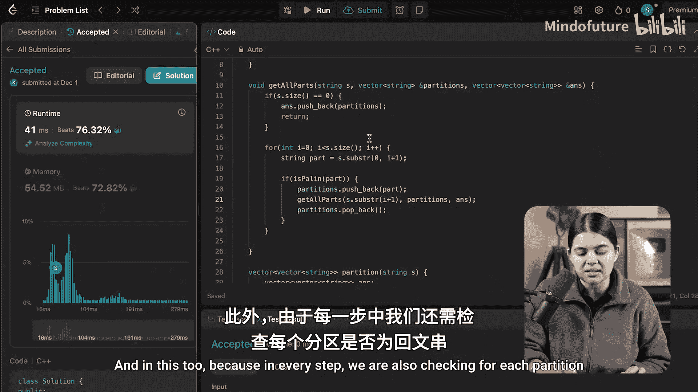

# C++ 数据结构与算法课程：P49-P50：回文分割问题 - 递归与回溯


在本节课中，我们将学习一个重要的递归与回溯问题：回文分割。我们将理解如何将一个给定的字符串分割成若干子串，使得每个子串都是一个回文串，并找出所有可能的分割方案。

## 概述

问题“回文分割”要求我们给定一个字符串 `s`，将 `s` 分割成一些子串，使得每个子串都是回文串。我们需要返回所有可能的分割方案。例如，字符串 `"aab"` 的可能回文分割是 `[["a","a","b"], ["aa","b"]]`。这是一个经典的递归回溯问题，也是 LeetCode 第 131 题。

## 问题理解

对于一个长度为 `n` 的字符串，我们可以在字符之间进行“切割”。总共有 `n-1` 个潜在的切割位置。我们的目标是尝试所有可能的切割组合，但只保留那些使得每一段子串都是回文串的组合。

上一节我们概述了问题，本节中我们来看看解决这个问题的核心思路：递归与回溯。

## 核心算法思路

基本思路是：我们从字符串的起始位置开始，尝试所有可能的前缀子串。如果当前前缀是回文串，我们就将其加入当前的分割路径中，然后对剩余的字符串部分递归地进行相同的操作。当递归处理完剩余部分后，我们需要“回溯”，即移除当前加入的前缀，以尝试下一个可能的前缀。

以下是实现此逻辑的关键步骤：

1.  **定义辅助函数**：我们需要一个函数来判断一个子串是否是回文串。
2.  **递归回溯函数**：这个函数接收当前待处理的字符串 `s`、当前已形成的分割路径 `partitions` 以及存储所有结果的答案列表 `answer`。
3.  **基准情况**：如果当前字符串 `s` 为空，说明我们已经处理完整个原始字符串，当前 `partitions` 就是一个有效的分割方案，将其加入 `answer`。
4.  **递归情况**：遍历所有可能的前缀子串（从索引 `0` 到 `i`）。对于每个前缀，检查它是否是回文串。如果是，则将其加入 `partitions`，然后对剩余子串 `s.substr(i+1)` 进行递归调用。递归返回后，从 `partitions` 中移除刚才加入的前缀（回溯），以尝试下一个前缀。

## 代码实现

现在，让我们将上述思路转化为具体的 C++ 代码。首先，我们实现判断回文的辅助函数。

```cpp
bool isPalindrome(const string& s) {
    string s2 = s;
    reverse(s2.begin(), s2.end());
    return s == s2;
}
```

接下来，我们实现核心的递归回溯函数。

```cpp
void getAllPartitions(const string& s, vector<string>& partitions, vector<vector<string>>& answer) {
    // 基准情况：如果字符串为空，当前分割路径是一个有效答案
    if (s.size() == 0) {
        answer.push_back(partitions);
        return;
    }

    // 递归情况：尝试所有可能的前缀
    for (int i = 0; i < s.size(); i++) {
        // 获取当前前缀子串 s[0...i]
        string part = s.substr(0, i + 1);

        // 检查当前前缀是否是回文
        if (isPalindrome(part)) {
            // 选择：将当前回文前缀加入路径
            partitions.push_back(part);

            // 递归：对剩余部分进行分割
            string remaining = s.substr(i + 1);
            getAllPartitions(remaining, partitions, answer);

            // 回溯：撤销选择，尝试下一个前缀
            partitions.pop_back();
        }
    }
}
```

最后，我们提供主函数来调用上述逻辑。

```cpp
vector<vector<string>> partition(string s) {
    vector<vector<string>> answer;
    vector<string> partitions;
    getAllPartitions(s, partitions, answer);
    return answer;
}
```

## 复杂度分析

*   **时间复杂度**：在最坏情况下，我们需要检查所有可能的分割方式。对于一个长度为 `n` 的字符串，有 `O(2^n)` 种分割可能。对于每种分割，我们还需要 `O(n)` 的时间来验证每个子串是否为回文（使用上面的 `isPalindrome` 函数）。因此，总时间复杂度约为 **O(n * 2^n)**。
*   **空间复杂度**：主要空间消耗来自递归调用栈和存储答案的列表。递归深度最大为 `n`，存储一个答案需要 `O(n)` 空间。因此，空间复杂度为 **O(n)**（不考虑输出答案所占用的空间，若考虑则为 O(n * 2^n)）。

## 总结

本节课中我们一起学习了如何使用递归与回溯算法解决“回文分割”问题。我们掌握了以下关键点：



1.  问题的目标是找到所有将字符串分割为回文子串的方案。
2.  递归回溯是解决此类“组合”问题的有效方法，其核心是“尝试-选择-递归-撤销（回溯）”。
3.  我们实现了判断回文的辅助函数和核心的递归回溯函数。
4.  我们分析了算法的时间与空间复杂度。

理解这个问题的解法对于掌握回溯思想至关重要。在后续学习动态规划时，我们还会遇到与此问题相关的优化解法。请继续练习，巩固递归与回溯的思维模式。