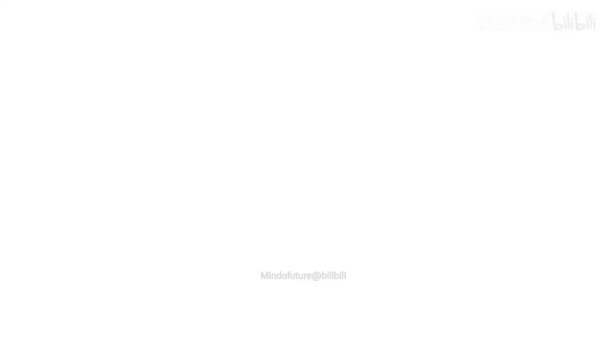
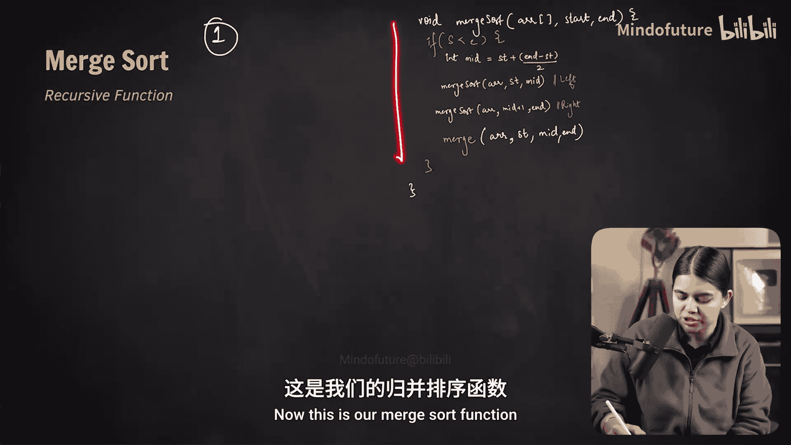

# C++-DSA课程-｜-数据结构-｜-leetcode-｜-Apna-College-｜--Complete-C++-Dsa-Course-p50-P51_归并排序算法-递归回溯--BV18oUGBkEmV_p50-

H in welcome to the complete series。 And today we're going to learn about one of the most important recurion algorithms called there is link for in the description box section complete what is the of different steps analyze and by the end of this lecture complete clarity regarding the entirecur use and Cooper based。

😊。

Basically， merge algorithm， those steps can come curtheium， sub step can hum divide curtheium。😊。

Uppen a array core into two equal parts。 Just， for example， if we have this array。

 let us try to visualize it。Just say if we have this E thear sub to repeatedly divide the E into two equal parts。

 midne mid is basically the middle part of theri this is the mid part of the in elements part elements right or equal parts can the divideham partitionpa and rightja andpa left and right recurively we are going to divide the into two parts If we talk about this part can the odd number of elementsition partition let us suppose or right side equal parts can the divide。

😊，Just may left May we have some elements and right side， May we have some elements。

 So is he same process called bar bar， bar bar recursive Li hum repeat Carthe Jatian。

The next level per be， if we have this array to is partition cardia is Eium partition cardia to divided it into two equal parts。

 And yet division here Ita K thehamari E kic single element ne twist the。

 we try to divide the array into two equal parts repeatedly and recursively。

 And for finally other Hamara's second step Gica underham merge K in divided parts quo to create。😊。

Asorted area。iri and in parts merge into a sorted form example k 12 and 31 12 and 31 topri12 and 31 go fashionche 12 and 31 3b writes Ija 1231 and35。

😊，Similar process right and 32 to8 and 32 elements combinesort8 and 32 and327 elements combine 1732 is an important step32 and 17 and 32 right7b merge which is called the merg step。

 which is the second step merge form817 and 32。😊，elements12173132 and35 and then we combining。

Proble problem problem problem and then solutions and then we try to combine the smaller parts intoeded parts useed first part focus which is to repeatedly fashion and let us talk about the first part of the problem。

 which is to repeatedly divide let given index functions call it and this function will be our function function which could also vector of inte。

😊，ika exact sizekiika toika rightika starting index and ending index v change startika and or inba middle part let's suppose which is equal to 0。

 And this is my end， which is equal to n1 n which is equal to 6 to my end will be equal to 5。😊。

So this is mycur function first part perform starting and ending value direct formula which is equal to mid equal plus n divided by core simple formula which is plus n minus divided by2 binary this is a more optimized version of the same thing and ending index in overflow and that is why overflow but they all amount to the same value plus divided by2 which is equal to mid。

😊，raju first part of the Eri start Hamraju second half y right half mid plus1ilireari ending position the tome recursively left half kmer co call and right half kmer sort co call So we are going to repeatedly call the same recursive function for our left and right half to sub up left half call left half key call k same mergerch sort function callgi just may we pass the Eri。

😊，Now， let us remove the square brackets。 Hamari left half Kle next time。

 Hamara starting position to Waega， but Hamara ending position， Kaowjaga， Hamari mid value。

 the starting position， Wahiega ending position， mid value Hogi， Similarlyly。

 Hamap near right half Kle be same Muarki call Karinggi right half Kla， if we call Muart。

We'll pass the Eri right Hakie starting position Hojagi mid plus 1 and ending position byragi the upper starting will be mid plus 1 and ending position。

 Hamari S regi to ye a Hamari left Haki K and yee Hamari right Haki Ke And is theriay repeatedly Hamab me Merar alm go call Ga for different parts。

 Any Ibar Agahamraid to k subse Hamari left Haki calledjagi left Haki call me。😊。

Will have 1231 and 35 Abbiba Hamra start Hoge 0 k equal， Hamara and Ho 2 k equal。

 Do Barasi hammane medical calculate carrying it。😊。

ju that will be equal to 0 plus2 divided by 2 which is equal to1 mid value partition value0 and right half2 the half12 and31 right3 will be equal to0 plus1 divided by2 which is equal to0 partition 12 and right 3 equal partition let us visualize these partitions in the previous is equal to0 and n is equal to next timeju will equal to。

Ca start n D equal logga， which is equal to 0。31 khamara start Hamari n K equal Loga。

 which is equal to1 Jbipa single element to the Yhi index start here and yhi indexhamara endjaga。

 Similarlyly， right half k mid plus1 is start carrying it midhamari pass a y 2 k equal to mid plus1。

3 to Yaara starting index 3 Hojaga ending index 5jaga The Ya next barri Kies star Hamara 3jaga and end will be equal to 5。

😊，ja n is equal to4 is equal to n is equal to 5。 and similarly is equal to n is equal to3 is equal to n is equal to basically notice a common equal value is less write。

My end So this is how we write thecur function for merge first part is second part basically talk about halfed and right halfed sorted let us talk about these two parts sorted sorted in sorted value is function value mid value is this which is end value is this which is5 and second part。

Basically， though parts go merge though different pointers use index I and index and will basically start comparing the values at index I and and in comparison will also create let us start with us start with starting equal equal we compare 12 with。

😊，And j is next index our next barham compareing is 12 is 17 k basically Jobiari smaller value because we want to asc order smaller storage and index value to compare the larger values andki basically compare 2117 2 next time2 value and index i isham compare 3117 k 7 17 and j to the last index we are going to compare 31 with 32 31 sub31 and i 35。

32 and。overall sort temporary8，1217。😊，hamas 8，12 and 17 Ajaga and second half kandander will have 31。

32 35， to 31，32，35jaga and cukietorahirajo original e to those steps may Hama subseto left half right half elements called temporarya fit temporaryhi elements original e basically we create a function。

 Let us call it mergeri merge Iasga starting value agi middle value agi and ending value agi I kar temporary storage create。

 Let us call it vector of intes and well call it temporary。😊。

hamid though index a k I starting index a kra j mid plus to basicallyariari right loopp tuari I value less than equal to mid andpari J value less than equal to。

😊，If we have two areass， this is my left array。This is my。

Rightite array can which elements I Yaha pointai J Yaai Muja Pa Icajo N here that is equal to mid Icajo N that is equal to n to muja I increase K9p K M K equal Jco increase Kine N K equal Or do no equal rank W comparisons O it。

 That is why the logical and operator to Yaha。😊，Hch klingiki agarhamra。

Aray of Iq value less than equal to the array of Jc。

push or plus and opposite of and let us remove elements and。😊，If my left half is thisas elements 1，2。

3， right halfpa elements 4，5，6 to 12，3， definitely4 kino orko right opposite and basically and right than equal to are going to push back my of and sameme this is for and this is for right half。

😊，Kjaptak， my J is less than equal to n Tatamiakrnaim。

Tta committee temporarily underpush back Kanaha Ane E of Jeco。

And her barham Jeko Cargi Blaques to yere left and right， half Klib， Hamme Luchali。

To basically pour left hand right half traverse loop basically from index equal to0 index index plus index example us take an example of twos。

😊，Ye is index example 2 index example 3ari starting valueari ending value inoco combine to this temporary and index value and index3 value original is to index this index is basically index plus whatever my starting value was basically original index plus starting value per sorted value we copy back the sorted values to the original So using these different loop and this is the second part of。

😊，S code the pseudo code convert contain to the actual code and Ukeba will also analyze the time complexity。

The code Gali we have already created this array in the form of a vector abna function Mane let us call this function merge sort merge sort can 8 to Hamipas vector of integer aa。

 which is E。😊，And is eri Kohan pass carryingi by reference， Kque Kam Ja changes reflectory。

 Usque at me， we have the starting value and we have the ending value。

 Jep the ka start is less than my end。Tta kmi sub palopum mid calculate khani。

 which is equal to star plus n minus star divided by 2。

Uuske Ba me Hammet Soko call Karinggi for the left half left half metlab Eri start and mid thekijaga。

 So this is for my left half， Similarlyly Hammet Soko call Karinggi for Eri right half Kastaru Jaga mid plus1 and end。

This will be my right half。 And for finally， hum up my Mer stepco perform Gurigi。Just can passna Eri。

 Sanastar， mid and。Ending value B per mergech function coically。

 we can create a function called merge just may。yes are parameters to pass Karinggi Sa Mehamapne integer Mkopi pass Kaneval。

 much can the sub temporary storage create Klethan， which will be vector of integer。

 let's call it temporary。Cch variables whene in teacher IK Shiwa Kingham start kissat and JKswar kingham mid plus1 kssat。

😊，A loop Chiang it Jeptak my I is less than equal to mid and Jeptak my J is less than equal to my n。

 Tpta may compare Kanahaki array of Igi value Jobi value Chotier basically say I temporary K add G。

 So if array of I is smaller than array of J， this case may temporary kander。😊。

Andm push back Ki area of ico and Ico Kinggi plus plus else valley case name。😊。

H temporary kandander push back Kne Ane E of jko and jko K plusla Jobi B elements Soge Agarvo left halfle left halfl lu inpt my I is less than equal to midme any donnoco repeatedly perform Knai and left half elements Ki nahito right half and j is less than equal to n tu right half elements go T kandme Koi jsse copyja the hum temporary say Ane original eander changes carrying it。

😊，To far index equals 0 jp my index is less than my temporary dot size index plus plus my original e canander at index plus start copy values of temporary of index So this is how the entire merge function is going to perform a merge function can even though loop but time complexity to y loop y left plus right half cubeid plus right half cubed key K is half n is half cubeid starting value0 Ho ending value n minus1 ho to overall y big of n time complexity is perform of n operations only the loop big of n operations only plus of4 loop is maybe temporary case me of n operations perform overall time complexity the merge step key that is big of n where n are the total number of。

the area Ya Merar function overall regardcur function merge function call from the main function。

 Just E pass start Hammia0 Hoga and Hamisha E dot size-1 Hoga。

 which is the last index of the area Yaish Ericika S Ericika last index Hoga。

And Jesse merge functions a mind， let us create a for each loop。 Just can a psari value score。

 sorted value score。😊，Print Kaannivali， see out。End off line。

 let us save it and run our let us clear descending order be logic basically greater than descending order us is in descending order and ascending let us the on as suppose is my starting value。

 This is my ending value plus divided by2 which is equal to1 So this is going to be my mid value。😊。

ham values4 and1 write half values 3 and2ja2 and equal calculate midja0 plus1 divided by2 equal So this will be my value Similarlyly right is equal to4。

 this is equal to1 this is equal to3 and this particular part is equal to2 Finally last equal to n equal to0 equal to n equal to1 Similarlyly index2 equal and equalt and co combine in sorted fashion。

 So in a in the form of1 and4 original basically。Vals score replace K with1 and4， Similarly。

mgi to values Em step helps 3 and2 combinegi values merge in the form of2 and3 original E values changegi to2 and3m is to 14 writes2 values combine will get 1。

2，3 and 4 original e change to ascending order lets the time complexity of this entire this is our merge sort functionari complexity basically time complexity is equal to totalcur calls。

😊。

Multiplied by work done in each call y basic formula just come me Puri seriesrique throughout work k A but total recursion calls him Cas basically Hammeki ham ns K Eriatier。

 her level pay Ham n by2 s K Eri K or y calls K Jae ye calls Jaept last mehamari Eikasis1 K equaljata。

😊，we are going to divide the in two and and let us assume is equal to。

Andmi simply see equation cosal kai， when n divided by2 the par k is equal to 1 hum k n is equal to 2 d parque。

 though nottara from log laying the log base to n is equal to my K k k me K total number of levels M。

 the total number of levels are log n based the upper Mapa total calls Zgi， which is equal to log n。

😊，So let us remove this。 the total calls log n and work done in is all constant work constant overall complexity is and that is why work done in each call is equal to n。

 and this is my time complexity So time complexity for the is n log that is a combination of the merge step and all of thecur complexity complexity temporary space use is complexity。

😊，So to summarize the time complexity of Merzart algorithm。Is equal to en login。

 The space complexity is equal to big yellow important parameters andin。

 because they form an important interview question。

 I hope lecture perfectly clear in complexity calculate and we have also driven the entire code on two different I doubtham lecture If you have successfully completed today's lecture you can mark your down in the comments and can also let me know what was the new thing that you learn from today's lecture Ask lecture can keep learning and keep exploring。

😊。