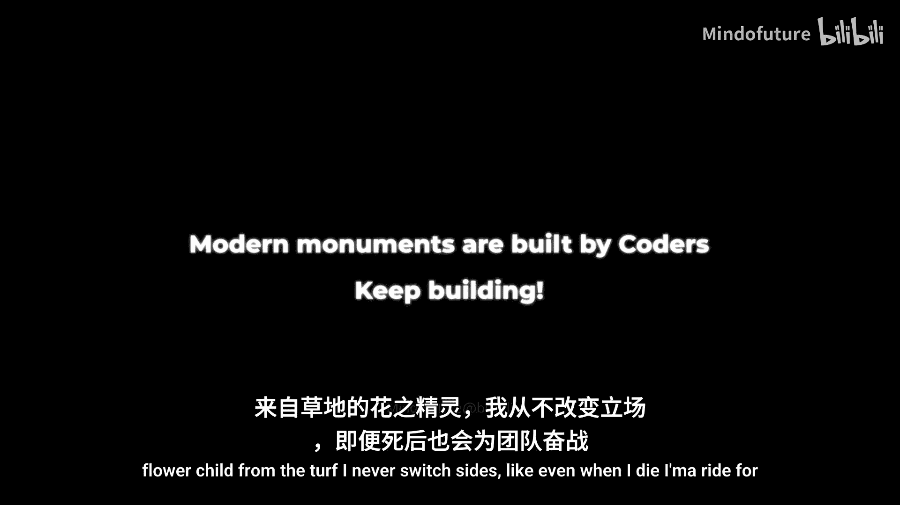

# C++-DSA课程-｜-数据结构-｜-leetcode-｜-Apna-College-｜--Complete-C++-Dsa-Course-p51-P52_一次重大更新_达到1000M播放量--BV18oUGBkEmV_p51-

I run in welcomeknna College and in today's session。

 well be covering two major announcements related to Opna College。

se Ana Ne as a tech educational YouTube channel recently 980 million viewsro And soon we will be touching the mark of 000 million views。

 which is 1 billion。 And this has only been possible because of the love and support of our students This is definitely something Jo Ki We did not imagine the support。

 We did not imagine the impact thatna is going to have。

 And that is why we have decided to scale things up more。

 That is why we have decided to bring newer things， multiple things on the channel。se announcementri。

 Secondly， Ari Chari， which is the C series O under already 50 plus lecturesinko a series scan at least hundred plus lectures or resolution will be making the best DS series on YouTube resolution。

😊，er and and the successfully complete This will definitely be one of the best series on YouTube in terms of content and in terms of completion extended with the name of seriesthon cover and more than and not notifications notified second benefit。

😊，Further different technologies and the newer things that we want to upload we have some space to upload them on this channel。

 yet though major announcementslist availability and futurelist and also dedicated regular notifications of in preparing some additional resourceslist and notifications。

🎼second channel description and also complete Python and complete jascript seriesy complete series So today is definitely a very happy and wanted to share happiness with of you educational learning and。

😊。

