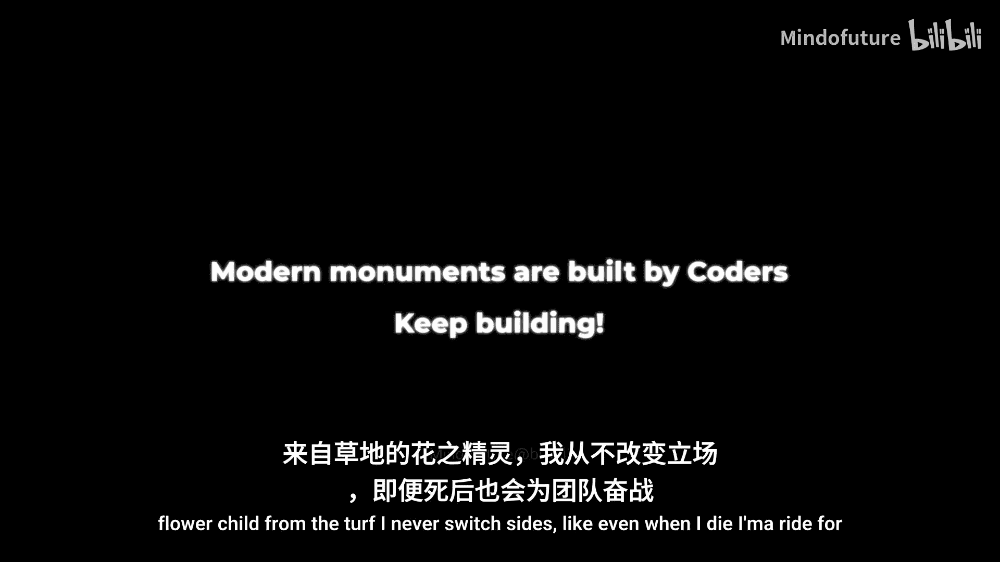

# C++ DSA课程：P51-P52：一次重大更新与未来展望 🚀

在本节课中，我们将分享关于Apna College的两个重要公告，涉及频道里程碑与课程系列的重大扩展计划。

## 概述

我们来自Apna College。在今天的课程中，我们将介绍与Apna College相关的两项重要公告。

## 里程碑：即将达到10亿播放量 🎉

上一节我们介绍了本次课程的主题，本节中我们来看看第一项令人振奋的公告。

Apna College作为一个科技教育YouTube频道，近期总播放量已达到9.8亿。我们很快将触及10亿播放量的里程碑，也就是10亿次观看。这一成就完全得益于我们学生们的热爱与支持。这绝对是我们在开始时未曾想象到的支持力度和影响力。

正因为如此，我们决定进一步扩大规模，为频道带来更多新内容。

## 课程扩展：C++ DSA系列将成为最全教程 💻

接下来，我们看看关于课程内容的重大更新。

第二项公告是关于我们的C++ DSA课程系列。该系列目前已有超过50节讲座。我们计划将这个系列扩展到至少100节讲座以上。我们的目标是打造YouTube上内容最全面、最完整的DSA（数据结构与算法）系列教程。

成功完成本系列后，它无疑将成为YouTube上在内容完整性和教学深度方面最出色的系列之一。系列将涵盖更多主题，确保内容详尽。

## 未来计划与额外福利 📚

在介绍了核心课程扩展后，本节将详细说明为支持这一目标而制定的具体计划。

为了确保大家能跟上更新并获取额外资源，我们制定了以下计划：

以下是确保学习连贯性的具体措施：
*   开启频道通知功能，以便及时获取新视频提醒。
*   我们将在准备一些额外的学习资源。

以下是关于频道内容多元化的安排：
*   我们将在频道描述中更新完整的学习路径。
*   我们将制作并上传完整的Python和完整的JavaScript课程系列。
*   为了有空间上传这些新技术和新内容，我们需要对当前内容进行规划。

因此，今天是一个值得分享喜悦的日子。我们希望将这份关于教育学习的快乐与大家共享。

## 总结

本节课中，我们一起学习了Apna College的两项关键动态：一是频道即将达成10亿播放量的里程碑；二是我们的C++ DSA课程系列将进行大规模扩展，目标成为YouTube上最全面、最完整的教程，并辅以系统的学习支持计划和更多编程语言课程。