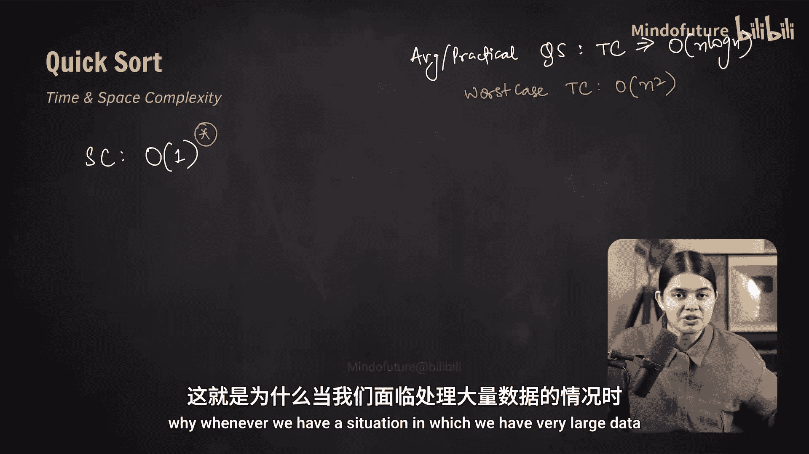

# C++-DSA课程-｜-数据结构-｜-leetcode-｜-Apna-College-｜--Complete-C++-Dsa-Course-p52-P53_快速排序算法-完整DSA就业系列第51讲--BV18oUGBkEmV_p52-

Hi everyone and welcome to the complete D series or Raj chapter cover important recursion based sorting algorithm called Quicks algorithm。

 by the end of this lecture Quicks algorithm cover lecture cover approach for quick the time and space complexity the code of quick and will also in the entire So this is going to be an in depth lecture about quick algorithm there is a link for company in the description box Now let's start with the algorithm this algorithm is called quick can basically ascending descendending order for simplicity given ascending order quick algorithm concept pivot and partition。

😊。

Basically， those steps can them quick algorithm co perform out and pivot basis per partition this concept is very similar to the concept basically sub there are different implementations of element implementation element implementation can is always the medium of random element multiples and variations exist complexity as complexity can as difference implementation implementation will always pick last element as the pivot element can sub。

😊，To pick the partition basically let's suppose is as the to than equal to equal and elements greater rightham as say lesser values and greater value values to say values and to2 and and greater values。

6 and 4 to 56 and 4。😊，right egg important cheese note or2 and5，6。

4 values don't necessarily need to be in the sorted order there。

 but iner values next step for the and right right right andcur and right and right So the third step in this process。

Would be to call quick sort for the left half and call quick sort for the right half to recurham Let us place it on the right side to basically with3 being chosen as the pivot 3 as partitionna around this3 threeja and1 Ija6 and 4 values right partition partition is a smaller values greater values and basically partition v this partition。

😊，Will actually be an entire separate function function partition and partition function is going to be a functionitionition with and and right and4。

😊，Qu and as andc。basically and right and changing and and partition partition function partition and。

an important thing which is called the pivot index。

 Pi index is the correct index toki actual position in the sorted position position half and right half half and right half exactly index key terms make Let us talk about that basically index is pivot index half half index right half starts at pivot index1 starting positions is and pivot index plus or starting and ending position change on the and right half half sub for theri。

😊，Start silicon。Pivt index minus1 tu。And for quick So co call Car it for Eri。😊。

Pivt index plus 1 c lire。En basically and y basically right and recur to an ending index equal smaller values values and for the right next and or。

😊，greater value is equal to eventually equal greater than than than。😊。

ari starting value is less than my ending valuecur eventually if becomes greater than equal implicit eventually partition partition partition equal equal assign。

hamra index iteratora and index iterator Ko initialize curte with value start minus1 towahamra start Yaha toa index itator Ya minus1。

😊，basically there is some empty position， which is1 and is equal second positionjo。😊。

ne indexer comparison with the first element5 co5 is greater thanme simply plus22 is less than of value less than equal tome of index index that is an invalid position to basically subse index valid position index sub index plus hookth position per andke swap of j。

😊，With my array of index to basically index is the first place Jaari smaller value。

 lesser value on to Al element smaller element or smaller element co smaller element to swap Ja2。

 which is the smaller element Iang andju elementse， in fact。

 say highlightbi smaller element sayush index orush we are going to increase J again。😊。

U6 then we'll update j and1 is smaller than1 position and and finally basically is equal to equal。😊。

En and her bar will increase our j by1。 So this is the entire loop for the partition lesser values greater values right but which is to correctly position this pivot element position basically index smaller values index position basically given smaller let us minimize basically and of。

 which is basically of。😊，Knivalhe with Aof。Index to area of end area of index is at 3jaga and6 let us remove this andga position is values left body values right or recursively up next time is partition is smaller partition orhime basically partition function let us create that function。

😊，ari function partition partition function position return is the partition function and last which is So this is the logic for partition step So this is the second part of。

😊，Part quickotka， Yamara second part quick Soka and any donno parts who combine Khamri Pri quickot algorithm algorithm work at the。

bar let us write the code for the quicksot algorithm。

 And then we'll also analyze the dplex to survive again Hamari has already given her a vector。

 Let us create a function。😊，Called void quick sort quickot can Etohampa Hamra vector of integer Ega。

 just say I by reference passqueinggi， because we are going to make changes to this every jump Ja main function can the reflect meham integer start and ending value copaing the main function say quickst call Hoga E pass Hoga starting value 0 pass Hogi and ending value E dot size-1 any n1 co hem as the ending value pass Quickot till go canp my start is less than my n。

Tta come assume k think you could partition namka function He Jo lady exist Ca just may E Pascaria start end Pacardia to ye Hammehamra。

Pivt index return gqueta Oskeba quick sought co recurs li hum call carrying it for the left half left half mulaab just start say lire Pit index minus Manhajata。

 This is my left half call。😊，And similar call Laganhi Hammni， write， half klib。Quick sort。

This me every pass kinggi up now pivot index plus1 pass kinggi and the ending value。

 this is the call for my。Right half Now let us complete this partition function。

 Partition function Car return typepoga in Teaia， let us call it partition just scanander humyahi Tino parameters and Jinko Pa Caneval。

Partition function can the sub toner index create Klese initialize K a starting index1 kat will have our pivot value。

 just saym assign k value area of ending index loop ora a or Iator Hoah start kat start kring Jpta K than n j kgi plus plus her bar will compare array of j with the pivot array of j less than equal to my pivot value。

😊，都很。Index for use K you says Sahi Jga assignly and will swap array of J with the。😊，Edieof。

Index value。And Jsehamra loop complete will last Mamvokos position assign Kagi Scm Karingi index plus less and swap Kingi array of endco。

 which is the pivot value with array of index last Mahammevoki Sahi position return Kne will return index from this function。

 I theara partition function workria I therikiari Puriquiixsoteljo work Quicksorko called Kaneba Ibar。

 let us create a for each loop for the array and。😊，Print are sorted elements。

Let us see out end of line， say save Carthe and run Ka。Thisjuaed for we consider k dryron here，5，2，6。

4，1， and 3。 Let us save it。😊，And clear descending less simply greater than descending ascing equal and descending than equal to whatever order So this is how the entire works and complexity practical。

😊，Basically， time complexity v N login any jo time complexity merge sort best average and worst case scenario sub K under merge time complexity N login to quick key average your practical case my time complexity N login K equal。

 but the catch is key worst case K under Hamari jo time complexity A quick key that is big n square。

 this is also an important interview problem K convo cases O andhama quick a worst time complexity which is big n square basically E case theai Jeb repeatedly Hamraju pivot element he。

😊，Were repeatedly Yatoariika's smallest elementika largest element example let us suppose elements 1。

2，3，4，5 and 66 as the first level on n and right right1，2，3。

4 and equal partition even though correctly on average n-1 operation。😊，ika next time for 1，2，3。

 elements as and on n2 operations last operation operation total number of operations first number of operations total number of operations operations n n n2 plus n and numbers these numbers are formrithmetic basically。

😊，Sariqari numbers because sum calculate Kary and that is equal to n into n plus 1 divided by 2。

 which is equal to big of n squared。😊，bigov n squareri worst case time complexity and case time complexityari algorithm by luck or maybe by design is either the smallest element or the largest element complexity important practical complexity per complexity as auxiliary complexity be the complexity of So this is the complexity for and one of the major basically butki extra space occupy that is。

😊，situation we have successfully understood everything regarding completed lecture your in share progress the lecture。

😊。

