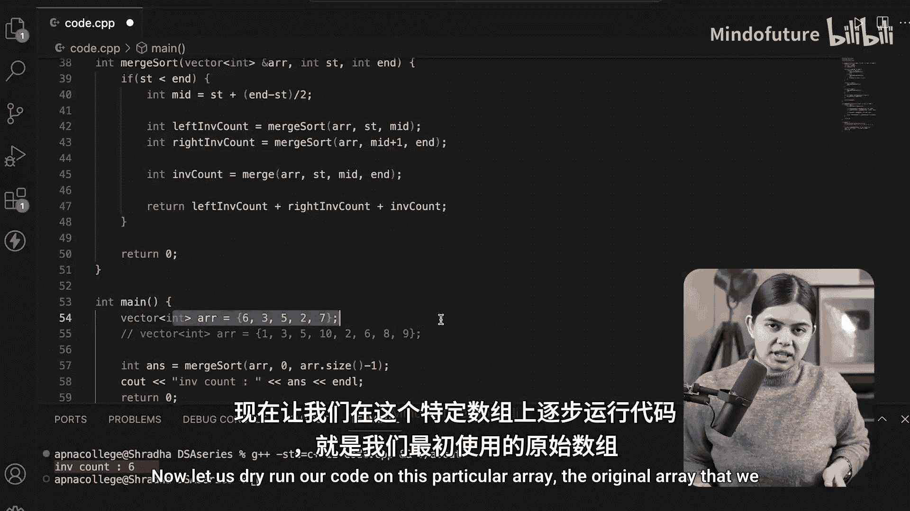

# C++-DSA课程-｜-数据结构-｜-leetcode-｜-Apna-College-｜--Complete-C++-Dsa-Course-p53-P54_计算逆序对问题-暴力和最优解--BV18oUGBkEmV_p53-

Hi everyone and welcome to the complete D series。 And today we are going to cover one more important regression problem called count inversions。

 Akva or concept is scanner available inja just calling N description box Also there is a link for a companyized D sheet in the description box This question is called count inversion can we given this array and is E visualize like this total number of inversions count ni inversion inversions basically though numbers S pair E K Jaha。

 if the first number is of I and the second number is array of J the numbers he conditions K sub condition I should be less than J and second condition E of I should be greater than。

😊。

Edie of j。Basicallyju first v index second us analyze6 value get one more Similarly。

 if we take an example of3 to3 for this particular total number of equal orte and willd Op approach。

😊，Willll basically be using an algorithm just come already called last last lecture details we also wrote the for optimal can look at the timet and you can directly go to the optimal approach bru brute than and array of value greater than of in conditions satisfy basically single number as ofs suppose this is my index and number second number。

sari index analyze kneingi Jahamar index value is greater than I Malavojo index have ik Bm exists Kneche and when index per value exists Kti array of I Choij less only j to for I equals0 J equals1 cre j equals n minus1ta loop or her element K analyze kringi Ki elements Hamari6 k pair form kam basically will have an outer loop for I equals 02 n Jaber sub Iara0 k equalga for i1 k equallog 2 klogga 3 k equalga 4 k equalga or her a array of i k hammusca pair area of j5 out kneus to k I K possible pairs Cato j equals i plus1 where j is less than n J plus。

😊，And y pair y pairari of I value will always be greater than E of inversion count lets call it inversion count and inversion count value similarly6 inversion count pair and Similarlyly3 kversion count when we pair it up with25 k inversion count when we are going to pair it up with2 and2 and7 as inversion is brute force our answer is going to be equal to and brute force I loop use complexityja will be n square brute force approach n square complexity Now。

 let us talk about the optimal approach say。😊，basically optimal approachham usene of the existing merge algorithm。

 And if we are more specific to merge algorithm， merge half and right half step help say total number of inversions let's revise what exactly wass suppose parts divide with the help of midpointer in say and we divide the into two partsja rightja and recurs and right is now sort。

23，5 and6 andju writebi and merge basically sorted of the merge to form a bigger sorted array how is this merge step important to find out the count of total inversions let us take an example of this let us suppose mid here half of the elements elements and index will middle index General and to the mid is going to be equal to start n divided by2 n minus star divided by2。

 which is the same value let's suppose merge perform sorted elements135 and 10。😊，Similarly。

 we have some elements in the right half。2，6，8 and9 to perform the merge step Mat ino sorted mergene to form a bigger sorted arraypa a important valueriariikaariika and aerererer and mergeo individual elements who compare basically inside the merge step。

 we compare this array of I with this array of j and Johem temporary bud store we have the storage to basically store8 elements E of I co array ofat though he cases into existri array of I value will be less than equal to array of j。

😊，for example，1 and represents the represents the right second default。😊。

index by default index second condition that is basically the value condition orversion array of i becomes greater than us is lesser in value compared toversionversion count interestingversion count calculate plus multipleversion。

😊，three and index and1 right are to greater in and basically with this elementversion。

1 inversion value x1，2 3 different inversions count or inversion basically inversion count。😊。

kderham k value add， can I say key agarhamari Es total size mid k equal because this is the last index of the E andki i index per kname elements mid or i B may existthe This value is equal to mid I or isham ih index value element be now。

 Then this value is equal to mid i plus1 say let's suppose ahamra star0ham n toari mid value which I3 k equal01。

2 and3ari am I key value1 k equal agarham count find out k in elements kkiinoari2 k inversion form So basically that count will be equal to mid i plus1 can I say mid is equal to3 minus1 plus1 this value is equal to3ham inversions a x single step can count K and this is the major benefit of using merge sort for inversions inversion count canham add mid minus i plus1 value co and a。

😊，is k multiple inversions count let's suppose co inversion count was equal to0 elements or inversion count value and next time we compare this withversion and10 and but once again we have reached a condition to count inversionsversion inversions it will be equal to mid i plus1 i it will be equal to mid plus equal to1。

😊，Basically6 k perspective say a number which is equal to 10 inversion pair Now we will compare 10 withversion1 orid minus mid answerversion andversion answer is going to be equal to for this particular In factversion let us merge。

This was the if condition， and this was the L condition。 Basically。

 I C function Gander Yahaba hamic variable Banasse in teacherger。😊，Let's call it inversion count。

inversion count plus equal count inversion function equal and last we are going to returnversion count merge let us talk about an important thing basicallyversion merge right and right inversion count andversion。

😊，Sot function Jo Ya call for the left half for the right half anus merge function a merge function settome inversion count return butm half and right half call to Ya left count a left inversion count and Ya right inversion count asce and the total inversion count of the entire array is going to be a sum of all three values This the recursively inversion count could calculate for the entire array。

 to basicallyme is function k be return type change K integer and at the end， we are going to。😊。

Return。My left count plus my right count， plus the current inversion count。

And nahito Matlaav Agarhamaripakui invalid Erihuga a single element varihuga Uskemeto inversion count exists Ni Kta Matlauskimm return Gingi1 value。

 The let convert this entire logic into the code and Ukeba I the same logicham of the original eri Cooperer driveringgi。

😊，The code can then basicallyme metzkao lickkn code K， let us start with the function。😊。

Well call it Moart Mozart kderhammmic vector of integer Leingage say by reference past this is temporaryhamra start and Hamra in A mergeart function He yeme inversion count to be calculate cur return kriga Ts return type hum change cur integer Kling。

😊，Mot key condition of the if start is less than n of Moart worker just my sub L will calculate our mid。

 which is start plus n minus star divided by 2。😊，Subseium left half kilocal Kit those may merge sortko call Gney v width。

This will be A with our array。Left half starts the start with a midperkauai。

 similarly Mozarko call Kringgi for Eri。😊，Mid plus1 cilire。

Entuk and Yase Hamipas left in Virgin Count return Hkuraga， Similarlyly， Yase Hamipas。

Right inversion count return Hokuraga ham Phic function called Kaingi。

 which is called the mergech function。 mergech function。

 Can the start mid and encodecho pass Kainggi or y Hamme upna。Current half scale。Inversion。

Coun return Karia Hamari Lio total inversion count Hoga Johanm return Karigi that will be equal to left inversion count plus right inversion count plus the current inversion count or u aku invalid index exists kte whose case may inversion count is going to remain 0 a create this merge function。

March function B， a andteger type of function Uga。 This is mergech Just scan the y parameters to hanging aippa Oque Ame we are going to get。

Am mid value。Amers function Gander will create a temporary。Vctor of intessure。

 I is going to start with start， and J is going to start with but plus1 Luomchlathem Jeptak。

 our I is less than equal to mid。And J is less than equal to my and Agahamari array of igi value is less than equal to array of J。

 Those case may temporary mayhem push back Kaneval array of Ico and Ikoham Cardie plus less。

Else while case me temporary candled。Push back area of jco and jco cardtheium plus plus is where else case me may call original step linear I which is to count the inversion count let us create an variable called inversion count and we will initialize it with0。

Yhaber upne inversion count canander plus equal to Caringm mid minus I plus1 k valueo。 And this way。

 we are going to count multiple inversions at once。

 Ferhambaio elements K like loopchla theyium or step kander。

 While my eye is less than equal to my mid。Amy indono Steppsco repeatedly performed Gnaim。Same loop。

 J elementkile， While my J is less than equal to my N。

 How may in those steps go repeatedly perform good Finally， hummnair。

Original e and the temporary key values go copy are they the the4 integer I equals 0。

 Yeah let's call it index equals 0 index less than。

My temporary dot size index plus plus Mar Cajo logic boham Al peranni Mo Pa lecture can the discussuque。

 So if you want a detailed explanation of this entire Mer code。

 those K Ja me series here previous lectures who the exc。

We already know that array of index plus start is equal to my temporary。Of index。

 and last May we are going to return the inversion count。Let us save it。 I said minimize Karingi。

 So this is the entire merge stop step。 Just Kandanderhame changes keym and yehamra Merarka function just canander say we are returning the inversion count。

 Ya， but we are going to call the Merart function just cananderhammna Epa Karinge start。😊。

And Eka ending index， Yami Amara answer return hooker meiga and Ui answer co outval。

And let us write in version。😔，Co， let's save it。 Now， let's run it for our Eri。

 Hammepathhihama answer already 5 k equal energy。 So this is the answer。

 We can also run it for the second E。😊，Discalehama answer should be equal to 6。

SoThis is the inversion count， which is equal to 6。 Now。

 let us dry in our code on this particular array。 the original array that we started with。

 So this is the original array Igi elements 63 and 5 rightja we have elements 2 and 7， Similarlyly。

 Iga mid So this will be the left half with 6 and 3。

 and this is the right half with calculatejaja individual elements calculate meja rightja backgi back and 6 and3merja 6 already36version count。

 that will be equal to1 left say inversion count k equal and and3ja3 and 6 k equal。😊。

Rightversion count0 return36 and co merge3 and merge we already know is greater than to inversion count value add plusversion count write inversion count equal will become3 and and inversion count will be equal to2 half inversion count will be equal to 2 same right count count merge7 which2 and 7 to inversion count return equal half inversion count right half inversion count inversion count2 and0 to add5 and27。

😊，is merge step per focus3，5，6 and 27 co algorithm mergering the three co2 compare k3 is greater than2 the two co pair with3。

5 and 6 inversion count start of the will will get and finally equal or inversion pair finally the answer is going to be2 plus0 plus3 which is equal toja for this particular array and merge in count calculate if we talk about the time in space complexity were not really doing anything extra in terms of time in space basically time complexitysari time complexity that is equal to the merge time complexity which is n space complexity merge which is as compared to the brute。

😊，In terms of time complexity， mergeart algorithm is a better algorithm to find out the count of total inversions in the entire area I hope that we have successfully understood the entire concept of counting ins and if count inversions concept a important and you have a Mo or other deeply understand can you maybe help time because it makes us understand the entire logic on which merge step is performed inside the Moart algorithm I hope that we have successfully completed today's algorithm you can mark your attendance down in the comments I case me you can also share your progress with me on Twitter is calling Ka description box scan Ja askate with the next lecture can that and keep learning and keep exploring。

😊。