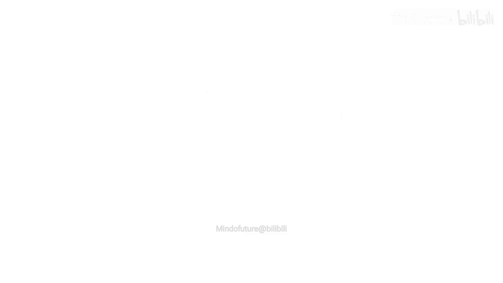
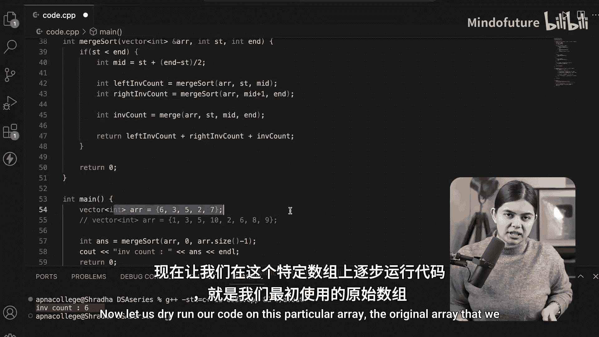

# C++ 数据结构与算法课程：53-54：计算逆序对问题



## 概述
在本节课中，我们将学习一个重要的递归问题：计算逆序对。我们将从理解问题定义开始，先探讨暴力解法，然后学习基于归并排序的最优解法。

## 什么是逆序对？
给定一个数组，逆序对是指满足以下两个条件的数对 `(i, j)`：
1.  索引 `i` 小于索引 `j`。
2.  数组在索引 `i` 处的值大于在索引 `j` 处的值，即 `arr[i] > arr[j]`。

例如，对于数组 `[6, 3, 5, 2, 7]`，我们可以找出所有逆序对。


## 暴力解法
首先，我们来看一种直观但低效的解法。以下是暴力解法的思路：
遍历数组中的每一对元素，检查它们是否构成逆序对。

具体步骤如下：
1.  使用一个外层循环，索引 `i` 从 `0` 遍历到 `n-1`。
2.  对于每个 `i`，使用一个内层循环，索引 `j` 从 `i+1` 遍历到 `n-1`。
3.  检查条件 `arr[i] > arr[j]` 是否成立。如果成立，则逆序对计数加一。

**代码描述：**
```cpp
int countInversionsBruteForce(vector<int>& arr) {
    int count = 0;
    int n = arr.size();
    for (int i = 0; i < n; i++) {
        for (int j = i + 1; j < n; j++) {
            if (arr[i] > arr[j]) {
                count++;
            }
        }
    }
    return count;
}
```
这种解法的时间复杂度是 **O(n²)**，对于大规模数组效率很低。

## 最优解法：基于归并排序
上一节我们介绍了暴力解法，本节中我们来看看更高效的最优解法。这个解法巧妙地利用了**归并排序**的合并步骤。

### 归并排序回顾
在归并排序中，我们将数组递归地分成两半，分别排序，然后在合并步骤中将两个已排序的数组合并成一个更大的有序数组。

### 关键洞察
在合并两个已排序的子数组（左半部分和右半部分）时，我们可以高效地计算跨越这两个子数组的逆序对数量。

假设左半部分 `[1, 3, 5, 10]` 和右半部分 `[2, 6, 8, 9]` 都是有序的。
在合并时，我们比较 `arr[i]`（左半部分当前元素）和 `arr[j]`（右半部分当前元素）。
*   如果 `arr[i] <= arr[j]`，这不是逆序对，我们将 `arr[i]` 放入临时数组。
*   如果 `arr[i] > arr[j]`，那么 `arr[i]` 不仅大于 `arr[j]`，而且由于左半部分是有序的，`arr[i]` 之后的所有元素（直到左半部分末尾）也都大于 `arr[j]`。

因此，当 `arr[i] > arr[j]` 时，我们可以一次性计算出多个逆序对：
**逆序对增加的数量 = (mid - i + 1)**，其中 `mid` 是左半部分的结束索引。

### 算法步骤
以下是修改后的归并排序函数，用于计算逆序对：
1.  **分割**：递归地将数组分成两半，直到子数组只有一个元素。
2.  **征服**：递归调用函数计算左半部分和右半部分内部的逆序对数量。
3.  **合并与计数**：在合并两个有序子数组时，计算跨越中点的逆序对数量。
4.  **汇总**：总逆序对数量 = 左半部分逆序对 + 右半部分逆序对 + 合并时计算的逆序对。

**核心合并步骤的代码描述：**
```cpp
int mergeAndCount(vector<int>& arr, int start, int mid, int end) {
    vector<int> temp;
    int i = start, j = mid + 1;
    int inversionCount = 0;

    while (i <= mid && j <= end) {
        if (arr[i] <= arr[j]) {
            temp.push_back(arr[i++]);
        } else {
            // arr[i] > arr[j]，发现逆序对
            temp.push_back(arr[j++]);
            inversionCount += (mid - i + 1); // 关键步骤
        }
    }
    // 复制剩余元素...
    // 将temp中的元素复制回原数组arr...
    return inversionCount;
}
```

### 完整代码实现
```cpp
#include <iostream>
#include <vector>
using namespace std;

int mergeAndCount(vector<int>& arr, int start, int mid, int end) {
    vector<int> temp;
    int i = start, j = mid + 1;
    int inversionCount = 0;

    while (i <= mid && j <= end) {
        if (arr[i] <= arr[j]) {
            temp.push_back(arr[i++]);
        } else {
            temp.push_back(arr[j++]);
            inversionCount += (mid - i + 1);
        }
    }
    while (i <= mid) {
        temp.push_back(arr[i++]);
    }
    while (j <= end) {
        temp.push_back(arr[j++]);
    }
    for (int idx = 0; idx < temp.size(); idx++) {
        arr[start + idx] = temp[idx];
    }
    return inversionCount;
}

int mergeSortAndCount(vector<int>& arr, int start, int end) {
    int inversionCount = 0;
    if (start < end) {
        int mid = start + (end - start) / 2;
        // 计算左半部分的逆序对
        inversionCount += mergeSortAndCount(arr, start, mid);
        // 计算右半部分的逆序对
        inversionCount += mergeSortAndCount(arr, mid + 1, end);
        // 计算跨越中点的逆序对并合并
        inversionCount += mergeAndCount(arr, start, mid, end);
    }
    return inversionCount;
}

int countInversions(vector<int>& arr) {
    return mergeSortAndCount(arr, 0, arr.size() - 1);
}

int main() {
    vector<int> arr1 = {6, 3, 5, 2, 7};
    cout << "Inversion count: " << countInversions(arr1) << endl; // 输出 5

    vector<int> arr2 = {8, 4, 2, 1};
    cout << "Inversion count: " << countInversions(arr2) << endl; // 输出 6
    return 0;
}
```

### 算法演示
让我们以数组 `[6, 3, 5, 2, 7]` 为例，手动推演算法过程。

1.  分割数组：`[6, 3]` 和 `[5, 2, 7]`。
2.  左半部分 `[6, 3]` 继续分割为 `[6]` 和 `[3]`。合并 `[6]` 和 `[3]` 时，`6 > 3`，逆序对计数为 `1`。排序后为 `[3, 6]`。
3.  右半部分 `[5, 2, 7]` 分割为 `[5]` 和 `[2, 7]`。
    *   `[2, 7]` 分割为 `[2]` 和 `[7]`，合并时无逆序对。
    *   合并 `[5]` 和 `[2, 7]` 时，`5 > 2`，逆序对计数增加 `(mid - i + 1) = 1`（因为 `5` 之后没有元素）。排序后为 `[2, 5, 7]`。
4.  合并左半部分 `[3, 6]` 和右半部分 `[2, 5, 7]`。
    *   比较 `3` 和 `2`：`3 > 2`，逆序对计数增加 `(mid - i + 1) = 2`（因为左半部分中 `3` 和 `6` 都大于 `2`）。
    *   后续合并过程不再产生新的跨越逆序对。
5.  总逆序对 = 左半部分内部(1) + 右半部分内部(1) + 合并时跨越计数(2) = **5**。




## 复杂度分析
*   **时间复杂度**：与归并排序相同，为 **O(n log n)**。
*   **空间复杂度**：与归并排序相同，为 **O(n)**，用于临时数组。

与 **O(n²)** 的暴力解法相比，归并排序算法在计算逆序对方面效率高得多。

## 总结
本节课中我们一起学习了如何计算数组中的逆序对数量。我们首先定义了问题并实现了简单的暴力解法。然后，我们深入探讨了基于归并排序的最优解法，理解了如何在合并两个有序子数组的过程中高效地计算跨越中点的逆序对。这种方法不仅时间复杂度更优，也加深了我们对分治算法和归并排序内部工作原理的理解。