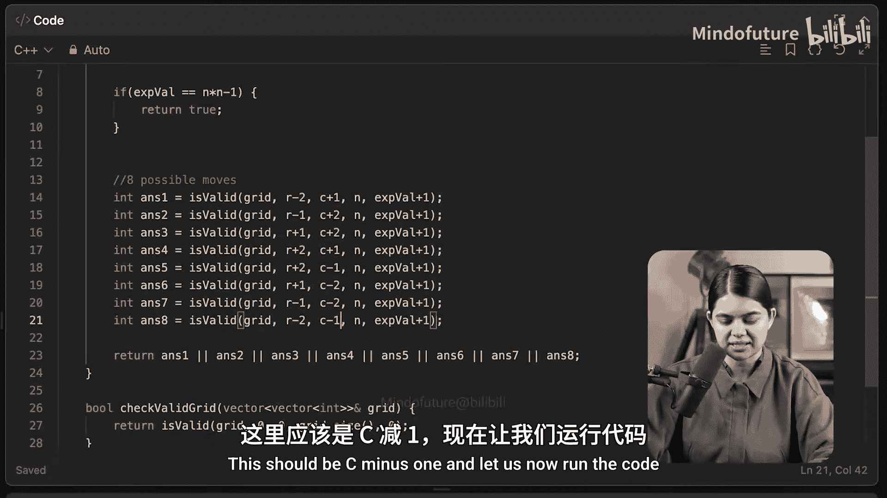

# C++-DSA课程-｜-数据结构-｜-leetcode-｜-Apna-College-｜--Complete-C++-Dsa-Course-p54-P55_骑士巡游问题-回溯-Leetcode_2596--BV18oUGBkEmV_p54-

Hi everyone and welcome to the complete D series and today we are going to solve one more important recurs problem called Knight this is a problem。

 homework problem the other。 If we have already done the problem completes problem Also there is a link for company in the problem is called In fact is a direct of then problem This problem number 259 on。

 which is called configuration Ies Sos suppose， there are three rows and three columnsite there are multiple pieces which。

😊。

Available Queenes that is to be an In fact different directions ins detail but basically this is a ch which is Joce In fact let us give it a So for this particular these valid moves or are in moves basically we have to complete this function which is a boolean to check if the given grid is valid。

😊，Not to bulloleion return return if it is invalid。

 then we have to return false basically how does it work。

 Lets suppose position that is this given number multiple moves and7 in order which is mentioned in this grid or false return this is the basis of the question。

Problem that we required to solve basic knowledge peace exactlyse moves let us look at this8 different directionss us call this12345。

6，7 and8 available is positions per analyze for this first move can we say is first12re。😊。

R or ham first move La to first move Le R2 K and column to column key value to column key value C plus1 Hogi the column valuejagi plus1 k equal Similarlyly secondgibi position ni Rari both1 ho column plus2 to row1 ho and column plus2 Similarlyly third cell kbari plus1 ho and column plus2 So this is R plus 1 and C plus2ari4 cell kb。

 This value is R plus2 C plus1。😊，similarlyel to， if we want to move to this fifth cell。

menaga plus2 and columnna1 is column is column So this will be R plus2 and-1 Similarlyly for the6 cellari the rh plus1 and column2 Similarlyly for the7 cellari1 column2 So this is rh1 and column-2 and finally for the8 cell is2 and column1 So this is rh-2 and column1 exist column we can figure out what the next8 moves are going to look like。

 these are the possible moves per and moves analyze。😊。

given is that the correct path or not Let us suppose we start from this cell。

 which is the and and say possible next times possible to move from2 next time is。

co 4 per3 k agakle immediate cells to bja perle possible is 5 perna Toco 5 per。

5 per a immediate cells blockja perkle is 6 perna possible to remove then from 5 to 6。

6 peragga to immediate cells blockja， and it can move to this 7， then 7 perag。😊。

immediate say who move to this87 say and that is configuration false because this is not configuration。

 which is valid for then possible moves complete configuration basically problem possible moves and8 possible moves possible moves say example If this is the positions to possible movee second possible move。

😊，Pos move next expected value value and so on value function to this task basically iss call which is grid position value and。

calculate but still will pass this n value to see the grid size grid and one more value。

 which is the expected value value value next is the correct answers are value。😊。

Plus to expected value expected value will return back from here。

 we'll backtrack from here butki to next path will basically pass this special value called expected valueju configuration configuration and finally we are going to return a boolean variable is function Boolean variableru return correct path per And if we return this as a false are on the incorrect path8 possible moves8 possible moves is valid function let's call this function is valid。

😊，H grid。 let's suppose first move first moveja R-2 and Cja plus1 next move R2 and plus1 next and I expected value next toel value we are sitting on the0 next time expected value11 value22 k value3。

 This is the way value plus1 and answer answer basicallyan valueid basically I I false return configuration return we need to store this answer value in a boolean variable Similarlyly move I second is。

😊，grid next time you move second second R1 and c plus2 R-1 and c plus2 with my n。

 And next time expected value possible movesari value value So this is the second possible move answer value return and similarly moves。

😊，8 different moves simply and column values to execute these eight possible moves let's suppose or possible is here tose second possible have found the expected value here but is is to expected value grid that is not equal to the expected value to re or rever with false that is not going in the correct。

😊，A grid of ourki value is not equal to the expected value that we were searching for。

 Those case case may return false value to y possible base case I there is one more possible base case for returning false value Let's suppose first callgi let us try to imagine that first call first call call R-2 C plus1 k R call R2 plus1 kham is0 started with0ari expected value0 togi that will go for2a1 expected value1gi is grid grid per in because2 is an in value for a value。

😊，column value in false is the condition for crossing the grid grid or grid grid less than than greater than equal to greater than equal cross the grid this is my base grid check for the basic conditions and what are the basic conditions basically than greater than equal to greater than equal to。

But grid underari expected value name giveari cases and ja we are going on the wrong path to Ya return Ki false value。

 So this is the base case for the false value。 a false value base case k to true value there must be a base case true value true return exactly let's supposehami example is。

 which is the last cell of the pathari towards return true value what true valueju exactlyju true valueariari n square1 moves If this is my ches board。

 which is of N n square n square total n squareiari moves0 already given here0 n square-1 moves。😊。

To finally aari expected value n square1， which was the last expected value true return expected value becomes equal to n square-1 and y expected value case grid is not equal to expected value value returnham grid is equal to value or expected value is equal to n square case directly return true answer to this is the case case moves possible possible answer and。

😊，return returne possible said 7 said true value。 though basically we are going to return。😊。

Answer1 or or answer 2 or or answer 3 and Iririari8 answer values or return answers say value to case value So this is the entire logic to check if then configuration is correct or not and recur let us convert the pseudo into the the time in space complexity given this this function does not have the required parametercur function function let us call this boolean is valid。

 In fact， we can also call this boolean is valid helper lets call this is valid is valid get the rh value column value and this expected value is valid。

😊，column starting me n that is basically equal to grid dot size and expected value for the initial cell is equal to0 valueer function return from this main function basically is function sub possible moves to8 possible move answer one return possible move possible move grid pass minus2 value c plus1 value n and expected value will be expected value plus this is our first move and similarly possible moves let me quickly change all of this and column values and my answer variableme simply inriri。

So， these are the eight possible moves in co Che ism Maripa 8 different values return Hokuragi and hum return Kingi answer 1 or or answer 2。

😊，So we will return the combined or for all the values or Q may say be8 moves aga through return okta to hum return K it through base cases can then subse in validity of base case they claim them Kabi B row value is less than 0 or column value is less than 0。

 or if row is greater than equal to n， or if column is greater than equal to n。😊。

Yair agahammaic grid of Roa column key value is not equal to。

My expected value in Sarari Gaari cases Kli， we are going to return false and Kabibi Agahamari expected value。

Becomes equal to n square minus-1。Those case may we are going to return a true value。

 So this is the entire logic to complete our is valid function。

 I say recursive function k logic pass and here function Jo be answer return Kgaium return King from check valid grid。

 before running， let us fix this last move， this should be C -1 and let us now run the code。

 The codea successful run Ka Iham submit Krigi。 So this is also a successful submission。

 if we talk about the time complexity of the entire code the time complexity con analyze K and Nsky analyze kam basically Hamari pass in total。

😊。

N square cells n availableari ideally we can make eight possible choices or agarham K8 possible moves to her single level per different branches n recur n square cellsham different choices link time complexity that will be big of8 to the power n square So this is the expected time complexity and in terms of space complexity asuxili space use herem recur callski recurgen stack basically0re n square minus1ari possible moves analyze we can sayari recur callski complexity that is big of n square So this is how we solve the problem ofn2 this is an important problemgarham already ns and backtracking in recur clear this is a pretty easy problem is problem tag medium level the but ahamari recur backtracking is fundamental strong to a problem ideally easy level problem。

😊，So I hope that we have successfully completed today's lecture if you have then you can mark your in us down in the comments。

 you can also share your progress with me on Twitter just Kakunija description box caner mill Ja askulate time with the next lecture can that tell them keep learning and keep exploring。

😊。