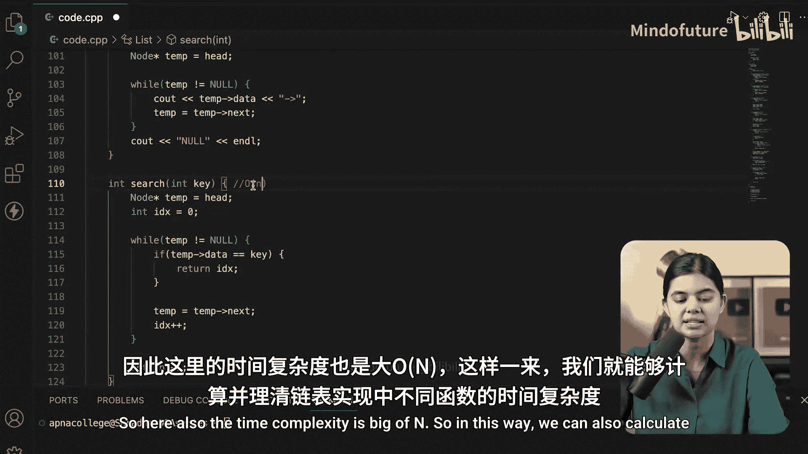

# C++-DSA课程-｜-数据结构-｜-leetcode-｜-Apna-College-｜--Complete-C++-Dsa-Course-p56-P57_链表简介-数据结构与算法--BV18oUGBkEmV_p56-

Hi everyone and welcome to the complete D series。 and today we're going to start with a new data structure。

 which is called chapter object oriented programming concept and lecture complete is or is visual visualize them like and called visualize。

😊，To say Hamko is thes visualized name， Kihamippa's individual boxism。😊。

ma her box node oreari individual data can node。 These are connected in the form of a chain with each other linear fashion of the major difference between or vector and stored inte in the form of location address will be 104。

 will be 100 will be112 and addresses nodes address can be any value is a contig memorylyja as structure visualize Also unlikes is。

😊，Dyna data structure run time per extra nodes and nodes delete So it is dynamically reizable very similar to available in the form of a list fundamental understanding interview of functions visual and if we talk about all the individual node node。

😊，Data say for example， am 12，3，44 numbers plus node for example this and this node in the form of basically node node address example node address equal equal2 address Similarly node node have address150 which is going to address of next location or the next node and and。

pa next pointer visual but internallybu memory k to her node k and that data will consist of。😊。

A integer or character or Jo different primitive plus next nodeer for example is as such index value second value value and one by one ander maintain which is called head header node and head node node second node node address。

😊，in the form of head pointer we also have a tail pointer but this is pretty optional General somethinger just like header is once again。

😊，Carring a Vo implementationari scratch use carrying a different different classes and objects the E Os of fundamental understanding that is important to be able to implement a link list from scratch A blinkless banana Kelly let us implement a link list from scratch。

😊，is also something called second。node address node create if we create a node classer address node value stored data and nodeer use let us class to create nodes of this is theer classs call it node this is the syntax for creating class properties and methods properties and methods access。

😊，Though public class can sub hum value beangi integer data and Ukeat may ignored star next pointer。

Ifjo next pointer here Yaisha next Noga address Kaagga Sakiat will create a constructor。

Note in teacher and next initialize with an nu value said this is an individual node class individual node class objects object second object object in the form of class but in combine class class class use use information single what is one。

😊，special ch dismiss special pointer is our head pointer。

 Def head pointer first node of head basically node pointer node will also create something called a tail pointer。

 which is alsoer or let us one more class。😊，Let's call it list。

Jisay under ham cha to Ane head and tailco。Private re Yuki as such head and tailky value。

 H Kahiper pass onhi Kne Valley。To Jse Bhame by default。

 public declare Nkiia protected declare Nia vrikisari values C plususus class kandic private memberrutheium Anyaer。

 if I use the public keyword， thham I list k it constructor define Casse。

 it will be a non parameterized constructor justkanderkoi parametermeter Niagga head and tail。

 thougho Kohiham initialize Kringi。With null values simple functions define。

 So with the help of these two classes scanner multiple functions only schedule major functionsium。

 which are also available in C plus basically major functions sub front。😊。

Push front function Gandergarham Valri I， Similarlyly， second functionai。

 which is called pushushback。😊，Pushback key helps saym value push it tries to store it at the end of the additional value and this node is again going to point to null or update update counterpart function which is called delete and delete major function insert additional to function and delete function that we are going to focus on is called let us imagine a with nu let us this as head。

😊，And this pointer as the tail pointer。Ykihamariuaro head and tailo values initializeaari completely valuenekypa no cases Yatohamara head。

😊，is going to look something like this， which is an empty。

 or second case let us suppose called So the first step is to。😊。

Add simplyer new node and tail pointer is also going to point to this new node。

 and by default node the second stepja and node case handle first casene let us write for function and well call this function front nodene nodene basically。

😊，let's call it new node node with the new keyword and。use new keyword。

 which helps us create a dynamic object Jo function called node or value nu case head and same value assign which is the new node and Fer functions return because this is the only thing that we wanted to do first case tackle Now let us tackle the second case second case node exist or node let us try to push front2 a push front to。

😊，second case is value is to and we are going to establish connection and existing。

But just second step ahead， to say I perform G I。😊，That is。

K new node new node next pointer is now going to point to the head pointer Any third step is going to be equal to node this isju head might be for basically。

Pointer he toham， basically Chahenhamraju new node hem， which is a node star pointer。

 I a D reference curque Ikijo next value property he Use value assign exactly internally memory operation for you can new node as a pointer pointer D reference Kki properties Kaneki I he cheesecomeki new node kander。

😊，Hm next to property co refersevana2 head I I second sentia。

 because this is very simple to understand Kyakeba。

 we are going to update our head value head is now going to become the new node This them push front Jopura function say complete Ka Ya。

 let us create a linked list。😊，Lin is already create O just scan push front me sub P push front curtain1 value co Uskeba2 and 3。

😊，valuesari Similarlylyham and this is going to be equal to connection establish and now let us try to print this entire let us take an example of the same in a manner interviewer cases only given the header operations print will create anotherer Lets call this one head。

😊，first node first node which is equal to one is always equal note basically we can start with a variable。

😊，Called star we can create a loop is not equal to my let us with some and update next pointer will become equal to。

😊，Next pointer temporarys suppose node to to print all of elements not directly in with the help of first want the value of always take in the form of let us convert this into。

😊，Lnk list class canner is list class canner， we are going to create one more public function。

 which is called print linklist print linkless canner will create this temporary variable just initialize carrying a head casesar jobt are temporary。

Is not equal to null。Doctor come see out Gneval。Ad。😔，Are temporary。

Arode data with some space andkebaovni T Rico Ham Karingab to Tempica。Next。And at the end。

 we can print a。😔，Next line。The Yaer in values co pushky link scanander。

 a blinklist carry call K print linklist function to a Mariipusvahiim linklesser print Hogiem Yai 3。

2 and1。 I'm trying to inky arrows we print Kak Ya spaceky， we create an arrow。 And at the end。

 a graham null like。😊，So let us save it and rerun it。 Tois theri a Hamari linkist head。

 Joari memory can the create Next， let us implement the pushback in linkedlist function。

 pushushback Kenika Malabeki Aripa Al Hamri linkist exist Katier。 tosk at the end。

 Ham E9 node go insert Kna。 Let us suppose Hamari pass a new node at。😊，Let's create this new note。

 and this node is4 a push front nu equal and same second case is not equal to nu exist once again，se。

😊，whichch is with some data we have already created a new node to or new node last connection establish basically a last node node would nodeju new node we want to establish this new connection What is the new connection Iju Now that should be equal to new node to say connectionja and to to this node third step key value will be update to new node value is not equal to a particular element or a particular node at the end of the let us write the for function。

😊，Going to create。A new function is a push front key directly in each create card。

Let's call it void push back Just scannerriasic in teacher value Igi is value key helps say how make node star new node create Kringi with the help of the new keyword。

 disma value Kpa Kinggi。 subsequently check Kringe if the head is equal to null head agarnalhe。

 those case may head is equal to my tail。Is equal to my new。Not。

Else Valari tailju that should now point to the new node。

 andari it should get updated to store the value of this new note we can complete our pushback function say test a new node which is43 to1 and 4 similarari values insert next important function this is called the pop front and the pop back function pop let us take an example of the same I elements delete is comparatively very simple Basically delete is node delete is node delete or node go delete is。

Dete connection code delete what wewordword call now nu is connection。

and update my is now going to store value or or。😊，Con next will be updated to this null value。

 basically is connection Coorka Hammiki next co。Point to this null value node delete delete and delete node of the delete and also call error message let us convert the to function let us call it。

😊，Pop front pop front kandander subseium checklaacari linklist empty to。

 If the head is equal to null case may， we can see out that link list is empty。

 And yhi say directly K return Natoname Nato temporary variable be then note star1canam through King head key value head go update Kque Kingi head K next。

 and temporary K next is now going to point to this null value。

 And for finally delete King temporary thera pop front function work k main function can a linkless co print Kneseium linklist dot pop front Kringgi。

😊，e completely delete or Now let us talk about the pop back function pop us。

previous node previous node or node node strategy elements name node what do we mean by this node basically node node nodes is equal mys equal to which is the previous node node。

Previous nodes pointer pointer whoseip node next is equal to the null value second last node next next。

Is equal to my null value。 That temporary node becomes equal to our previous node to I am ye condition use Scle。

 I am ye condition use kle。 thougho he condition Hamari is previous node he conditions with him to Abidto Hamaripa tail hair we can use the tail condition。

Basically， ham temporary variable lingy and his temporary co heads the start up previous node Jesse previous node previous of is is of established。

😊，Is equal to null those case metoham k delete carectile in is already empty。

 case mam return K thing。Dusraquera Yehua justma will start with a temporary variable to say initialize Kinge Hekeath and Abnaham Tutalu Chilani v himm。

 Jeptaak my temporary doesn't become equal to this previous note previous nokika condition thee Jeptahammaara temporary。

😊，Khan next is not equal to my tail。 temporary co basically update Ka to temporary will keep on becoming equal to temporary at the end of this loop。

 is previous node my is pointing to this node that is to break this connection is nextbi is going to become equal to connection let us resize this。

Connection go breakju delete is node we want to delete it from memory simply delete the delete and to the last node of the。

 which is currently the node node delete node next tail is going to become equal to this valueju node and this is what my is going to look like is and then we try to print our。

 The code similar to pop front we are going to create another function called pop back。😊。

Just scan the subse paltoium Yahiargiki， if my head is equal to null。

Whose case may we want to see out List is。Empty。Backlash in return。

Neither will create a temporary variable。😊，Which will start with note for we are going to increase the value of temporary of the temporary card next is not equal to our tail value。

Her bar from temporary coard K， temporary K next k equal。And at the end。

 temporary Cajo next I point cur to null value delete Kne tail node and tail is again going tojo delete K y memory can tail node to and Yajo tail variable kjo value under assign K temporary variable key value delete keyword say variable Kam delete U variablejo internal heap memory delete tail variable co we can still use it to assign or reassign our pointer values This the we have completed the pop back function Yaha before printing the link list In fact。

 after printing the link list a list pop back value co and the bar print K will see the change。😊。

Let us run the quote4 delete node2 and implement the and pop back function in interesting function which is called insert in middle of basically function insert position position for example。

 we already which looks like implicit let us node position position and position per。😊。

insert function example let us suppose insert value is equal to4 and position per position is equal to basically to position or12 insert So the first step is basically to node node is my node node insert insert。

Insert connections if we want to insert the node at this position position or second connection position repeat this basically node position us and position position。

positions a previous node address to basicallyp I is less than my position1 andb k update to temporary next to jari pass value to。

😊，ju that is pointing to this node which is position-1 insert position1 k equal given the temporary temporary node establish directly connection connection establish addresses preserve is node address preserve is node preserve node。

😊，ham established with the temporary position next address second connection second connection second connection will become equal to next is now going to become equal to。

😊，New note position and in the middle of the position is less than0 position is less than position position value position can be equal to0 position is equal to0 and basically case is actually the case second case and rest of the case。

😊，This is the rem insert k in the middle of the linked list at any particular position there is a ch canander convert Cartheium code can convert knyse subse hamm nearly linkless create Kleium which is1。

2，3 though is linkedless canander。😊，A Bhamari usual linkus have a good the high I canar hammic function create Kanevalle void insert Just can the8 to Hamaripaari value Ie doaripaari position aval I canander sub checkkaing。

 if position is less than 0， whose case may harm see out Kanevallehe in valid position。😊。

And well return from here。Dusahammaa k Oak the a position 0 k equal。

Those case may Hu simply guarding gave。Push front function co call with the value and will return from here。

 Bakiari cases K a sub palo hum temporary go use curque up now position minus1 v index tu it。

The temporary is equal to head4 in teacherger I equals 0 I less than position -1 I plus plus Her bar hum temporary go carheni temporary can next。

And last make， Jpa Mariippa temporary key Sahi value Ajagi theam create k up nearly a new node。

 So our new node is equal to new node of value。😊，Andhaari new nodeju next that is going to point to temporary and temporary point to the new node complete function which is to insert in the middle of the complete let us test it insert lets suppose insert position save and let us run ourja 14。

2，3， which is equal to the same let us clear this and this caseari start of theap value and12。

3 we can implement the insert function in the as we are going to additionally check for one more condition to in valid position basicallyari position。

case may， we can create one morelog Those connects to exist Those case may。😊。

In valid position with the next line and Yahi sayhi return to extra check here in the insert function justcom me implement Last justcom Ka here。

 which is to implement the search functionality in a link list。 and this is going to be very simple。

 In fact， you can pause here。 and you can try to implement this functionality from scratch on your own。

 This is going to be very easy and very similar to the print link function。

 search linkless canham function Manang search under we are going to pass some key value in teacher key pass carrying here Agarari linkist can key exists Katier let us supposeari link have 1 to3 k equal Agarhamari linkless cani key exists Kat here This key Ka index return Kane This is index0。

 This is index 1。 This is index 2。😊，Thisis case me。

 let's suppose ariki to k case Mahamra answerchi1 kha or kbi Ugarki exists Nehikati those case Mahamm-1 could return Kunga as an invalid index。

 to Kni Kanami simply a temporary variable create Kna。😊。

ba temporary data compare Kling key k position variableing index variableing initialize K k temporary upper point index0ba temporary updateari index value update Ho temporary key k equal case ma return King me index value go So let us directly implement this link let us create this function in T searchari key value i。

😊，Note star。Tempur。Is equal to my head。Jumpt， my temporary is not equal to null。

Take index B create Klean index is equal to 0。 Herbarhammiche Kanaki agahamari temporary card data is equal to the key。

 Those case mehamari return K index value。 Nahito we are going to update temporary to store temporary next value and index co card plus plus last Agahamari key return E those case mem return Kne1 to indicate that the answer doesn't exist。

 This say save Kle andari link Jobi we are going to simply see out。😊，Let's suppose search off， too。

Search of 2 kilohamas you value return O on each T that is equal to 0，1，2 to value hamipas。

2 equal let us clear this in run value2 equal search for4。

 those case may we should get a0 minus can implement search in the in today's lecture extensively talked about what is functions in fact we can even discuss the time complexity of different functions function because as loop use function complexity is equal to of functionham complexity function function as such loop use。

😊，To Yaha purbe， the time complexity is equal to be of1 pop back function K under Q K of a previous point to find out canulic loop gellanai。

 to Yaha per the time complexity is beov n where n represents the size of the linked list insert function K under Bic loop gellanna 4 position -1 to find out the position。

 a position verse case may N K equal Oake to Yaha purbi Joang complexity la in the worst case。

 that is beov of n。😊，Print time complexity definitely search maybe case also and out the of the different functions that we have implemented for the lecture if you successfully completed today lecture share progress with on and exploring。

😊。

