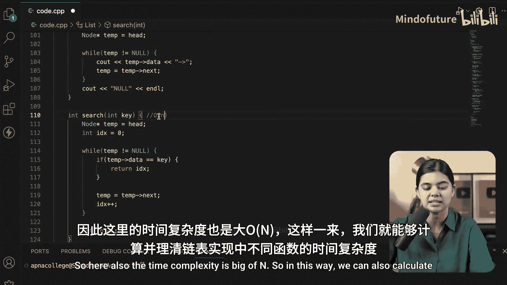

# C++ 数据结构与算法课程：P56-P57：链表简介 📚


在本节课中，我们将要学习一种新的数据结构——链表。我们将了解链表的基本概念、它与数组的区别，并学习如何从零开始实现一个链表，包括创建节点、插入元素、删除元素以及搜索元素等核心操作。

---

## 什么是链表？🔗

上一节我们介绍了数据结构的基本概念，本节中我们来看看链表。链表是一种线性数据结构，由一系列称为“节点”的元素组成。

*   每个节点包含两部分：**数据**和指向下一个节点的**指针**。
*   节点在内存中不必连续存储，它们通过指针连接成一个链式结构。

这与数组（或向量）有显著区别。数组在内存中是连续存储的，而链表的节点可以分散在内存的任何位置。因此，链表是一种**动态数据结构**，可以在运行时轻松地添加或删除节点，从而调整大小。

---

## 链表的结构与核心概念 🧱

为了理解链表，我们需要先理解其基本构成单元——节点。

一个节点通常包含：
*   **数据**：存储的实际值，可以是整数、字符等。
*   **下一个指针**：存储下一个节点内存地址的指针。

此外，链表通常由两个特殊的指针来管理：
*   **头指针**：指向链表的第一个节点。
*   **尾指针**：指向链表的最后一个节点（可选，但常用）。

我们可以用类来定义节点和链表本身。以下是核心概念的代码表示：

```cpp
// 定义节点类
class Node {
public:
    int data;       // 节点存储的数据
    Node* next;     // 指向下一个节点的指针

    // 构造函数
    Node(int value) {
        data = value;
        next = nullptr; // 初始时指向空
    }
};

// 定义链表类（管理头尾指针）
class LinkedList {
private:
    Node* head; // 头指针
    Node* tail; // 尾指针
public:
    // 构造函数
    LinkedList() {
        head = nullptr;
        tail = nullptr;
    }
    // 后续将在这里添加各种操作函数...
};
```

---

## 实现链表的基本操作 ⚙️

理解了链表的结构后，我们现在来实现它的基本操作。我们将重点关注以下几个函数：在头部插入、在尾部插入、删除头部节点、删除尾部节点、在任意位置插入以及搜索。

### 在链表头部插入节点

这个操作的目标是在链表的最前面添加一个新节点。

操作步骤如下：
1.  创建一个新节点。
2.  将新节点的 `next` 指针指向当前的头节点。
3.  将链表的 `head` 指针更新为这个新节点。

需要考虑特殊情况：如果链表原本是空的，那么新节点既是头节点也是尾节点。

以下是 `push_front` 函数的实现代码：
```cpp
void push_front(int value) {
    Node* newNode = new Node(value); // 步骤1：创建新节点
    if (head == nullptr) { // 链表为空的情况
        head = newNode;
        tail = newNode;
        return;
    }
    // 链表非空的情况
    newNode->next = head; // 步骤2：新节点指向原头节点
    head = newNode;       // 步骤3：更新头指针为新节点
}
```

### 打印链表内容

为了验证我们的操作，我们需要一个能打印链表所有元素的函数。

思路是使用一个临时指针，从头节点开始，逐个访问每个节点并打印其数据，直到遇到 `nullptr`。

以下是 `print` 函数的实现代码：
```cpp
void print() {
    Node* temp = head; // 从头部开始
    while (temp != nullptr) {
        std::cout << temp->data << " -> ";
        temp = temp->next; // 移动到下一个节点
    }
    std::cout << "NULL" << std::endl;
}
```

### 在链表尾部插入节点

这个操作的目标是在链表的末尾添加一个新节点。

操作步骤如下：
1.  创建一个新节点。
2.  找到当前的尾节点。
3.  将当前尾节点的 `next` 指针指向新节点。
4.  将链表的 `tail` 指针更新为新节点。

同样需要处理链表为空的情况。

以下是 `push_back` 函数的实现代码：
```cpp
void push_back(int value) {
    Node* newNode = new Node(value);
    if (head == nullptr) { // 空链表
        head = newNode;
        tail = newNode;
        return;
    }
    // 非空链表
    tail->next = newNode; // 原尾节点指向新节点
    tail = newNode;       // 更新尾指针
}
```

### 删除链表头部节点

这个操作会移除链表的第一个节点。

操作步骤如下：
1.  检查链表是否为空。若为空，则无法删除。
2.  用一个临时指针保存原头节点。
3.  将 `head` 指针指向原头节点的下一个节点。
4.  断开原头节点的连接，并释放其内存。

以下是 `pop_front` 函数的实现代码：
```cpp
void pop_front() {
    if (head == nullptr) {
        std::cout << "List is empty!" << std::endl;
        return;
    }
    Node* temp = head;      // 保存原头节点
    head = head->next;      // 更新头指针
    temp->next = nullptr;   // 断开原头节点连接（可选，安全起见）
    delete temp;            // 释放内存
}
```

### 删除链表尾部节点

这个操作会移除链表的最后一个节点。它比删除头部稍复杂，因为我们需要找到倒数第二个节点。

操作步骤如下：
1.  检查链表是否为空。
2.  使用循环找到尾节点的前一个节点（即 `next` 指针指向 `tail` 的节点）。
3.  将倒数第二个节点的 `next` 指针设为 `nullptr`。
4.  释放原尾节点的内存。
5.  更新 `tail` 指针指向倒数第二个节点。

以下是 `pop_back` 函数的实现代码：
```cpp
void pop_back() {
    if (head == nullptr) {
        std::cout << "List is empty!" << std::endl;
        return;
    }
    if (head == tail) { // 链表只有一个节点
        delete head;
        head = nullptr;
        tail = nullptr;
        return;
    }
    Node* temp = head;
    // 找到尾节点的前一个节点
    while (temp->next != tail) {
        temp = temp->next;
    }
    // temp 现在是倒数第二个节点
    delete tail;          // 删除尾节点
    tail = temp;          // 更新尾指针
    tail->next = nullptr; // 新的尾节点指向空
}
```

### 在链表任意位置插入节点

这个操作允许我们在链表的指定索引位置插入一个新节点。

操作步骤如下：
1.  处理特殊情况：位置无效（如负数）或位置为0（相当于 `push_front`）。
2.  使用临时指针遍历到目标位置的前一个节点。
3.  创建新节点。
4.  调整指针：新节点的 `next` 指向目标位置的节点，前一个节点的 `next` 指向新节点。

需要考虑插入位置超出链表长度的情况。

以下是 `insert` 函数的实现代码：
```cpp
void insert(int value, int position) {
    if (position < 0) {
        std::cout << "Invalid position!" << std::endl;
        return;
    }
    if (position == 0) {
        push_front(value); // 在头部插入
        return;
    }

    Node* temp = head;
    // 遍历到 position-1 的位置
    for (int i = 0; i < position - 1 && temp != nullptr; i++) {
        temp = temp->next;
    }
    if (temp == nullptr) { // 位置超出链表长度
        std::cout << "Position out of bounds!" << std::endl;
        return;
    }

    Node* newNode = new Node(value);
    newNode->next = temp->next; // 新节点指向原位置节点
    temp->next = newNode;       // 前一个节点指向新节点

    // 如果插入到了最后，需要更新尾指针
    if (newNode->next == nullptr) {
        tail = newNode;
    }
}
```

### 在链表中搜索元素

最后，我们实现一个搜索函数，查找给定值是否存在于链表中，并返回其索引（从0开始）。

操作步骤如下：
1.  使用临时指针从头开始遍历。
2.  维护一个索引计数器。
3.  将每个节点的数据与目标值比较。
4.  如果找到，返回当前索引；如果遍历完都没找到，返回-1。

以下是 `search` 函数的实现代码：
```cpp
int search(int key) {
    Node* temp = head;
    int index = 0;
    while (temp != nullptr) {
        if (temp->data == key) {
            return index; // 找到，返回索引
        }
        temp = temp->next;
        index++;
    }
    return -1; // 未找到
}
```

---

## 时间复杂度分析 ⏱️

了解操作效率很重要。以下是已实现函数的时间复杂度分析：
*   `push_front`, `pop_front`: **O(1)**。只涉及固定数量的指针操作。
*   `print`, `search`: **O(n)**。需要遍历整个链表。
*   `push_back`: **O(1)**。如果有尾指针，可以直接访问。
*   `pop_back`: **O(n)**。需要遍历找到倒数第二个节点。
*   `insert`: **O(n)**。在最坏情况下，需要遍历到链表末尾。

---

## 总结 🎯

本节课中我们一起学习了链表这一重要的数据结构。我们从链表的基本概念和结构入手，理解了节点、头指针和尾指针的作用。然后，我们一步步从零开始实现了一个完整的链表类，涵盖了在头部/尾部插入删除、在任意位置插入以及搜索等核心操作，并对每个操作的时间复杂度进行了分析。



通过本课的学习，你应该已经掌握了链表的原理和基础实现方法，这是深入学习更复杂数据结构（如双向链表、栈、队列）的重要基础。