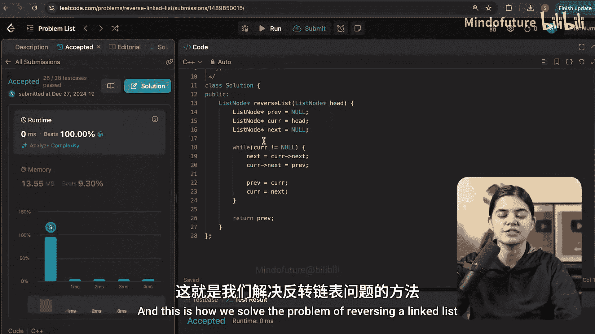

# C++-DSA课程-｜-数据结构-｜-leetcode-｜-Apna-College-｜--Complete-C++-Dsa-Course-p57-P58_反转链表-DSA系列_由shradhaKD讲解--BV18oUGBkEmV_p57-

H everyone welcome to the complete series。 and today we're going to solve one more important classical problem。

 which is called reverse and there is a link for company description problem is called and is problem number 2 given the next pointer and all of the constructors are and example completely。

😊，and the first node will now point to and this will become basically the new head of the and is new function is fixed classical and is a very simple approach or node this is node will update and now it will point to the node node basically in the reverse。

forward connection or backward connection establish with the previous node we solve the problem in the form of three previouserer next pointer set of it the node or node So this node is going to be the node Similarlyly previous。

😊，ize and next to and node is to equal is now which is to actually basically and backward fashion establish basically。

😊，Next forward will start pointing to the previous pointer will now become equal to and this is the major part is the major of answer assign and and that is why the first step in revers to preserve address。

the nexter previous and and is orientation。previous needs to come to this position。

 Then current needs to come to this position。 And next pointer goes to the next position and andhi same sequence next time next next previous key。

Andne next will start pointing to the next value toja steps next is already at the correct positionja and previous next last we can stop the operation basically in stepsbar perform equal we can create loopb is not equal to steps initializationers。

😊，And basically in cha steps repeatedly perform within should be at end of now extra。

L a travel under n nodes available he to the time complexity of the solution is going to be big。

 So now let us convert this pseudo into the actual function complete nodeersSimilar way we have to three pointers1 will beizeerize my current is not equal to nu value key correct value assign basically in the form of this pointerju next。

It will now point to the previous pointer next iteration Cal previous co current key value assign Kthi and current co next key value assign Carheni Yahi can basically repeat otaga。

 and last mayhem return Kne v our previous value as the new head of the linked list to code Koigbar run Ktheier。

😊，And now let us submit it successfully submit And this is how we solve the problem of reversing a。

 I hope that you've successfully completed today's lecture can this approach on a different can remember to to threeers and step a logically steps simply if you have successfully completed today's lecture you can mark your in the comments share your progress with me on and exploring。

😊。

