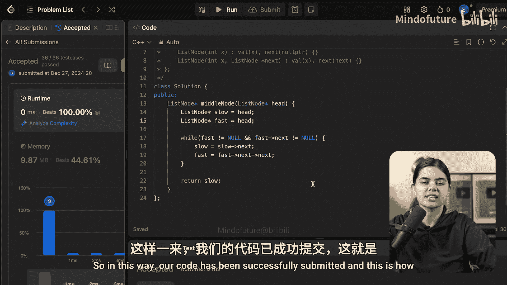

# C++-DSA课程-｜-数据结构-｜-leetcode-｜-Apna-College-｜--Complete-C++-Dsa-Course-p58-P59_链表的中间节点-DSA系列_由shradhaKD讲解--BV18oUGBkEmV_p58-

Ive drawn and welcome to the complete D series。 and today we're going to solve one more important classical linked list problem。

 which is called find the middle of concept scan Also there is a link for a company D sheet in the description box to start This problem is called middle of a where we are given a can contain even number of nodes and it can also contain odd number of nodesme middle second nodeja and it's obvious that this is going to be the middle node in nodeme return the function Now this problem is also question number 876 on given we basically have to complete this function which is called middle node given andme middle nodeer to solve this question Let us take an example of two I number of nodes。

😊，6 k equal Ya aari even size skill second link can n is equal to5 jamic or sizeki for example yeah odd size skill K this is going to be the middle node this come highlight here and linked head Bripa given him。

😊，Even size middle node， though ni second node go as the middle returnja that will be equal to4 and the head of the is also given to us this question is a comparatively easy question and multiple approaches dismisses sub simple approach to calculate node calculate number of nodes divide first will be equal to2 second will be equal to is divided by plus is basically the fourth node This is my first node。

 This is my second node third node to fourth node。😊。

First second third node size divided by2 plus this value is going to be the answer take a temporary pointer pointer is straightforward brute solve is In am 100 is very easy which。

Call the slow， fast pointer approach。And his approach kander， Jome Ben Honi Val。

 Gham I single Lublgaker。single iteration middle of the figure out slow fast approach。

 This is a very classical based approach will be about detection fast approacherer and let us take an example。

 This is the pointer and this iser and basically and fast pointer by。😊，Next time， next value。

 it will be equal toka next Similarly，ham fast fast will always be equal to fast k next。😊，Next value。

To3 cases low kham plus1 kgi fasthambar plus2 guval and slow and fast pointers move kgi jaa fast pointerariri cross nilega because we obviously know fast pointer slow pointers at double speed by move k to definitely fast pointer subri cover Kaga or jse fast pointerri cover kga our slow pointer will be pointing to the middle of the linkist C verify let's see same case verify kringgi。

😊，Example later subsequently evenka evenlogi move k k fast move k12 move k1 fast move k1 and2se nu or to the middle of theer becomes equal to nu becomes equal to nu same cheese odd size and fast in fact is。

😊，and21 and2ing at middle and is equal to。Can basically start kringgi with slow and fast pointers。

 So Im initialize carryinginggi， though pointers slow and fast。 Andake loop Cheellae vlehem Jab。😊。

Ytohamra fast Nlingjata。and and is point middle。He presents the number of nodes in the linked list and slow fast pointer as compared to the brute force approach use Kneah benefit Yaeham single passium single passler upne bar size calculate k a loop second loop size divided by2 plus1 value node do Nikki kring Yaha single go can single iteration can upne middle of the link list find out K。

 and that is the beauty of this approach convert cur to actual。😊，To S Ken。

 we are going to start with linkless notes。Jisma Hamek create Karingi Ana slow jse initializes Karingi with the head。

 Sa katham C Kane Aneek fast winder。 Hammeek loop Chilanim Jeptak。 my fast is not equal to null。

And and my fast kn is also not equal to Nll Yukihora fast Jesse fast is not equal to Nll。

 but fast cann to be N。Howeverbar hum slowko update carryingge by one。

 any slow is equal to sca next and fast update carrying a by2。

 any fast is equal to fast K next next And at the end of the loop。

 hum return King a slow pointer go as our a final answer。

 Yuki slow point Kaari middle of the linkless score code go run Kanese。

 let us change this to fast is equal to head。 and now let us run the code。😊。

And submit it T the Ri say Hamju code have we successfully submit over。

 And this is how we solve the problem of middle of felingist The Agam Ne lectureco successfully complete career to ween mark our attendance down in the comments。

 I says Armi can also share your progress with me on Twitter just Kakunesia description box and the mijaga Ask your late9 millionic lecture Can Keep learning and keep exploring。

😊。

