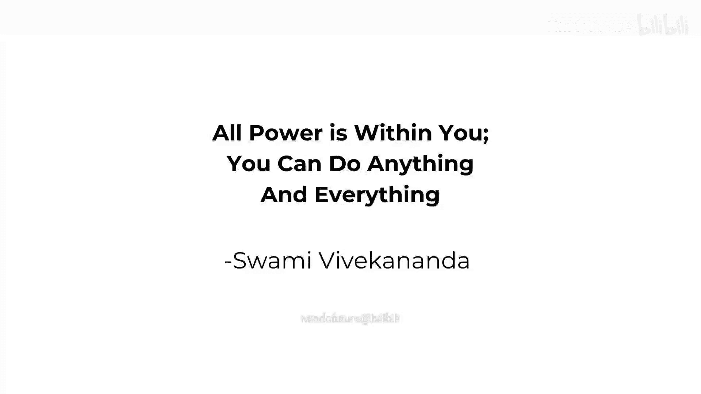
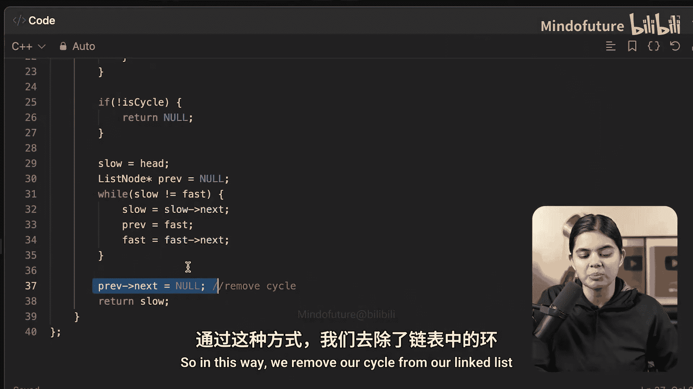

# C++-DSA课程-｜-数据结构-｜-leetcode-｜-Apna-College-｜--Complete-C++-Dsa-Course-p59-P60_检测和移除链表中的环-DSA系列_由shradhaKD讲解--BV18oUGBkEmV_p59-

Hi everyone， and welcome to the complete D series。 and today we're going to learn about an important linked concept。

 which is to detect and remove a cycle or a loop in a concept there is link for company sheet in the description box problem into two parts to detect or So lets focus on the first part of problem which is to detect given is aing twist in the question plain loop。

😊，cycle node that is getting connected to one of the nodes inside the ending question or is also problem number144 and this function which is called or which is callederer。

Basically， is approach pointersium a pointer pointerergar this is the head pointer Ko ander Ko with head value with head value and head value ander pluser plus Similarlylyerer plus anderer to detect cycle in the mathematical problem and。

Mathematically analyze approach logically what we do and fast pointers and or will become equal to my fast are my and fast time12 next time and fast two moves and and is and fast。

example let take an example of。Basically， hamap me slow and fast pointersco move Kan Chaem by one and by two to slow co by one move Knekaki Herbar slow pointer key valuejagi Ska next and Herbar fast pointer key value Hojagi fast K。

😊，Next next to is not equal to which is the case for an even even and to should equal to remove this。

😊，and next becomes equal to is equal to and also equal to。😊。

loop but agar if there comes a point after we have updated and equal directly So this is the entire logic check or let us convert into about the we to complete this and similar will create one more pointer。

Which is the first pointer also initialized with it。Yaber Hamabh， Luchlangi。

Jeptak are fast is not equal to null and Jeptak fast Ka next is also not equal to null value Hamme herber slowko update K I by one。

 Ya slow hojaiga Ska next and fast co update， can I buy2 Ya fast hojaga fast K next car。

Next update Kaig herba ch Kinggi Agarham's Loki value fastki equal。

 Those case may loop exist Ktai Cy exists Kahi Yani Asam return calling a true value or Agarham' while loop a Bahara to directly return Ks false Kpakui Cy in can exist Kaier。

 Now let us run our code。😊，And submit it。successfully completed the question。

 and this is how we find out if our contains a cycle or not mathematical proof and then we finally talk aboutclaim interview fundamental scene reasoning this。

😊，ari is the head。 or this is the end of the basically starting This distance is equal to some x distance。

😊，Andjuaura distance this distance is equal to some d distance arbitrary values x is123 notes this distance is equal to two connections So this is some value x is some value and and fast and distance is equal tob and fast next time update and distance is distance Similarlyly。

 if we update the values again and fast distance。😊，and assume。

distance that is equal to k initial distance or and length or distance exactly same position and distance and n。

fast meeting is and So this is the logic using detect logic proof basically the second question is。

Jes is is This is the exact node category of a category of or。😊，he cases is starting Nor。 Now。

 let us talk about Norse to find。If a cycle exists or not。

 or is say find fast approach fast pointers important to find out starting note fast point fast1 to1 to1 this is the meeting and fasterize with the head valueer and。

😊，To subseham approach co they then， we re initialitize the slow pointer with the head value and isbarringbarra slow and fast pointers go update kring。

 but is Ko plus1 and fast Ko plus1 dono value equal Yai will run a loop will run a while loopb my is not equal to my fast pointer plus update will become equal to slow k next fast plus1 update fast will become equal to fast k next。

 and in a tu update k don valueo they are pointing to the same note slow by fast by update by fast update Ka by1 and finally yeo meet Ka This meeting point is the star。

😊，of the cycle is mathematical proof meet starting starting as basically sub to figure out if my contains a cycle or not head value and and fast plus1 plus and last as starting point convert to actual proof。

😊，To Savalgeander。Y， but we have to complete this function is function can the sub paltome cycle code detect Knaardiga justca let us create two pointers。

 less node slow just initialize carrying a head case。😊，And listen note。

Fast G B initialize carrying a head casear upcycl detection car logic already per time Jep theak k fast is not equal to null and Jep the fast car next is not equal to null up the kme。

😊，Slow by1 fast2 fast andgaran variable and because we want to preserve this value equal cycle is equal to false cycle case。

Mier withp。😊，Is not equal to my fast pointer。 Herbars logoco。 We are going to update it with one。

And fast Ko be update King with one value。 Jesse don no update Hoge last meish a point I equal Javo equalge that will become the starting point of our cycle of the linkist。

 the Asem return logo。 So this is the entire logic to detect our linkedist has a cycle or not。

 And Jese cycle Homuscycl starting point return。😊，And now let us submit it。

 we have successfully figured out what is the starting point of theriri approach mathematical logic to mathematical logic and is connection form course distance let us suppose distance between the head and the starting point is value starting is equal to value x loop distance total distance value D let us suppose and fast point K loop k per node per node starting value this is the starting value and this is the head pointer starting node starting node。

😊，Ja distance is equal to some y distance， and distance is equal to some d minus y distance and fast distanceer and finallybo distance travel travel travel a number of a multiplied by d times plus travel travel Similarlyb distance。

travel travel two times travel travel plus this is equal to2 multiplied which is x plus。😊。

So is equation co hamringi is equation co solve knegiuchgi toipasja x plus b d plus y is equal to 2 x plus 28 D plus 2 y x co right side meang toip Xjaga。

 this will get cut B D minus28 D minus yas valuejagi to x is equal to D B minus2 a minus y。

And this B and a， these were two constant values。 Basically。

 a a times loop co travel kta to a number he B times loop co travel kta to b which number to B minus2 a Bpa which constant value y B minus2 a co replace cur with some constant value toari pass unique equation A and the unique equation is that x is equal to K D minus y a equation Q x is equal to k d minus y co k re change cur k that this is equal to k1 D plus D minus y I the same expression co Ham asa expand curque。

 though different expressions K under change K aari y value and aari y value the to kra x distance he Joari linkist K under exist Kta that distance is equal to some constant number of。

😊，Times hum up now D distance travel car D distance travel can come a constant number of times hum up loop may gumterrete plus y D1 distance here justco travel cur E thinna agarham travel carrying a loop candle that is equivalent to coming from the head value to this starting point basically hum carrier。

😊，K jury initialize to the head value pointer pointer is pointer starting valuena distance travel pointer second loop x distance travel pointer x distance travelham logical pointer fast pointer distance travel distance travel fast pointer minus y distance travel D minus y distance traveler iser D minus y distance travel D minus y distance travel and fast will now come to this starting point plus constant times D distance travel pointer。

😊，reason。though variations Basically， the first variation was to detect if a cycle exists。

 Second variation was starting node of the out third variation is remove remove and faster node previous pointer we basically create a new pointercom previous pointer。

😊，i remove So this is the step that we can do to remove the cycle in the and previous will be equal tos suppose and and head value and faster fast。

😊，previous and fast are the three variations of as well as。😊。

He kiss the re a up link list can same P cycle code detect kakname and remove ksectname If you have successfully completed today's lecture you can mark your tennis down in the comments I case A me can also share your progress with me on Twitter company descriptionscript the Ask next lecture can that keep learning and keep it。

😊。