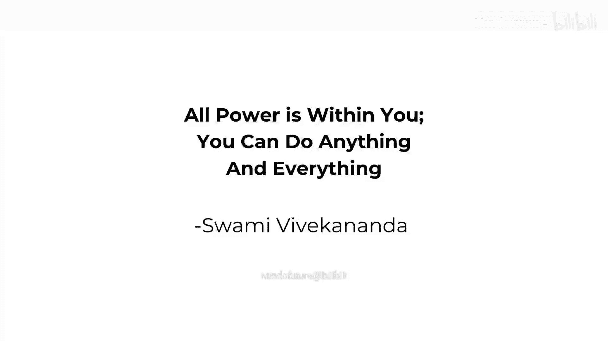
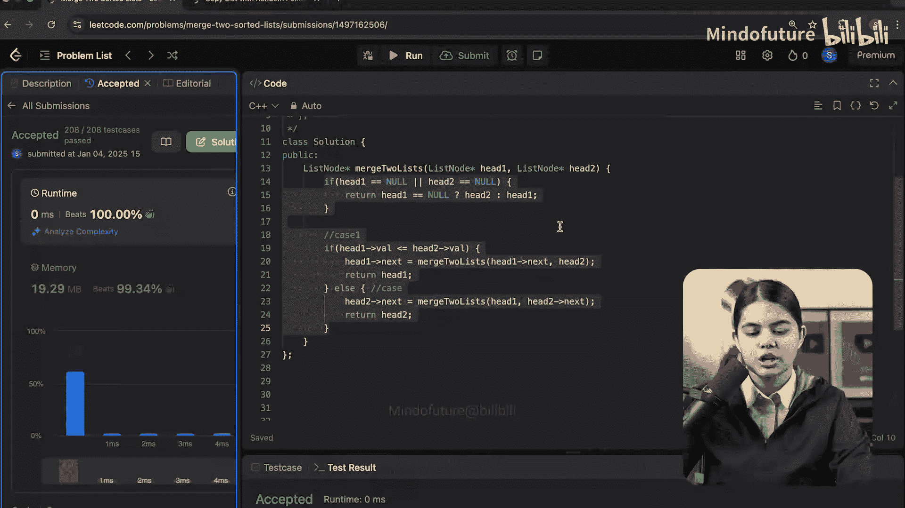

# C++-DSA课程-｜-数据结构-｜-leetcode-｜-Apna-College-｜--Complete-C++-Dsa-Course-p60-P61_合并两个有序链表-DSA系列_由shradhaKD讲解--BV18oUGBkEmV_p60-

Everyone， and welcome to the completely series。 and today we're going to solve one more link problem。

 which is called merge to sorted list concept available Also there is a link for company in the description box is called merge to sorted list and this is problem number 21 on is function mergeed listed list exampleed list sorted list secondededed list from this function。

 basically we have this function given which is called merge list and。😊。

So complete basically becomes more complex as compared to fairly as compared is are convert。😊。

secondc and is the head of。The jbiham， though node who compare Ka Hamipas。

 though case asam first case is basically T Jebham H1 k value co compare Kringi。

 and it becomes less than or equal to h2 key value。 Malabijoari node1 H。

 This is less than equal to this node Dura case T Asaib H1ha H2ha Jahaa H1 key value greater than Hojae H2 key value the first case Hamapasaihamari H1 k value less than equal to h2 key value H。

 And similarly， Hamapas second case Iga。 Yeah， in fact， let us write it in this way。

 This is basically our case 1。 and Iika else va case Hoga Hama case2。😊。

J value greater thanari value smaller He Je pass head1 and head2 value givengarari value smallerariari simply ask returnariari1 returnari Ko。

😊，To， basically。compare return function once we have decided that is going to be the head of the problem basically what we are going to do next node。

😊，problem is first and second next node3，5，2，3，6 final result have 2，3。

35 and6 which is going to be as next and recur next。😊，next and and。😊。

H1 connect will basically be equal to the output of whatever the recursive function is going to return to us。

 Andusba fine H1 kham return K is the final head isri logic H1 value H2 values a smaller head is case we Let's suppose next timepa H1 and H2 obviouslyki2 value smaller as compared to H1 value Tombi opposite Iri linkedka H2 bar notes compare kne definitely greater Tom success those smaller notesko compare H2 value return K。

😊，but return and finally which is merge function and and original is going to point to the final of result equal to result of and equal。

And next time2 compare is lesser in value as compared to value2 is basically second value5。

 this is h。😊，And2 ands suppose let usize and this is how as return。😊。

Haari 5 connect Kariga is 6 kssat， Similarly， ye 5 as head return。

 who guys 3 equal to 3 K kriga 5 kissat。😊，3 core head return Hoga 3 to83 is 3 kat connect kga。

 Similarlyly， Hamaripa 2 Iga， which is going to be the head。

And y2 as head return Hohams1 v node or finally one v node is2 krigi and one nodehamya return as a final answer to theari whopa sorted fashion may returngi And this is how we write the recursive code to do that。

 Now， let us convert the pseudo code to the actual code andke we are going to analyze the d complexity。

 So this is the function that we are given I scan the list1 rename head1 and head2 kam sub kbiari head1 key value Nge Yaari head2 key value N。

😊，Those case may hum return Guringgi， if my head1 is equal to null those case may hum head2 co return Gnyval。

 neither we are going to return head1 key value。 So this is a turnernary statement that we have writtenhammna case1 li letium case1 is Jeb Hamari head1 keyjo value here that is less than equal to head2 key value。

😊，W case may head1 car next is going to be equal to the final result of the recursive function。

 Ja perham head1 car next。And head2asring And finally return head1 co as the final head of the。

 This is going to be case2 head head and this will be head us and submit So this is how we solve the problem to merge let us assume is notes second notes as head or So basically。

😊。

no link can the total number of nodes A n plus m equal to the time complexity of our solution is going to be big of n plus m。

 So this is the final time complexity with which we have solved the entire problem。

 So I hope that you've successfully completed today's lecture You can mark your attendance now in the comments because me can also share your progress with me on Twitter justku description box scan Ask Mil lecture again that then keep learning and keep exploring。

😊。