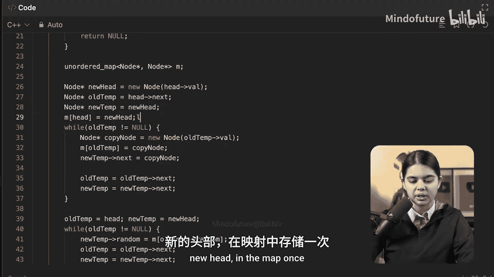

# C++-DSA课程-｜-数据结构-｜-leetcode-｜-Apna-College-｜--Complete-C++-Dsa-Course-p61-P62_复制带随机指针的链表-DSA系列_由shradhaKD讲解--BV18oUGBkEmV_p61-

Hi everyone， and welcome to the complete DS series。

 and today we're going to solve one more important linked problem。

 which is called copy list with random pointers。 concept there is for in the description box。

 So the problem is copy list with random pointers So in the problem are basically given aer has special pointer which is called randomer individual node which we always a pointer in which is pointing to the next node special pointer is called the randomerer this random pointer could point to any random value in the example node。

😊。

Noode。 this is pretty straightforward。 Parrisme， let's suppose 7 Cajo random pointerki blues highlight ni connection to 7 Ca random pointer13 Ca randomer11 Ca randomer is pointing to110 Ca randomer is pointing to 11 and1 randomer is pointing to7 So basically the random pointer of node can point to any random node of the or it can also point to the null This is also problem number138 and function to question is key exact deep copy deep copyre with the copies of the exact nodes and copy of the。

😊，deep copy head return key copy sub node replicate nodes same connections follow original original random pointer connections connections for example7jo random point to13 random 137 new 11 random pointer new10 random pointer 11 random pointer original or or here with the help of new nodes11。

😊，It is pointing to the old one Old north connection exists I exact copy or functions return Now to solve the problem。

 we are going to solve this in the form of two stepser completely or straighter is given in the first step to ignore the randomer second step original random basically first stepari are to create a new note。

😊，Newers。 let's call the first pointer as old temporary pointer。

 and the second pointer as new temporary pointer。 old new old notes or basically create a star pointer called keyword let's write it as new note。

😊，P original Now this node class can vary on the question also going to create and and basically from we are to copy and。

😊，Abehamra old temporary 13 ker of point node Bananni。

 justham old temporary key valueo copylinggi basically will create a node star。

 let's call it copy node， copy node khamnianni vo copy Ggi。

 any new new node of old temporary key value。😊，The old temporary g be value guitar of point Kara Hammuske copy node beanggi Andoskeba Hamra new temporary here is copy node guitar of point Carga Yani new temporary Kn is going to be equal to this。

😊，Copy note and next iteration K ham uplay old temporary co update Kque 1 Peangnge up a new temporary co update K 13 Peangnge And we are basically going to repeat these two steps again。

 So update Kni Kle Hamra old temporary。😊，Will now become old Tempica next。And the new temporary。

Is now going to become new temporaryica。Next and similarhamra is stepari old temporary of I copy node copy node can create this new node。

 which is 11 news is copy nodeham connection establish andham old K to this value。

 Basically it is pointing to 10。 and new temporary K to 11。 and he process。

 Next time we are going to make a copy of the 10 node connection establish K and Finallyri last node have node1 will establish one more connection Finallyham Jo key valuero inro repeatp。

😊，While are old temporary。Is not equal to null value。 we are going to repeat all our four steps。

 and this is what the entire first step is going to look like。

hamse andki simple with the help of the next pointerse second problem which is to recreate the random connections in the newist connections basicallyki17 connection is connectionii particular information connectionsre and that information is oldii。

😊，Example， let's suppose this is address， and this is address 560i and new node Similarlyly3 original in is which is this note random connection with new formed note connection。

😊，information stored k original new node search we can use an unorder map are going to get an optimize time complexity basically what we are going to do we are going to create an unordered map or unordered map can map use but order maintain nodeers search since un map is more efficient as compared to a plain simple map of easily map use un map can node pointers pair my first pointer is going to be the old node。

😊，And the second is going to be the pointer to the new node。

 The jobbhamm me first time we copy linkless Bar Hamharbar pairs Cosor Karakiki Ki old node K me Ki new nodeki value go create here。

 top me original code galer。 We are going to start with an unordered map。😊。

And unordered map Kderham node and nodeka Per Leing。

 let's call this M M Kander Perskot Karankalabe subseleham old and new headkahi Pertkarainggi old and new heka Perkala M for the head value is going to be equal to the。

😊，New hit。Jiska la。 let's imagine our map like this。 Ke Agarhamni map kander。Yhani old Norko。

 which is going to be the mapki Nor in the form of the values。

 old Norko7 new 7 nodeka address Yaga thebiha map the copies map can the st we can simply write map ofarianni Norjagi old temporary old temporary copy No。

 theanni Nor will be old temporary which is now going to point to the。😊。

Copy note informationrai Norka 3 Ka pointer israi 13er k13 k pointers Similarlyly。

ic single node k value Corai I am highlighting them with the help of different colours。

ka different different pointer values Co。😊，Once we have stored the addresses of the old and new node humdubars linkless quo a core by traverse kingi Dono linkless score and up up near random connections go form Kna start K random connections come Casse form Kneval random connections go form Knele dubars up old temporary co initialize Kringi with the head。

 and we are going to initialize the new temporary with the new head to basically。😊。

Upne old temporary co。 Hure initialize Carhenga with the head and new temporary co。

 Hu initialize Carheni with the。New head Abdubars a upna same loop Chilan Jup Jagapta old temporary nanijaa new temporary nanija。

 In fact， the size of both the link list is going to be same。

 Tom Kissie pointer use Case Hamic Lo Chilai v Jeb tu。😊。

My old temporary is not equal to null or is loop random connections recreate random connections recreate simply random connection7 connection that is pointing to connection and and Then we are going to repeat the process for the next note13 connection 13 connection7 k 13 connection problem7 and or search old7。

😊，address or simply recreate basically what we do value is is basically is random key and if this is the key is random connection random pointer is now going to point to this value and this is the magical statement connections and。

😊，ate to simply next statement would be to update the old temporary， it will be equal to old temp。

Come next。And new temp。Is going to be equal to。New tip。

Con and similar manner loop repeat So this is the first part of the code。

 and this is the second part of the repeat is the old is search old simply11 random and is 1010 111111 to this node node to 11 and finally update to the last node of the。

😊，IsPoing to this7 is7 addressari toward is7 k corresponding。

 This is the new node that we have created to node to one directly randomly to connection create and and key finally our reached null random connections replicate random connections replicate unor map Ju for nodes and new nodes and at the end of the function we are going to return new head of the So this is how we are going to solve our problem in two parts convert to the actual code and then we talk about the time complexity is the function that we have to complete is function nu case are given a null。

😊，Copy bananagi or Yahihi return kto Heke valueenl。😊，Usip。

 we are going to create an unordered map for。Noode pointers justca underham pair of node pointers toward Kaangi。

 Let's call it M Sa kat Hammic new head value create Kaangi， which is going to be a copy of the。

Original head value。We are going to create two pointers a kra old temporaryjagari old linklessverse kname start cur from head UK headm already copy next time head next thing any next pointer a copies banana start cur and one will be new temporary new temporary k start k with the new head because we haven't really created the next pointer So this is the only node that we have right now。

😊，Haic Lulan。Jepta kmara， old temporary。Is not equal to null Tta Kmi plain simple thatco copyja plain simple that aco copy K sub will create the copy node。

 It is going to be new node of our old temporary key。😊，Value Okebalraju new temporary here。

 Isk next is going to point to the copy node。 And finally， we are going to update the old temporary。

To point2。Old Tica next。And new temporary to point to。New temporaryica next。

 aber up map cander be values Sc Can start Car here map can their values Sc canham simply map of old temporary key is pointing to the。

😊，Copy note， though this is the original load in the original linkist。

 and this is the copy node disc onnet new linkist scan the create here at the end of this loop。

 Yahammnesf plain copy when I here Aham second loop gellani Jo Kopi Carrega Sarigiari random connections go to dubarra say up old temporary go hum initialize Cardean with head and new temporary go hum initialize Carithta with the。

😊，New head a loopp old temporary is not equal to anal value。

me map old temporary k random connection K corresponding mal node duowsky value and this value will now be pointed to by our new temporary random and finallyo values So in fact。

 we can copy these two statements say copyle and last may return new head of the。

 basically loopri original linkverse k and y loop original linkverset So if the size of the original link is n though loops big of n So the practical time complexity of the entire solution is essentially going to be big off and if we ignore the unordered map verse case before running the code Ebar map head copy note any new headbarham storedle So this is a change that we need to do。

😊。

Let us run our code。And submit it。This therique a Hammy linkless Kki complete copy C curte including the random pointers I hope that you have successfully completed today's lecture If you have done it。

 you can mark it in as now in the comments excuse case me can also share your progress with me on Twitter just calling Kakuni description box can the Jaga Ask Kate 9 Milton next lecture can that then keep learning and keep exploring。

😊。