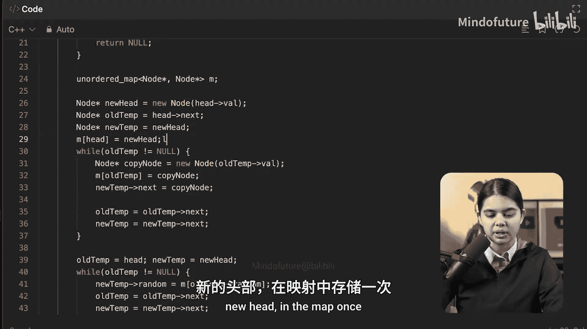

# C++ 数据结构与算法课程：P61-P62：复制带随机指针的链表


在本节课中，我们将学习如何解决一个重要的链表问题：**复制带随机指针的链表**。我们将通过一个清晰的、分步的方法来创建原链表的深度拷贝，包括其`next`指针和`random`指针的连接。

## 问题概述

我们被给予一个特殊的链表。链表的每个节点除了包含一个指向下一个节点的`next`指针外，还包含一个`random`指针。这个`random`指针可以指向链表中的任意一个节点，也可以指向`null`。

我们的任务是创建这个链表的一个**深度拷贝**。这意味着我们需要生成一组全新的节点，这些新节点与原节点的值相同，并且新链表中的`next`和`random`指针连接关系必须与原链表完全一致。

## 解决方案：两步法

为了解决这个问题，我们将采用一个分为两步的策略。

### 第一步：创建节点并建立 `next` 指针连接

首先，我们忽略`random`指针，专注于复制节点并建立`next`指针的连接。同时，我们需要记录原节点与其对应新节点之间的映射关系，这将在第二步中至关重要。

以下是第一步的具体步骤：

1.  初始化两个指针：`oldTemp`指向原链表的头节点，`newTemp`指向新链表的头节点（初始时新链表为空）。
2.  创建一个哈希表（如 `unordered_map`），用于存储原节点到新节点的映射。
3.  遍历原链表。对于每个`oldTemp`指向的原节点：
    *   根据原节点的值创建一个新节点，称为`copyNode`。
    *   将`newTemp`的`next`指针指向这个新创建的`copyNode`。
    *   在哈希表中记录映射关系：`map[oldTemp] = copyNode`。
    *   更新指针：`oldTemp = oldTemp->next`，`newTemp = newTemp->next`。
4.  完成遍历后，我们就得到了一个只有`next`指针连接的新链表，并且拥有了原节点到新节点的完整映射。

### 第二步：建立 `random` 指针连接

上一节我们创建了新链表并记录了节点映射，本节中我们来看看如何利用这个映射来重建`random`指针。

现在，我们再次同时遍历原链表和新链表，利用第一步中建立的映射关系来设置新节点的`random`指针。

以下是第二步的具体步骤：

1.  重新初始化指针：`oldTemp`指向原链表头，`newTemp`指向新链表头。
2.  遍历链表。对于每一对节点（`oldTemp`和`newTemp`）：
    *   找到原节点`oldTemp`的`random`指针指向的节点，记为`randomTarget`。
    *   在哈希表中，通过`map[randomTarget]`找到`randomTarget`对应的新节点。
    *   将新节点`newTemp`的`random`指针指向`map[randomTarget]`。
    *   更新指针：`oldTemp = oldTemp->next`，`newTemp = newTemp->next`。
3.  遍历完成后，新链表中所有节点的`random`指针就设置完毕了。

## 代码实现

以下是上述算法的C++代码实现：

```cpp
class Solution {
public:
    Node* copyRandomList(Node* head) {
        if (head == nullptr) return nullptr;

        // 步骤1：创建节点，建立next连接，并记录映射
        unordered_map<Node*, Node*> nodeMap;
        Node* oldTemp = head;
        Node* newHead = new Node(head->val); // 创建新头节点
        Node* newTemp = newHead;
        nodeMap[oldTemp] = newTemp;

        while (oldTemp->next != nullptr) {
            oldTemp = oldTemp->next;
            Node* copyNode = new Node(oldTemp->val);
            newTemp->next = copyNode;
            newTemp = newTemp->next;
            nodeMap[oldTemp] = newTemp; // 记录映射
        }

        // 步骤2：建立random指针连接
        oldTemp = head;
        newTemp = newHead;
        while (oldTemp != nullptr) {
            if (oldTemp->random != nullptr) {
                // 通过映射找到原random节点对应的新节点
                newTemp->random = nodeMap[oldTemp->random];
            }
            oldTemp = oldTemp->next;
            newTemp = newTemp->next;
        }

        return newHead;
    }
};
```

## 复杂度分析

*   **时间复杂度：O(n)**。我们遍历了原链表两次，每次都是线性时间。哈希表的插入和查找操作平均时间复杂度为O(1)。
*   **空间复杂度：O(n)**。主要空间开销来自于存储`n`个节点映射关系的哈希表。

## 总结



本节课中我们一起学习了如何复制带随机指针的链表。我们通过一个高效的**两步法**解决了这个问题：
1.  首先遍历原链表，创建新节点并建立`next`指针连接，同时用哈希表记录原节点到新节点的映射。
2.  然后再次遍历，利用映射关系为新节点设置正确的`random`指针。

这种方法思路清晰，代码简洁，且时间复杂度和空间复杂度均为O(n)，是解决此类问题的经典方案。