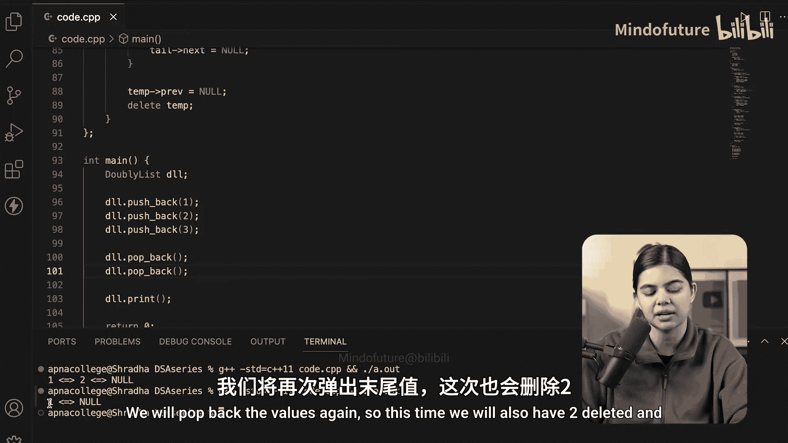

# C++-DSA课程-｜-数据结构-｜-leetcode-｜-Apna-College-｜--Complete-C++-Dsa-Course-p62-P63_双向链表教程--BV18oUGBkEmV_p62-

Hi and welcome to the complete series。 And today we are going to cover the concept of aub in detail。

 concept there is a link for company talk about the ors three different types of If you want to know about the series internship oriented are going to focus on the concept of and we are going to。

😊，basically ask detail and different functions let us talk exactly something likeconn nu。

ub is next pointer a condition pointer route which is called the previous pointer a address in previous nodes her node address basically if we talk about the structure of key key key node。

😊，Andariub link key different different nodesri node intercon intercon node and previous node Similarlyly。

 her node ugly node plus previous nodeari head node is previous will be a null value Sa we also have a tail pointer and tail value node pointer is pointing to the null value we visualize a in the form of this diagram sub individual nodeub link key individual node could create create a node class。

😊，Very similar to how we created a single linked list is class kartoham integer dataingki nodemi Saari her single node can。

 though different pointers andcomang the node star aari pass next pointer Rojaga and similarly we have a node star previous pointer。

 So this is what the structure of each node of the link list is going to look like abar node structure create Ksham linkist structure create kna different class create k name。

 let us call it list。😊，And is class canander hum though node star pointer create ksne a kra head of the linkistjaga and a kra tail of the linkistjaga。

 this is what the structure of a doubly list is going to look like Hamjo individual node Hamari list Vo is node class create Hoga and an individual node Scjo Jone Kahi must love the aggregation of all of the nodes into a single structure。

 Vohamari doub list k Yogiki actually doubly list is the class Sam of me linkless score linkless create K to let us write the code to implement this do linkist and create the basic structure for it。

 Tom already of now C plusca boiler plate code is code canander let us create a class node。😊。

Just came there。Subipto hamapna in teacherger data Liliium， Sa Kat， we have a node star next。

And a node star previous because we are going to make all of these things accessible in the next class。

 Tomk K in sari properties Co， we are going to declare them as public。 Sa satmic constructor。

 we create Kle them node constructor jque under Kisbi No Kku value atium to value of noded k data can assign Kinggi and her E nodedco initialize Kringge Uque next and previous pointer quo with the。

😊，Nll value。 This is also the same line Johammnapi Sing linkless K Kiy。 I case ask me。

 we are going to create a second class。 Let's call it doubly list， doly list candander。😊。

Ami Pattaya Hamari pass I Hamari headn Hogi and Sa kat Wililha。Tail note。

 we can even implement this doubly list without a tail note。

 General linkless scan their head note subs are important to them。

 But tail note be algorithmgrily create yet， implementation may knows other difference like a niag。

 Sakiat， let us create a constructor for it。Doubly list。Initialize jobam Kevni A lesko。

 to head and tail Donnocom initialize Carneval here。😊，Nal value kat。

 So this is what the basic structure of the linkless is going to look like above a main function can there A me list go create Kav。

 we can simply write doub list。 Let's call it D L L next。

 sum of me doub link list get different different functions go implement Kne just may say first and sub a primary important function。

 Huai Hama push front。😊，Basically， push front function implement do push and if we pass a value basically this is value So this is the node。

😊，First case Oakki Yatorijo linkist have w empty linkist heavy Jessi Abi。

 we haven't really created a linked list even in our code。

 empty linkist Holaki abirijo Heki value head that is equal to null And doa Sota are linked list is not empty。

 I case me， our head is not going to be equal to null。

 to subel me empty linkless for a casele them Jbipa empty linkist have the empty linkist can the Hammekijo head pointer let's assume it to be the head pointer。

 and this to be the。😊，Taale pointer。Jie linklist emptyra head and tail Don point asign value a point up Jesse Hamus scan the push front1 here to head Agar equalto Jovi node He head this node is going to become the head and the tail of the newly created linkedist to this case may Jebiri linklist empty him。

 whose case may 9 node Bengi and9 noderi tail nor to basically first case justma our head。😊。

Is equal to null。Wse case may our head will be equal to the till。

 which will be equal to the new node that we have created。

 and Iika's second case second case may basically second case statement Lets supposeub do case of is pointer which is currently pointing to the nu and nodeing to nu but generally nodes is next node and in fact。

 we are not even concerned with it is previous node。😊。

connections connectionsrange basicallyham to noded Ju next point their。

 It should now point to the current head of the link Matla Jobi new node create。😊。

Is new nodeju next pointer It should now point to the head of the link by default new node pointer connection It should also point to the new node basicallyju connection is now pointing to this。

😊，New nodehi head previous should now point to the new node of the link The finally connection established or node pushm node head pointer it is going to get update and it will now point to the new node that we created the last step for push front is basically head update headjaari new node So these are the two cases push statementran to let us suppose D dot push this case me sub node create node create is simply node star。

New Nor。Is equal to new。 This is the keyword new Nord andusandermni value Pa topani new Norki value Ajagi the new Norco create Klean。

 This is the new node。 jaander value had 3 is3 value value Norko meushka mekala。😊。

Agarri to sub new node next connection established the previous new node connection established And finallyko updateing So head will now start pointing to the new node link front make O value Let us convert this into the code doub list class we are going to create a new function。

 Lets call it white push front value input sub based upon this value new node create the node star new node is equal to。

😊，New node of value。 Ferm check Kanival， if the head is equal to null。

 whose case may marry link is empty linkless empty Honikala head tail。Sariki Sari values。

 Hamari new nodeki of point Kainggi and ahammara L va K Sojaga just my linked list already exist。

 Kaier。 whose case May Hamari new node car next pointer is going to point to the head value and Hamra。

😊，Head cup previous pointer is going to point to the new node。And finally。

 head go update herque hum equal King Gni new nodeque。

 So this is how we push front inner a linked list。 A Yper。

 let us also try to dry in this subse push front hum Kringgivanko， Sba 2 and 3。😊。

An egg barmri linkless can the pushran toia， though upni linkless could display canally let us also create a print function。

 Basically， upne class andhi Hamek function create kam。 Let us call it void print。😊。

This may of link print link print Carva process E link can follow key Ya will create a temporary pointer during jambi head point color temporaryvalue of printva and to say update K to next dubars value update K to du value print update K to nextp k temporary null value。

 So let us create a node star temporary， which will equal headp at temporary is not equal to null。😊。

Tak kami see out Kanae temporary。K data Co， let us see out it with some connections。

And her bar hum temporaryco update Kingage to temporary car next。 And finally。

 last mayhem see out Carnevallehe。9 value。Withow， next line。Let's save it。

 Any upperpper pushushran Knegabat DL L dot print Carleanmaipas Mari Lnkist V Btorajagi。😊。

So this is what the current link list looks like。 is made 3 v node sub R2 R1 R only steps repeatta。

 So basically the link list looks exactly like this values plus values next function implement is the push back function pushback function can node insert to push back basically though cases engineer repeat let us suppose D dot push back value value push sub new node createna node star new node is going to be equal to。

😊，New node of the value that we have been given togaramaippas1 value to ekilehammic node create kte Just can the value Ajagi1。

 should what me Hoecttagihamra head and Hamra tail pointer。 Dono k dono point K to some null value。

 Kamaipas， though cases I subsea case here， if our head is equal to null。

 anyhamari link list is an empty linklist。 whose case mehammipata that the head is going to be equal to the tail。

 and this is going to equal to the。New路。The Hamara headbyhamari new node kterra point Cara。

 and the tail is also going to point to the new node twist thatari linkka structure running up Jeff Hamari a single node or tail linkless can twist connects bealgira point Car a previous vialgiter of point。

 and that is a by default functionality。😊，alreadyari values exist and basically statement dot repeat now basically if we a new node now equal to and。

Kjo Tauska next to pointer Joeli Alkira point Karaha should now point to the new node to Hamari tailka next should now point。

To the new note。Triarinai Noriat Bier。 and finally。

 Kkijo No and toham upni tailco update kque Car to this new mode to finally art tale becomes equal。😊。

To new node until Hamappa update Ojagi to yhamra first case here。

 And this is the second case Jki helps himmmi linklessander push back Khimi value score I K our example dic。

 let us suppose Hamnibarraki Do linkist dot push back 3。

 Those case may sub Paleto Hammmi 3 value new node who create K3 value nu node who create Knela I theriki say we have created a new nodeander value here 3。

😊，This is the else value situation。 just memory link to be is scanner， which nodes exist Ka。

 the new node of previous tail kta of point Carga in new node here is previous tail kta of point Carga So hammerari pass here connection established Soga for tail connects new node kta of point Carga to tail connects new node kta of point Kja and finally tailcom update Car to point to the new node。

 So tail co update Kham new node k of point Kvailjagi。

 And this is what the final double link list is going to look like。

 So let us convert this entire pseudo code into the code。

 The code canner up same double list class canar create Ke a core Nya function。😊。

Let's call it void pushback。 Just scananderham Kobeek value pasting it。 In fact。

 Hamju Uervaa Ko herri Pushrankosko Kopi Ksekname， because the process is going to be very similar。

Subseto pushbackhammniak 9 nodeco create Kinggi Ahamari linkist empty case me head and tail our ball going to point to the null node else valley case me Hamari new node Caju previous Victorari tailgi point Kaga and tail car June next pointer here。

 It is now going to point to the new node。 Sa Samni tailco update Kingi to point to the new node。

 This thekira pushback function complete toga aber push front key J。

 if we try to use the pushback function。😊，So let us seearigi This is the final link that we've been able to create。

 And in stepsing to is pointing to3， which is the tail of the。 see same in。

 So this is how we implement the push front and the pushback function in a function is called the front function starting node head delete Now let us take an example of this head node delete and our new head of should be pointer can the store because single nodeally dynamicyally memory node。

😊，keyword delete Jovi memory inri allocate specifically is delete keyword need to store address in a temporary pointers call it address update now can point to the。

Next note。Of itself。and the next for example，😊，Also pointing to the same node。

 and the tail is also pointing to the same node。 whose case may agahamko update next node either nubi previous pointer exists statement。

 it should not be a single node the head is not equal to Nll。

i case single node exists automatically and second second connection and should next essentially is the first part is the second part pointer is now pointing to。

😊，So this is the entire enander pop front Kni valueo ahamme simply is temporary key memory of free Kna or say delete Kna delete Kna hum simply like delete。

😊，Temporary， so this is how we are going to delete a node from the front of the link list。

 node delete K connections co K first connection second connection head update or simply last meham memory of Now。

 let us convert the pseudo code into actual code code Al a list create under。

 we have the same nodes 1，2，3me doub list class function create Kna。 Let us call it。😊，Wait。Op front。

Is kth subse pal Im temporary kal who not store carralling am delete Kna。

And head go update Kingi to the next value。If our head is not equal to null。

Those case may headup previous is now going to point2。Nll value。 and last mayhamari temporary to nu。

 And finally， delete will basicallyari already emptyla head is equal to nu is empty So this is the entire logic to delete the first note of Let us also test it out123ham。

😊，ari2 and three value nodes available the final print that will be2 and3 same process repeat letters dry in this one more is to basically and now point to the same is equal to and is now nu will equal to will now null and finallyri and。

😊，there a single node which is equal to three next function back function delete delete keyword create star。

Temporary， which is going to store the address of the tail pointer that will be this node basically will now become equal value is after deleting node is now point nu node node。

😊，Previous also case is equal equal this is second。To basically， temporary come。Previous。

Is now going to point to the null value。 is connection co break K Yaga and I previous will now point to a null value The finallyri can delete and this is the final resultant link Finally。

 Joari temporary key allocated memoryse delete K and this is the entire logic can pop Let us convert the pseudocode into the code。

 can convertneatle。😊，Though this is the linked list this co now already create here where upably list candle will create a function called pop back。

Just can the sub palleto node start temporary， it is going to point to the tail node。

Talekoham point Carvaing it to tail cap previous。E check Laing if tail is not equal to null。

Wse case made tca next will be equal to null。Finally。

 Johammara temporary head temporary cup previous will now point2。

Nll value and hum delete curling a temporary go from memory base case may a cheese they Sa thanky agarrilings already empty him。

 love if the head is equal to null。 Those case mayam see out herect him。

 that doublyling list is empty， and we can't really delete a note。he say I Gjai returns。

 So this is the logic to pop back from a doub linked list is say save colour there。

Yaper link list already onlymprint for Valier is under algorithm popback value scope。😊。

Toipas last node Dhijagi to linkist Agi as1 and2。 the Va popbaingi values score is baras2bi dega and will only have a single note I except themip Ihamham。

 it will point2 to to previous tail and heado sameri。😊。

is not equal connection and it is now to point nu Similarly this is similar to such to summarize today's lecture。

😊，W linkist Uskimeowkirasy implementation codedehi。

 we have covered the pseudo code as well as the code Ham Panjo major functions within w linkist scan the un cover K。

 we started with push front push back。😊，Pot front。And pop back I print functionality Ko basically print under same loopverse。

 So this is how we implement and use a link list。 So if you're successfully completed today's lecture you can market in is now in the comments。

 I， you can also share your progress with me on Twitter Just linkkuche description box can Ask late the next lecture can keep learning and keep exploring。

😊。