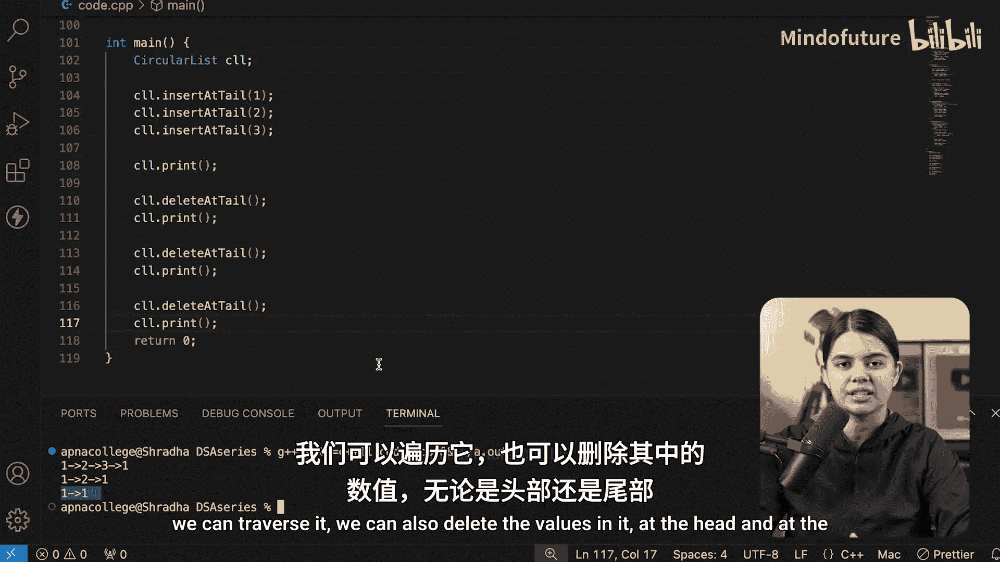

# C++-DSA课程-｜-数据结构-｜-leetcode-｜-Apna-College-｜--Complete-C++-Dsa-Course-p63-P64_数据结构中的循环链表--BV18oUGBkEmV_p63-

Hi， everyone， and welcome to the series。 And today we' are going to cover the concept of a circular linkist in detail。

 A your concept per playless scanner availableja。 Also there is a link for a company sheet in the description box The circular linkists already S linkist and link cover in detail。

 The wholes already scan available When we talk about a circular linkist。

 How is it exactly different from a normal linkm link we have multiple notes which is scan different different data And node a connected with him with the help of pointerri general link which Sta。

😊，We have a head pointer。And we have a tail pointer generally normal scanner tail pointer next pointer it is pointing to a null value as compared to connected headererer insert insert insert。

😊，changeappa's last connection key and last node key access toid tail node keyia to be able to implement the functions which are related to head headcut address anyways a Mariippa Sajagaipas tail pointer key value because the head of a circular linked list is always equal to。

😊，Tale pointer next note because tailer head node connected with header implement but we are going to use both the head and tailer for but in the Ill also show you function head So this is the basic concept of majority questions or a class node and in terms of。

😊，In terms of the basic class structure， Ham extra connection hesco form the way functions can to class node canhi same in teacher data laying Jo datam link K node can the store kra and Sa will be taking a node pointer next them node class implement carrying andri circular list class will called implement Ho single linkist andub link can。

 So let us implement our classes from scratch。 This is the C plus boiler plate code。

 sub create carryingni class node just under。😊，Hamkuush public properties create carrying it because we want to access these properties in a second class to integer data Hamari pass Ajaga。

😊，And Same will have node pointer。 Next， let's create a constructor Justcan demapas Val Ajagi thham data Co。

Upni value assign kectane。 and the next is going to point to the null value。

 the Yaari node class O Sa K Sa Ani Accor class create kectane。 Let's call it circular list。

Justca under humdo pointers create Kringi。 One is the head pointer。

 and the other is the tail pointer。 Saqueat hammnily， a constructor create kname circular list。

ander head and tail。 So this is what the basic structure of the is going to look like and main function functions dismiss sub common function to insert at the head of the1 is header and one is lets first case is value is equal to nu case is empty function insert at equal。

😊，To insert step that is to create a node node lecture node node is equal to node dynamically corresponding like this andari link head the is pointing to nu case node and node basically or node head and tail node case。

😊，If the linkless head is pointing to null value， those case may sub a， though。

Head is going to become equal to tail， and is going to become equal to the new node。

 Aippas new node Aekiki C circularjo tail， It points to the head note a cuki tail and head note dono same node toham Ii Nokoki of to basicallyhamrijo tail no。

Iscon next is going to point。To the head note， which is the basic condition of a circular linked first case link insertion at the head note Second case second case Vo node already exist and node let us take an example。

 let's suppose insert at head for some value insert node createna2 value node node This is basically the node create insert add head basically establishna from the old node to the new node new node next pointer head node insert next pointer will now start pointing to the head value new node。

😊，Next is going to be equal to the head value alreadyri can exist。 and in fact。

 let us minimize this and basically is to the head value and finally is going be equal to note and that will now point head basically head So this is how we insert a new node in values。

statements in statements headari header implement Lets assume head pointer exists Ni whose case same connections basically next should point2。

😊，givener is always pointing to the header second it is now going to point insert at beginning of thiss that operations perform So this。

node create let us create a node with a new valueari circular and this list is definitely non empty non empty new node connects head node is node secondly the node and it will now point to the head node So this is we can simply remove this and connection is and So let us convert this pseudocode into actual code list we are going to implement a function。

😊，Let's call it insert at head， or is it insert at beginning Bm Gace pen。

 Just scanander Mariippa Sama value barmeter Rajaga subseto ham Ani Ini nodeko create Karinggi。

 new note is equal to。😊，New node of value。Well check key Hamari dual linkless hair Uka head can nu K equal。

 If the head is equal to null Ya Yahaer Hamish condition go change her case A tailby cur。 though no。

 may he Hamari pass same implementation aga。 If the tail is equal to nu T link is temp A head is equal to nu T B circular link stem。

 Those case may our head is going to become equal to the tail is going to become equal to the new note。

 Sa K S Hamari tail car。😊，Your next tip。A K accept it is going to point to the new node。

 which is also the same value Ya upper head wheel accept a lying by line logical nano。😊，Else。

 else valley case me sub ato new node Caio next head it will point to the head value head coham update Kingge to be new node and finally tail Ca next here it will now point to the new head This the a hammni linkless can the insert Kni values score circular linkless can the values insert Kki B they them。

So let us insert one， two then3。And let us create one more function。

 just say how me circle linkless cupid reverse carrying。

 This function is going to be pretty similar to Jomney doub link scania， single link scan B khi。😊。

We create a print function。Just my sub to check kseari linked list empty to。

 Just case me emptyus kiss me return Kzgi Nahitoham simply see out ks upne headka data。😊，With。😔。

Anarrowru。And I or temporary Nordham laakname， which will point to headgun next。

Fra milk loop gelazten jata kmaari temporary E value dubarra heke equal Neoja Y exchange heoccularling canander rather normallingist can condition withe temporary should not be equal to null。

😊，But agarhamne ani circular in k the Kisbi temporary variable coia to temporary birthday jaga。

 birthdayjaga or Kkikui en， there is no next pointer， which is pointing to a null value。

 tohammic in loop create Carsebanimenaga temporary should not be equal to the head value。

 Tme C out ki。😊，Temporary card data。With an arrow and her bar will update temporary to point to the。

Next value。 And last Maym simply see out ksacque。 let's suppose I'm thebarra say headgar data C out Kingi to show that there is actually a cycle that exists。

 Im trying to temporary kbi data print ksque， and then end of line。Let us。Call print， CL dot print。

And run the code。This theapas circular in scanner head node is321hi same list g create kra with the functions up next function implement K that is the insert at tail function insert at tail is very similar to how we implemented insert at head is scanapas though cases O node insert K for example。

 insert at tail kna value1 sub node create kna So this is one value noderurajo head pointer andra tailer they are both pointing to the null values subseo node create k the node star new node。

😊，Is equal to new node。This is the new keyword with the value empty。

 This is the first case case and if the head value is equal to null or tail is equal to nu will become equal to will become equal to note and that is going to be equal to the head value insert at this value ideally。

😊，A should point to the head value。 Tommkaa Caringriju new node he is con next will now start pointing to the head value。

 Tommka is a tank new node Caju next hem。It is now pointing。To the head value。

Andjurani tail I isi tail value。 It will start pointing to the new it will now start pointing to the new node basically and will now point to this connection orkyja that the tail。

😊，Is now going to be the new node or the new node is now going to be the tail of the circular in。

 So in teen steps， say Hammni K C B circular in canander up 9 nodeco insert kectam。

 Let us dry on it on a different value。 Let's suppose ahamme insert at tail Kapni value 3 co。

 the subel tohammi new node by any particular use3 value key。

 tohammi upper a new node create Carheni。😊，3 value coari linkless is not empty。

 new node connect will now point to the head valueari node is This will now point to the new value Sa tail connect will now point to new noderi tail is value is establish and finally tail node to tail andari node insert to let us convert the pseudo code into actual code code let us create one more function and is function insert at insert at tail。

😊，Just canander Hamipas valueajagi。In fact， we can copy this。Insert add head while I cold let them。

Yea statementpagi yea conditionpagi El Val case me sub new node Cajo nextga。

 it will keep pointing to the null value Ukeriju tailka nextse to the new node。

 And finallyse to the new node value。 the I insertion at finally insertion at pale li weaken。😊。

Try to print our circularari just 1，23 nodes back1，2。

3 nodes and is now reconnect to values insert plus we can also traverse or print our by forming a loop logic the in the same fashions let us an example of circulars supposeari which delete first case case is empty。

😊，Mmpty valley case definitely delete empty case value already cannot delete any node the head of second case single node case nodes exist delete So third case what exactly are we going to do delete delete keywords delete keyword explicitly pointer。

😊，All this temp head basically temporary node star temporary create。

 which will start pointing to the head note address Jo head next。😊，To point to next。

 and finally andjo will start pointing to head and basicallyjo。😊。

It should now start pointing to the null value to a connection。

 and this next will now start pointing to nullari This is the new circular and is delete so we can write the delete keyword along with the temp pointerer memory is to ands head is now going to will start pointing to the head is my note and。

😊，and finally delete delete second single node single node simply value note what is the second case second case basically valueri value equal。

😊，Is Kamalahamaripa6 single node here single node key case me hum directly delete kaknee headki memory。

 directly delete Kne Kamatlavaki yea node memory say hjagi。 And finally， hum head and tail。

 Don noko assign King in nu value to Hamrajo head。😊，And Johamra tailhoga。

 they will both become equal to null value。 This is the re case a single node goham delete curthe Ani circular linkless。

 So first case， Amni re， second case ammni re and third case Bmni reier。

 And is the rese Ani linkus can same ofni node for delete curtheham。

 Let us convert the pseudocode into code。😊，T knee circular list classor function Menanggi。

 let's call it delete at head。J first case Ajagabi U N whose case simply return。

Second case ktaak kbi V Ugar head key value tailgi value K equal。

 This is the case of Hamipas single node head circle in scanander。

 I casemem directly free curectname headki meicco and head will become equal to tail。

 And this is going to become equal to null value。 And third Hogahama L v case just may basically hamipas 2 or more nodes there to exist。

 Kaium I case me subsequently gaggering。😊，Subse ahamic temporary variable create Kane v。

 which will start pointing to the head value Oskebal haveap head go update Caring to headka next and Hamrijo tail hair。

😊，will start pointing to the head。 Finally， temporary value and we are going to delete the temporary pointer is the dot delete delete and we do delete andham node this case delete head Similarlyly function implement which will help us delete values at the tail of the circular let us consider the same example。

😊，And the same conditions， Jinkiham Bakiti subsequently condition Yagari Llessander。

A we not exist in Ne。W case k node delete simply return Kaja second va case Hoga Just case meari link can single node exist ktheier Mulabari headki value tail key value K equalb headkey value tail value K equal to head delete Car I tailco delete logicga same logic follow last function can basically simply delete call K for the head pointer and finallyra head。

😊，Andari and third case， which is two or more nodes in third case's supposeererer help what is thise basicallyari previous。

😊，And what is previous previous summaryari v node doier Gsca next becomes equal。😮。

To the tail value j node k next pointerriea basicallyri previous node or yhi previous nodeari tail previous basically create a previous pointer let us create a previous pointer。

 and is previous pointer barb while our previous k next。😊。

Is not equal to tail loadp previous k tail equalme previoushi valueme previous co update to2 previous value to basically previous head value is initialize where previous k is not equal to tail previous previous k is now equal to the tail valuehi value valuejiham simply。

😊，reassign previous key value The previous is this will be now pointing to the previous value andestab will now pointing to head value now pointing to and this is what is look like should become equal to。

😊，value or and us suppose will now value。😊，To tail basically tailjari value and tail will now start pointing to head。

 This is taile。 It will start pointing to headja and simply delete I delete This is the second case node and head and tail。

 So this is how we delete a node at the tail of a circular let us convert this pseudo into actual core function。

😊，Let us call it wide delete at till。Just scan the team cases only subs to other head key value null K equal those case map simply return k Z game。

😊，Second case U head key value tail equal him， this is our single node case case mapm simply delete cur head key memory and head will become equal to tail will become equal to the null value。

And else while a case are multiple node ca cases set。

 this may sub a through temporary co point caring it to the till node。😊。

S previous pointer from la thems call it initial cutting a head kat Japt previous car。

Next is not equal to the tail note。 the to come a previous Co K。

 So previous will keep pointing to previous K next。

 And as the say finally Ammapa tailkii value Ajagi， which is the previous value。

tail to new connection here any tail connects it should start pointing to the head note and temporary delete is equal and simply delete pointer So this is how we delete a node at the tail of circular say save and let us see what is the output in fact reprintlet and and let us save and run basically and third delete。

😊，Insert the and theverse values delete and the。 So this lecture was all about circular all questions If you have successfully completed today's lecture then you can mark your attendance down in the comments can share progress with me on description lecture keep learning and keep exploring。

😊。

