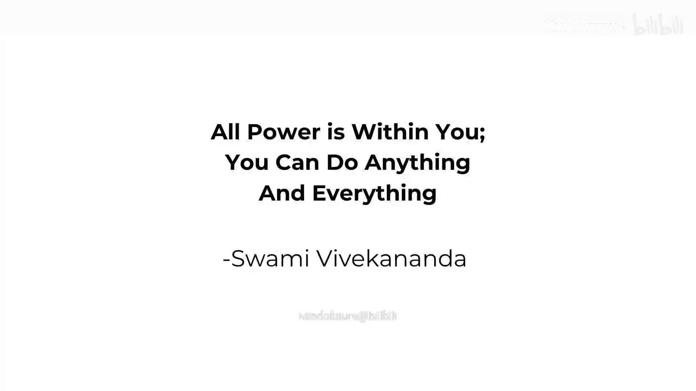
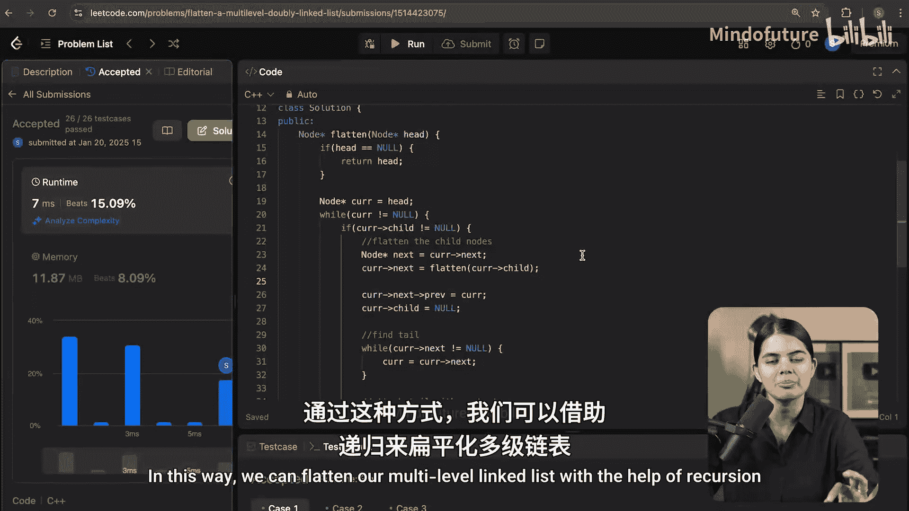

# C++-DSA课程-｜-数据结构-｜-leetcode-｜-Apna-College-｜--Complete-C++-Dsa-Course-p64-P65_展平双向链表-Leetcode_430-DSA系列_由shradhaKD讲解--BV18oUGBkEmV_p64-

Hi everyone and welcome to the complete D series。 and today we're going to solve one more important problem。

 which is called flatten or multilevel concept is company in the description box and has is multi which is called this is also problem4 with concept ofer。

😊，basically childer for exampleer。single。what。I This reminds us of recur bo similar recur looks like almost。

😊，vakarijanander already implicitt the logic Dono approacheskoja isne。

 because that is going to be more intuitive for us。 and alreadyjanhamander detail mejava， basically。

 we are going to start with the head of the linkist toa function given heremaari linked head given this head start basically functionham last way。

😊，we can call this function and and basically say。😊。

K him with the help of current tohamic Loazak Jabuk， are current is not equal to null。

case and second case。😊，between three and4 given and that is why the first thing to is。

is a4 but and level basically let us call it let us let us call。

de next pointer now it should be equal to the result of the flatten function。

 So let us minimize this a bit。😊，To basically ye action perform dismiss a first action k next pointer second action k it is pointing to the head of the flatten is link not linkist next previous pointerer basically establish what is this note currently node should be equal to。

😊，To basically current car， June next node here。Next previous node is equal to nu basically valid is equal。

perform perform Gbari if condition such asem。 So this is the first part of the problem。

 first part of the problem validja to or and let us paste it inside our function。

So this is the logic that we are going to followari。 Let us remove this logical。😊。

Is not equal to N j will now be equal to this next forward connection backward connection is is basicallyari should now be equal to。

😊，that are next should not be equal to connection this is the second and third part of the。

So let us paste it here to basically up me problem goham the parts solve subse current node currentham bar bar bar bar increase K loop continuous loop k current child node not naja valid condition whose casela if condition k multiple ca。

 Basically， this is where the if condition is going to start。😊，Yari。

 if condition Joriari or So this is the first part of the problem。

 Second part k tailari if condition k tail and egg barari tailga This is the second partkeba third part is if statement tail。

😊，With the。Next note。And condition， this is the third part in and and the turns out to So this is what the entire logicten looks like visualize。

😊，head of the given This is our current node what we docur call function for second second problem is my This was the first level。

 This is the second level of recurs。😊，77 third level。😊。

will come to in the second part second and finally and and and and this is arecur form a single which has all of let us convert this entire into is the function that we want to complete function。

😊，K head value null case me we are going to return the head value。

 current nodeing start head Then we are going to run a loopp current is not equal to nullne pointer is it a valid value or not if this is not equal to null steps perform simply current update to current and last return head the link logic here child node sub part basically steps we are going to flatten。

😊，The child notes。Second part candle， we will find the tail of the new link list and third part candle attach。

😊，Tal with。Next pointer，8 parts head and go perform carrying a the come。Yeah upper sub。

Hm upne next pointer k Valkoto Karani to Jubi Kran K Kaalgi Oskeba。

 we are going to call the same function， which is flatten Giske under Hammni K in Noka。😊。

Child in old pass， Kane Vallehem and Jobi Valhamipas return Hokaragi Useham Kranka next Manaling。

 Similarly， current car next car previous will now point to the。

Current node and current K child node goham assign Garnege null value。 So this is the first part。

 Second part can thehammock looplangi ch the current car next is not equal to null。

T tu kko update ki to K k next to find the tail Jessehamraari tail node hitherjaling。

 If our next is not equal to nu k k next will start pointing to the next note and next Caju previous Ho that will start pointing to the current note。

 is theju function here。se inki helps say this is the major logic of this entire function。

ko Latin let us run our quote。😊，And submit it twist the multilevel with the help of recursion up to analyze the time complexity of this code。

 basically current and bar current changes next recur single bar single node basically recurri per single node in our recur calls and that is why nodes exist complexity linear time complexity with the help recursion and this is one of the most optimal solution to this problem I hope that we have understood the entire solution in depth is concept recur concept because the entire solution lies upon the basic fundamentals of how recurs works internally。

 So if you have successfully completed。😊。

Da's lecture you can market in is now in the comments I case me can also share your progress with me on Twitter upkuniche description box can Miljaga Ask89 Mil next lecture can tell them keep learning and keep exploring。

😊。