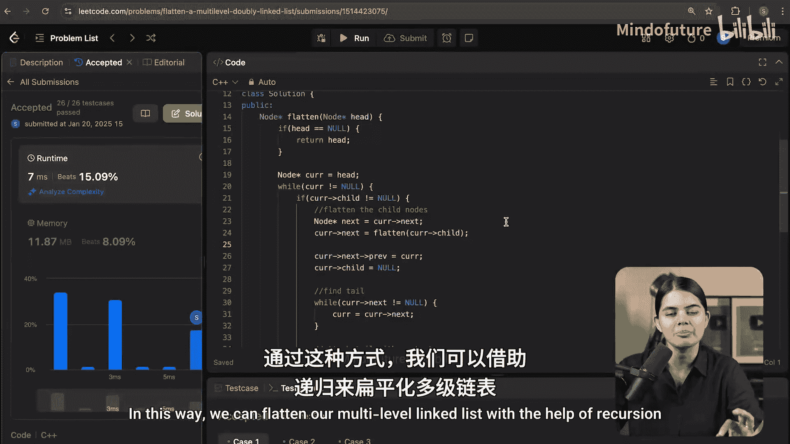

# C++数据结构与算法课程：64：展平多级双向链表 - LeetCode 430


在本节课中，我们将学习如何解决一个重要的链表问题：展平多级双向链表。我们将深入理解递归在解决此类问题中的应用，并逐步构建解决方案。

## 概述

我们将要解决的问题是LeetCode第430题“展平多级双向链表”。题目给定一个带有多级子链表的双向链表，我们的目标是将它展平成一个单级的双向链表。核心解决思路是使用递归，我们将通过遍历链表，每当遇到有子节点的节点时，就递归地展平其子链表，并将其正确地插入到主链表中。

## 问题分析与递归思路

上一节我们介绍了问题的基本概念，本节中我们来看看具体的递归解法思路。

链表中的每个节点除了有`next`和`prev`指针，还可能有一个`child`指针指向另一个双向链表的头节点。我们的任务是将这些多级结构“拉平”。

递归的核心思想是：当我们遍历链表遇到一个具有子链表的节点（`current->child`不为空）时，我们首先递归地展平这个子链表。然后，我们需要将这个已经展平的子链表插入到当前节点和它的下一个节点之间。

以下是解决此问题的三个关键步骤：
1.  **处理子链表**：如果当前节点有子节点，递归调用展平函数处理子链表。
2.  **寻找子链表的尾节点**：为了将子链表插入主链，我们需要知道子链表的最后一个节点（尾节点）。
3.  **连接链表**：将展平后的子链表插入到当前节点和原`current->next`节点之间，并正确设置`prev`和`next`指针。

## 代码实现与逐步讲解

理解了递归思路后，我们现在将其转化为具体的代码。我们将定义一个递归函数`flatten`来处理链表。

函数的框架如下，它接收链表的头节点，并返回展平后的链表头节点。
```cpp
Node* flatten(Node* head) {
    // 递归基：如果链表为空，直接返回
    if (head == nullptr) return head;

    Node* current = head;
    // 遍历主链表
    while (current != nullptr) {
        // 主要逻辑将在这里实现
    }
    return head;
}
```

接下来，我们在循环中填充核心逻辑。以下是每一步的详细说明：

**第一步：处理子链表**
如果当前节点`current`有子节点，我们递归地展平该子链表，并准备将其插入。
```cpp
if (current->child != nullptr) {
    // 递归展平子链表，得到其头节点
    Node* childHead = flatten(current->child);
    // ... 后续连接操作
}
```

**第二步：连接子链表与当前节点**
展平子链表后，我们需要将其头节点连接到当前节点的`next`位置，并建立双向链接。
```cpp
// 保存当前节点原来的下一个节点
Node* nextNode = current->next;
// 将当前节点的next指向展平后的子链表头
current->next = childHead;
// 子链表头的prev指向当前节点
childHead->prev = current;
// 将当前节点的child指针置空（题目要求）
current->child = nullptr;
```

**第三步：寻找子链表的尾节点并连接剩余部分**
为了将原`current->next`之后的链表接回来，我们需要找到子链表的尾节点。
```cpp
// 寻找子链表的尾节点
Node* tail = childHead;
while (tail->next != nullptr) {
    tail = tail->next;
}
// 将子链表的尾节点与原下一个节点连接
if (nextNode != nullptr) {
    tail->next = nextNode;
    nextNode->prev = tail;
}
```

**第四步：移动当前指针**
完成插入后，我们需要移动`current`指针。注意，由于我们已经将子链表插入，`current->next`现在指向了子链表的头，而循环会自动通过`current = current->next`遍历到我们刚插入的子链表节点。为了避免重复处理子链表，我们应该直接将`current`移动到原子链表末尾的下一个节点，即之前保存的`nextNode`的位置。但为了逻辑清晰并与遍历循环配合，我们可以在完成连接后，让循环自然迭代。更准确的做法是，在插入子链表后，`current`应该跳至`tail`的位置，因为`tail`之后的下一个节点才是原主链的下一个待处理节点。但为了简化，我们依靠`while`循环的`current = current->next`，它会遍历整个新连接起来的链表。关键在于，在连接完成后，`current`的`child`已被置空，所以不会再次触发递归。
```cpp
// 循环的末尾，指针向前移动
current = current->next;
```

将以上所有步骤整合到循环中，就得到了完整的递归解法。

## 复杂度分析与总结

本节课中我们一起学习了如何使用递归展平多级双向链表。

我们分析了问题的结构，并利用递归“深入优先”的特性，先处理最深层的子链表，再逐层向上合并。算法遍历了链表中的每一个节点，每个节点至多被访问一次，因此**时间复杂度是O(N)**，其中N是展平后链表的总节点数。递归调用栈的深度取决于链表的级数，**空间复杂度在最坏情况下是O(N)**（例如链表完全是一条竖线）。

这个解决方案建立在递归的基本原理之上。通过这个问题，我们巩固了如何利用递归分解问题、处理子任务并组合结果的思维模式。记住处理链表连接时，要细心维护`next`和`prev`指针的正确性。




如果你成功理解了本讲内容，可以在评论区进行标记。你也可以通过Twitter（链接在描述框）与我分享你的学习进度。如果有任何疑问，欢迎提出。我们下节课再见，继续学习，继续探索。