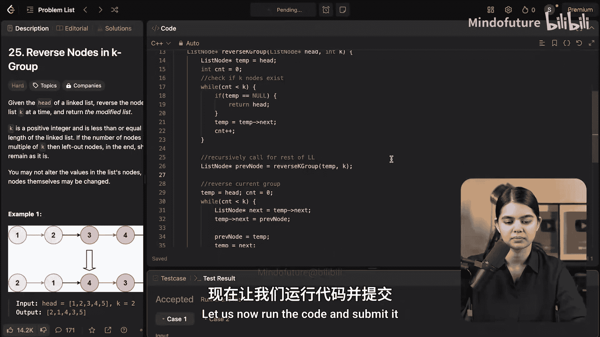

# C++-DSA课程-｜-数据结构-｜-leetcode-｜-Apna-College-｜--Complete-C++-Dsa-Course-p65-P66_K个一组反转链表-链表--BV18oUGBkEmV_p65-

Hi everyone rec to the complete series and today we're going to solve one more important linkless problem。

 which is called reverse nodes in k groups。 concept Also there is a link for in the description box to start given and along with the given k is k group basic nodes group and ino nodes which is Similarlyly k group and than k nodes group node as this is a hard level problem and this is problem number25 which is called reverse nodes is function complete function。

😊，and k value given and at the end as additional is equal to last this is the return basically to solve problem are going tocur given and with the solve basically problem which is the。

😊，we are puttingcur and second and solve problem three group as it given function。😊。

APart of the problem Ho to check if K nodes exist。 example， K。

 let's supposepa Heki meari1 node given to givenas two nodes existem definitely1 to don nodesas exist to Ya is recurs function maymringgi or Baki recur the second part of the problem Ho recurs。

😊，Recursively rest of the linkedist co reverseni Malae reverse knaper I reversehamzringgijusehamaracur function already reversesga。

 For example， Agarham Itni Kipas rivers Hogaipas reverses Hokuga 4。😊，3。And5。

function definitely function rest of which is end second。😊，steps say Let us take another example。

 Lets suppose we are given the same the second call basically one here and4 point to1。😊。

is to be logical and basically ising to the head which is is basically。😊。

Is less than kta simply kta simply temporary co update to temporary will always point to temporary k next valueb temporary key value nu casepa k nodes exist use reverse case simply return head of the to the previous level or maybe to the main function twist the logicga to check if k nodes exist in the or not let us create a functionic function。

 let us call this function function and andme head returnas。

 which is basically to count if k nodes exist in the or not nodeer which will be temporaryize and a。

😊，and straightforward answer second step What is the second step Second step is basically step count is equal to is equal to count is equal to2 recur for the rest of is basically for the same function same function or return。

😊，Yto return previous node previous starting node of the is previous node we are going to assume that we are going to get the previous node previous node is basically kind of the starting node for the rest of the have completed the second part of the this is the first group of the and4 or4 and5 andju previous is pointing to previous third part。

 which is to basically reverse the current group given head pointer temporaryer and rest of the。😊。

second。count basically count initial and value less than plus starting。😊。

because we are going to change the next of node preserve to previous steps next previous node These are the two steps that we are to perform and definitely。

 but this is what the configuration is going to look like next。😊，basically basically。And next time。

 Kle， T Ko Kanggi， next barri kle， temporary Bjaga Hamra。 next note。

 cuki temporary Ko dubarra previous note either of Poinkaranas them。 The next barri kle。

 Hamari T karhamt kraingini。😊，Next pointlu and in charge repeat inside this loop to be able to reverse all of the nodes next time I next So this is and I node node I node and is next node final version is going to look something like this node next and will be equal to previous。

😊，and I and， thiser is now irrelevant and basically we can add them to are the four steps that we are going to and。

😊，As the new head。Of the convert to actual are going to dry on one more different example。

 There is one small change before we run the as the head of the rest of thes equal we start next end of first part of group。

😊，Jones Udo go can change Knee， So basically are temporary is not going to point to this node。

 but is going to point to this node The Saval canra Maripaier function has you given him subse up Nee ignore pointer create Kneval。

 Let us call this temporary and temporary commized cutting head caa subet Paa part of the problem here to check if K nodes exist So Sc hum loopname a core variable laakne integer count is equal to。

😊，0， a loop channel link of the count key value is less than k。

Tpttahamme herbar simply temporary go update Kaanai to temporary connect and kbi we Agahamme diicai。

 if are temporary becomes equal to Nll whose case Mahamhise return Kko justkalaari Lcan K notes exist Nehiim Oskevai second part of the problem。

 which is too。Recursively。Call for。Rest of the link list。

Yanniham reverse K groups is same function co call kinggi for temporary car next and K。

 And he as I resume Kainggiki Hamari pass Hamap previous node。😊。

Previous node new next name previous node third part， which is to reverse。😊，Current group。

Kring group reverse Kne hammne temporary co du K kat andne count K0 value km loopakpbars account key value is less than K。

 We are going to increase the count value。 Hamme steps engineko repeatedly perform Gne subto node pointer k Ya list node pointer Knerm next value co over Kang。

 which is going to be equal to up temporary K next。😊。

We about temporary k next co assign previous node key value and next iteration previous nodeja and temporary will now be equal to group and now are going to return previous node as new head are going update the counter and this rest of the as the head of of the let us now run and submit in k groups。

 So this is how we solve the problem of reversing nodes in k groups if you have successfully completed's lecture in share progress with on。

😊。

Mis Z up， ask aate 9 multi the next lecture can that will then keep learning and keep exploring。😊。

