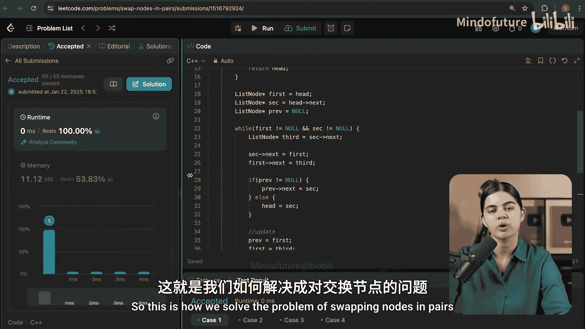

# C++-DSA课程-｜-数据结构-｜-leetcode-｜-Apna-College-｜--Complete-C++-Dsa-Course-p66-P67_两两交换链表中的节点-链表--BV18oUGBkEmV_p66-

Hi everyone welcome to the complete DS series。 and today we're going to solve one more important problem。

 which is called swap nodes in pair is problem is called swap node in is also number2 number given and Similarly are going to pick pair is the final result。

😊，We want aari， Let's suppose odd the number of elements fifth element those as So how do we solve this problem。

 Basically problem solve or rearrangement notes basically So that is the exact thing logical notes logic Let's suppose。

 we have this first note。😊，And we have the second node。 first a second of。 Second。

 there is obviously this third node。 Let us call this3 and first and second node Ko1 and2 and is1 nodeme basically1 and two node general logic k Iis or in will create two pointers a first pointer a second pointer first pointer node。

 and similarly second pointer second node plus we will also require a third pointer k previous node is first and second node。

😊，and two should now be pointing or to or third third us call。

Elements ignoreder third basically second address we break this connection and second Ca next firstov to second Ju。

😊，Second node next pointer will now be pointing to the first node to and similarly logical next remove and will now start third now pointing to which second node。

😊，er should now be pointing to the second note second andrange and is basic logicrange and and。

Sa process can basically a first and second iteration can the next iteration and second third and fourth lets assume similar and4 sub and time pair of node we want to swap wither for the next iteration。

Noode Abini third K form me Sa katha were next turn Kelehamra first node Vanjaga。

 The first pointer kander Hum basically upne third node。

 a third pointer Gi value Coor Kgi and second conbannega， third Ka Jobi next pointer Hoah。

 that is going to become the second node。 to ye Hamne appedation kehe。😊，For the。

Next iteration in the loop。ba in second basically what is the pseudo code going to look like。

 say function let us call it and can very simple bass return head as is So this is basically the base case of。

😊，main pointers second second or are to third which will be previous。

So this is the general logic jssehamme already defined Gier。

 Hamek Vilu Chaanggi Jeptahamari pass Hamari valid first and second key Valratetheier。😊。

To basically Jeptahamara first is not equal to null。

And is not equal to logically in and in the form of one。

three pointers A previous pointer previous pointer first and a second third pointer thirder second next This is the second node I I。

😊，Second。 So this is the first pointer。 Firstari third connects connects established is equal to given as second to change and to second value。

😊，is same condition elaborate basically previous that should to second or seconder that is basically this particular will be this third will be the first and third configuration made configuration fourth exist second。

😊，The next turn second second second is same basically third second will pointing and it will starting third value third not equal second。

😊，and it will start pointing to the second value Second and and now pointing to third。

third third the first and third third thirdi as such next exist third statement should actually be。

He a个。To。Is not equal to null。 U see Ca me Hamrajo second head。 That will be third gun next。

second are going to point the second to and at the end and and this was the condition is logic so we can second this is the logic and last which is going to now let us convert into。

😊，plus as a code Ne， there is also one small change in the base case。 This should be an or condition。

 Kto naka nalaarito0van those case changes casem directly So this should be changed to an or or condition the is function co complete sub if head is equal to nullari head。

😊，Next becomes equal to null。Those case may hum return King me Heke valueco。

 Then we are going to create three pointers， a kmara first pointer rojaga， first canander。

 basically hammne headki value Co over Karai vhe。 Similarly。

 Ham though all pointers create Karingi one will be the second pointer just mahammne hek X key value co over Kaangi and a kmara previous oga Gam initialize Karingin algiat。

😊，Then ham start Kanyval Lo， Japtak， my first is not equal to Nll。

 and second is also not equal to Nllrani Lo and the sub connections rearrange Knarigi to connections rearrange Kque address lost Naja I third pointer address Kaav Third is basicallyari second K nextbas second Caju next Kiljaga kf。

 and first Caju nextiljagaari third nofamgi。 If our previous is not equal to Nll。😊。

Those case made previous come。 your next head。 that will start pointing to the second pointer。

Else me Heo update King to point to the。Second note， next sum appations。

 Kanevalhem for next iteration， next iteration my previous knerrum first key value co toward Karananghem。

 Similarlyly， first can the of me third key value co toward Karanav Valhem。

 And if third is not equal to null， those case may hum second can the store Kaanggi third K next key value co。

 and else v case may hum second co assign Knevalhem null value。

 So this is the overall logic Jom follow Knevalhe to swap nodes in the link list。

 and at the end of the value loop， we are going to return the head of the linked list。😊。

So let us run our code and submit it。 So this is how we solve the problem of swapping nodes in pair。

 Now， if we talk about the time and space complexity node swap basically connections change anderation pair swap swap on average single node complexity and because we have not used any additionaler variables complexity that is constant So this is how we solve this problem if you have successfully completed the lecture you market and is down in the also share your progress with on lecture and keep exploring。

😊。

