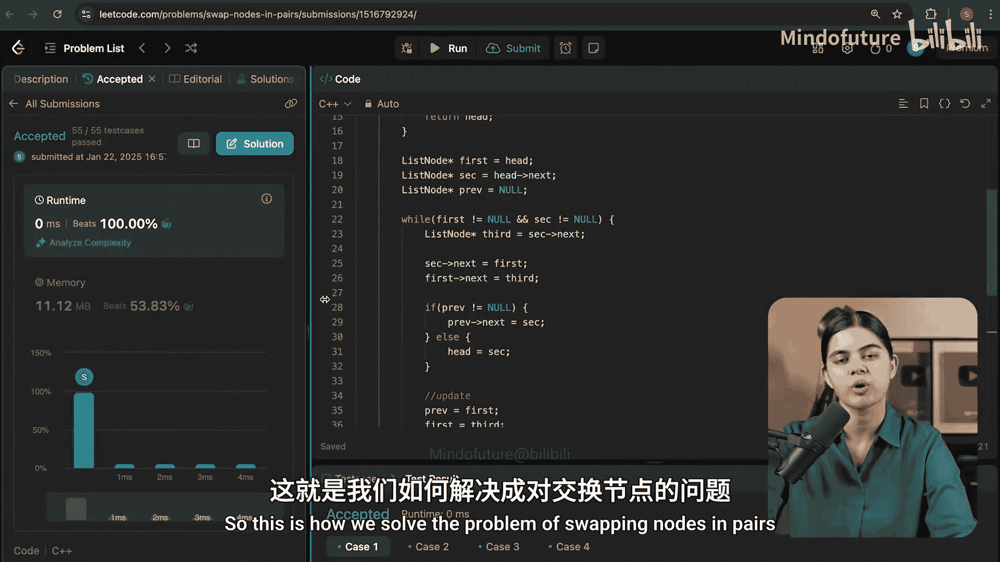

# C++ 数据结构与算法课程：P66-P67：两两交换链表中的节点


在本节课中，我们将学习如何解决一个重要的链表问题：**两两交换链表中的节点**。我们将详细分析问题，理解其背后的逻辑，并最终用代码实现解决方案。

## 概述

问题要求我们给定一个链表，然后两两交换其中相邻的节点。如果链表节点数为奇数，则最后一个节点保持不变。例如，链表 `1->2->3->4` 经过交换后应变为 `2->1->4->3`。我们的目标是理解并实现这个交换逻辑。

## 问题分析与核心逻辑

上一节我们概述了问题，本节中我们来看看解决这个问题的核心逻辑。关键在于重新安排节点之间的连接，而不是仅仅交换节点中存储的值。

假设我们有一个链表，其中包含节点 `1`、`2`、`3`、`4`。为了交换第一对节点（`1` 和 `2`），我们需要三个指针来辅助操作：
*   `first`：指向当前待交换对的第一个节点（节点 `1`）。
*   `second`：指向当前待交换对的第二个节点（节点 `2`）。
*   `prev`：指向上一对交换完成后，新链表的最后一个节点（对于第一对交换，初始时为 `nullptr`）。

以下是交换一对节点（例如 `first=节点1`， `second=节点2`）的步骤：

1.  首先，我们需要记录 `second` 节点的下一个节点，我们称之为 `third`（即节点 `3`）。这是为了在断开连接后能找到下一对节点。
    `ListNode* third = second->next;`
2.  然后，我们改变 `second` 节点的 `next` 指针，使其指向 `first` 节点。这就建立了 `2 -> 1` 的连接。
    `second->next = first;`
3.  接着，我们改变 `first` 节点的 `next` 指针，使其指向 `third` 节点（即节点 `3`）。这就建立了 `1 -> 3` 的连接。
    `first->next = third;`
4.  最后，也是最关键的一步，我们需要更新 `prev` 指针。如果 `prev` 不是 `nullptr`（即这不是第一对交换），我们需要将 `prev->next` 指向新的当前对的第一个节点，即 `second`（节点 `2`）。这样就把前面已经处理好的链表部分和当前这对新交换的节点连接起来了。
    `if(prev != nullptr) prev->next = second;`
5.  完成一对交换后，我们需要移动指针，为下一对交换做准备：
    *   `prev` 移动到当前这对交换后的第二个节点（即原来的 `first`，现在的节点 `1`）。
    *   `first` 移动到 `third`（即节点 `3`）。
    *   如果 `first` 不为空，则 `second` 移动到 `first->next`（即节点 `4`）；否则 `second` 设为 `nullptr`。

## 代码实现

理解了核心逻辑后，现在让我们将其转化为具体的 C++ 代码。我们将遵循上述步骤，并处理好边界情况。

```cpp
/**
 * Definition for singly-linked list.
 * struct ListNode {
 *     int val;
 *     ListNode *next;
 *     ListNode() : val(0), next(nullptr) {}
 *     ListNode(int x) : val(x), next(nullptr) {}
 *     ListNode(int x, ListNode *next) : val(x), next(next) {}
 * };
 */
class Solution {
public:
    ListNode* swapPairs(ListNode* head) {
        // 处理空链表或只有一个节点的链表
        if(head == nullptr || head->next == nullptr) {
            return head;
        }

        // 初始化指针
        ListNode* first = head;
        ListNode* second = head->next;
        ListNode* prev = nullptr;

        // 新的头节点将是原链表的第二个节点
        ListNode* newHead = second;

        // 遍历链表，进行两两交换
        while(first != nullptr && second != nullptr) {
            // 步骤1：记录第二个节点的下一个节点
            ListNode* third = second->next;

            // 步骤2 & 3：交换 first 和 second 节点的连接
            second->next = first;
            first->next = third;

            // 步骤4：连接上一对交换后的节点与当前这对
            if(prev != nullptr) {
                prev->next = second;
            }

            // 步骤5：移动指针，为下一轮迭代做准备
            prev = first;      // prev 移动到当前对的第二个节点（交换后）
            first = third;     // first 移动到下一对的第一个节点

            if(first != nullptr) {
                second = first->next; // second 移动到下一对的第二个节点
            } else {
                second = nullptr;     // 如果没有下一对，second 设为空
            }
        }

        return newHead;
    }
};
```

## 复杂度分析

在实现了算法之后，我们来分析其效率。

*   **时间复杂度：O(n)**，其中 n 是链表的长度。我们只需要遍历链表一次，对每一对节点执行常数时间的操作。
*   **空间复杂度：O(1)**，我们只使用了固定数量的额外指针变量（`first`， `second`， `prev`， `third`， `newHead`），没有使用与链表规模相关的额外数据结构。

## 总结

本节课中我们一起学习了如何**两两交换链表中的节点**。我们首先分析了问题，明确了交换节点连接而非节点值的核心思想。接着，我们详细推导了使用三个指针（`first`， `second`， `prev`）进行单对节点交换的步骤，并将其扩展为遍历整个链表的循环逻辑。最后，我们实现了完整的 C++ 代码，并分析了算法的时间和空间复杂度。掌握这个问题的解法，有助于加深对链表指针操作的理解。



