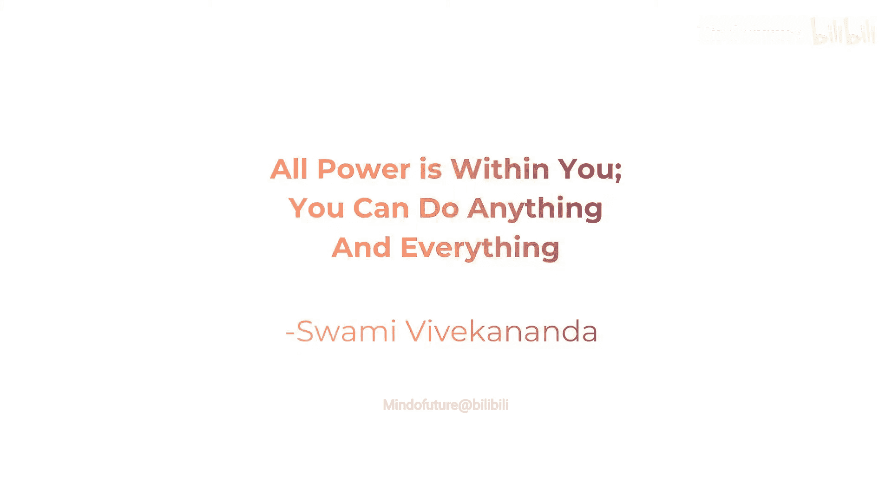
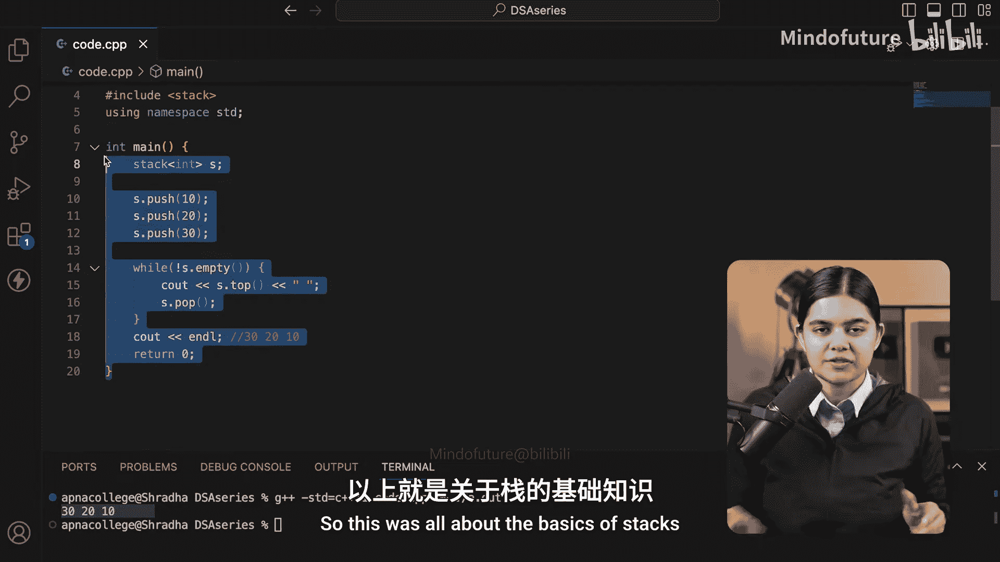

# C++-DSA课程-｜-数据结构-｜-leetcode-｜-Apna-College-｜--Complete-C++-Dsa-Course-p67-P68_栈简介-数据结构与算法-第66讲--BV18oUGBkEmV_p67-

H and welcome to the complete series。 And today we're going to understand the stack data structure in detail。

 is new visual are going to analyze what a looks like and。😊。

Up JM stack data structure keytehamni clear key it is a bucket like structure up stack data structure key sub important property U Vo the key it is a last in first out data structure last in。

😊，First， outgni Kalabe。delete which is from the top is very similar to。and In fact。

 function deletes and this got delete0 be and in0。Last may inside of thehar So that is why it's called a data structure。

 and this is a very important property Q data and this is the general basic difference between basic concept very easy to visual functions and third is top function。

😊，functions important functions constant but want to。

Lit now vector say stackco create kne pale mu love so much basically stackco implement code vector create value Any is say we are going to create a vector internal and is vector ca behavior ho。

😊，Ose him implement Karinggi。In the form of stack behavior， Yani uppen is vector per hum T functions。

 push P and top co implement Karinggi juino kino Bego one time complexity can the K kringi。

 And in Tino functions Caju behavior Uga or stack behaviorga is the A will connect a vector with three different functions。

 so that the vector starts behaving like a stack and is the vector k mehammni stackco create kringgi to stackco create kne subseic basic classme code can the implement knaga。

 This is our Cus boiler plate code is can stackco implement Kus subseto will create a class called stack。

😊，Is object of inte values let us call it main function internally sub top element we are trying to let us。

😊，Is element co property， which is my top property top element similar functionality top element by default generally for the sake of simplicity and indexse top index top index top default last index if we add one more element in the index internal internally。

😊，Normally a core value push at the end of the vector and functions is the stack function of if we want to implement the top function。

index calculate it is simply vector dot size1 is index index and finally function basically and top value value last index。

😊，And Hamraju top indexpa resetjaga to this 20 value to stack value simply vector say pop back last inserted value Similarlylyham20 sayra top resetja vector pop top indexja and simply this is how we are going to implement the stack functions as implement and values internally vector in to implement these functions。

 So let us convert this entire implementation into C plus simply complete class complete let us create some public functions stack implement the functions implement subja push function in value。

😊，Second functionjaga Hama avoid pop function， the same last inserted value co P K and third Hojaga in T top return inino functions go implement K with a time complexity of big internallyas internallyas vector to stack may pushne vector kni value co push back and he ask simply returnja a pushback function a constant time complexity function That is why push function B a constant time complexity function Similarlyly popne vector C value co pop back King this is also a constant time complexity function。

 That is why stack cajo pop function a that will be constant time complexity function top return return King vector Cni vector dot s minus1 key。

😊，Value value Jo axis index constant functionino functions constant abstract core important function which is called boolean empty this function returns a true value empty and returns a false value non empty vector is vector for example。

 last element vector empty function true value returnb。😊，Haari vector cassis becomes equal to 0。

 whose case me we are going to get through else we are going to get a false value。

 So is the re say Hammniip complete stack class co implement k up。

 let us use this stack class in our main function。 main function can the sub stackco create K I simply extract create Kip stack can which values engineer push Knaem the stack dot push 20。

😊，And stack dot push 30。320 basically。😊，Not S do empty。

 Ttaham simply stack it topco print Knaem with some space Andoskybas Stam pop Kingusk top element last mehem C out Kde end off line。

 And is that he is a final output Hammebaripa 30，20 and 10 printto kranology。

 Let us save this code and run it。😊，So this is the output that we have gotten。

 and this is the correct output。 basically last in first and this is how we basically try to implement this was first using。

😊，Of the importanterham visualize implement top sub important implementation can will basically use a class list class list of in and this will basically functions available this is how the stack is and。

😊，10 it now points to this 10。😊，To Lless Kanderam Gaaringgi， Jesse Hamniia Staander。

and front of next time in the front of basically。😊。

canner push Kna in the front of the link front change see same value go is the say K push function co implement carrying in the class。

 basically code jahaa me last time vector use is we are going to use a list to sub include Kle lets go we create a list of integer lets call it linked list。

😊，Push function k is simply。 let us remove all of these values。

 vector exist P function S implement push function simply push front use update and O function constant overall push function B constant to push implement we are going to do this next time core value push let's suppose is30 k to simply top push link39 node 30。

😊，Vohamari linkedlist K。Front per aja， which is the andari。

 So this is how we are going to internally implement the push function of the top of top of front as the top of top function front function basically3 remove。

😊，Will delete this element and update the of from the or head dot。😊。

equalja those case So this is how we implement a stack using a implementation logic will the same output using another using of using or simply class。

T functions same same push function same empty function same top function same pop function let us save the code and run it function。

 and this is how we use a stack using C plus S So this was all about the basics of stacks fundamental property of stack cover stack。

😊。

for structure major function push and top implementation using vectors and using a So this is all about the basic lecture will also complete lecture if's lecture in share progress with me on description lecture and keep exploring。

😊。