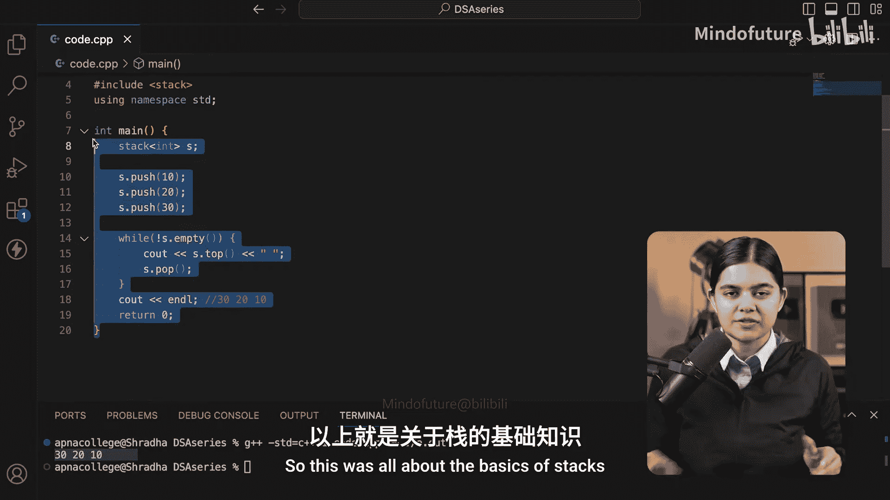

# C++ DSA课程：67：栈数据结构简介 🥞


在本节课中，我们将要学习一种名为“栈”的基础数据结构。我们将了解它的核心特性、基本操作，并学习如何在C++中实现它。

## 概述

栈是一种遵循“后进先出”原则的线性数据结构。你可以把它想象成一个桶，你只能从顶部放入或取出物品。最后放进去的物品，会最先被取出来。

## 栈的核心特性与操作

上一节我们介绍了栈的比喻，本节中我们来看看它的核心特性与基本操作。

栈最重要的属性是 **LIFO**，即 **Last In, First Out**（后进先出）。这意味着最后被添加到栈中的元素，将是第一个被移除的元素。

栈主要支持三个基本操作：
*   **`push`**：将一个元素添加到栈的顶部。
*   **`pop`**：移除栈顶部的元素。
*   **`top`**：查看栈顶部的元素（不移除它）。

以下是栈操作的示意图：


## 使用向量实现栈

理解了栈的基本概念后，我们来看看如何在C++中实现它。一种常见的方法是使用标准库中的 `vector` 来模拟栈的行为。

我们将创建一个名为 `Stack` 的类，它内部使用一个 `vector` 来存储数据。通过封装 `vector` 的特定操作，我们可以让它表现得像一个栈。

以下是实现栈类的核心代码框架：

```cpp
class Stack {
private:
    vector<int> v; // 内部使用向量存储数据
public:
    void push(int val) {
        v.push_back(val); // 在向量末尾添加元素，模拟入栈
    }
    void pop() {
        if(!v.empty()) {
            v.pop_back(); // 移除向量末尾元素，模拟出栈
        }
    }
    int top() {
        if(!v.empty()) {
            return v[v.size() - 1]; // 返回向量最后一个元素，即栈顶
        }
        // 处理栈为空的情况，这里简单返回-1
        return -1;
    }
    bool empty() {
        return v.empty(); // 判断向量是否为空
    }
};
```

**代码解释**：
*   `push` 函数：调用 `vector` 的 `push_back`，时间复杂度为 O(1)。
*   `pop` 函数：调用 `vector` 的 `pop_back`，时间复杂度为 O(1)。
*   `top` 函数：返回向量最后一个元素，时间复杂度为 O(1)。
*   `empty` 函数：检查向量是否为空。

## 使用链表实现栈

除了向量，我们也可以使用链表来实现栈。链表在头部插入和删除元素非常高效，这正好符合栈的操作特性。

我们将使用C++标准库中的 `list`（双向链表）来实现。核心思想是将链表的**头部**作为栈的**顶部**。

以下是使用链表实现栈的关键逻辑：

```cpp
class Stack {
private:
    list<int> l; // 内部使用链表存储数据
public:
    void push(int val) {
        l.push_front(val); // 在链表头部插入元素
    }
    void pop() {
        if(!l.empty()) {
            l.pop_front(); // 从链表头部删除元素
        }
    }
    int top() {
        if(!l.empty()) {
            return l.front(); // 返回链表头部元素
        }
        return -1;
    }
    bool empty() {
        return l.empty();
    }
};
```

**实现逻辑**：
*   `push`：使用 `push_front` 将新元素加到链表头部，使其成为新的栈顶。
*   `pop`：使用 `pop_front` 移除链表头部元素。
*   `top`：使用 `front` 获取链表头部元素。

无论使用向量还是链表，栈的 `push`、`pop` 和 `top` 操作的时间复杂度都是 **O(1)**。

## 栈的应用示例

现在，让我们使用实现的栈类来完成一个简单的操作，验证其LIFO特性。

```cpp
int main() {
    Stack s;
    s.push(10);
    s.push(20);
    s.push(30);

    cout << s.top() << " "; // 输出 30
    s.pop();

    cout << s.top() << " "; // 输出 20
    s.pop();

    cout << s.top() << endl; // 输出 10
    s.pop();

    return 0;
}
```

运行这段代码，输出将是 `30 20 10`。这清晰地展示了“后进先出”的顺序：最后入栈的30最先被访问和移除。

## 总结

本节课中我们一起学习了栈数据结构。
*   栈是一种 **LIFO**（后进先出）的线性数据结构。
*   它的三个基本操作是：**`push`**（入栈）、**`pop`**（出栈）和 **`top`**（查看栈顶）。
*   我们学习了两种实现栈的方法：基于**向量**和基于**链表**，两者的核心操作时间复杂度均为 O(1)。
*   栈是许多算法（如函数调用、括号匹配、深度优先搜索）的基础，理解它至关重要。




在接下来的课程中，我们将探索栈的更多应用场景和高级用法。