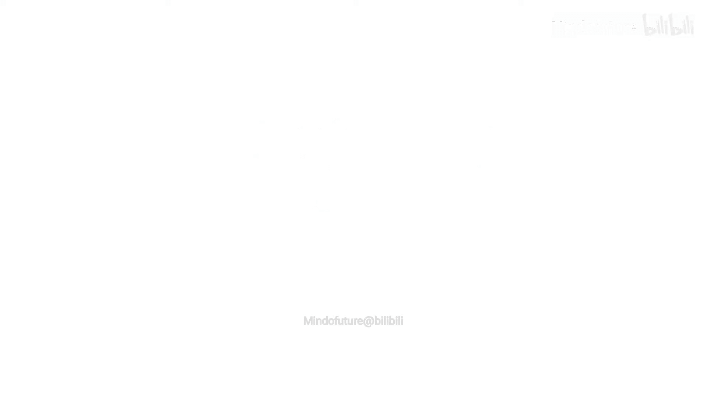
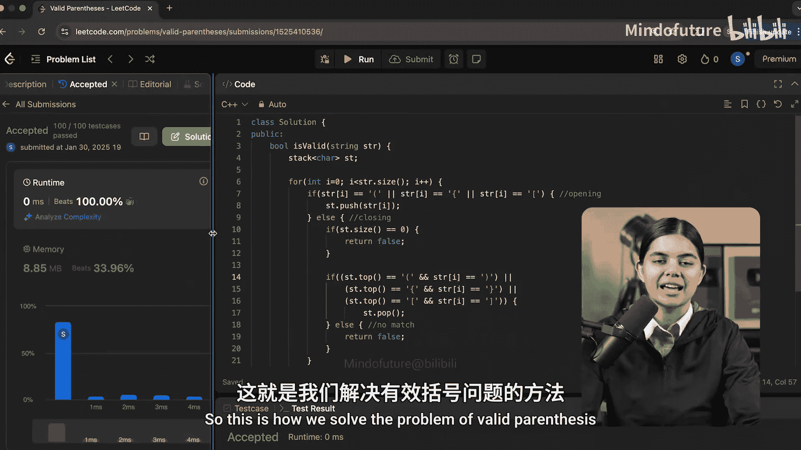

# C++-DSA课程-｜-数据结构-｜-leetcode-｜-Apna-College-｜--Complete-C++-Dsa-Course-p68-P69_有效的括号-栈-第67讲--BV18oUGBkEmV_p68-

Hi everyone， welcome to the complete series。 and today we're going to solve one more classical problem。

 which is called valid parenthesis is a list for description this problem is called parenth number 20 or。

😊。

basically question according valid parent given conditions the given conditions are opening bracket must be closed by the same type of bracket bracket curly closing bracket curly opening bracket curly bracket this is a valid parenthesis is not a valid parenthesis second condition brackets must be in the order for example。

 bracket bracket in string opening brackets order brackets Third condition every bracket has a corresponding opening bracket of the same type string equal number of opening and equal number of closing brackets。

😊，For example， bracket in basically for given。😊，in string if that string is a valid string or invalid string invalid to at the general logic of things is an example of basically bracket let bracket or example。

 closing bracket。😊，se just order basically opening This is the rule that is followed in every valid parentheesis What is the rule opening bracket。

😊，Jb typeke parenttheisca Ayahi， Uika subse。First closing。😊，character。

Closing character definitely and is closing and finally basically if we want to us。😊。

Let's call this stack S T。Fhamek Lolae Valhem for I is equal to 0 to n Yopni stringy total length per Agarhamaripa。

 Agarhamara Jobi character， Yani Strka Kobi character， I， Agarik opening character。

 hekle Skele simply Sta hum King's character。😊，Ellffali kiss meminaelfaah case。

 This is the case for opening characters。 Jkiari conditions I'm directly called meing。

 And this else case is the case for closing character。

 closing characters can case me me simply closing characters could match Kel Staki Topkiat to hum string of Ijora closing character here who say match Kneki Ko Kringi with。

😊，St dot。opening situation there are less number of opening brackets and more number of closing for example。

 and closing in number of opening basically if this is the。😊。

To when we are coming towards this closing character condition to it becomes equal to0 false value closing brackets opening bracket and bracket bracket for example。

 bracket but we only a is is but at the end of completely empty。😊。

String invalid last May after this entire loop completes aer Paga yet directly returned because thank stackis。

😊，If this will become equal to 0， the B returnring naon false returnring to basically ham said jaha are opening brackets become greater or more in quantity as compared to the closing brackets。

 So this is the entire logic disk basis by ham valid parent this is vvalco allring to let us convert the pseudocode into actual plus code the codeganander。

 This is the function that we want to complete is function Gnda subto xt create of characters let us call it S T and string Ham loop string I than S R dot size I plus plus。

😊，Herbar subseelliom Czekanivai Hamraju character I it an opening character or a closing character。

 The Yabram Czequeare a string of Ike value If this becomes equal to this parenthesis， Yair。

 basically Hamripas teen conditions， onlygi。😊，Od， o。Yber Hamipas， Curly Bra Ajaga。

 Yaas square Bjaga Y Hamipas opening Ca casese， Aga opening head。

 whose case may Hamme simply stack Ken P Kana Ani character go， which is Etar of I。

Elsevaakki Samariipas。Closing bracketka kjaga， closing bracket Valley games may successfully to checkling aur。

😊，If the stack size becomes equal to 0， those case mayhihi directly returned G false value Ime。

 in fact， Iam exact match mira andra exact match simply subsegarhamraju closing bracket here。

 If this is equal to this parenthesis to I closing karipper any S T dot topki value should be equal to Iika opening Mae condition satisfy Honiwahi opening and very closing bracket let us copy this or or。

😊，Yaur Mariippa curly braces the upper oneche。Yair Hamipas， square bracket Soji。

Agarinino Mese Ko8 case exists Kakage Male is simplyt pop a value。😊，And Phil Agahamara El vakki。

 just kiss me。No matches found。 This case in false last simply dot size is this value equal to 0 equal to0 string But if the is not equal to0 So this is the entire logic logic character single the complexity is going to be and the complexity use case opening or the space complexity is also going to be of。

😊，Do you say runthe and let us submit it。 So this is how we solve the problem of valid parenthesis。

 lecture track data structured， but based Sa solve to tackle our interview problems。

 If you have successfully completed today's lecture then you can mark it in now in the comments me can also share your progress with me on Twitter is calling description box can Ask lecture can keep learning and keep exploring。

😊。

