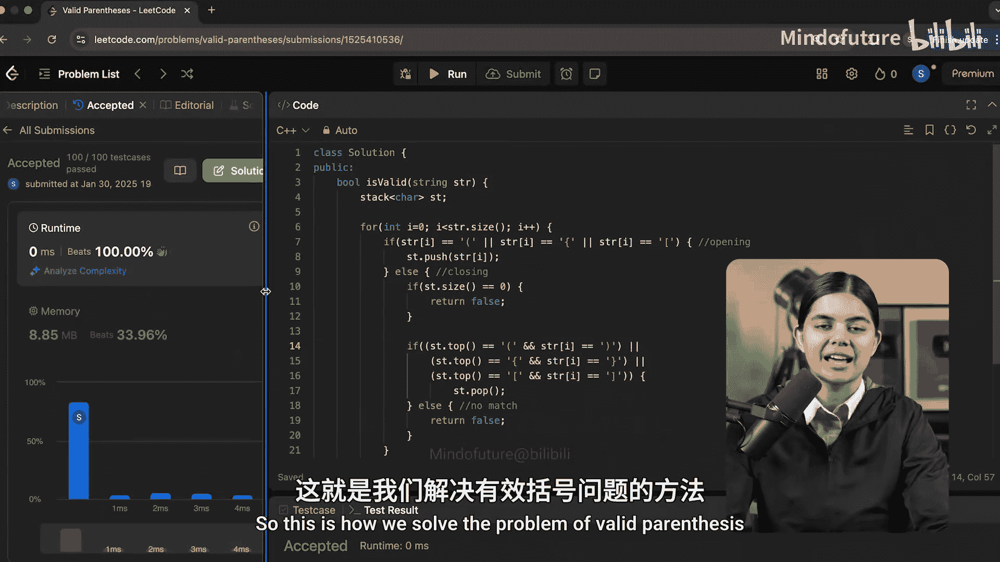

# C++数据结构与算法课程：68：有效的括号问题


在本节课中，我们将学习如何解决一个经典的算法问题——“有效的括号”。这是一个在技术面试中非常常见的问题，我们将使用栈这一数据结构来巧妙地解决它。

## 问题概述

问题的核心是判断一个仅由括号字符 `(`， `)`， `{`， `}`， `[`， `]` 组成的字符串是否有效。一个有效的字符串必须满足以下三个条件：
1.  每个左括号必须用相同类型的右括号闭合。
2.  左括号必须以正确的顺序闭合。
3.  每个右括号都有一个对应的相同类型的左括号。

## 核心思路与规则

上一节我们明确了问题的要求，本节中我们来看看解决它的核心逻辑。关键在于观察有效括号字符串的闭合顺序：**最后出现的左括号，必须最先被匹配和闭合**。这种“后进先出”的特性，正是栈数据结构的典型应用场景。

因此，我们可以遵循一个简单的规则：遍历字符串，遇到左括号就将其压入栈中；遇到右括号时，检查栈顶的左括号是否能与之匹配。

## 算法步骤详解

以下是使用栈解决此问题的具体步骤：

1.  **初始化**：创建一个空栈 `stack<char> st`。
2.  **遍历字符串**：对字符串中的每一个字符 `s[i]` 进行判断。
3.  **处理左括号**：如果 `s[i]` 是左括号（`(`， `{`， `[`），则将其压入栈中。
    ```cpp
    if(s[i] == '(' || s[i] == '{' || s[i] == '[') {
        st.push(s[i]);
    }
    ```
4.  **处理右括号**：如果 `s[i]` 是右括号（`)`， `}`， `]`），则进入匹配检查流程：
    *   **检查栈是否为空**：如果栈为空，说明没有左括号可以匹配当前的右括号，字符串无效，直接返回 `false`。
    *   **检查栈顶元素**：取出栈顶的左括号，检查它是否与当前的右括号 `s[i]` 匹配（例如 `(` 匹配 `)`）。如果不匹配，字符串无效，返回 `false`。
    *   **匹配成功**：如果匹配成功，则将这个栈顶的左括号弹出，表示这对括号已成功处理。
    ```cpp
    else { // s[i] 是右括号
        if(st.empty()) return false;
        char topChar = st.top();
        if( (s[i] == ')' && topChar != '(') ||
            (s[i] == '}' && topChar != '{') ||
            (s[i] == ']' && topChar != '[') ) {
            return false;
        }
        st.pop();
    }
    ```
5.  **最终检查**：遍历完整个字符串后，检查栈是否为空。
    *   如果栈为空，说明所有左括号都找到了匹配的右括号，字符串有效，返回 `true`。
    *   如果栈不为空，说明还有未匹配的左括号，字符串无效，返回 `false`。

## 复杂度分析

*   **时间复杂度**：`O(n)`，其中 `n` 是字符串的长度。我们只需要遍历字符串一次。
*   **空间复杂度**：`O(n)`，在最坏情况下（例如全是左括号），我们需要将所有字符都压入栈中。

## 完整代码示例

将上述逻辑整合，得到完整的C++解决方案代码如下：

```cpp
bool isValid(string s) {
    stack<char> st;
    for(int i = 0; i < s.length(); i++) {
        char ch = s[i];
        // 如果是左括号，入栈
        if(ch == '(' || ch == '{' || ch == '[') {
            st.push(ch);
        }
        else { // 如果是右括号
            // 栈为空，无法匹配，无效
            if(st.empty()) return false;
            // 检查栈顶元素是否匹配
            char topChar = st.top();
            if( (ch == ')' && topChar != '(') ||
                (ch == '}' && topChar != '{') ||
                (ch == ']' && topChar != '[') ) {
                return false;
            }
            // 匹配成功，弹出栈顶元素
            st.pop();
        }
    }
    // 最终检查栈是否为空
    return st.empty();
}
```

## 总结



本节课中我们一起学习了如何使用栈来解决“有效的括号”问题。我们首先理解了有效括号的三个条件，然后抓住了“后进先出”这一关键特性，从而选择栈作为解决方案的数据结构。通过遍历字符串、分类处理左右括号、并及时进行匹配检查，我们能够高效地判断字符串的有效性。这个方法思路清晰，代码简洁，是栈的经典应用之一，请务必掌握。