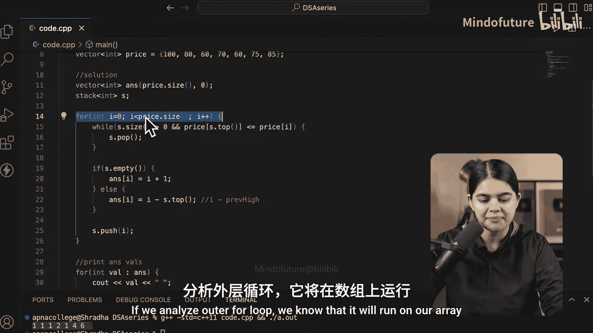

# C++-DSA课程-｜-数据结构-｜-leetcode-｜-Apna-College-｜--Complete-C++-Dsa-Course-p69-P70_股票跨度问题-最优解--BV18oUGBkEmV_p69-

H everyone and welcome to the complete series。 and today we're going to solve an important and classical DSA problem。

 which is called stock span concept available Also there is a link for company in the description box this problem is called stock span on price given price and price of graph。

 For example， according to this data0 price equal first per equal to1 price is equal to 80 day2 60 day3 70 day4605 75 and 6 85 for this particular stock。

😊。

D kle span valueco calculate up span a coffee special and interesting valueka detail particularka calculate for example。

 Aham iski to is particular kka kpan basically stock span maximum number of。😊，Conecutive days。

From today。Jahaur on diinander， Jobi Price said that is less than or equal to。😮，Today's price。

 this is the technical definition of what the span is going to be easy technical definition Go break down basicallyham calculate toari immediately Kiar continuous deb priceki equal maximum deky valueka for example。

 I de7 Kiari price 7ki equal and I includehe。😊，Current de price， for example。

70ham to 70 say less value 60 Jeseari greater than valuejaham debi greater than value to 70 khamsjaja that will be equal to do Why will it be equal to doki 7 value tos price plusgaham 7 include and Similarlyly singles calculate Let us take an example of the first。

😊，I is equal to 0 k de0 de less equal value equal Similarlyly。

 if we take i is equal to1 I is equal to equal is80ja equal next6 price than equal to6 for I is equal to because there is no smaller value for is equal to7 which is 60 to8 then 6。

😊，7 value next for I is equal to4 to 60 say less than value 60 but with todays price60 say immediately starting from to 6 smaller value which is equal to1 is equal to 5 k to 75 k6070 less6inoino de and equal Similarlyly for I is equal to to85 equal。

2，3，4，5， and definitely 6 to Yaha Hamaspan Hoja 6 k equall。

 and is theri answer return Gnai in the form of vectorriari values Hamra answer for given stock price single returnnaimi problem go solve let us first minimize this definition is definition me。

 because this is the general definitionco calculategime Al answer Yahari1，1，12，1，4 and 6 returngi。😊。

calculate observe for example， value and and take an example of。😊。

egg then plus ham current deko be count herte to 7 pos Cajopanjaga。

 that will be equal to2 to her a current de Agarhamuska previous high calculate kth Igbar definition be for previous high previous high for any day is basically the immediate。

😊，Greater value。For any day。greater value equal to basically。😊。

Current index i per replace with this index i value previous value then this gap is going to be equal to index i index i660 equal60 60 say greater value greater value that will be equal to 2121 equal equal next time7070 will be equal to31 equal we again i is60。

😊，6ja7 equal 43as equal next time75 equal75 equal585 equal So these values calculate calculatene that is the correct approach logically than equal less than equal value and value equal is。

😊，middle values the gap between thiseth index and this previous high is equal to that count of values that count of consecutive days less than equal basic logic modify given less than equal problemefineefine for any and and this is the problem solve。

Data structure Ka use Kgi to Saval kander， we are going to create a stack data structure and is stack data structure canar how much unique data to Kgi previous Haikaka lab previous Haka lab had immediate greater values。

 Toham her I D Kle is stack canander， greater values。😊。

For today and we are going to traverse the entires suppose index 0 index12，3，4。

5 and values and particularly values as compared to greater。Ya Jat Kaliga， just case me。

 let's suppose we are on this day。And value exists price days exist price less than equal to greater value23 total number of less than equal to is equal to4 than is equal to logic equal to is equal to basically the case is is no said。

😊，logic can create a vector Let's call it answer equal equal are not going to store this price of instead we are going to store index the index calculate index index basically or。

😊，Hika index a to Uham。Priciceces will try to store the index values index index is increase greater value equal index which is equal to which is equal to equal equal used this formula to calculate and。

last value index1 index1 value Now for the current value86 is equal to case equal value and previous equal21 is equal to value value value index。

😊，To previous high 7 previousgi logical 60 definitely 7 current values greater previous values607 isgi Jo value values less values87。

87ja I， which is equal to3。😊，Are span。us our previous high。

 which is equal to1 to Iham pangi valuejagi2 k equall a dene hamm current value co over k is will get index 3 with a value of 70 and isham I Next time I k Hamki previousgi is60 k previous definitely 70jaga to calculate I value have 4 k equal Y this value and previous high is 3 to4-3 is equal to 1 the answer megi1 valueram current de co is to index 4jaga with a value of 60 the I K Next time I is equal to 75 k to 75 previousmen k top60 is not greater than 75me the barra is 70 is also not greater than 75 to Igi。

😊，80 is greater than 75。 tohamme upna previous high Yahamga current D key value have 5 k equal。

 and I equal to 5 previous high key value have 1 k equal-1 to A K pan value Hojaas 4 k equal。

 Next I co Kane upni current value co K is stack me toas index Ajaga 5 with a value of 75。

 The next de co update Carringe is byipas I Ajaga。😊，85 k top previous exist K 75。 No。

 this is lesser value to pop 858 compare this is also lesser value to pop next value is0 to current index minus previous which is equal to0 will be equal to6 values calculate calculate for our and in values calculate now in a very logical logical process x use in values in than equal to values exist or top greater value Kagi greater value k greater value。

😊，is formula use calculate and last may index i update simply we are going to create a vector of integer values are also going to create a stack of integer valuess call it index take this i。

😊，let's create a four loop。 Jahaa Iq value co 0 start carrying it less than n I plus plus。😊。

Sse smaller values always contain greater values is smaller values。😊。

Toari size is greater than equal to 0 andp topper andp S dot topjo value If that value is less than equal tojo price of I dot y value index is index value or value less than equal to less than equal to value v。

😊，Less than equal to values from our， though he cases exist kari values value exist first case already discussed first case becomes equal to0 caseja caseja plus1 equal casevi will be equal to I minus dot top dot previous values calculate So these are the formulas to calculate values。

 And finally index which is equal to I and last way。😊，Hamerton Kingi。

Upne answer after storing all of the span values。 So this is the general logic disk basis per deki span value calculate。

 Now， let us convert the pseudo code into actual code andke we are going to try to analyze the weve already created this C plus boiler plate is platform per ja because this is the most optimized solution main function weve already created this price value solution K sub Victor create carrying it。

 let us call this answer。😊，And Uskiba。Ex stack come create cur stack of integer。

 as we have already included the required headerophiles。

Haic loop Chilanni value from i equals0 i less than price dot size i plus less。

Subipium less than equal to valuesku remove Ki to Jeptahamari stack cas is greater than 0。

 and Jeptak price of stack dot top key value is less than equal to price of today Any price of Ipttaham stack pop kgi values Sc Uskeba thoughhi cases exist kecname Agarhamari stack casis0ga mut empty yogaga。

😊，Those case mean Hamara answer of I。Let us initialize answer of I with a size of price dot size and 0 is La Kalahammni answer vector initialize Kaia justscas N K equal and just can the sari Sari values of be 0 M。

 The answer at Ieth position is going to be equal to I plus1。😊。

Else valley case my answer of I is going to be equal to I minus stack top per Jobi value。

 basically stackka top Yaha heb， Hama previous I。And last May， Ja Jaar humush Kingath indexco。

 Last May， we are going to print answer values， Tkyle I loopal them。😊，Value in our answer。

 Thea see out Kinggi hum up me values go with some space。 And last me， let us see out end of line。

So this is the entire logic just case basis solution go calculate kgi let us run our code。

 and this is the final solution for the given test case。

 if we try to analyze the time as beginner out and inner but that is not the case outer loop that is going to be bephaari outer。

😊。

N logical and multiple that is number is。😊，C use app may complexity of biggo and。

 So this is how we solve the classical problem of stock span lecture successfully may we can mark attendance down in the comments I can also share progress with me on Twitter box lecture keep learning and keep exploring。

😊。