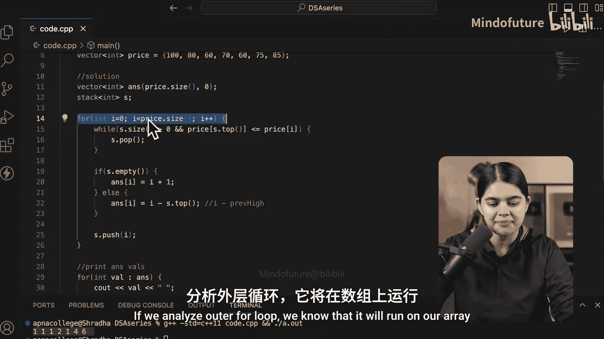

# C++ DSA课程：P69-P70：股票跨度问题最优解 📈


## 概述
在本节课中，我们将学习并解决一个经典的数据结构与算法问题——**股票跨度问题**。我们将理解其定义，分析其逻辑，并使用**栈**这一数据结构来实现一个高效的解决方案。课程内容将涵盖从问题分析到代码实现的完整过程。

---

## 问题定义与理解
股票跨度问题描述如下：给定一系列每日的股票价格，我们需要计算每一天的“跨度”。某一天的跨度被定义为：从当前天开始，**连续**的、价格**小于或等于**当前天价格的最大天数（包含当前天本身）。

### 核心公式
对于第 `i` 天，其跨度 `span[i]` 的数学定义为：
`span[i] = i - previousHigh(i)`
其中，`previousHigh(i)` 是第 `i` 天之前、价格**严格大于** `price[i]` 的最近一天的索引。如果不存在这样的天，则 `previousHigh(i)` 视为 `-1`。

### 示例分析
假设我们有连续7天的股价：`[100, 80, 60, 70, 60, 75, 85]`。
根据定义，我们可以手动计算出每天的跨度：
*   第0天（价格100）：之前没有价格大于100的天，`previousHigh = -1`，`span = 0 - (-1) = 1`。
*   第1天（价格80）：之前价格大于80的是第0天（100），`previousHigh = 0`，`span = 1 - 0 = 1`。
*   第2天（价格60）：之前价格大于60的是第1天（80），`previousHigh = 1`，`span = 2 - 1 = 1`。
*   第3天（价格70）：之前价格大于70的是第1天（80），`previousHigh = 1`，`span = 3 - 1 = 2`。
*   第4天（价格60）：之前价格大于60的是第3天（70），`previousHigh = 3`，`span = 4 - 3 = 1`。
*   第5天（价格75）：之前价格大于75的是第1天（80），`previousHigh = 1`，`span = 5 - 1 = 4`。
*   第6天（价格85）：之前价格大于85的是第0天（100），`previousHigh = 0`，`span = 6 - 0 = 6`。

因此，最终跨度数组为：`[1, 1, 1, 2, 1, 4, 6]`。

---

## 核心思路与数据结构选择
上一节我们通过手动计算理解了跨度的定义。本节中我们来看看如何高效地通过编程实现。关键在于快速找到每一天对应的 `previousHigh(i)`。

观察发现，`previousHigh(i)` 是第 `i` 天左侧第一个价格高于 `price[i]` 的索引。我们可以使用一个**栈**来维护一个“递减”的价格索引序列。栈顶始终保存着最近一个可能成为“之前高点”的索引。

以下是算法的核心步骤：
1.  初始化一个空栈，用于存储价格索引。
2.  遍历每一天 `i`（从0开始）：
    *   当栈不为空，且栈顶索引对应的价格 `<=` 当前价格 `price[i]` 时，弹出栈顶元素。这保证了栈中剩余索引对应的价格都是严格递减的。
    *   计算跨度：
        *   如果栈为空，说明左边没有比 `price[i]` 更高的价格，`span[i] = i + 1`。
        *   如果栈不为空，栈顶索引就是 `previousHigh(i)`，`span[i] = i - stack.top()`。
    *   将当前索引 `i` 压入栈中。

---

## 算法实现详解
理解了核心思路后，现在让我们将其转化为具体的C++代码。

我们将实现一个函数 `calculateSpans`，它接收一个股价向量，并返回跨度向量。

```cpp
#include <iostream>
#include <vector>
#include <stack>
using namespace std;

vector<int> calculateSpans(vector<int>& prices) {
    int n = prices.size();
    vector<int> spans(n, 0); // 初始化跨度数组，所有值先设为0
    stack<int> indexStack;   // 用于存储索引的栈

    for (int i = 0; i < n; ++i) {
        // 步骤1：弹出所有价格小于等于当前价格的栈顶索引
        while (!indexStack.empty() && prices[indexStack.top()] <= prices[i]) {
            indexStack.pop();
        }

        // 步骤2：计算当前天的跨度
        if (indexStack.empty()) {
            // 栈为空，说明左边没有更高的价格
            spans[i] = i + 1;
        } else {
            // 栈顶索引即为 previousHigh(i)
            spans[i] = i - indexStack.top();
        }

        // 步骤3：将当前索引压入栈中
        indexStack.push(i);
    }

    return spans;
}

int main() {
    vector<int> prices = {100, 80, 60, 70, 60, 75, 85};
    vector<int> result = calculateSpans(prices);

    cout << "股票跨度: ";
    for (int span : result) {
        cout << span << " ";
    }
    cout << endl;
    // 输出: 股票跨度: 1 1 1 2 1 4 6
    return 0;
}
```

### 代码逐行解析
以下是代码中关键部分的解释：
*   `while (!indexStack.empty() && prices[indexStack.top()] <= prices[i])`：这个循环确保栈中只保留比当前价格高的索引，维护了价格的递减单调性。
*   `spans[i] = i + 1`：对应公式中 `previousHigh(i) = -1` 的情况。
*   `spans[i] = i - indexStack.top()`：直接应用核心公式计算跨度。
*   `indexStack.push(i)`：当前索引在处理完后成为后续天数潜在的“之前高点”。

---

## 复杂度分析
最后，我们来分析一下这个解决方案的效率。
*   **时间复杂度：O(n)**。虽然代码中有一个嵌套的 `while` 循环，但每个索引最多被压入和弹出栈各一次。因此，总操作次数与价格天数 `n` 成线性关系。
*   **空间复杂度：O(n)**。在最坏情况下（价格严格递减），栈可能需要存储所有 `n` 个索引。

这个使用单调栈的解法是该问题已知的**最优解**。

---



## 总结
本节课中，我们一起学习了**股票跨度问题**。我们从问题定义出发，通过示例理解了“跨度”的概念，并推导出其核心计算公式。接着，我们引入了**单调栈**这一数据结构来高效地找到每一天的“之前高点”，从而将时间复杂度优化至 O(n)。最后，我们完成了从伪代码到完整C++程序的实现，并分析了算法的时间与空间复杂度。掌握这个问题的解法，对于理解单调栈的应用场景非常有帮助。