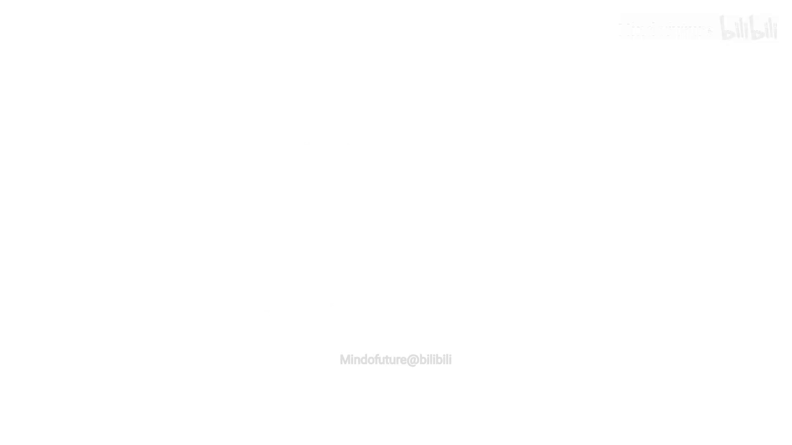
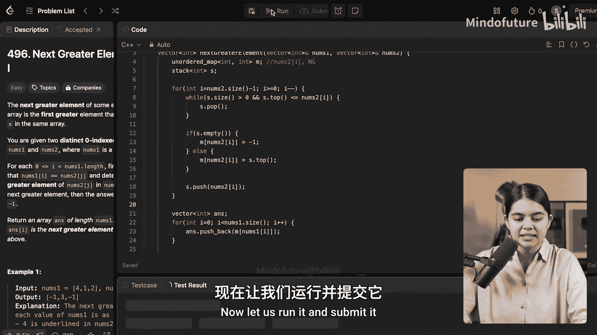

# C++-DSA课程-｜-数据结构-｜-leetcode-｜-Apna-College-｜--Complete-C++-Dsa-Course-p70-P71_下一个更大元素-最优解代码--BV18oUGBkEmV_p70-

Hi， everyone， and welcome to the complete DS series。

 And today we're going to solve one more important tag based question。

 which is called next greater element。 A concept。 Also there is a link for a company sheet in the box arch lecture can。

 we are going to study two things sub we learn about the concept of finding the next greater element。

 and this is a very crucial concept。 scan different different variations concept are going to solve which is a direct variation of this concept given single element next greater element find what do we mean by the next greater element basically index I element of I next greater element is the element immediately greater value and I K right side may exist。

😊，For example， agaraham 6 k to 6 kska next greater element 8jaki 6 k right v elements may say6 valuea and 6 k sub pass valueala and 6 k sub pass element here。

 That is 8 to6 k Joka next greater elementjaga that will be 8 In fact， backwards calculate。

 because itll probably be easier to calculate backwards。

 Aham 3 sub3 k right side element exist inta greater element exist inta to 3 k next greater element exist in11 per1 k right side3 and3 key value1 say greater3 sub say immediately1 k me to 3 is the next greater element of10 per00 right per we have two elements 1 and3 elements。

0 per。😊，immediately greater immediately greater next greater element1 greater element and greater element this is the basic of what next greater greater and backward in or greater element。

😊，To find out the next greater element。H stack data structure can use K。

 And this is the general approach。 iskohammne last stack lecture。 can there be used k。 Basically。

 we use a stack。 Why do we use the stack。example to next greater element find out information right elements exist and greater basically information right side second of greater than current is the of what the next looks like element already predefined。

😊，next element right exist or current are we specifically using because most。😊。

And that is why it is crucial to use a stack here to basicallyari approach approach element and as is to element greater greater。

😊，ne11 greater then we are going to update greater but if it is not greater is greater than is no greater very similar to what happened to this。

😊，And we are going to update to the66 greater elements is equal to 8ja answer and are to find out all of the greater elements for all the elements present in interesting question And the question is and greater elements is an impossible case basically let us take an example of and and。

😊，greater element second third case second to out the next greater for the。

Rise it in the form of a pseudocode。 So basically we are starting with a stack structure in of in next greater elements is equal to n greater than equal to0 general logic that is the basic logic the first step that we want to greater。

Yesariri properties exist cut these stack elements may Joe in properties who specifically greater value value property go satisfy tax remove K to remove K we can create a separate vi loop g K kptaari stack size is greater than 0。

😊，H Hamish kring stack K Jobi element exists K Kia is key value less than equal to hepne current element A current elementjaga area of I current index element A stack K Joby element I is key value less than y equal toja next greater k k strictly greater element K Kham equality value elements could be na theham stack pop K element score。

 So this is basically the first step just K under we are removing。😊。

Inval elements from Sta of Jese Ham invalid elements who remove Kaahas those cases Yato elements removeja or emptyjaga。

 Just case me stack empty， whose case me answer is -1。 Just case my stack empty。

 whose case me stack toppper Jubi elementga， That is the answer。 The thhi cases exist carrying it。

 Yato Cajoju empty here。😊，Okme the answer is going to be minus1 and Iika vga just case me。

 the answer is going to be stack k top Jovi element here。

 and lastme simply stack push current element， which is array of I and I we are going to complete the entire loop take single loop greater find Now let us convert the pseudocode into actual code will analyze the time phase complexity and I concept variation questions top solution weve already created the boiler plate C plus Yarum solution but I platform per same question So it is going to clear all of the test cases because this is one of the most optimal approaches next greater element find out sub we are going to create a stack will create a。

😊，Vctor in teacherger， let's call it answer reverse up Luranganneval from I is equal to a dot size -1 I greater than equal to 0。

 I minus minus。Hahaba Stai Vo values remove Kringi。

 Jew answer name secti muavt it toppper if the value is less than equal to Hamra E of I。

 those case may stackay pop Kingiham values go and Ugar Hamas Sta empty Hujaai。

 whose case may answer him me already Patai， the answer。For I8 index is going to be equal to -1。

 the index exists cur Ukham answer initialize v kectamjusigari next greater tosjaga E dots initialize K0 value ka So answer is case me -1 Ojaga L Val case me answer of I is going to be equal to stackka top and last may stackush King E of I。

😊，Now， let us print our answer answerco print canulamic loop jae in teacherger valueska in our answer array just scan the sea out King Iariari values go with some space and last me see out K end off line。

 lets save this and run。This thepa Saraari answers calculated I seeri the answer is supposed to be 8-11。

3 and-1 aer， if we analyze the time and space complexityki up solution under have used this extra stack space In fact。

 answerjubi N equal stack be case case sa element stack the element code time the toka。😊。

complexityja solution key that will be complexity as is nesting of and multiple and out is going this is the。

😊，Sp complexity for our solution。 And this is one of the most optimal approaches to find out the next greater element element concept work we are going to solve a question。

 which is a direct variation of this concept question 496。

 which is called next greater element to1 set ofs givens。

 which is a vector Now this is an easy we can also pause here and try to solve this particular question on our basicallyas given and question already given is a subset of this nus to。

😊，Mam nus2 eriari elements and I elements existri nums1 questions1 next greater element out but for next greater element。

2 order out I pass nus1 4，1 and2 elements existri we are going to find out the next greater element of these three numbers。

 But in Tino numbers next greater element。 is accordingly is outgi greater out and4 k next greaterki greater element exist-1 Then we are going to analyze for one1ari is right may next greater element is equal to33 will analyze for2。

😊，basically which is present in。😊，equal step。😊，Search the second step may nus one caseriari elements next greater search from this storage4 next greater element in mei because the order of elements in both of the arrays is not same to I mapping element 4 to greater 4 and I Ma will use an unordered map basically unorder map what we are going to door map table structure visual。

 this will be the value。😊，K elements in this way we are going to store all of the key value pairs second basic into actual。

😊，again that， this is the function that we have to complete。 is made subse Patoi Ka I unordered。

Mapco create Kna just mayham integer integer values compared over Karare。

 basically Hamaripa nus2 of I and Uske next greater caponache。 Uqueame。

 we can also create a stack because we need a stack to find out the next greater element。

 Va he same backwards loop of hanginging any I equal nus2 dot size-1。😊，I greater than equal to 0。

I minus minus。Hamari Lee。Jept stack size is greater than0 and Jept stack get topper Joby element here。

It is less than or equal to hama current element， which is nus2 of I hum stacka popka they a value scope Agarhamra stack empty Hoia those case me Hammeya upne map canander hum upne nus2 of I kle value to kangi -1 and else valley case me map canander nus2 of I kle hum value st kange stackka。

😊，Top Joby hip and last may stack Kar humush Kneval upni current value， which is nus2 of。I。

 this is the first step。 Just can the sariris2 element next greater co calculate Kaab second step can actually a answer vector create kringgi。

 let us call it answer loop nus 1 per I less than nus 1 dot size I plus pluski nus1anari elements1 nus subris2 can there be exist kring guaranteedkis1 k sari elements k next greater elementja simply answer dot push back。

😊，Jobi Hamari map Kar， nus1 key Val head， nums1 of Iki U Valka next greater Hamari pass Ajaga andusi answer Kandam pushush Kingip and Yahasem return Kinggini answer Vallugo。

 So this is the entire logic to find out the answer。😊，Now， let us run it。

And submit it。To we can find out the next greater element for all of the values from a different area。

 So this was a direct variation of the next greater element。

 Next lectureham I a core variation discuss which is called greater previous element hardly5 minute is going to be very very easy concept important complete mark in the also share progress with me on Twitter and exploring。

😊。