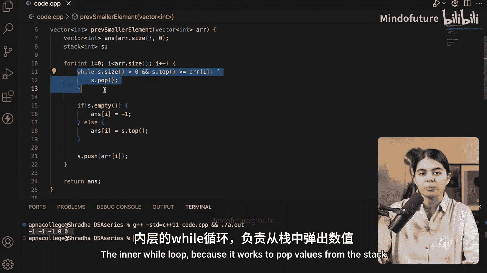

# C++-DSA课程-｜-数据结构-｜-leetcode-｜-Apna-College-｜--Complete-C++-Dsa-Course-p71-P72_前一个更小元素-最优解代码--BV18oUGBkEmV_p71-

Hi everyone， and welcome to the complete DS series。

 and today we' are going to solve one more important DSA question。

 which is called previous smaller element all concept。

 there is a link for a company in the description box to start。

 this is called previous smaller element and this question is a direct variation of next greater element last lecture if we have already done the next greater question to previous v In fact。

i same Basically for a given element previous smaller element And what do we mean by this previous smaller element Basically element array of previous smaller element to element immediately。

😊，Smaller hair in value。 and is。On the left side of a given element。 For example。

 am startsse first element previous smaller element k smaller element element will move on to the next element1 k exist element smaller Then we'll move on to001 we move on to88 k smaller previous So0 is going to be the is the first。

😊，6 a Choy value li The Yahama answer Rojaga0 equal。

 So this is the answer that we want to return for a given particular E。

 Abs Saalcoalham Bul same approach Raing Johamni next greater element Me Yanni。

 to solve this question， we are going to use a stack。😊。

And answer element smaller value and is is to help solve this for example。😊。

Previous smaller element exists3ja equal co at the top of the stack。

 and we are going to move to11 value should not exist in and and we move on to01 and answer0 is smaller than8 to0 will be the answer。

8 toward and we'll move on to 66 kbi previous smaller elements stackpper search k stackpper smaller value exists greater value exists I next elements compare k0 is smaller than 6 to0 answer andariari values previous smaller values who calculate with the help of this Now the pseudo code for this approach is going to look something like thisham vector in teacherger let us call this answer answerang of in teacherger values let us call it S loop from I equals0 I than n I plus。

😊，Abi general element to sub， for example， am 6 to 6 k elements analyze k0 and 8 to sub element previous smaller niki category value current elements a greater values values compare with the current element。

😊，To internally hammk viluakam jab the stack kander kbi element exists kthtai and jab the stack K toppper Jobi element here。

 If it is greater than or equal to the current element， which is array of I Thamt pop K top element。

 So this is the first step of the problem。andermniander eliminateni in。😊。

Value quo any jokebibi previous smaller ni secki greater values smaller values Jovi values greater Je valueshi cases existri values and empty Just case me kja answer minus just case me values exist case Jovi value that is our answer。

hi cases existis if Sta。😊，Becomes empty。 Those case， my answer is going to be -1。

 and El v case made stack K topper Joby value here。 That is going to be the answer。

 And last May Jati Ja ham kering it stack canander。😊。

Push Kna hammni current value co Yani array of Ico。

 So this is the overall logic diskk basis per hammni previous smaller element co calculate Ktheme。

 Now， let us convert this pseudo code into actual code anuske we are going to analyze the time complexity to C plus Boular plate code can。

 weve already created this sample array Saa Jse answer calculate ozagase print Carva logically clear。

 This is the function complete Kna Hamari given E K， we want to return a vector of integer。

 which is full of all the previous smaller elements to subse to Ane answer co create Kleium and let us also initialize it with array dot size and0 values。

😊，Ok asked me we are going to create a stack of impeachs。

E loop chi integer I equals 0 i less than a dot size i plus plus sub a y loopki formula me。

Jeptak stack cassise is greater than 0， and stack at top per。 We have some value。

 which is greater than or equal to Hama current element area 5。

Hmt say pop Kingi on greater value school Oskeba Agar Hama stack emptyhuja。

Those case mehamaju answerga。Answer of I is going to be -1 L F case may answer of I is going to be Staka top element。

 And last May， Ja Ja Staakian humush Kne vhapna current element， which is area  P。

 So this is how we calculate the answer and Yahaseham return Guingne answer go。

 So let us save the code。 and run it。To same valueprint analyze time complexity outer loop n times because elements exist plus time complexity for this particular solution it is going to be and data scenario So this is how solve the problem of finding out the previous element So if we have successfully completed the lecture can market share progress and keep exploring。

😊。

