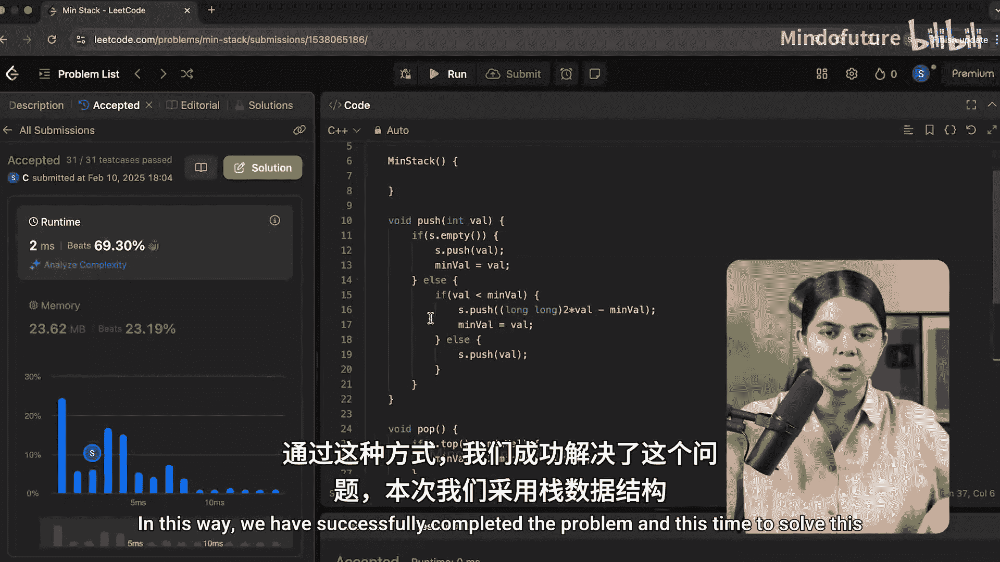

# C++-DSA课程-｜-数据结构-｜-leetcode-｜-Apna-College-｜--Complete-C++-Dsa-Course-p72-P73_设计一个最小栈-最优解代码--BV18oUGBkEmV_p72-

Hi， everyone and welcome to the complete D series。 And today。

 we' are going to solve one more important question， which is to design a mint。 conceptja。 Also。

 there is a link for a company in the description box start， the problem is called design a mint。

 and this is also problem number 155 on lead I different approaches approaches in terms of time complexity are going to be optimized。

 But first approach off to into n space complexity use second approach I complexity optimize Buto approaches platform for first approach。

 which is going to be pretty simple basically designna general functions Je。😊。

Top functions to work or additional function here， which is getmin getmin function elements available minimum element to extract data structurero functions and all the four functions should be implemented with a constant time complexity loop operations constant time operations basically question class cocomp and this class is basically function original and top functions So this is the problem that we want to solve let us take an example of this sample case。

 let us suppose instructions given。😊，first instruction co execute。

 which is to push-2 we are going to push0 are to push-3 minimum value is1 value up top of to print 0 and we are minimum minimum value minimum value2-30 and-2 in functions implement functions implement basically the first approach first logic that we are to use is。

Value co pushush single value co pop orari available。 is I logic value。

 we also need to track the minimum value。😊，Jovi minimum value get minimum function constant time minimum element co return minimum value return constant time return logic minimum value already readily available only plug calculate constant requirement satisfy to what we are going to do stack data structure linkage just may inno value score we can create a stack。

 which basically stores we can create a stack， which basically stores the pair of two values。😊。

a of me normal value cos kanggi or a a B stack can the Jo V minimum H whose value co over kanggi t the is a pair of integer and integer values while a stackum create curam or stack cander is by single value minus20 a Bta key minimum value coium sub me pushush kanggi。

😊，Basically， the dryran is going to look something like this k sub22 value2 and pairka minimum which isba's second instruction of executegi minimum minimum this0 compared with this2 minimum minimum2 k equal33 minimum3 and2 minimum that is going to be-3ba minimum get minimum top minimum value who we are going to returnpa answer- k equal。

😊，Though we have executed this pop complete pair top to top Jobi element0 return answer then get minimum is minimum topbi minimum value which is2 return pair of value so minimum elementpa readily available ho constant time top operation operation readily available Ho let us implement this entire approach in the form of code the code public data structure create which will basically be a pair of integer and integer values。

 Let's call it S sub function implement push function sub empty。😊。

Tkiarushari or minimum valuegi because it is the first element of this stack。

Else Val cases me Javamaast non empty toari minimum value Kzagi say Ibar evaluate Kle。

Minimum value is going to be minimum of Jobiri current value A J pushshkva， just for example。

 Japan-3 co pushushkva to-3 cohamni compare katta Purranni minimum value Sa don Jobi minimum Ho v3 kssat as the minimumga。

Though stack k toppper Jobi's second value Mathamari Jobi minimum value jaam pay over ke to basically hum valueari first value Hogi and abijo minimum valuema stack top pairja second valueari minimum Jobi minimumga that will be the minimum value the stack K a pair of value and the minimum value I operation work kriga pop operation simply stack dot pop Kna top operationme simply return Kna said top first value。

And get minimum maymi simply return Kaneh stack K top C me second value go。

 So this is the entire logic。 This function is also in constant time complexity and is theaprivalgoran Knesele。

 let us just fix this。 And now let us run this code。😊，And submit it。

This solution was successfully submit of alternate Any second approach of the question approach functional complexity But if we talk about the space complexity n elements element minimum value n elements push operation case complexityja into because operation may double second approach is complexity second approach simple。

 which will be a stack of in and overall minimum value minimum minimum value is minimum。😊。

separate variable variableari global minimum value For example。

 minimum value minimum value equal global minimum value which will store answer functions first will be in minimum function minimum value function minimum value variable complexity problem function value。

😊，Haara pop function Iri implement Karing and top function implement problem basically。

 the problem with creating a single global minimum value variable is-2 and0 value to his point perari minimum valueba2ari minimum value change problemari minimum value is going to be-3 but says-3ari minimum value ret to the previous minimum value basically a minimum value2 but possible with the plain logic of just using this one variable me approach we need some kind of a trick or some kind of。

😊，wayay to go from this new minimum value。To the old minimum value minimum value minimum value minimum value new minimum value。

 say old minimum value in the second approach we are going to use a specific formula。

 and what is that formula basically formula or minimum value global minimum。😊。

lets call it value into value minimum value， for example。

3 value ch which is2 this will be6 plus24 will be equal to4 and not combination of new value and previous minimum value minimum value and to。

Use a series of formula is a formula Any patience case Basically Jbi situation。 Igi。

 This is what we are going to do。 ham pushush kring value dashko in the stack and not the value and Ukeba kring a minimum value Co upate King to this new value Jopa Ikihi valueari minimum which basically means and Uskeba change K Hamari minimum value Co to the current value。

Which is basically-3-4 minimum value logical need some kind formula to basically convert this minimum value to minimum value value value was the new minimum value minimum value。

Toko， new minimum value，ath and just second minimum value T。

 This was the old minimum value Mat ye valueanni minimum value change any minus I formulabar minimum value valuepa new value minimum value can minimum value I formula I formulaque。

😊，Minimum value will be equal to 2 in2。😮，The new value， new value Mat。

 new minimum value to I say Lihan， new minimum value minus value dash to I formula and the value score at placed here to2 into new minimum value is  minus-3。

The 2 into-3 Hamari Jovi value dash， which was pushed in the stack。

 which is-4 topa answerja-6 plus 4， which is equal to2 kri old minimum value to a single formula reverse kque basically of the old minimum value and v valuetenkome and So this is basically the magical formulai hamni new minimum value and old minimum value aari problem t with a single global variablehamque value minimum valuerii value value to those value lose we have integrated both of the value into this single formula。

 So this is basically the trick or the magical formulani minimum values who retain in the same stack。

 So what we are going to do。minimum value equal。Basically， push a time for check cur。

 if the value is less than。The current minimum value， those case may tome。

Stack push Kana2 into value minus Abbijo current minimum value ch and Uskeba uppni current minimum value goham update according it to the new value。

Aniska Agarel vakquise， El Mula。If the value is greater than or equal to minimum value。

 those case may simply stack Kderham Push King up me。Normal value Co。

 So this is the push logic is may aor Beach May Hamaripa example case Asak Agarhamast empty him Any first time jan values kush K first time agarme 2 kush K time per minimum value can the kpiner Tom simply2 k K Jo B Hamari value have say minimum assign K Agar stack is empty。

😊，Those case may simply stack we can push the value andari minimum value that is going to be equal to value base functions suppose minimum value minimum valuegi4 value minimum logical are always less than the current minimum value。

is value value was2 into value minus minimum value a minimum value minimum value is value value that this is equal to value than minimum value which was the result of this formula。

Ye he logic pura mathematical G sumjaica the Jbi stacks A S value Pur of minimum value Jotto dubarrami is same formula apply Knet to change our minimum value。

 The Y upperbraham check kectam， basically Ugarhamari stack K top E value have。

 which is less than the minimum value。Those case may hum up me minimum value could change K minimum value change Hor Rojagi2 into Mari Jobi current minimum value H minus stack K。

 toppper Jobi value。Though if statement can， we can do this and Uskibats stack me Jobi value here Useya popka。

 So this is the get minimum function。This is our push function。

function andham top function second case formula minimum return minimum value and not is less than minimum value minimum value holds。

normallyvi value So this is how we are going to implement all of the four functions。 Now。

 let us convert the pseudo code into actual code look space complexity in fact in any case if we is basically preca are takingflow are also going to long。

Inst time operationge Javam push K value scope to sub a case Heki Hama Sta Johe that is empty。

Stackag empty thememini value co and Hamariju minimum valuejagi that will also be equal to value。

Isika Elva casekikui elements exist。 Ka was my first case heriju current value here。

 If this becomes less than the minimum value， those case may have a minimum could change Kna minimum could change Knekalakiandanderush kringi2 into value minus the minimum value。

😊，And minimum value co update Kingi to store the。New valuebaki value overflow I typecast to long long in in fact。

 long long and else valley case me simply stack push K Jobi normal value or Ya minimum value which So this is how we are going to implement the push function under constant time complexity and the sri pop function popderrum stack K top per Jobi value here If that is less than the minimum value。

Do skis mean。H upne minimum value code change Kav2。

2 into minimum value minus stack k top per Jobi value here and Ukebas stack same pop King yni value co。

 So all of these operations are also done in constant time complexity top function can hum subs check is stack K top per Jobi value H If that is less than the minimum value those case may tohamme return Knani minimum value co and else value case may hum return King is stack K top Jobi value here see same value co。

 So this is also implemented in constant time complexity So E bar run Kthe。And let us submit it。

This the say we have successfully completed the problem and is is problem co solve extractt data structure useander mut element store operations caseari space complexity Q data structure use additional variable global variable use here。

 to this space complexity this time is going to be bigari approaches the optimal approaches3 to design this ment。

 So if you is successfully completed today's lecture， you can market it in is down in the comments。

 I can also share progress with me on Twitter lecture learning and keep exploring。😊。

