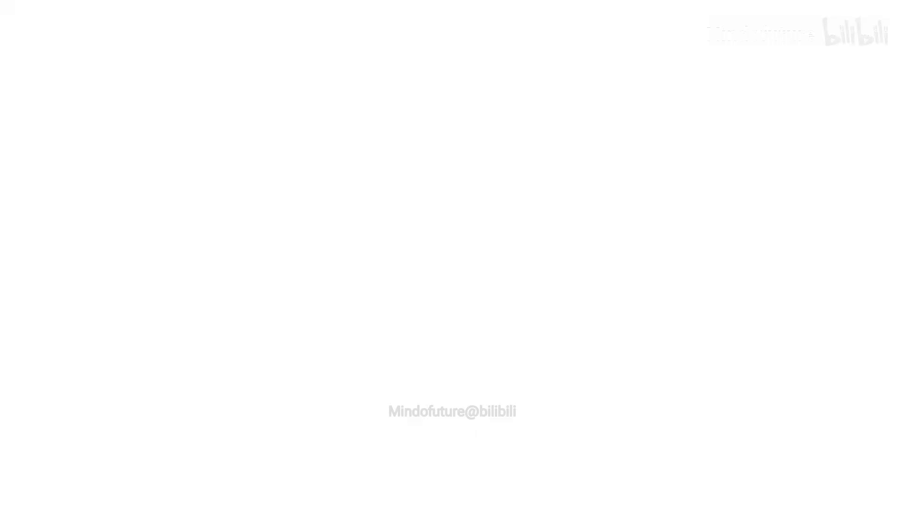
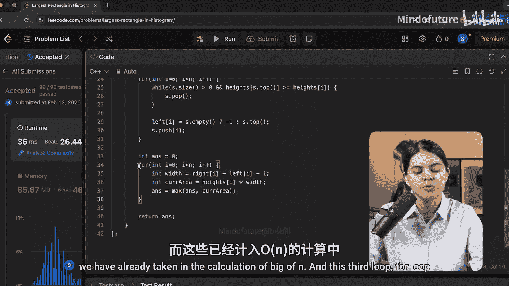

# C++-DSA课程-｜-数据结构-｜-leetcode-｜-Apna-College-｜--Complete-C++-Dsa-Course-p73-P74_直方图中的最大矩形-最佳解代码--BV18oUGBkEmV_p73-

Hi， everyone， and welcome to the complete D series。

 And today were going to solve one more interesting DA problem。

 which is called largest rectangle in histogram。 Ascale algorithmmic your concept is Also there is a link for a company by the in the description box to startar this problem is called largest rectangle in a histogram。

 This is also problem number 84 on lead code。 and this is a hard level problem。

 Sa histogramjo height The histogram is theke just met different differentasriskias given to The height of this bar is2。

😊。

1，5，6，2 and3 histoogram largest rectangle return when we are talking about the rectangle。

 what do we exactly mean by that basically histogram different rectangle example rectangle rectangle which is So this is one possible rectangle his second possible rectangle rectangle this is also one of the possible rectangle basically his rectangle or possible rectangle rectangle return glasses area of rectangle is going to be the height multiplied by the width of the rectangle。

😊，maximizene though approaches exist aari brute force approach andriari Op approachari lecture main focus that will be on the optimal approach brute force just brute force sorry possible rectangles calculate or sub For example。

ari is histogram possible rectangles index note down01 to 3，4 and5。😊。

ham index is Ya first possible rectangle， which is Similarlyly second possible rectangle。

 is exceed third rectangle Similarlylyangletangle andtangletangles Similarlyly6 rectangle5 rectangles。

 rectangles，3 rectangles2 rectangles and1 rectangles with global answer brute force n bru force to from j equals i to n ending。

😊，To starttangle calculate is the brute process optimize help basically optimal to。

Withhoja1 high toja2， tosika area， 호jaari plus2 k equal。

To is 0 bar maximum possible area rectangle same cheese sum secondme1 bar includena is maximum largest possible rectangle1 largest possible rectangle histogram that is this rectangle height equal and is withjagi 6 k equal to is rectangleja 6 k equal is。

 If it is compulsory for us to include this bar the largest rectangle that we can form in this histogram will look something like thisja5 k equal because we are going to cap it at 5 and withja equal that will be equal to 10 same cheese we are going to do for 66 v bar include largest rectangle widthja6 k equal is。

 the largest possible rectangle is going to。😊，like this。

ander will have a height of2 and a width of four area k equal。 And finally， for this bar。

 the largest rectangle is going to look something like thisander height is3 but the width is equal compulsory include rectangle or basically that is going to be this value。

 which is equal to 10 histogram largest rectangle that is this rectangle top logical simply basically global variable value value or his width value minimum value。

from i equals0 to n and loop krum loop can her a bar hum current area calculate kne kgi is current area value hogi you basically hum upne her a i barche calculate kgi and is current area a basis per hum upne answer calculate ki。

 which will be the maximum of。😊，Existing answer value。 and are current。

A same answer calculate this current area is going to be equal to height width maximum possible maximum equal say and that variable is height which is equal to height calculate width。

😊，So thank kbibi if you want to calculate the current area to kiss theriki say Hammuski width co calculate cut them。

😊，Let us take an example of thisab Let us suppose and logical Similarlyly rightangle or basically value we can observe for。

😊，s example maximum is equal to1 or right and what is is the nearest value and right right value take of right and no value。

2 and three near a smaller value to boundary rectangle current area calculate and right smaller value for example。

 if we talk about this smaller right equal is and r calculate basically and r right r is going to equal to r equal equal the width is equal to orangle。

😊，ectangle formari with2 equal width value I replace in the same formula to basicallyme R L1 value co calculate K or other single bar R y right smaller nearest and left small nearest value calculate single bar current Ico calculate。

 So now the problem changes into calculating these two values for every single bar of the histogram。

 though values basically calculate K subri。Right。Smaller。Nearest value。

And second cheese calculate k left the smaller nearest value is right smaller nearest cheese basically calculate with the same concept is a medium level greater value greater value right value and logic smaller value are going to use a stack data structure。

😊，Already Hamidju hides him， forgiven him。Abi Sta data structure Kandrum K Karangi。

 Jo we answerhammi calculate Kana who says to Karanana start Karinggi Agarhammi right side made smaller。

 nearest values， Chahi though is stack kander。😊，Hmt cutting 게。Smaller values go。 Small values go。

 smaller values from。Current element， which is height of height of element smaller valuesne or values next greater simply values or what is the exact right value in reverse in right value right or。

😊，smallest value fashion right we are trying to write。😊，Smaller and left smaller index value in fact。

 equal equal write equal and。😊，are going to update to a previous value6 and with going to update next value index is going to be equal to and which is equal to we are going to update。

again1 k smaller1 basically with which also is process of calculating straightforward。😊。

Greater vjo question herekobija accept because I he concept K Uer I he important。

 crucial DS a concept K U Hamra histogram v question based Ab Buri approach。

 if we convert it into a pseudo code the subham pseudo called right。😊，Smaller。

Nearest calculate simply of integer values i equals n1 I greater than equal to0 basically backwards loop simply is greater than that element is greater than equals So this is that index values。

😊，Inex value normal value is index value actual value value depending upon write smaller of I calculate write caseja Na index writeja And last。

 So this is how we are going to complete the loop。 say write smallest nearest value calculate let us copy this entire。

😊，This is basically the answer。 Jomni calculate Kiia to is answer Koham to Yehamipas calculate Ho right smaller I he similar logic per base。

 Ham Ana calculate Karinggi left to smaller， nearest value。 Uklebi next greater element。

 Valahhi Iri logicrega， In fact， Yto Ea Savalje Johamm left to smaller。😊。

Nearest value we calculate you basically S This is the same question or the same thing as calculating the previous smaller element same smaller element left smaller nearest element basically previous that is or that is right side is is equal to side logic we can also calculate the previous values this time will basically start from thisja。

😊，update11 equal and with of equal equal and。smaller value to index and with its index which is equal to is equal to4 to calculate the smaller value we can in fact copy this entire second loop right。

Will create a different array and is I is equal to basically and and and basically this right of of and is answer。

😊，Convert this entire pseudo code into actual C plus code and。 So for code。

 we have to complete this entire function。 sub integer n calculate basically vectors vector Similarly vector size smaller right right we can create a stack of integer values calculate we calculate right let us calculate the right backward loop i is equal to n1 greater than equal to0 I minus。

😊，Sipelto stack as Jepta greater than 0 he and Jepta Hamari stack and the heights of stack it topper greater values exist Katihan than the current value any heights of I。

 Those case may stack it topse Jobi valueon him Po Kane Valhem。

 and finally answerojaga right of I Agat Kalihe。😊，Those case with answer minusja this case me stack whose case me stack it top per jubi indexbu last me current index for push to right calculate K almost I same logic perra left smaller to left smaller k left smaller v code me bus forward looplega I equal 0 I。

😊，Less than n I plus of I calculate loop complete since we want to reuse this stack the stack which elements already exist elements remove remove elements elements So values answer will basically convert this pseudo into answer。

😊，If variable ete， let us call this answer， Se initialize Kleta 0 ka andapna loop Chilate for intesger I equals 0 I less than n I plus plus。

😊，U current area calculate conahid， though is in a a height。And the width height already。

 this is going to be the current height， which is height of I width calculate kpargi width Ca I calculate k width is going to be right of I。

 left of I-1。And current area calculate and finally answer is going to be maximum of answer and current area answer calculate and answer return is one small change logic and is change is particular line basically with calculate to we are trying to apply this formula is apply normal values smaller and right smaller values exist exampleham。

😊，Is2 v bar left smaller to right smaller value exists say example。

 if we come here to this two I left smaller boundary the left smaller value is equal to1。

 but right smaller valueki right smaller value right smaller value formula So that is going to be111 which is a very funny calculation basically2 here per right value boundary sayski right value boundary in per case my right boundary default value for the sake of this particular calculation。

 we don't want that。 right side boundary last。😊，hi opposite case v one valley exists formula but right side and default case right whose case instead of using this1 we are going to assign value of n11 right bars include istangle and right smaller default boundary for the correct calculation logically but for this。

😊，Particular question， we need to make this change。

 The write smaller K minus1 default value K N go as the default value set Ke value。

This code quick bar run， cur。And now， let us submit it。

So this is how we solve our largest rectangle in histogram question with an optimal time complexity time complexity to basically different loop co is first loop observe even though loop time complexity is going to be big and overall is loop complexity big n loop time complexity big n similarly smaller loop complexity n is elements and is third loop loop because this is running n time complexity n overall the time complexity is going to be big and complexity。

😊。

In additional vectors and Staco use k， tohamari space complexity B Hoja Beov and K equal。

 So this is the overall time in space complexity for our optimal code。

 One thing that I would like to give you as a homework problem is basically aco y va right smaller index vala Eel and here left smaller index va Eel。

😊，In donno C， you have to try and dry run to calculate all of the current areas of individual bars。

 Basically， example k a for example is2 k is k histoogramka calculatehome with4 k equal2 k equal going to be8 is fourth index Kpa heightme2 k equal width kja width will be R L1 the2 in2 R value 2 kho2 k R value is minus1 perham decide minus1 co replace R and right value with a value of n which is 6ja 6 minus。

😊，L， which is equal to 1-1 Ya2 into 4 equals 8。 is particular bar Jovi rectangle form calculate from these areas。

 So you see that you can for all of the bars and try to values calculate values In fact。

 with n value Joe So if you have successfully completed today's lecture。

 Then you can mark and is down the also share your progress with me on Twitter description box the next lecture and keep exploring。

😊。