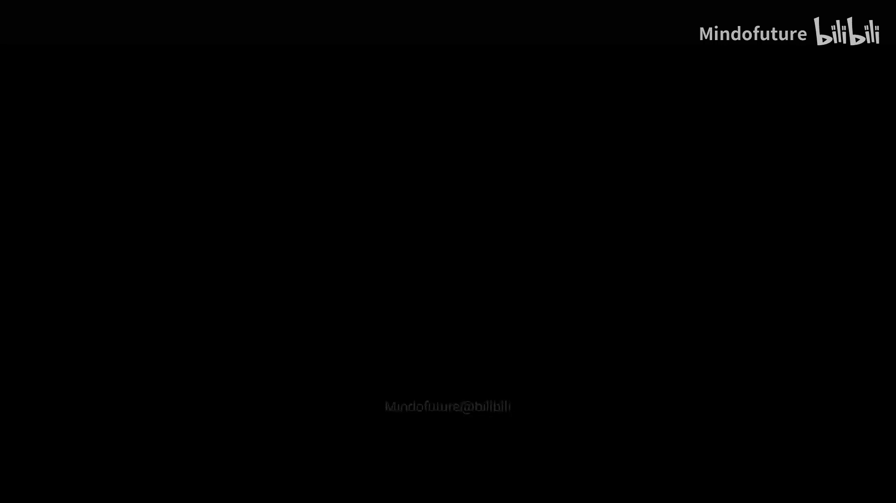
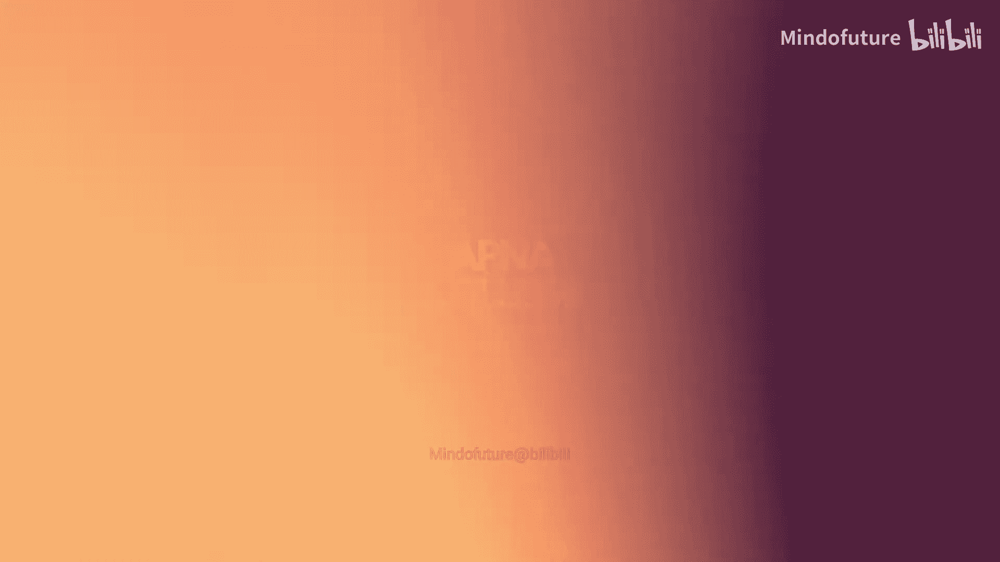
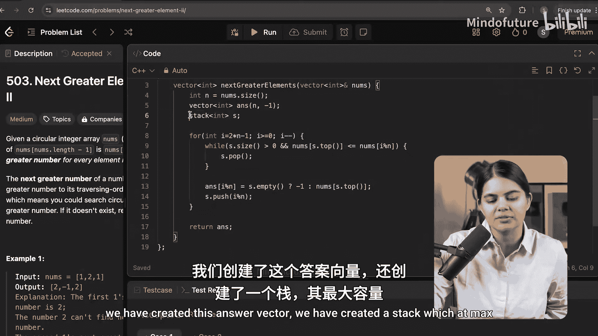

# C++-DSA课程-｜-数据结构-｜-leetcode-｜-Apna-College-｜--Complete-C++-Dsa-Course-p74-P75_L73._下一个更大元素II-栈和队列--BV18oUGBkEmV_p74-

Hi everyone， and welcome to the complete D series。 And today。

 we're going to solve one more important problem， which is called next greater element2。

 Also there is a link for a company sheet in the description box this problem is called next greater element2。

 and this is problem number 503 on this is a direct variation of the classical question。

 which is next greater element or is already different different forms we have covered next greater element。

 we have covered previous smaller element v largest rectangle in a histogram question we cover concepts question Then this question should be very easy for us but my assumption is at least next greater element v already solve。

😊。

Tukiier concept is rather important here as compared to this question。😊，To meva。

 basically Sva numbers Naka Eri given here。 And this is not a simple Eri。 This is a circular Eri。

 C Eriki isriju last element here Bohamari first element 1，2，3，4 and 3。😊。

in elements k next greater element calculategi element k right side elements consider per circular side example if we try to calculate the next greater element for x greater elementja2 x greaterja greater elementja4 right greater circular12 minus right forward sequenceja equal next greater element would be in the original question left side。

😊，her element k， we cannot traverse in a circular manner again and again to find out the next greater element to give unopimized time complexity basically mu out and let us suppose1 and2 in elements go many traverse elements traverseham44 k right elementsverse traverse3 k k right elements B and elements B brute forceba manner elementsverse brute force brute n square complexity but we want a more optimize solution optimal approach basicallyva let us take another example。

😊，Let us supposeari numbers and greater answer same size。s suppose greater greater right right42 and。

😊，and6 There is only one greater element greater is greater and greater is greater interesting。😊。

ura single and greater basically are repeating in the same order answer and let us create a new So this is the answer and in particular index。

😊，ura is index values 0，1，2，3，4，5，6，7，8 and 9 backward fashion may obtain greater element greater will take and element next greater greater greater element we are going to start a backward loop is greater element greater greater。

😊，for example， greater first time first time equal second and instead of traversing for the next the first that we are encounter。

Index co index cogar index valid index and pan per original elements number consider case proper mapping mapping is k is3 k72 k k and is kja and original elements map original double that is output index is equal to Jobi index mod total of mod equal and that is how we are going to map this 9 with this mapping with the help of this formula index value greatergi index。

😊，mod greater than n as equal is update。index 6 k greater element6 is not smaller than smaller and-1 and finally is equal greater greater and are also going to push3 on the top of answer2 greater greater2-1 to。

😊，And two co pushush ki on the top of the stackla2 index k。

 Then well do I minus minuskeba 4 kka x greater K greater2 in k greater is going to be 6 to6 co replace K andba we are going to push4 index which is3 on the top of the Then we are going to update this I5 greater element it can't be4 greater element is going to be 6 to5 greater element as6 and5 on the top of the stacklaka index6 next greater element cannot be cannot be6 greaterish greater than equal to be value stack isri values and this is going to remain。

😊，push with the index one last itator update greater element is going to be 6。

 and two times which is the same as the answer which we interesting or even though approach or the don't need to do values or index values。

😊，Because eventually Jo index index original second copy process can actually create vector of and with n and will take a of in n。

😊，Or greater element greater element smaller elements smaller size is greater than and that is less than or equal to the element what is the element the current element is basically than n1 greater than n than equal the proper value of actually fetch。

😊，V we are going to do nus of s dot top less than equal to So this is to be the and depending upon value doing numbers and answer than and last greater than than equal。

I push proper index， which is i mod and proper index can valid index stack push basically is normal index code value greater than equal to N map to the correct index in the memory Now let us convert the pseudo into the actual plus are going to complete this function function sub vector。

😊，Let us take N to be nus dot size。Uner initialize Calta n with default value of maybe -1 x stack of。

In teacherger S create colorium， Fric backwards loop Chelangi from i equals2 into n minus1。

I greater than equal to 0。 I minus minus。Subseel while loop Chiang it Je the kmaari stackca size is greater than。

😊，0 and Jupta Hama nus of stack dot top is less than equal to because we want greater values。

 That is why we want to pop smaller values。 The nus of I modulo N Co。

The stack say pop Ki elements go and answer of I modo n。

 basically Hamariasjaga Atli here those case meo。 the answer is going to be -1 greater element existing Nahito stack it toppperjubi index the nus of S dot top and last may stack kushka current index current indexla I modo n。

 and last me returnna answer。Now， let us run this court。And try to submit it。

successfully accept if we talk about the time complexity complexity single loop overallju n then the time complexity of overall solution is can always ignore the complexity equal and if we the complexity created this created complexity So this is the optimal time and complexity n。

😊。

You can also share your progress with me on Twitter just calling upkunij box and then mill ja up Ask a little time multi experiment and tell them keep learning and keep exploring。

😊。