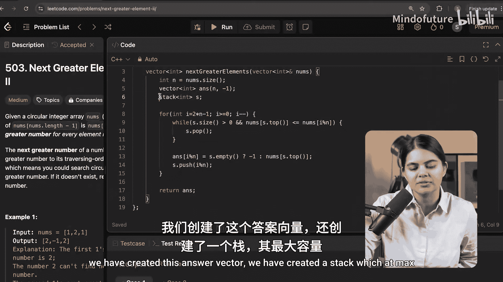

# C++ 数据结构与算法课程：74：下一个更大元素 II


## 概述
在本节课中，我们将学习如何解决“下一个更大元素 II”问题。这是一个关于循环数组的问题，我们需要为数组中的每个元素找到其下一个更大的元素。我们将利用栈这一数据结构来实现一个高效的解决方案。

---


## 问题理解与概念

上一节我们介绍了栈的基本应用，本节中我们来看看如何将其应用于循环数组。

问题核心是：给定一个循环数组，需要为每个元素找出在数组中下一个比它大的元素。这里的“下一个”意味着在循环顺序中，从当前元素的下一个位置开始向右寻找，直到再次遇到该元素为止。

核心概念是**循环数组**和**下一个更大元素**。我们可以通过将数组长度翻倍来模拟循环遍历，但更高效的方法是使用取模运算来映射索引。

**公式**：`有效索引 = i % n`，其中 `i` 是遍历的索引，`n` 是原始数组长度。

---

## 算法思路

以下是解决问题的步骤：

1.  初始化一个结果数组 `ans`，长度与输入数组 `nums` 相同，所有值预设为 `-1`。
2.  初始化一个栈 `s`，用于存储数组元素的索引。
3.  我们从后向前遍历一个长度为 `2*n` 的虚拟数组。对于每个位置 `i`：
    *   计算当前元素在原始数组中的实际索引：`index = i % n`。
    *   当栈不为空，且栈顶索引对应的元素值小于或等于当前元素值 `nums[index]` 时，弹出栈顶元素（因为它不可能是当前元素的下一个更大元素）。
    *   如果此时栈不为空，则栈顶索引对应的元素就是当前元素 `nums[index]` 的下一个更大元素，将其存入 `ans[index]`。
    *   将当前索引 `index` 压入栈中。
4.  遍历完成后，返回结果数组 `ans`。

---

## 代码实现

现在，让我们将上述思路转化为实际的 C++ 代码。

```cpp
class Solution {
public:
    vector<int> nextGreaterElements(vector<int>& nums) {
        int n = nums.size();
        vector<int> ans(n, -1); // 初始化结果数组
        stack<int> s; // 存储索引的栈

        // 模拟遍历两倍长度的数组
        for (int i = 2 * n - 1; i >= 0; i--) {
            int currentIndex = i % n; // 映射到原始数组的实际索引

            // 弹出栈中所有不大于当前元素的索引
            while (!s.empty() && nums[s.top()] <= nums[currentIndex]) {
                s.pop();
            }

            // 如果栈不为空，栈顶元素就是下一个更大元素
            if (!s.empty()) {
                ans[currentIndex] = nums[s.top()];
            }

            // 将当前索引压入栈中
            s.push(currentIndex);
        }

        return ans;
    }
};
```

---

## 复杂度分析

*   **时间复杂度**：O(n)。每个元素最多被压入和弹出栈各一次。
*   **空间复杂度**：O(n)。最坏情况下，栈需要存储所有 `n` 个索引。

---

## 总结



本节课中我们一起学习了如何解决“下一个更大元素 II”问题。我们利用栈来高效地查找下一个更大元素，并通过取模运算巧妙地处理了数组的循环特性。这个方法的时间复杂度是线性的，非常适合处理大规模数据。